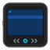

<!-- BEGIN GENERATED: banner (kleidos-dev/social, tools/sync_readme_banners.py); do not edit by hand -->

<picture>
  <source media="(prefers-color-scheme: dark)" srcset="https://raw.githubusercontent.com/kleidos-dev/social/main/svg/readme/boards/banner-dark.svg">
  <source media="(prefers-color-scheme: light)" srcset="https://raw.githubusercontent.com/kleidos-dev/social/main/svg/readme/boards/banner-light.svg">
  
</picture>

<!-- END GENERATED: banner -->

# boards

Drawings, measurements, specifications, schematics and 3D models of the nine boards [Kleidos](https://kleidos.dev) runs on: true-scale SVG drawings, hand-kept measurements, a sourced component-level specification, a KiCad schematic of each board's connectivity and a 3D model at two levels of detail, in glTF and in Wavefront OBJ, with the builders and checks that keep them consistent.

| | Board | Vendor | SKU | Drawing | Schematic | Model |
| --- | --- | --- | --- | --- | --- | --- |
|  | [M5StickS3](sticks3/) | M5Stack | K150 | [front](sticks3/svg/front.svg) | [PDF](sticks3/schematic/sticks3.pdf), [notes](sticks3/schematic/README.md) | [glb](sticks3/model/sticks3.glb), [obj](sticks3/model/sticks3.obj) |
|  | [M5StickC Plus2](m5stickc-plus2/) | M5Stack | K016-P2 | [front](m5stickc-plus2/svg/front.svg) | [PDF](m5stickc-plus2/schematic/m5stickc-plus2.pdf), [notes](m5stickc-plus2/schematic/README.md) | [glb](m5stickc-plus2/model/m5stickc-plus2.glb), [obj](m5stickc-plus2/model/m5stickc-plus2.obj) |
|  | [M5StickC Plus 1.1](m5stickc-plus1/) | M5Stack | K016-P | [front](m5stickc-plus1/svg/front.svg) | [PDF](m5stickc-plus1/schematic/m5stickc-plus1.pdf), [notes](m5stickc-plus1/schematic/README.md) | [glb](m5stickc-plus1/model/m5stickc-plus1.glb), [obj](m5stickc-plus1/model/m5stickc-plus1.obj) |
|  | [M5StickC Plus SE](m5stickc-plus-se/) | M5Stack | K016-P-SE | [front](m5stickc-plus-se/svg/front.svg) | [PDF](m5stickc-plus-se/schematic/m5stickc-plus-se.pdf), [notes](m5stickc-plus-se/schematic/README.md) | [glb](m5stickc-plus-se/model/m5stickc-plus-se.glb), [obj](m5stickc-plus-se/model/m5stickc-plus-se.obj) |
|  | [M5Stack CoreInk](coreink/) | M5Stack | K048 | [front](coreink/svg/front.svg) | [PDF](coreink/schematic/coreink.pdf), [notes](coreink/schematic/README.md) | [glb](coreink/model/coreink.glb), [obj](coreink/model/coreink.obj) |
|  | [M5Stack CoreS3 SE](cores3-se/) | M5Stack | K128-SE | [front](cores3-se/svg/front.svg) | [PDF](cores3-se/schematic/cores3-se.pdf), [notes](cores3-se/schematic/README.md) | [glb](cores3-se/model/cores3-se.glb), [obj](cores3-se/model/cores3-se.obj) |
|  | [M5Stack Core2 v1.3](m5stack-core2-v13/) | M5Stack | K010-V13 | [front](m5stack-core2-v13/svg/front.svg) | [PDF](m5stack-core2-v13/schematic/m5stack-core2-v13.pdf), [notes](m5stack-core2-v13/schematic/README.md) | [glb](m5stack-core2-v13/model/m5stack-core2-v13.glb), [obj](m5stack-core2-v13/model/m5stack-core2-v13.obj) |
|  | [M5Stack Cardputer ADV](cardputer/) | M5Stack | K132-Adv | [front](cardputer/svg/front.svg) | [PDF](cardputer/schematic/cardputer.pdf), [notes](cardputer/schematic/README.md) | [glb](cardputer/model/cardputer.glb), [obj](cardputer/model/cardputer.obj) |
|  | [LILYGO T-Deck Plus](tdeck-plus/) | LILYGO | T-Deck-Plus | [front](tdeck-plus/svg/front.svg) | [PDF](tdeck-plus/schematic/tdeck-plus.pdf), [notes](tdeck-plus/schematic/README.md) | [glb](tdeck-plus/model/tdeck-plus.glb), [obj](tdeck-plus/model/tdeck-plus.obj) |

Each board folder holds:

- `README.md`: the board's page, written from `board.json` by [`_shared/emit_board_readme.py`](_shared/emit_board_readme.py) (one layout for all nine; a test fails when a page differs from what its `board.json` writes): its dimensions, its parts, its wiring and their sources.
- `board.json`: every part on the board, each value with its source ([`_shared/board.schema.json`](_shared/board.schema.json)).
- `measurements.json`: the case, display, button and keyboard geometry the front is drawn against ([`_shared/schema.md`](_shared/schema.md)).
- `svg/`: the board's faces at 1 SVG unit = 1 mm. `front.svg` has the screen's active area, a press target for every control and each printed legend as a group of its own; `back.svg` is the back seen from behind with what it prints; a side that prints anything has its own drawing (`left.svg`, `top.svg`).
- `icon.svg`: a 64 px pictogram of the board.
- `model/`: the 3D model at two levels, glTF 2.0 binaries in metres (glTF's unit): the master (`<board>.glb`, every print kept) and its web level of detail (`<board>-web.glb`), with the recipe they are built from (`spec.json`) and their provenance (`source.json`, `web.json`). The master is also there as Wavefront OBJ (`<board>.obj`, in millimetres, Y up, one object per part) with its material library (`<board>.mtl`), written from the GLB by [`_shared/export_obj.py`](_shared/export_obj.py).
- `schematic/`: the board's connectivity in KiCad, documented from the vendor's public documentation, with Kleidos additions and corrections listed on page 1. `netlist.yaml` holds every part, pin and net with its source, and the entries `K1`, `K2`... that add what the vendor's print leaves out or correct what it gets wrong, each settled by a datasheet, the vendor's other documents, the firmware or a bench probe; `bench/` holds the probe records, `improvements.md` the triage behind the entries, and the folder's `README.md` the sources and the open questions. The PDF (`<board>.pdf`) is made to be followed by clicking; the export writes one SVG per page into `svg/` when it runs, and git does not keep them.

Every board but the CoreInk also has a `sources.md`: the vendor drawings, photos and CAD files its front and measurements were taken on, by address (with the digest where one was recorded), what each gave, and what could not be established. No folder holds a vendor file: photos, renders, drawings, schematics, datasheets and CAD files are cited by address, never copied.

Which model file to use: the GLB for the web and most viewers (browser engines such as three.js, Blender, online glTF viewers); the OBJ with its MTL for most other 3D tools (FreeCAD, Fusion, MeshLab, slicers, and Blender too), which import OBJ where they may not import glTF. Both hold the same geometry; the GLB is the one the others are made from.

How the drawings, models and schematics are made, and which script writes each file: [`docs/models-and-drawings.md`](docs/models-and-drawings.md). All nine fronts side by side: [`fronts-contact-sheet.svg`](fronts-contact-sheet.svg); all nine models: [`models-contact-sheet.png`](models-contact-sheet.png).

## How Kleidos uses it

This repository is the one place the boards' drawings, facts and models are kept; the Kleidos firmware repository, which also holds the site at [kleidos.dev](https://kleidos.dev), is its first reader:

- The site publishes each `svg/front.svg` with the annotations and the press targets stripped, and lays real screen captures on the `screen` quad every model carries over its display.
- The site's web models are cut from each board's web level of detail (`<board>-web.glb`, tied to its master by `web.json`); the videos draw the masters, close up.
- Every path recorded here is relative to this repository's root, so a reader that mounts it elsewhere prefixes its own mount path and nothing here changes.

The firmware repository is to mount this repository as a git submodule, and the digests a reader pins the models by are in [`docs/models-and-drawings.md`](docs/models-and-drawings.md#model-digests).

## Build and check

Python 3.15 and the pinned `requirements.txt`; the schematic export also needs KiCad 10.0.8 (`kicad-cli`; no KiCad library is read), which pip does not install.

```bash
python3 -m venv .venv
.venv/bin/pip install -r requirements.txt

.venv/bin/reuse lint                                          # licenses
.venv/bin/python _shared/check_public_tree.py                 # no vendor file, nothing private
.venv/bin/python _shared/check_board_specs.py                 # board.json files
.venv/bin/python -m pytest tests                              # contracts, models and checks
.venv/bin/python _shared/emit_front_svg.py --contact-sheet    # regenerate every front
.venv/bin/python _shared/kicad_schematic.py sticks3           # a schematic from its netlist.yaml
.venv/bin/python _shared/export_schematic.py sticks3          # ERC, netlist check, PDF and its links, SVG pages (needs kicad-cli)
.venv/bin/python _shared/build_board_glb.py sticks3/model/spec.json --fetch --check   # a model, byte for byte
.venv/bin/python _shared/export_obj.py --check                 # every OBJ and MTL is what its GLB gives
.venv/bin/python -I _shared/check_metadata.py                 # every media file carries its embedded metadata
```

[`.github/workflows/check.yml`](.github/workflows/check.yml) runs the first four and the metadata check on every push and pull request: the licenses, the tree, the specifications, the embedded metadata and the contracts always; the board models' tests when a model's inputs changed; the checkers' slower planted-defect selftests when a checker or its fixtures changed, weekly and on demand. A fourth job, in KiCad 10.0.8's container, holds every schematic to its `netlist.yaml` (the ERC, the netlist pin for pin, every Kleidos entry marked and listed, the generator giving back the committed files) and every link of its PDF to the place it names, and requires the committed PDF to be byte for byte a fresh export. Not in CI: regenerating the drawings, and rebuilding a model from its vendor's CAD file, which downloads that file.

Agents working here read [`AGENTS.md`](AGENTS.md) and the two skills under [`.claude/skills/`](.claude/skills/).

## Licenses

Everything this project wrote is under the [MIT License](LICENSE), free for anyone to use: the code, the drawings, data and documents, the schematics and their PDF, the board models and the pictures of them, and the agent skills. The boards are M5Stack's and LILYGO's designs; the permissive license keeps this project from appearing to claim them. Every license in the tree is OSI-approved:

- This project's work: [MIT](LICENSES/MIT.txt).
- The M5Stack cases inside eight of the board models (`<board>/model/*.glb` and `<board>/model/<board>.obj`) and their picture (`models-contact-sheet.png`): M5Stack's, under the MIT License too, "Copyright (c) 2021 M5Stack". The T-Deck Plus's model is this project's own throughout, built from no vendor file.
- One function of `_shared/model_raster.py`, the Khronos PBR Neutral tone mapper: Khronos's, under the [Apache License 2.0](LICENSES/Apache-2.0.txt).
- Inter (`fonts/inter/`): [SIL Open Font License 1.1](LICENSES/OFL-1.1.txt).
- The banner at the top of this page is not in this repository: the page reads it from the [`social`](https://github.com/kleidos-dev/social) repository (`svg/readme/boards/`), where it is artwork of the same author under the GNU General Public License, version 3 or later, the license of everything social draws. It shows this repository's fronts with the Kleidos firmware's own unlock screens.

Every drawing, model, schematic and picture also carries its title, description, author, copyright line, license and address inside the file, written by the script that writes it and checked by `_shared/check_metadata.py` ([`docs/models-and-drawings.md`](docs/models-and-drawings.md), "Embedded metadata").

Vendor files (photos, renders, drawings, schematics, datasheets, CAD files) are cited by address and never copied here; [`NOTICE.md`](NOTICE.md) has the details, including the terms of the vendor geometry inside the 3D models. `REUSE.toml` states the license of every file; [`LICENSE`](LICENSE) is the MIT License as GitHub shows it, the same text as `LICENSES/MIT.txt`.

## Trademarks

M5Stack, LILYGO, Espressif and the other names and logos printed on these boards are trademarks of their respective owners. The third-party logos and marks drawn on the boards and their models (Espressif, M5, LILYGO, CE, FCC and the others) remain their owners' and are shown only so the products can be recognised. This project is not affiliated with, sponsored or endorsed by any of them. The licenses in this repository cover our drawings, models and code; they grant no right to use any trademark.
