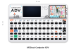

 

# Cardputer-Adv

M5Stack · SKU **K132-Adv** · also sold as Cardputer Adv, Cardputer ADV [1]

Every value below comes from [`board.json`](board.json), where each one carries the id of its source; the numbers in brackets point to the sources listed at the end of this page. This page is written from that file by [`_shared/emit_board_readme.py`](../_shared/emit_board_readme.py): change the file, then run the script.

Vendor links: [docs](https://docs.m5stack.com/en/core/Cardputer-Adv) · [repository](https://github.com/m5stack/M5Cardputer-UserDemo/tree/CardputerADV)

## Dimensions

| Width | Height | Depth | Weight |
| --- | --- | --- | --- |
| 84.0 mm | 54.0 mm | 19.6 mm | 81.0 g |

Product size and product weight as the vendor's specification table states them. The vendor's dimension drawing gives the same 84 x 54 x 19.6 mm and M2 mounting screws on the back. Package: 145.7 x 95.0 x 20.7 mm, 98.5 g gross. Operating temperature 0 to 40 degC. [1] [2] [5] [20]

## Components

41 entries (113 parts counting quantities).

### Processing and memory

| Part | Role | Ref. | Qty | Key facts | Src |
| --- | --- | --- | --- | --- | --- |
| ESP32-S3FN8 (Espressif Systems) | soc | U1 (on the Stamp-S3A) | 1 | cpu: Xtensa 32-bit LX7 dual-core, up to 240 MHz; in package flash: 8 MB, Quad SPI; in package psram: none; rom kb: 384; sram kb: 512; wifi: 2.4 GHz; bluetooth: Bluetooth LE (Bluetooth 5, Bluetooth Mesh); ambient temperature c: -40 / 85; vdd spi v: 3.3; chip revisions listed: v0.1 / v0.2; native usb: USB_D-: GPIO19 (pin 25); USB_D+: GPIO20 (pin 26); strapping note: Strapping pins (datasheet Table 3-1): GPIO0 weak pull-up, GPIO3 floating, GPIO45 and GPIO46 weak pull-downs. GPIO0 and GPIO46 pick the boot mode (GPIO0 low and GPIO46 low: download boot), GPIO45 the VDD_SPI voltage (low: 3.3 V, unless an eFuse forces it; Table 3-4). G46 must not be pulled high before the chip boots. The bench unit's ROM printed boot:0x2b, read with the TRM's GPIO_STRAP_REG bits: GPIO0 latched 1, GPIO45 and GPIO46 latched 0 with the codec on G46. — Power pins on the module sheet: VDD3P3 (pins 2, 3) through L2 2 nH from VDD_3V3 with C5 10 uF, C6 1 uF, C7 100 nF, C8 3 pF; VDD3P3_RTC (pin 20) and VDD3P3_CPU (pin 46) on VDD_3V3; VDDA1/VDDA2 (pins 55, 56) on VDD_3V3 with C12 1 uF and C13 1 nF; VDD_SPI (pin 29) is FLASH_VCC with C26 100 nF and C4 1 uF. SPIHD..SPID (pins 30-35), SPICS1 (28), SPICLK_N/P (36, 37) and GPIO45 (51) carry no net. XTAL_32K_P/N carry the GPIO15/GPIO16 nets, not a 32 kHz crystal. | [7] [1] [6] [2] [4] [17] |
| — | flash | — | 1 | capacity mb: 8; interface: Quad SPI; location: inside the ESP32-S3FN8 package — In-package flash of the ESP32-S3FN8 (the F N8 in the part number); no separate flash chip is drawn on either sheet. | [7] [1] |
| — | crystal | X1 (on the Stamp-S3A) | 1 | frequency mhz: 40; load capacitors: C9 12 pF (XTAL_P side), C14 12 pF (XTAL_N side) | [2] [4] |

### Power

| Part | Role | Ref. | Qty | Key facts | Src |
| --- | --- | --- | --- | --- | --- |
| JW5712 | regulator | U4 (on the Stamp-S3A) | 1 | topology: buck (DC-DC); input: VIN_5V; output rail: VDD_3V3; output current a: 0 to 0.6 (as printed on the sheet: IOUT 0~0.6A); inductor: L4 MWTC201608S2R2 — The Stamp-S3A documentation lists the module's DC-DC as MUN3CAD01-SC; the Stamp sheet the Cardputer-Adv page shows draws JW5712. The part on a given unit is not confirmed here. | [2] [6] [4] |
| TP4057 | charger | U1 | 1 | function: battery charger; input: +5VIN through R1 0.8 ohm; prog resistor ohms: 3300; output net: VBAT_IN; charge current a: about 0.30 (RPROG = 1000 / IBAT with R5 3.3 kohm); float voltage v: 4.2 — Charge current and float voltage from the TP4057 datasheet (p. 7 and the electrical table), worked with the schematic's R5; computed, not measured. Kleidos schematic addition K5. | [2] [3] [11] |
| SY7088 | regulator | U2 | 1 | topology: boost (DC-DC); input: VBAT_OUT through R2 0 ohm and L1 3015 1.5 uH; output rail: +5VOUT (through D2 SS34); feedback resistors: upper_ohms: 75000; upper: R4; lower_ohms: 22000; lower: R6; formula as printed: Vout=1.2V*(R1/R2+1); vout by printed formula v: 5.29 — The 5.29 V is the printed formula worked with R4 and R6, before D2's drop; it is arithmetic on sourced values, not a measurement. +5VOUT feeds the Grove port through SW2, the FPC1 connector pin 4 and the EXT header's 5VOUT (pin 6 in the vendor pin map's numbering, pin 12 in the schematic's). | [2] [3] |
| SY8089 | regulator | U4 | 1 | topology: buck (DC-DC); input: VBAT_OUT; output rail: +3.3V; inductor: L2 3015 4.7 uH; feedback resistors: upper_ohms: 68000; upper: R11; lower_ohms: 15000; lower: R13; vref v: 0.6; vout v: 3.32 — 0.6 V x (1 + 68K / 15K) = 3.32 V, from the SY8089 application note's formula (pin table, p. 2) and VREF (p. 4) with R11 and R13; computed, not measured. EN tied to IN turns it on whenever VBAT_OUT is up. Kleidos schematic addition K6. | [2] [3] [12] |
| — | battery | — | 1 | capacity mah: 1750; energy wh: 6.475; cell model: YS 603075; capacity mah units from 2026 07 13: 1500; chemistry: lithium (Li-ion as the vendor's April 2026 page wrote it); connectors: J1 Header 2 (pin 2 BAT+, pin 1 BAT-) and J8 Header 2 (pin 1 BAT, pin 2 GND) — Two capacities exist. The owner's unit, the one this file describes, carries 1750 mAh, 6.475 Wh, cell model YS 603075 (owner observed on his unit, 2026-11-17; 6.475 Wh over 1750 mAh is 3.7 V nominal, computed). The vendor's version-change table: on 2026-07-13 the battery capacity changed from 1750 mAh to 1500 mAh, so today's vendor page says 1500 mAh, for units built from that date; the vendor page printed on 2026-04-07 says 1750 mAh. Vendor standby current with the power switch OFF: 0.23 uA at 4.2 V; operating 120.2 mA, Wi-Fi 132.3 mA, BLE 154.6 mA, each at DC 4.2 V. | [19] [1] [2] [3] |

### Display and touch

| Part | Role | Ref. | Qty | Key facts | Src |
| --- | --- | --- | --- | --- | --- |
| — | display panel | — | 1 | technology: LCD; diagonal in: 1.14; resolution px: 240 / 135; backlight supply: BL_3V3, switched by GPIO38 (DISP_BL) through the AW35122FDR | [1] [2] [4] [3] |
| ST7789V2 | display controller | — | 1 | resolution px: 240 / 135 — The vendor's specification table: Display ST7789V2@1.14", 240 x 135px. | [1] |

### Sensors and timekeeping

| Part | Role | Ref. | Qty | Key facts | Src |
| --- | --- | --- | --- | --- | --- |
| BMI270 | imu | U7 | 1 | axes: 6; kind: 6-axis motion sensor; i2c address: 0x69; interface mode: I2C (CSB tied to VDDIO) — The sheet prints 7-bit Address 69H beside the part. | [1] [2] [3] |

### Audio

| Part | Role | Ref. | Qty | Key facts | Src |
| --- | --- | --- | --- | --- | --- |
| ES8311 | audio codec | U6 | 1 | function: audio codec: the microphone into it, its OUTP to the amplifier and the jack; i2c address: 0x18; ce pin: tied to AGND; analog supply: AVDD from +3.3V through R24 33 ohm 1 %; agnd link: AGND joined to GND through R26 0 ohm — The address is not printed: the ES8311 datasheet gives 0011 00x with x = CE, and CE is on AGND (0x18); the vendor's library and a scan of the bench unit (0x18, 0x34, 0x69 only; chip ID 0x83 0x11) agree. Kleidos schematic addition K9. | [1] [2] [3] |
| MSM381A3729H9BPC | microphone | U8 | 1 | type: MEMS microphone, analog; snr db: 65 | [1] [2] [3] |
| NS4150B | audio amp | U5 | 1 | function: speaker amplifier; supply: +3.3V through FB3, C17 10 uF/10 V; enable: CTRL = AMP_EN, pulled up to +3.3V through R23 10 kohm 1 %; no SoC pin drives it. CTRL high turns the amplifier on, low shuts it down (VIH 1.2 V minimum), so it runs whenever +3.3V is up and no plug is in the jack | [1] [2] [3] [13] |
| — | speaker | J4 (Header 2) | 1 | impedance ohm: 8; power w: 1 | [1] [2] [3] |

### Input and indicators

| Part | Role | Ref. | Qty | Key facts | Src |
| --- | --- | --- | --- | --- | --- |
| WS2812B-2020 | led | U3 (on the Stamp-S3A) | 1 | type: programmable RGB LED; supply: BL_3V3 (switched by GPIO38) — The Stamp-S3A documentation names the part WS2812B-2020; the module sheet's symbol reads WS2812. | [6] [2] [1] [4] |
| SMT_SW_1TS026A | button | S1 (on the Stamp-S3A) | 1 | function: user / boot button on the module | [2] [6] [4] |
| — | button | BTN1 | 1 | function: reset (pulls EN low) | [2] [3] |
| — | button | BTN2 | 1 | function: G0 / boot button on the case side | [2] [1] [4] [3] [18] |
| TCA8418RTWR | keyboard controller | U9 | 1 | function: I2C key-scan controller (the vendor's comparison table calls it the keyboard IO expander); i2c address: 0x34; rows used: ROW0-ROW6; columns used: COL0-COL7; unused: ROW7 / COL8 / COL9; column series resistors: R27-R34, 22 ohm 1 %; decoupling: C21 100 nF; internal pullups: 105 kohm typical on ROW0-ROW7 and COL0-COL9, enabled at reset (GPIO_PULL1-3 = 0); they hold the unconnected ROW7, COL8, COL9; int output: open drain, active low — The sheet prints 7-bit Address 34H beside the part. Internal pull-ups and the INT output type from the TCA8418 datasheet (pp. 3, 5, 34); on the bench unit GPIO_PULL1-3 read 0x00 and ROW7, COL8, COL9 read high (Kleidos schematic additions K7, K15). | [1] [2] [3] [14] [16] |
| — | button | S1-S56 (carrier keyboard sheet) | 56 | layout: 4 rows x 14 keys; electrical matrix: 7 rows (ROW0-ROW6) x 8 columns (Y0-Y7); actuation force gf: 160; type: SW-PB push buttons | [1] [2] [3] |
| — | ir led | IR1 | 1 | function: infrared emitter (transmit only); drive: direct from the GPIO, active high; series resistor ohms: 22 — G44 is also the module's U0RXD (RX) pin. | [1] [2] [3] |

### Radio and positioning

| Part | Role | Ref. | Qty | Key facts | Src |
| --- | --- | --- | --- | --- | --- |
| — | antenna | ANT1 (on the Stamp-S3A) | 1 | type: 2.4 GHz 3D antenna; band: 2.4 GHz — The product comparison table describes it as an optimized antenna design for better reception, against the standard antenna of the first Cardputer. | [6] [1] [2] [4] |

### Connectors, storage and USB

| Part | Role | Ref. | Qty | Key facts | Src |
| --- | --- | --- | --- | --- | --- |
| — | connector | J2 (on the Stamp-S3A) | 1 | type: USB Type-C receptacle; data: USB 2.0 D+/D- to the ESP32-S3 native USB; cc termination: 5.1 kohm 1 % to GND on CC1 (R1) and CC2 (R2); fuse: F1 6V/1A PPTC between VBUS and VIN_5V — The vendor: switch the side power switch on while charging. To enter download mode, set the power switch to OFF, hold G0 while connecting USB-C, then release. | [2] [1] [4] |
| HDGC/0.5K-HX-8PWB/NC and HDGC/0.5K-HX-12PWB/NC | connector | J3 (8 P), J1 (12 P) (on the Stamp-S3A) | 2 | pitch mm: 0.5; positions: 8 / 12 | [2] [6] [4] |
| PJ-342 | connector | J7 | 1 | type: 3.5 mm audio output jack, with detect switch | [1] [2] [3] |
| TF-015 | sd slot | J3 (carrier) | 1 | card: microSD; interface: SPI; series resistors: R19-R22, 33 ohm; decoupling: C18 100 nF 0402 10 % 16 V | [1] [2] [3] |
| HY2.0-4P | connector | J2 (carrier, HY-2.0_IIC) | 1 | type: Grove HY2.0-4P; vendor name: PORT.CUSTOM; vcc source: +5VGrove, selected by SW2 between +5VOUT (boost) and +5VIN (USB) | [1] [2] [8] [3] |
| HDR-SMD_14P-P2.54 | connector | P3 | 1 | type: EXT 2.54-14P expansion bus; pitch mm: 2.54; positions: 14 | [1] [2] [3] |
| FPC-8P-0.5 | connector | FPC1 | 1 | pitch mm: 0.5; positions: 8 — Drawn on the carrier's power sheet; the vendor page does not say what plugs into it. | [2] [3] |

### Protection

| Part | Role | Ref. | Qty | Key facts | Src |
| --- | --- | --- | --- | --- | --- |
| PESDNC2FD3V3B | esd | carrier D4-D7, D9-D12; module D1-D4 | 12 | function: bidirectional ESD protection on signal lines — Carrier: D4 (EN), D5 (G0), D6, D7 (Grove signals), D9-D12 (microSD signals). Module: D1 (GPIO0), D2 (VDD_3V3), D3, D4 (USB data). | [2] [4] [3] |
| PESDNC2FD5VB | esd | carrier D8, D13; module D14 | 3 | function: ESD protection on supply lines — Carrier: D8 (Grove VCC), D13 (+3.3V at the microSD). Module: D14 (VIN_5V). | [2] [4] [3] |

### Other parts

| Part | Role | Ref. | Qty | Key facts | Src |
| --- | --- | --- | --- | --- | --- |
| Stamp-S3A (M5Stack) | other | M1 | 1 | kind: core module (minimum-system board around the ESP32-S3FN8); footprint on carrier: STAMP-S3-DIP-1.27; io pitch mm: 1.27 / 2.54; gpio broken out: G0 / G1 / G2 / G3 / G4 / G5 / G6 / G7 / G8 / G9 / G10 / G11 / G12 / G13 / G14 / G15 / G39 / G40 / G41 / G42 / G43 / G44 / G46; input voltage: DC 5 V; lcd fpc: 0.5 mm pitch, 12 P or 8 P, on the back of the module; size mm: 26 / 18 / 4.7; weight g: 2.9 — The Cardputer-Adv documentation names its core module Stamp-S3A. The carrier sheet draws it as M1, footprint STAMP-S3-DIP-1.27, with Header 17 (P1) and Header 11 (P2) beside it. The module's sheet titles its pin block STAMP-S3M. The module's own documentation page (Stamp-S3A, SKU S007-V033) is the source of the module-level specs; which SKU variant is fitted inside a Cardputer-Adv is not stated. | [1] [6] [2] [4] [3] |
| AW35122FDR | other | U2 (on the Stamp-S3A) | 1 | function: load switch for the LCD backlight and RGB LED supply; input: VDD_3V3; output rail: BL_3V3 — The vendor: compared with the Stamp-S3, the Stamp-S3A adds an independent electronic switch for the RGB LED supply, controlled by GPIO38, which must be set high before driving the RGB LED; the comparison table says the RGB LED shares power with the display backlight. | [1] [2] [4] |
| CN809J | other | U3 | 1 | function: supervisor on +5VIN whose RESET output drives the gate of Q1; threshold v: 4.00 (3.89 to 4.11); output: active-low, push-pull (CMOS); reset timeout ms: 140 minimum, 240 typical, 400 maximum — Q1 sits between VBAT_IN and VBAT_OUT; D1 (SS34) feeds VBAT_OUT from +5VIN. RESET stays low while +5VIN is below 4.00 V, so Q1 joins the cell to VBAT_OUT only without USB; with USB present RESET goes high, Q1 turns off and VBAT_OUT comes through D1. Threshold, output type and timeout from the CN803/809/810 datasheet (pp. 2, 4); Kleidos schematic addition K4. | [2] [3] [10] |
| LP3218DT1G | other | Q1, Q2, Q3 | 3 | type: 12 V P-channel MOSFET; package: DFN2020-6S: 1, 2, 5, 6 drain, 3 gate, 4 source; the vendor's 8-pin symbol adds 8 (drain pad) and 7 (source pad) — Pin roles from the LP3218DT1G datasheet (p. 1, pin configuration); pins 8 and 7 are taken as the drain and source pads because the schematic joins 8 to 1, 2, 5, 6 and 7 to 4 on all three parts. Kleidos schematic additions K1-K3. | [2] [3] [9] |
| SS34 | other | D1, D2 | 2 | D1 from +5VIN to VBAT_OUT; D2 from the SY7088 boost output to +5VOUT. | [2] [3] |
| — | other | R8, R12, C10 | 1 | function: battery voltage divider for the ADC; ratio: 1/2 (100 kohm over 100 kohm); filter capacitor: C10 100 nF — Divider from VBAT_IN (R8 100 kohm) to GND (R12 100 kohm), midpoint on G10 with C10 100 nF; the vendor pin map lists G10 as Battery ADC. | [1] [2] [3] |
| — | other | SW1 | 1 | type: SPDT slide switch (SW-SPDT); function: side power switch (independent power switch) — With the switch OFF the vendor states 0.23 uA standby at 4.2 V. | [1] [2] [3] |
| 2N7002T | other | Q4 (with D3 1N4148WT) | 1 | function: turns the speaker amplifier off while a plug is in the jack | [1] [2] [3] |
| — | other | SW2 | 1 | type: SPDT switch (SW-SPDT); positions: pin 1: +5VOUT; pin 3: +5VIN; common: +5VGrove (pin 2) | [2] [3] |

## Connections

Each row is one fact of wiring, read from the component in the first column; a row without sources of its own takes its component's.

| From | To | Bus | Address | Pins | Pulls | Notes | Src |
| --- | --- | --- | --- | --- | --- | --- | --- |
| Stamp-S3A | ESP32-S3FN8 |  |  |  |  | The module carries the SoC, its crystal, antenna, 3.3 V regulator, the RGB LED and its supply switch, a G0 button, the USB-C connector and the LCD FPC connectors; the Cardputer-Adv carrier reaches it only through M1's 28 pins. | [1] [6] [2] [4] [3] |
| ESP32-S3FN8 | connector J2 (on the Stamp-S3A) | USB (native USB Serial/JTAG and OTG pins) |  | GPIO19 (pin 25) → USB_DU_N GPIO20 (pin 26) → USB_DU_P |  | Through the common-mode choke L5 to USB_D_N / USB_D_P, each with a PESDNC2FD3V3B to GND, then to the USB-C connector J2 (A6/B6 D+, A7/B7 D-). | [2] [4] |
| ESP32-S3FN8 | external | UART0 |  | U0TXD (pin 49) → TX net through R5 510 ohm 1 % = G43/Tx on the module pin 26 U0RXD (pin 50) → RX net = G44/Rx on the module pin 24 |  | G44 also drives the IR emitter on the Cardputer-Adv carrier. | [2] [4] |
| ESP32-S3FN8 | external | GPIO |  | CHIP_PU (pin 4) → ESP_EN = EN, through L7 0 ohm, C24 3 pF to GND ESP_EN → R7 10 kohm 1 % to VDD_3V3 and C23 1 uF/10 V to GND (module); BTN1 to GND on the carrier | ESP_EN / EN: up 10k to VDD_3V3 (R7 (module)) EN: up 10k to +3.3V (R15 (carrier)) |  | [2] [4] |
| crystal X1 (on the Stamp-S3A) | ESP32-S3FN8 |  |  | pin 1 → XTAL_40M_P = XTAL_P (pin 54), through L3 10 nH pin 3 → XTAL_40M_N = XTAL_N (pin 53) pins 2, 4 → GND |  |  | [2] [4] |
| antenna ANT1 (on the Stamp-S3A) | ESP32-S3FN8 |  |  | ANT1 → LNA_IN (pin 1) through the matching network |  | From the antenna: shunt C19 (printed 4.3nH) to GND, series L6 0 ohm, shunt C20 (NC), shunt C2 2.2 pF, series L1 2.7 nH, shunt C1 1.8 pF, then ESP_LNA to LNA_IN. | [6] [1] [2] [4] |
| JW5712 | connector J2 (on the Stamp-S3A) |  |  | VIN (A2) → VIN_5V EN (B1) → VIN_5V through R16 100 kohm 1 % VSEL1, VSEL2, VSEL3 (C1, D1, D2) → VIN_5V VOS (C2) → VDD_3V3 SW (A1) → L4 to VDD_3V3 |  | Input capacitors C16 10 uF/10 V and C18 100 nF/25 V; output C15 1 nF/25 V at SW, C21, C22, C25 10 uF/10 V on VDD_3V3. | [2] [6] [4] |
| AW35122FDR | ESP32-S3FN8 |  |  | EN (B2) → DISP_BL = GPIO38 (pin 43) VIN (A2) → VDD_3V3 with C3 100 nF/25 V VOUT (A1) → BL_3V3 GND (B1) → GND |  |  | [1] [2] [4] |
| AW35122FDR | display panel |  |  | VOUT (A1) → BL_3V3 = LCD connector J3 pin 8 |  |  | [1] [2] [4] |
| AW35122FDR | WS2812B-2020 |  |  | VOUT (A1) → BL_3V3 = WS2812 VDD (pin 4), C17 10 uF/10 V |  |  | [1] [2] [4] |
| WS2812B-2020 | ESP32-S3FN8 | single-wire LED data |  | DI (pin 3) → SK_DIN = GPIO21 (pin 27) DO (pin 1) → SK_DOUT (no other connection drawn) VDD (pin 4) → BL_3V3 GND (pin 2) → GND |  |  | [2] [8] [4] |
| SMT_SW_1TS026A | ESP32-S3FN8 |  |  | S1 → GPIO0 to GND when pressed | GPIO0: up 10k to VDD_3V3 (R4 (10K/1%)) | ESD diode D1 PESDNC2FD3V3B on GPIO0. | [2] [6] [4] |
| connector J2 (on the Stamp-S3A) | ESP32-S3FN8 | USB |  | A6, B6 (DP1, DP2) → USB_D_P -> L5 -> USB_DU_P = GPIO20 A7, B7 (DN1, DN2) → USB_D_N -> L5 -> USB_DU_N = GPIO19 VCC → F1 -> VIN_5V A5 CC1 → R1 5.1 kohm to GND B5 CC2 → R2 5.1 kohm to GND GND, SHELL → GND | CC1: down 5.1k (R1) CC2: down 5.1k (R2) | ESD: D3, D4 PESDNC2FD3V3B on the data lines, D14 PESDNC2FD5VB on VIN_5V. The module sheet labels this block Type-A USB while the part is USB-TYPEC. | [2] [1] [4] |
| connector J2 (on the Stamp-S3A) | TP4057 |  |  | VCC → VIN_5V = module pin 13 (5V) = carrier net +5VIN |  | The carrier takes +5VIN from M1 pin 13; it feeds the charger, the CN809J, D1 to VBAT_OUT, SW2 for the Grove port and the EXT header pin 2 (5VIN). | [2] [1] [4] |
| HDGC/0.5K-HX-8PWB/NC and HDGC/0.5K-HX-12PWB/NC | display panel |  |  | J3 pin 1 → DISP_CS (GPIO37) J3 pin 2 → VDD_3V3 J3 pin 3 → DISP_SCK (GPIO36) J3 pin 4 → DISP_MOSI (GPIO35) J3 pin 5 → DISP_RS (GPIO34) J3 pin 6 → DISP_RST (GPIO33) J3 pin 7 → GND J3 pin 8 → BL_3V3 |  | J1 repeats pins 1-8 and adds pin 9 GPIO16, 10 GPIO17, 11 GPIO18, 12 VIN_5V. Both part names end in /NC as printed; which connector a Cardputer-Adv uses for its panel is not stated. | [2] [6] [4] |
| display panel | ESP32-S3FN8 | SPI (write-only, with D/C line) |  | DISP_BL → G38 RST → G33 RS (D/C) → G34 DAT (MOSI) → G35 SCK → G36 CS → G37 |  |  | [1] [2] [4] [3] |
| TP4057 | connector J2 (on the Stamp-S3A) |  |  | VCC (pin 4) → +5VIN through R1 0.8 ohm, C1 10 uF to GND BAT (pin 3) → VBAT_IN, C6 10 uF to GND PROG (pin 6) → R5 3.3 kohm to GND GND (pin 2) → GND |  | CHRG (pin 1) and STDBY (pin 5) carry no net on the sheet. | [2] [3] [11] |
| TP4057 | battery |  |  | BAT (pin 3) → VBAT_IN, which reaches the cell through Q3 and Q2 (power switch path) |  |  | [2] [3] [11] |
| CN809J | LP3218DT1G |  |  | VCC (pin 3) → +5VIN RESET (pin 2) → gate of Q1, R7 100 kohm to GND GND (pin 1) → GND |  |  | [2] [3] [10] |
| LP3218DT1G | battery |  |  |  |  | Q2 (drain on BAT, gate on GND) and Q3 (drain on VBAT_IN) meet source to source on BAT_SW, back to back, between BAT and VBAT_IN; the power switch SW1 sets only Q3's gate, through R9 100 kohm, shorting it to its source to turn it off. With Q3 off, the charger's path to the cell crosses Q3's body diode (drain to source), a diode drop below the TP4057's regulated output; the vendor asks for the switch on while charging. Q1 sits between VBAT_IN (drain) and VBAT_OUT (source) with its gate on the CN809J's RESET output. | [2] [3] [9] |
| SY7088 | battery |  |  | IN (pin 6), EN (pin 3) → VBAT_OUT (through R2 0 ohm), C4 22 uF and C5 1 uF LX (pins 1, 2) → L1 1.5 uH OUT (pins 7, 8) → C3 22 uF, D2 to +5VOUT FB (pin 5) → R4 75 kohm / R6 22 kohm GND, PGND (pins 4, 9) → GND |  |  | [2] [3] |
| SY8089 | Stamp-S3A |  |  | IN (pin 4), EN (pin 1) → VBAT_OUT, C11 100 nF and C12 22 uF LX (pin 3) → L2 4.7 uH to +3.3V FB (pin 5) → R11 68 kohm / R13 15 kohm GND (pin 2) → GND +3.3V → M1 pin 28 (3V3), C8 22 uF and C9 100 nF |  | The carrier's +3.3V is the module's VDD_3V3 net (M1 pin 28), which the module's JW5712 also drives from VIN_5V. | [2] [3] [12] |
| battery | other R8, R12, C10 |  |  | VBAT_IN → R8 100 kohm / R12 100 kohm divider to G10 |  |  | [19] [1] [2] [3] |
| other R8, R12, C10 | ESP32-S3FN8 | ADC |  | divider midpoint → G10 |  |  | [1] [2] [3] |
| other SW1 | LP3218DT1G |  |  |  |  | Common (pin 2) through R9 100 kohm to the gate of Q3; pin 1 on the Q2/Q3 source node; pin 3 on BAT-/GND. | [1] [2] [3] |
| button BTN1 | ESP32-S3FN8 |  |  | BTN1 → EN (M1 pin 22) to GND when pressed | EN: up 10k to +3.3V (R15) | ESD diode D4 PESDNC2FD3V3B on EN. | [2] [3] |
| button BTN2 | ESP32-S3FN8 |  |  | BTN2 → G0 (M1 pin 20) to GND when pressed | G0: up 10k to +3.3V (R18) | ESD diode D5 PESDNC2FD3V3B on G0. In parallel with the module's own G0 button S1 and its R4 10 kohm pull-up. On the bench unit G0 reads high with neither internal pull on, so R18 and R4 hold it. | [2] [1] [4] [3] [18] |
| TCA8418RTWR | ESP32-S3FN8 | I2C (shared with the BMI270 and ES8311) | 0x34 | SDA (pin 22) → G8 SCL (pin 23) → G9 INT (pin 24) → G11 RESET (pin 20) → R38 10 kohm to +3.3V VCC (pin 21) → +3.3V GND (pin 19), EP (pin 25) → GND | SDA (G8): up 3.3k to +3.3V (R35) SCL (G9): up 3.3k to +3.3V (R36) INT (G11): up 3.3k to +3.3V (R37) RESET: up 10k to +3.3V (R38) |  | [1] [2] [3] [14] [16] |
| TCA8418RTWR | button S1-S56 (carrier keyboard sheet) | key matrix |  | ROW0..ROW6 (pins 8..2) → ROW0..ROW6 COL0..COL7 (pins 9..16) → Y7..Y0 through R27..R34 |  | COL0 drives Y7 and COL7 drives Y0: the column nets are numbered in reverse. | [1] [2] [3] [14] [16] |
| button S1-S56 (carrier keyboard sheet) | TCA8418RTWR | key matrix |  |  |  |  | [1] [2] [3] |
| BMI270 | ESP32-S3FN8 | I2C (shared) | 0x69 | SDX (pin 14) → G8 SCX (pin 13) → G9 SDO (pin 1) → R43 3.3 kohm to +3.3V (selects 0x69) CSB (pin 12) → VDDIO VDD (pin 8), VDDIO (pin 5) → +3.3V through FB7 120 ohm ferrite bead, C25 10 uF/10 V, C27 100 nF GNDIO (pin 6), GND (pin 7) → GND | SDO: up 3.3k to +3.3V (R43) | INT1 (pin 4), INT2 (pin 9), ASDX (2), ASCX (3), OSDO (11) and OCSB (10) are not connected: the IMU has no interrupt line to the SoC. | [1] [2] [3] |
| ES8311 | ESP32-S3FN8 | I2C control (shared) | 0x18 | CCLK (pin 1) → G9 CDATA (pin 19) → G8 CE (pin 20) → AGND |  |  | [1] [2] [8] [3] [15] [16] |
| ES8311 | ESP32-S3FN8 | I2S |  | SCLK/DMIC_SCL (pin 6) → G41 ASDOUT (pin 7) → G46 LRCK (pin 8) → G43 DSDIN (pin 9) → G42 |  | The vendor's driver library runs the codec with MCLK taken from BCLK (register 0x01 written 0xB5 for the speaker, 0xBA for the microphone); no SoC pin is drawn on MCLK (pin 2). | [1] [2] [8] [3] |
| ES8311 | MSM381A3729H9BPC |  |  | MIC1P/DMIC_SDA (pin 18) → MIC_P through C22 1 uF/10 V MIC1N (pin 17) → MIC_N through C23 1 uF/10 V |  |  | [1] [2] [3] |
| ES8311 | NS4150B |  |  | OUTP (pin 12) → DAC_P through C30 22 uF/10 V |  | OUTN (pin 13) carries no net. VMID (16), ADCVREF (15) and DACVREF (14) are decoupled with C24, C28, C29 1 uF/10 V to AGND; PVDD/DVDD (3, 4) and AVDD (11) on AVDD with C26 10 uF and C31 1 uF. | [1] [2] [3] |
| MSM381A3729H9BPC | ES8311 |  |  | OUT (pin 4) → MIC_P GND (pin 3) → MIC_N VDD (pin 1) → +3.3V through R41 100 ohm 1 %, C33 10 uF/10 V to AGND GND (pin 2) → AGND |  |  | [1] [2] [3] |
| NS4150B | ES8311 |  |  | INP (pin 3) → DAC_P through R16 100 kohm 1 % and C13 100 nF/50 V INN (pin 4) → AGND through R17 100 kohm 1 % and C15 100 nF/50 V BYPASS (pin 2) → C16 1 uF/10 V to GND CTRL (pin 1) → AMP_EN | CTRL (AMP_EN): up 10k to +3.3V (R23) |  | [1] [2] [3] [13] |
| NS4150B | speaker J4 (Header 2) |  |  | VOP (pin 8) → FB1 to J4 pin 2 VON (pin 5) → FB2 to J4 pin 1 |  | C19 and C20 100 pF/50 V from the speaker lines to GND. | [1] [2] [3] [13] |
| NS4150B | 2N7002T |  |  | CTRL (pin 1) → AMP_EN = drain of Q4 |  | The vendor: when a 3.5 mm plug is inserted, the speaker amplifier is disabled. | [1] [2] [3] [13] |
| speaker J4 (Header 2) | NS4150B |  |  | J4 pin 2 → VOP via FB1 J4 pin 1 → VON via FB2 |  |  | [1] [2] [3] |
| PJ-342 | ES8311 |  |  | DAC_P → through R25 10 ohm 1 % to the jack's signal contacts pin 3 → AGND |  | R42 1 kohm from the jack side of R25 to AGND. A switched contact, through R40 1 kohm 1 %, sets HP_DET. | [1] [2] [3] |
| PJ-342 | 2N7002T |  |  | switch contact → HP_DET through R40 1 kohm 1 % |  |  | [1] [2] [3] |
| 2N7002T | NS4150B |  |  | gate → HP_DET, C32 1 uF/10 V to GND drain → AMP_EN source → GND |  | HP_DET is fed from +3.3V through R39 100 kohm 1 % and D3 1N4148WT; the jack's switch contact pulls it through R40 1 kohm 1 %. | [1] [2] [3] |
| ir led IR1 | ESP32-S3FN8 |  |  | anode → G44 cathode → R14 22 ohm 1 % to GND |  |  | [1] [2] [3] |
| TF-015 | ESP32-S3FN8 | SPI (shared with the EXT 2.54-14P header) |  | CS (pin 2) → G12 via R19 MOSI (pin 3) → G14 via R20 CLK (pin 5) → G40 via R21 MISO (pin 7) → G39 via R22 VCC (pin 4) → +3.3V GND (pin 6), GPAD (pin 0) → GND |  | No pull-up is drawn on any card line. ESD: D9-D12 PESDNC2FD3V3B on the four signals, D13 PESDNC2FD5VB on +3.3V. | [1] [2] [3] |
| HY2.0-4P | ESP32-S3FN8 | I2C (as the sheet names the pins) or GPIO |  | pin 1 IIC_SCL → G1 pin 2 IIC_SDA → G2 pin 3 VCC → +5VGrove pin 4 GND → GND | G1 (SCL): up 10k to +3.3V (R10) G2 (SDA): up 10k to +3.3V (R3) | ESD D6, D7 PESDNC2FD3V3B on the signals, D8 PESDNC2FD5VB on VCC, C14 100 nF. The vendor's driver library uses G1 as the external SCL and G2 as SDA. The sheet's net names are GI and GO. The vendor's pin map gives the wire colors: black GND, red 5V, yellow G2, white G1. | [1] [2] [8] [3] |
| HY2.0-4P | other SW2 |  |  | pin 3 VCC → +5VGrove = SW2 common |  |  | [1] [2] [8] [3] |
| other SW2 | SY7088 |  |  | pin 1 → +5VOUT |  |  | [2] [3] |
| other SW2 | connector J2 (on the Stamp-S3A) |  |  | pin 3 → +5VIN |  |  | [2] [3] |
| HDR-SMD_14P-P2.54 | ESP32-S3FN8 |  |  | 1 RESET → G3 2 5VIN → +5VIN 3 INT → G4 4 GND → GND 5 BUSY → G6 6 5VOUT → +5VOUT 7 SCK → G40 8 I2C_SDA → G8 9 MOSI → G14 10 I2C_SCL → G9 11 MISO → G39 12 UART_TX → G13 13 CS → G5 14 UART_RX → G15 |  | Numbering and function names as the vendor's pin map prints them on 2026-11-16 (odd pins left, even pins right). The sheet's symbol numbers the same pins differently (1 RESET G3, 2 INT G4, 3 BUSY G6, 4 SCK G40, 5 MOSI G14, 6 MISO G39, 7 CS G5, 8 GPS-TX G15, 9 GPS-RX G13, 10 SCL G9, 11 SDA G8, 12 5VOUT, 13 GND, 14 5VIN). The vendor page printed on 2026-04-07 names pin 12 (G13) UART_RX and pin 14 (G15) UART_TX, the reverse of today's page; the sheet's GPS-RX on G13 agrees with today's G13 UART_TX. SCK, MOSI and MISO are the microSD's bus, SDA and SCL the internal I2C bus. | [1] [2] [3] |
| FPC-8P-0.5 | ESP32-S3FN8 |  |  | 1 → GND 2 3V3 → +3.3V 3 → GND 4 5V → +5VOUT 5 IO1 → G7 6 IO2 → G8 7 IO3 → G9 8 → GND |  |  | [2] [3] |

## Not on this board

| Role | Notes | Src |
| --- | --- | --- |
| psram | The ESP32-S3FN8 has no in-package PSRAM, and no PSRAM part is drawn on either sheet; the vendor's specification table lists flash only. | [7] [1] [2] [3] [4] |
| rtc | No RTC part on any of the five sheets; the ESP32-S3's 32 kHz crystal pins carry the GPIO15/GPIO16 nets. | [2] [3] [4] |
| pmic | Power is a TP4057 charger, discrete MOSFET switching and three separate DC-DC converters; no PMIC is drawn. | [2] [3] [4] |
| fuel gauge | The battery is read only through the G10 divider. | [1] [2] [3] [4] |
| touch controller | No touch part is drawn or listed. | [1] [2] [3] [4] |
| usb uart bridge | The USB-C connector goes straight to the ESP32-S3's native USB pins (GPIO19, GPIO20). | [2] [3] [4] |
| buzzer | Sound is the ES8311 + NS4150B + 8 ohm speaker path; no buzzer is drawn or listed. | [1] [2] [3] [4] |
| gps | No GNSS part on the board; the EXT header's G13/G15 pins are named GPS-RX/GPS-TX on the sheet for an add-on. | [1] [2] [3] [4] |
| lora | No radio besides the ESP32-S3's is drawn or listed. | [1] [2] [3] [4] |
| magnetometer | The motion sensor is the 6-axis BMI270 only. | [1] [2] [3] [4] |

## Notes

Two boards make the product: the Stamp-S3A core module (SoC, crystal, antenna, 3.3 V buck, LCD and RGB LED supply switch, USB-C) and the Cardputer-Adv carrier (charger, power path, boost and buck converters, keyboard, IMU, audio, IR, microSD, Grove, EXT header). Designators repeat between the two sheets (U1-U4, D1-D4, J2, J3, R1-R7, C1-C25...), so each module-side designator here carries '(on the Stamp-S3A)'. Rails: +5VIN (USB 5 V via the module's fuse), VBAT_IN (charger output and switched cell), VBAT_OUT (after Q1, or +5VIN through D1), +5VOUT (SY7088 boost), +3.3V / VDD_3V3 (SY8089 on the carrier and JW5712 on the module, one net), BL_3V3 (switched by GPIO38), AVDD/AGND (codec). The base holds magnets and has LEGO-compatible holes.

## Sources

1. [Cardputer-Adv (K132-Adv), M5Stack documentation](https://docs.m5stack.switch-science.com/en/core/Cardputer-Adv) — vendor docs, checked 2026-11-16 (`m5-docs`); read at a mirror of <https://docs.m5stack.com/en/core/Cardputer-Adv>. Read at Switch Science's mirror of docs.m5stack.com: the original host timed out from the machine that wrote this file on 2026-11-16. The page carries the description, specification table, pin map, EXT 2.54-14P map, product comparison and the version-change row of 2026-07-13 (battery 1750 mAh -> 1500 mAh).
2. [Cardputer-Adv documentation page printed to PDF (update time 2026-04-07), as RS Components hosts it](https://docs.rs-online.com/18b4/A700000015714380.pdf) — vendor docs, checked 2026-11-16 (`m5-docs-print`); read at a mirror of <https://docs.m5stack.com/en/core/Cardputer-Adv>. A 14-page print of the vendor page. Pages 7 to 10 embed the five schematic sheets the page's viewer shows: the four Cardputer-Adv sheets and the Stamp-S3A sheet (the same drawings as adv-schematic and stamp-schematic). Page 12 embeds the dimension drawing (84 x 54 x 19.6 mm, M2 screws). This print says 1750 mAh and names EXT pin 12 (G13) UART_RX and pin 14 (G15) UART_TX; today's page says 1500 mAh and the reverse.
3. [Cardputer-Adv schematic, v1.0 (2025-06-20)](https://web.archive.org/web/20260717140556id_/https://m5stack-doc.oss-cn-shenzhen.aliyuncs.com/1178/Sch_M5CardputerAdv_v1.0_2025_06_20_17_19_58.pdf) — schematic, checked 2026-11-16 (`adv-schematic`); read at a mirror of <https://m5stack-doc.oss-cn-shenzhen.aliyuncs.com/1178/Sch_M5CardputerAdv_v1.0_2025_06_20_17_19_58.pdf>; found through [1]. Four sheets, Altium output created 2025-06-12: 1 power, Stamp connections, buttons, microSD, Grove, IR, FPC1; 2 keyboard; 3 IMU and audio; 4 EXT header. Read at the Internet Archive's capture of 2026-07-17 because the vendor's host (aliyuncs.com) timed out from this machine; the same sheets are embedded in m5-docs-print and agree with it. Address as the docs page lists it.
4. [Stamp-S3 / Stamp-S3A schematic, v0.3.3 (the module inside the Cardputer-Adv)](https://web.archive.org/web/20261030120518id_/https://m5stack-doc.oss-cn-shenzhen.aliyuncs.com/1150/Sch_StampS3_v0.3.3.pdf) — schematic, checked 2026-11-16 (`stamp-schematic`); read at a mirror of <https://m5stack-doc.oss-cn-shenzhen.aliyuncs.com/1150/Sch_StampS3_v0.3.3.pdf>; found through [1]. One sheet, Altium output created 2024-09-11: ESP32, DCDC, LCD, RGB LED, BTN-USER, Type-A USB blocks. Read at the Internet Archive's capture of 2026-10-30 because the vendor's host timed out from this machine; the same sheet is the fifth image in m5-docs-print. Address as both docs pages list it.
5. [Cardputer-Adv model size (dimension drawing)](https://m5stack-doc.oss-cn-shenzhen.aliyuncs.com/1178/K132-Adv-cardputer-ADV.pdf) — vendor docs, checked 2026-11-16 (`model-size`); found through [1]. Address as the docs page lists it. It timed out when first read, so the Internet Archive's copy was read then; on 2026-11-18 the address answered with the same file, SHA-256 6c937ca05e0894e54a3e47abb57e91de1b755dea032fd3f7438ea7a3e34550da. The same drawing is embedded on page 12 of m5-docs-print.
6. [Stamp-S3A (S007-V033), M5Stack documentation](https://docs.m5stack.switch-science.com/en/core/Stamp-S3A) — vendor docs, checked 2026-11-16 (`stamp-s3a-docs`); read at a mirror of <https://docs.m5stack.com/en/core/Stamp-S3A>. Read at Switch Science's mirror. The module page lists DC-DC MUN3CAD01-SC, the WS2812B-2020 RGB LED, the 2.4 GHz 3D antenna, 1.27 mm / 2.54 mm IO pitch, a 0.5 mm 12 P or 8 P LCD FPC, 26.0 x 18.0 x 4.7 mm and 2.9 g. The page links the same Sch_StampS3_v0.3.3.pdf as the Cardputer-Adv page.
7. [ESP32-S3 Series Datasheet v2.2 (Espressif Systems)](https://www.espressif.com/sites/default/files/documentation/esp32-s3_datasheet_en.pdf) — datasheet, checked 2026-11-17 (`esp32-s3-datasheet`). Table 1-1 (series comparison): ESP32-S3FN8 = 8 MB Quad SPI in-package flash, no in-package PSRAM, -40 to 85 degC, VDD_SPI 3.3 V, chip revision v0.1/v0.2. Features: Bluetooth 5, Bluetooth Mesh; 384 KB ROM, 512 KB SRAM. Read again on 2026-11-17: Table 3-1 (strapping pins, p. 32), Table 3-3 (boot modes, p. 33), Table 3-4 (VDD_SPI, p. 34).
8. [M5Unified (M5Stack's driver library), src/M5Unified.inl at commit 96576a1](https://github.com/m5stack/M5Unified/blob/96576a14247ddc935149145aa6b51943464120f1/src/M5Unified.inl) — vendor docs, checked 2026-11-16 (`m5unified`). The vendor's own board-support code: es8311_i2c_addr0 = 0x18; Cardputer ADV speaker on BCK G41, WS G43, DOUT G42 (I2S port 1) and microphone on DIN G46; RGB LED on GPIO21; internal I2C SCL G9 / SDA G8 and external (Port A) SCL G1 / SDA G2.
9. [LP3218DT1G datasheet, Rev.B, May 2017 (Leshan Radio), a distributor's copy](https://static.chipdip.ru/lib/495/DOC013495055.pdf) — datasheet, checked 2026-11-17 (`lp3218-datasheet`). p. 1: 12 V P-channel MOSFET, DFN2020-6S, pins 1, 2, 5, 6 drain, 3 gate, 4 source.
10. [CN803/809/810 datasheet, Rev 0 (Consonance), a distributor's copy](https://static.chipdip.ru/lib/180/DOC014180357.pdf) — datasheet, checked 2026-11-17 (`cn809-datasheet`). p. 1 pinout (1 GND, 2 RESET, 3 VCC); p. 2 device table (CN809J: 4.00 V, active low, CMOS output); p. 4 thresholds and reset timeout (140/240/400 ms).
11. [TP4057 datasheet (NanJing Top Power), a distributor's copy](https://atta.szlcsc.com/upload/public/pdf/source/20140228/1457706997013.pdf) — datasheet, checked 2026-11-17 (`tp4057-datasheet`). p. 7: RPROG = 1000 / IBAT up to 0.3 A (3 kohm for 300 mA); electrical table: VFLOAT 4.2 V.
12. [AN_SY8089/SY8089A, Rev 0.9A (Silergy), a distributor's copy](https://static.chipdip.ru/lib/930/DOC012930027.pdf) — datasheet, checked 2026-11-17 (`sy8089-datasheet`). p. 4: VREF 0.588/0.6/0.612 V; pin table (p. 2): EN pull high to turn on, do not float; Vout = 0.6 x (1 + R1/R2).
13. [NS4150 user manual V1.0 (Nsiway, May 2011), as Espressif hosts it](https://dl.espressif.com/dl/schematics/NS4150B.pdf) — datasheet, checked 2026-11-17 (`ns4150-manual`). Section 9.6, Table 4 (p. 11): CTRL high on, low shutdown, VIH 1.2 V minimum. The manual names the NS4150; no NS4150B-specific document was found.
14. [TCA8418 datasheet, SCPS215G (Texas Instruments, revised June 2018)](https://www.ti.com/lit/ds/symlink/tca8418.pdf) — datasheet, checked 2026-11-17 (`tca8418-datasheet`). p. 3 pin 24 (INT: active-low, open drain), p. 5 (RINT 105 kohm), p. 25 (address 0110100), p. 34 (GPIO_PULL1-3, 0 = pull-up enabled, the default).
15. [ES8311 datasheet, Revision 7.0 (Everest, January 2020), as Espressif hosts it](https://dl.espressif.com/dl/schematics/Audio_ES8311.pdf) — datasheet, checked 2026-11-17 (`es8311-datasheet`). p. 5: chip address 0011 00x, x = CE.
16. Internal I2C scan and chip identities on the Kleidos bench Cardputer-Adv (probe P01) — measured, checked 2026-11-17 (`bench-i2c`). The Kleidos cardputer_debug console over the board's USB Serial/JTAG port, case closed: I2CALL?, I2CRD of the ES8311's 0xFD-0xFF and the BMI270's CHIP_ID, the TCA8418's GPIO_PULL and GPIO_DAT_STAT registers; recorded in schematic/bench/2026-11-17-i2c-scan.md.
17. ROM boot line and latched strapping pins of the Kleidos bench Cardputer-Adv (probe P06) — measured, checked 2026-11-17 (`bench-straps`). The first lines the ESP32-S3 ROM prints on USB Serial/JTAG after a reset (rst:0x15, boot:0x2b), decoded with the ESP32-S3 Technical Reference Manual v1.8, Register 6.15 GPIO_STRAP_REG (bit 2 GPIO46, bit 3 GPIO0, bit 4 GPIO45, bit 5 GPIO3), with which esptool's esp32s3.py and ESP-IDF's boot_mode.h agree; reset 0x15 is a Core Reset (TRM Table 7.1-1), so the value holds the straps latched at the last power-up; recorded in schematic/bench/2026-11-17-boot-strap.md.
18. Idle levels and pulls of G0, G1, G2 and G11 on the Kleidos bench Cardputer-Adv (probe P02, released half) — measured, checked 2026-11-17 (`bench-gpio`). The Kleidos cardputer_debug console's GPIO? after a reset, case closed; recorded in schematic/bench/2026-11-17-gpio-levels.md.
19. Owner observed on his unit, 2026-11-17 — measured, checked 2026-11-17 (`owner-unit`). Read by the owner on his own Cardputer-Adv and reported on 2026-11-17: the battery's capacity, energy and cell model. No instrument, and nothing probed from the firmware.
20. Verified against the owner's physical unit, 2026-11-18 — measured, checked 2026-11-18 (`owner-unit-verified`). The owner compared his own Cardputer-Adv with this repository's front drawing (svg/front.svg) and 3D model (model/) on 2026-11-18: the model and the drawing match the real board. A check by eye, no instrument. The original source of the measurement was not recorded (sources.md).

## In this folder

- [`board.json`](board.json): every part on the board, each value with its source ([`_shared/board.schema.json`](../_shared/board.schema.json)); this page is written from it.
- [`measurements.json`](measurements.json): the case, display, button and keyboard geometry the front is drawn against ([`_shared/schema.md`](../_shared/schema.md)).
- [`sources.md`](sources.md): the vendor drawings, photos and CAD files the measurements were taken on.
- [`icon.svg`](icon.svg): a 64 px pictogram of the board.
- [`svg/front.svg`](svg/front.svg): the front at 1 unit = 1 mm: the screen's active area, a press target for every control and each printed legend as a group of its own.
- [`svg/back.svg`](svg/back.svg): the back, seen from behind, with what it prints.
- [`svg/top.svg`](svg/top.svg): the top face and what it prints.
- [`svg/left.svg`](svg/left.svg): the left face and what it prints.
- [`model/cardputer.glb`](model/cardputer.glb): the 3D model, glTF 2.0 binary in metres (glTF's unit), every print kept: the format for the web and most viewers.
- [`model/cardputer-web.glb`](model/cardputer-web.glb): its web level of detail.
- [`model/cardputer.obj`](model/cardputer.obj): the same model as Wavefront OBJ, in millimetres, Y up, one object per part: the format for most other 3D tools (Blender, FreeCAD, Fusion, MeshLab, slicers); written from the master by [`_shared/export_obj.py`](../_shared/export_obj.py).
- [`model/cardputer.mtl`](model/cardputer.mtl): the OBJ's materials: each part's colour, transparency, roughness and metalness.
- [`model/spec.json`](model/spec.json): the recipe both are built from.
- [`model/source.json`](model/source.json): the master's provenance.
- [`model/web.json`](model/web.json): the web level's record.
- [`schematic/cardputer.pdf`](schematic/cardputer.pdf): the connectivity schematic, made to be followed by clicking.
- [`schematic/README.md`](schematic/README.md): the schematic's sources, its Kleidos additions and corrections, and its open questions.
- [`schematic/netlist.yaml`](schematic/netlist.yaml): every part, pin and net of the schematic with its source.
- [`schematic/improvements.md`](schematic/improvements.md): the triage behind the additions and corrections.
- [`schematic/bench/`](schematic/bench/): the bench probe records.

How the drawings, models and schematics are made, and which script writes each file: [`docs/models-and-drawings.md`](../docs/models-and-drawings.md).
