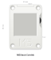

 

# CoreInk

M5Stack · SKU **K048** [1]

Every value below comes from [`board.json`](board.json), where each one carries the id of its source; the numbers in brackets point to the sources listed at the end of this page. This page is written from that file by [`_shared/emit_board_readme.py`](../_shared/emit_board_readme.py): change the file, then run the script.

Vendor links: [docs](https://docs.m5stack.com/en/core/CoreInk) · [repository](https://github.com/m5stack/M5_Hardware/tree/master/Products/K048_CoreInk)

## Dimensions

| Width | Height | Depth | Weight |
| --- | --- | --- | --- |
| 40.0 mm | 56.0 mm | 16.0 mm | 31.5 g |

The vendor gives the product size as 56.0 x 40.0 x 16.0 mm; width and height here are the front face upright, as the drawings use them. Package 80.0 x 45.0 x 20.0 mm, gross weight 42.6 g. Enclosure: plastic (PC). Operating temperature 0 to 60 C. Magnetic back. [1]

## Components

34 entries (51 parts counting quantities).

### Processing and memory

| Part | Role | Ref. | Qty | Key facts | Src |
| --- | --- | --- | --- | --- | --- |
| ESP32-PICO-D4 (Espressif Systems) | soc | U1 | 1 | cpu: Xtensa 32-bit LX6, dual core, up to 240 MHz; dmips: 600; rom kb: 448; sram kb: 520; rtc sram kb: 16; in package flash: 4 MB, quad SPI; in package psram: none; in package crystal: yes; wifi: 802.11 b/g/n, 2412 to 2484 MHz; bluetooth: v4.2 BR/EDR and Bluetooth LE; supply v: 3 / 3.6; package mm: 7 / 7 / 0.94; chip revision: v1.0 or v1.1 (the datasheet's ordering table; which one a given unit carries is not stated by the vendor); lifecycle: Not recommended for new designs (NRND), per the datasheet; supply net: MCU_VDD on VDDA (1, 43, 46), VDDA3P3 (3, 4), VDD3P3_RTC (19) and VDD3P3_CPU (37); decoupling C46 22 uF, C10, C12 to C15 and C18 1 uF. VDD_SDIO (26) is an output of the module (fed inside from VDD3P3_RTC while MTDI is low at reset), with only C16 1 uF to GND; unconnected pins: IO6/CLK (31) / IO7/SD0 (32) / IO8/SD1 (33) / IO11/CMD (30) / IO16 (25) / IO17 (27) / XTAL_N_NC (44) / XTAL_P_NC (45) / CAP2_NC (47) / CAP1_NC (48); in package flash pins: IO6/CLK FLASH_CLK, IO16 FLASH_CS, IO8/SD1 SI/SIO0, IO17 SO/SIO1, IO7/SD0 WP/SIO2, IO11/CMD HOLD/SIO3 (datasheet Table 3); not for other use; ground: exposed pad (pin 0) — Every GPIO the board uses is listed on the peripheral it reaches. GPIO numbers are the U1 pin names; the schematic's U1 pin numbers are given where a pin is unused. | [2] [3] [1] |
| — | flash | — | 1 | capacity mb: 4; interface: quad SPI; location: inside the ESP32-PICO-D4 package | [3] [1] |
| — | crystal | X1 | 1 | frequency hz: 32768; load caps: C26, C27 6 pF to GND | [2] |

### Power

| Part | Role | Ref. | Qty | Key facts | Src |
| --- | --- | --- | --- | --- | --- |
| SY7088 (Silergy) | regulator | U5 | 1 | type: synchronous boost, output disconnected in shutdown; schematic section: 5V DC-DC; input net: BST_IN (SYS_BAT through D10 SS34, or CHG through D9 1N5819); output net: SYS_P050; inductor: L2 2.2 uH; input caps: C20, C21 47 uF/6.3 V; output cap: C31 47 uF/6.3 V; feedback: R43 15 kohm from OUT to FB, R44 4.7 kohm from FB to GND; vref v: 1.2; vout v computed: 5.03; input range v: 2.3 / 5; output range v: 2.5 / 5.5; peak current a: 3; switching mhz: 1; package: DFN2x3-8 — vout_v_computed is VOUT = 1.2 V x (RH/RL + 1) from the datasheet with the schematic's 15 kohm and 4.7 kohm. SYS_P050 feeds the 3.3 V buck and, through D11 1N5819, EXT_5VO (C29 10 uF), the 5 V of the Grove port, the M5-Bus 5VOUT, the HAT connector and the buzzer. | [2] [7] |
| SY8089 (Silergy) | regulator | U3 | 1 | type: synchronous step-down; schematic section: 3.3V DC-DC; input net: SYS_P050; output net: MCU_VDD; enable: EN tied to IN; inductor: L3 2.2 uH; input cap: C19 22 uF/6.3 V; output caps: C28, C33 22 uF/6.3 V; feedback: R39 22 kohm from the output to FB, R40 5.1 kohm from FB to GND — The schematic gives no suffix for the part, and its datasheet was not read for this file, so the output voltage is stated only by the schematic's section title. MCU_VDD supplies the ESP32-PICO-D4, the panel logic, the ESD arrays, the pull-ups, the M5-Bus 3V3 and the HAT connector. | [2] |
| — | charger | U6 | 1 | schematic value: TP40P57; type: single-cell charger; input net: CHG (VCC, pin 4; C23 10 uF/6.3 V); battery net: SYS_BAT (BAT, pin 3; C11 10 uF/6.3 V); prog: R45 5.1 kohm from PROG (pin 6) to GND; chg pin: CHG# (pin 1) sinks LED1 through R34 2.2 kohm from CHG; stdby pin: STDBY# (pin 5) unconnected — The schematic writes the part as 'TP40P57'; the vendor's block diagram, the second image of the docs page's schematic section, names it TP4057. No datasheet has been read against the schematic's pin names yet, so no maker is given here, and the charge current PROG sets is not computed. | [2] [4] |
| — | battery | — | 1 | capacity mah: 390; nominal v: 3.7; chemistry: lithium (built in); net: SYS_BAT | [1] [2] |

### Display and touch

| Part | Role | Ref. | Qty | Key facts | Src |
| --- | --- | --- | --- | --- | --- |
| GDEY0154D67 (Good Display) | display panel | EPD1 | 1 | technology: electrophoretic (e-paper), TFT active matrix; diagonal in: 1.54; resolution px: 200 / 200; active area mm: 27 / 27; pixel pitch mm: 0.14; dpi: 184; outline mm: 31.8 / 37.32 / 1; weight g: 2.18; colors: black and white, 1 bit; refresh s: full: 2; fast: 1.5; partial: 0.3; operating temp c: 0 / 50; interface: SPI; BS1 tied to GND on the board, which selects 4-wire 8-bit SPI; connector: 24-pin FPC; temperature sensor bus: TSCL and TSDA left unconnected — Pin names and numbers as the vendor schematic's EPD1 symbol writes them; the symbol is named EPD_SPI and names no panel model. Each of VGL (4), VGH (5), VDD (18), VPP (19), VSH (20), VSL (22) and VCOM (24) has a 1 uF/25 V capacitor to GND (C35 to C41); BSI (8), VSS (17) and the shell go to GND. The GDEY0154D67 specification names pin 4 NC and pin 5 VSH2. M5Stack states for this panel: viewing area 27.0 x 27.0 mm, dot pitch 0.14 mm, 184 DPI, refresh 2 s, partial refresh 0.26 s, 'grayscale: 2'; Good Display's product page states 4 gray levels. M5Stack changed the panel from GDEW0154M09 to GDEY0154D67 on 2024-10-25. On one unit the Kleidos firmware read the controller's identity back as SSD1681. | [2] [1] [5] [6] [9] |
| SSD1681 (Solomon Systech) | display controller | — | 1 | mounting: chip on glass inside the GDEY0154D67 panel module; interface on this board: 4-wire SPI (BS1 tied to GND) — Good Display's GDEY0154D67 specification names the SSD1681 as the panel's driver, and on one unit the Kleidos firmware read the controller's identity back as SSD1681. | [5] [9] |

### Sensors and timekeeping

| Part | Role | Ref. | Qty | Key facts | Src |
| --- | --- | --- | --- | --- | --- |
| BM8563 | rtc | U4 | 1 | interface: I2C, up to 400 kbit/s; i2c address: 0x51 (0xA2 write, 0xA3 read); supply range v: 1.5 / 5.5; sleep current ua typ: 0.25; sleep current conditions: VDD 3.0 V, 25 C; supply net: SYS_BAT, the battery ahead of the power switch (C25 100 nF/10 V); crystal: X1 32.768 kHz; clkout: unconnected; int output: open drain | [2] [8] [1] |

### Audio

| Part | Role | Ref. | Qty | Key facts | Src |
| --- | --- | --- | --- | --- | --- |
| — | buzzer | BZ1 | 1 | type: passive buzzer; supply: EXT_5VO through R5 4.7 ohm to BZ1 +; driver: Q1 S8050 low side on BZ1 -, D4 4148 flyback across BZ1; drive path: GPIO2 -> R2 2.2 kohm -> C1 10 uF/6.3 V (AC coupling) -> Q1 base; D18 4148 clamps the base to GND | [2] [1] |

### Input and indicators

| Part | Role | Ref. | Qty | Key facts | Src |
| --- | --- | --- | --- | --- | --- |
| — | led | LED1 | 1 | color: red; drive: from CHG through R34 2.2 kohm, sunk by the charger's CHG# pin; not on a GPIO | [2] |
| — | led | — | 1 | color: green; drive: GPIO10, lit when the pin is low; location: inside the case, near the top — The vendor's pin map gives G10 as the LED. The vendor's specification table lists one green LED. On the owner's unit it is green, sits inside the case near the top, and lit on the Kleidos firmware's LED-on command (owner observed on his unit, 2026-11-17). That command drives GPIO10 to the level the firmware declares as on, which is low (STATUS_LED_ACTIVE_LOW in the Kleidos firmware's variants/m5core_ink/variant.h, taken as the off level's inverse by statusLedOffLevel in src/hal/common/peripheral_switch.cpp; the pin driven as a plain push-pull output, schematic/bench/2026-11-17-led-and-user-key.md), so the LED is lit when GPIO10 is low. | [1] [2] [10] |
| K1-1502SA-02 | button | S3 | 1 | type: three-way dial switch: roll up, press, roll down; common: C to GND, so each position reads low when active | [2] [1] |
| — | button | S1 | 1 | type: side push button to GND (the schematic's value is a Chinese description of a side-press key); use: press and hold to power on; location: right side as the front is seen, the dial's side, under the dial — A push key, not a slide switch, on the same side as the dial (owner observed on his unit, 2026-11-17). The back sticker points at it with 'Switch G27' and 'POWER ON'. | [2] [1] [10] |
| — | button | S2 | 1 | schematic value: PTS_820_H2.5mm; type: push button to GND on MCU_RST (ESP32 EN); use: reset; the vendor gives it as the way to power off; location: on the back, beside the sticker's SYSTEM RST arrow — On the back of the case (owner observed on his unit, 2026-11-17); svg/back.svg draws it. | [2] [1] [10] |
| — | button | — | 1 | use: programmable button; location: top end — The vendor's pin map gives G5 as the User Button. On the top end of the case (owner observed on his unit, 2026-11-17). | [1] [2] [10] |

### Radio and positioning

| Part | Role | Ref. | Qty | Key facts | Src |
| --- | --- | --- | --- | --- | --- |
| — | antenna | ANT1 | 1 | type: 2.4 GHz 3D antenna; matching: pi network: C4 1.5 pF to GND, L1 1.8 nH in series, C6 1.2 pF to GND | [1] [2] |

### Connectors, storage and USB

| Part | Role | Ref. | Qty | Key facts | Src |
| --- | --- | --- | --- | --- | --- |
| CP2104-F03-GMR (Silicon Labs) | usb uart bridge | U2 | 1 | supply: VBUS (8) and REGIN (7) on USB_5V (C3 10 uF/6.3 V); VIO (5) tied to VDD (6), the on-chip regulator's output (C5 100 nF/10 V); unused pins: GPIO0 to GPIO3 / SUSPEND / SUSPEND# / RI / CTS / DSR / DCD / VPP — The vendor's documentation says the board ships in two versions, one with a CP2104 and one with a CH9102 USB-UART chip; the schematic shows the CP2104 version. | [2] [1] |
| — | connector | ANT2 | 1 | type: IPEX RF connector; net: the same antenna feed as ANT1, after the pi network — The schematic draws ANT1 and ANT2 on one feed; it does not say whether both are fitted. | [2] |
| — | connector | J2 | 1 | type: USB Type-C; input: 5 V at 500 mA; vbus net: USB_5V (to the CP2104, to the charger input through D8 1N5819 and FU1, and to the power latch through D19); data: DP1/DP2 joined and DN1/DN2 joined, each through a 47 ohm resistor (R17, R18) | [2] [1] |
| — | connector | BUS1 | 1 | type: M5-Bus, 16-pin female socket; schematic value: M5_BUS_16P_H7.1; pinout: 1: GND; 2: BAT (SYS_BAT); 3: 5VIN (EXT_5VI, joins the 5 V input after D8); 4: 5VOUT (EXT_5VO); 5: RST (MCU_RST); 6: 3V3 (MCU_VDD); 7: G13 / RXD; 8: G14 / TXD; 9: G21 / SDA; 10: G22 / SCL; 11: G18 / SCK; 12: G36 / AD; 13: G34 / MISO; 14: G26; 15: G23 / MOSI; 16: G25 — The vendor's pin breakout list is G25, G26, G36, G23, G34, G18, G21, G22, G14, G13. | [2] [1] |
| — | connector | J3 | 1 | type: HY2.0-4P (Grove), PORT.CUSTOM; pinout: 1 (black): GND; 2 (red): 5V (EXT_5VO); 3 (yellow): G32; 4 (white): G33 | [2] [1] |
| — | connector | J1 | 1 | type: 10-pin FPC, 'FPC TO HAT': links the main board to the top HAT expansion interface; pinout: 1: LED (GPIO10); 2: KEY (GPIO5); 3: GND; 4: EXT_5VO; 5: EXT_G26; 6: EXT_G36; 7: EXT_G25; 8: SYS_BAT; 9: MCU_VDD; 10: EXT_5VI; shell: GND | [2] [1] |
| — | connector | J4 | 1 | type: 2-pin battery connector; pinout: 1: GND; 2: SYS_BAT (+); shell: GND | [2] |

### Protection

| Part | Role | Ref. | Qty | Key facts | Src |
| --- | --- | --- | --- | --- | --- |
| SRV05-4 | esd | D1, D2, D3 | 3 | vcc: MCU_VDD (pin 5); gnd: pin 2; d1 channels: IO1: GPIO13; IO4: GPIO14; IO2: MCU_RST; IO3: unconnected; d2 channels: IO1: GPIO21; IO4: GPIO22; IO3: GPIO18; IO2: GPIO36; d3 channels: IO1: GPIO34; IO4: GPIO26; IO3: GPIO23; IO2: GPIO25 — They sit on the ESP32 side of the 47 ohm series resistors (R6 to R16) that lead the same lines to the M5-Bus. The Grove port's G32 and G33 have their series resistors but no ESD array. | [2] |

### Other parts

| Part | Role | Ref. | Qty | Key facts | Src |
| --- | --- | --- | --- | --- | --- |
| CJ2310 | other | Q6 | 1 | type: N-channel MOSFET; function: switch of the panel's gate-voltage booster, driven by the SSD1681's GDR pin; circuit: MCU_VDD -> L4 10 uH -> Q6 drain; Q6 source -> R47 0.47 ohm -> GND; C34 10 uF/6.3 V on the input; vgg output: D15 1N5819 from the switch node to VGG, C45 1 uF/25 V; vee output: C43 1 uF/25 V from the switch node into a D16/D17 1N5819 charge pump to VEE, C44 1 uF/25 V | [2] |
| SI2301 | other | Q4 | 1 | type: P-channel MOSFET; function: battery power switch: source on SYS_BAT, drain on the switched battery that enables the 5 V boost (PS_EN) and feeds the battery ADC divider; gate: R32 100 kohm to SYS_BAT (off by default); PWR_TRIG through R36 47 ohm (pulled low to switch on) — PWR_TRIG is pulled low by any of: Q5 (held by GPIO12 or by USB 5 V), the power button (through D6), or the RTC's INT# (through D13). | [2] |
| SI2302 | other | Q5 | 1 | type: N-channel MOSFET; function: power hold: drain on PWR_TRIG, source on GND; while on it keeps the Q4 battery switch on | [2] [1] |
| 1N5819 | other | D8, D9, D11, D15, D16, D17 | 6 | type: Schottky diode; uses: D8: USB_5V into the charger input (towards FU1 and CHG); D9: CHG into BST_IN; D11: SYS_P050 into EXT_5VO; D15: e-paper booster, VGG output; D16: e-paper booster, VEE charge pump; D17: e-paper booster, VEE charge pump | [2] |
| SS34 | other | D10 | 1 | type: Schottky diode; use: SYS_BAT into BST_IN, the boost's input | [2] |
| — | other | D4, D5, D6, D7, D12, D13, D14, D18, D19 | 9 | schematic value: 4148; type: small-signal diode; uses: D4: flyback across the buzzer; D5: power button to GPIO27; D6: power button to PWR_TRIG; D7: auto-reset transistor Q3 to GPIO0; D12: RTC INT# to GPIO19; D13: RTC INT# to PWR_TRIG; D14: GPIO12 to the power latch's gate; D18: base clamp of the buzzer driver Q1; D19: USB_5V to the power latch's gate | [2] |
| S8050 | other | Q1, Q2, Q3 | 3 | type: NPN bipolar transistor; uses: Q1: buzzer low-side driver; Q2: auto-reset, drives EN; Q3: auto-reset, drives GPIO0 | [2] |
| — | other | FU1 | 1 | type: PTC resettable fuse; rating a: 1; position: between the 5 V input (USB_5V after D8, joined by EXT_5VI) and CHG, the charger input | [2] |

## Connections

Each row is one fact of wiring, read from the component in the first column; a row without sources of its own takes its component's.

| From | To | Bus | Address | Pins | Pulls | Notes | Src |
| --- | --- | --- | --- | --- | --- | --- | --- |
| ESP32-PICO-D4 | antenna ANT1 |  |  | LNA_IN (pin 2) → ANT1 through a pi network: C4 1.5 pF to GND, L1 1.8 nH in series, C6 1.2 pF to GND |  |  | [2] [3] [1] |
| GDEY0154D67 | ESP32-PICO-D4 | SPI; no separate MISO line reaches the panel connector: the panel answers register and RAM reads on SDA (GPIO23), half-duplex three-wire |  | BUSY (9) → GPIO4 RST# (10) → GPIO0 D/C (11) → GPIO15 CS# (12) → GPIO9 SCK (13) → GPIO18 MOSI (14) → GPIO23 VDDIO (15), VCI (16) → MCU_VDD (C42 1 uF/25 V) | RST# (GPIO0): up 2.2k to MCU_VDD (R28) | GPIO0 is also the ESP32 boot strap the USB-UART auto-reset drives (usb-uart). The reads over SDA are what the Kleidos firmware does on this board (EpaperPanelDriver::makePanelReadDevice and EpaperPanelDriver::readPanelRegister in src/hal/display/epaper_panel_driver.cpp), with which it read the controller's identity back. | [2] [1] [9] |
| GDEY0154D67 | CJ2310 |  |  | GDR (2) → Q6 gate (net EPD_GD) RESE (3) → Q6 source, current sense across R47 0.47 ohm (net EPD_IS) PREVGH (21) → VGG, the booster's positive output PREVGL (23) → VEE, the booster's negative output |  |  | [2] |
| SSD1681 | GDEY0154D67 |  |  |  |  | The controller is inside the panel module; its signals are the panel connector's pins. | [5] [9] |
| CJ2310 | GDEY0154D67 |  |  | gate → GDR (EPD_GD) source → RESE (EPD_IS) | gate (EPD_GD): down 10k to GND (R46) |  | [2] |
| SY7088 | SI2301 |  |  | EN (3) → PS_EN, Q4's drain through R50 10 kohm | EN (PS_EN): down 100k to GND (R35) |  | [2] [7] |
| SY8089 | SY7088 |  |  | IN (4), EN (1) → SYS_P050 |  |  | [2] |
| charger U6 | led LED1 |  |  | CHG# (1) → LED1 cathode |  |  | [2] [4] |
| SI2301 | ESP32-PICO-D4 |  |  | drain (switched battery) → GPIO35 through a divider, R41 20 kohm over R42 5.1 kohm, C30 1 uF/6.3 V to GND |  | The divider ratio is (20 + 5.1) / 5.1 = 25.1 / 5.1. | [2] |
| SI2301 | SY7088 |  |  | drain → EN through R50 10 kohm (net PS_EN) |  |  | [2] |
| SI2301 | SI2302 |  |  | gate → PWR_TRIG (Q5 drain) through R36 47 ohm | gate: up 100k to SYS_BAT (R32) |  | [2] |
| SI2302 | ESP32-PICO-D4 |  |  | gate → GPIO12 through D14 4148 (anode on GPIO12) | gate: down 10k to GND (R33) | The vendor calls GPIO12 HOLD: driven high it keeps the board powered. | [2] [1] |
| SI2302 | connector J2 |  |  | gate → USB_5V through D19 4148 and R51 5.1 kohm |  | With USB 5 V present the latch is held on whatever GPIO12 does. | [2] [1] |
| SI2302 | SI2301 |  |  | drain → PWR_TRIG -> R36 47 ohm -> Q4 gate |  |  | [2] [1] |
| BM8563 | ESP32-PICO-D4 | I2C | 0x51 | SDA (5) → GPIO21 SCL (6) → GPIO22 INT# (3) → GPIO19 through D12 4148 (cathode on INT#) | SDA (GPIO21): up 2.2k to MCU_VDD (R26) SCL (GPIO22): up 2.2k to MCU_VDD (R27) GPIO19: up 10k to MCU_VDD (R37) INT#: up 10k to SYS_BAT (R38) | GPIO21 and GPIO22 also reach the M5-Bus (pins 9 and 10) through 47 ohm resistors. | [2] [8] [1] |
| BM8563 | SI2301 |  |  | INT# (3) → PWR_TRIG through D13 4148 (cathode on INT#) |  | An RTC alarm or timer pulling INT# low pulls PWR_TRIG low and switches the board on. | [2] [8] [1] |
| BM8563 | crystal X1 |  |  | OSCI (1) → X1 OSCO (2) → X1 |  |  | [2] [8] [1] |
| CP2104-F03-GMR | ESP32-PICO-D4 | UART0 |  | TXD (21) → GPIO3 (U0RXD) through R21 47 ohm RXD (20) → GPIO1 (U0TXD) through R22 47 ohm DTR (23), RTS (19) → EN and GPIO0 through the Q2/Q3 S8050 auto-reset pair | EN (MCU_RST): up 10k to MCU_VDD (R29) GPIO0: up 2.2k to MCU_VDD (R28) RST# (9): up 10k to the CP2104's VDD (R20) | Auto-reset: Q2 has its base on DTR through R30 10 kohm, its emitter on RTS and its collector on EN; Q3 has its base on RTS through R31 10 kohm, its emitter on DTR and its collector on GPIO0 through D7 4148 (cathode on Q3). EN also has C17 1 uF to GND. | [2] [1] |
| CP2104-F03-GMR | connector J2 |  |  | DP (3) → SYS_DP DM (4) → SYS_DM |  |  | [2] [1] |
| user-led | connector J1 |  |  | LED → J1 pin 1 |  | J1 pin 1 is GPIO10, with no series part on the main board; the LED and its resistor are beyond J1, off the schematic. | [2] |
| buzzer BZ1 | ESP32-PICO-D4 |  |  | drive → GPIO2 | GPIO2: down 5.1k to GND (R3) |  | [2] [1] |
| K1-1502SA-02 | ESP32-PICO-D4 |  |  | 1 (dial up) → GPIO37 T (dial press) → GPIO38 2 (dial down) → GPIO39 | GPIO37: up 10k to MCU_VDD (R25) GPIO38: up 10k to MCU_VDD (R23) GPIO39: up 10k to MCU_VDD (R24) | Each line also has 1 uF/6.3 V to GND: C9 on GPIO37, C7 on GPIO38, C8 on GPIO39. | [2] [1] |
| button S1 | ESP32-PICO-D4 |  |  | press → GPIO27 through D5 4148 (anode on GPIO27) | GPIO27: up 10k to MCU_VDD (R19) | GPIO27 also has C2 1 uF/6.3 V to GND. | [2] [1] [10] |
| button S1 | SI2301 |  |  | press → PWR_TRIG through D6 4148 (anode on PWR_TRIG) |  | A press pulls PWR_TRIG low and switches Q4 on. | [2] [1] [10] |
| button S2 | ESP32-PICO-D4 |  |  | press → EN (pin 9, net MCU_RST) | EN (MCU_RST): up 10k to MCU_VDD (R29) |  | [2] [1] [10] |
| user-button | connector J1 |  |  | KEY → J1 pin 2 |  | J1 pin 2 is GPIO5, with no pull-up on the main board; the button and any pull-up are beyond J1, off the schematic. | [2] |
| connector J2 | CP2104-F03-GMR |  |  | DP1 (A6), DP2 (B6) → DP through R17 47 ohm DN1 (A7), DN2 (B7) → DM through R18 47 ohm | CC1 (A5): down 5.1k to GND (R1) CC2 (B5): down 5.1k to GND (R4) |  | [2] [1] |
| connector BUS1 | ESP32-PICO-D4 |  |  | 5 (RST) → EN 7 → GPIO13 8 → GPIO14 9 → GPIO21 10 → GPIO22 11 → GPIO18 12 → GPIO36 13 → GPIO34 14 → GPIO26 15 → GPIO23 16 → GPIO25 |  | Each signal passes a 47 ohm series resistor (R6 to R16) with an SRV05-4 ESD array on the ESP32 side. | [2] [1] |
| connector BUS1 | external |  |  |  |  | Modules stack on this socket. | [2] [1] |
| connector J3 | ESP32-PICO-D4 |  |  | 3 (IO1) → GPIO32 through R48 47 ohm 4 (IO2) → GPIO33 through R49 47 ohm |  |  | [2] [1] |
| connector J3 | external |  |  |  |  |  | [2] [1] |
| connector J1 | ESP32-PICO-D4 |  |  | 1 → GPIO10 2 → GPIO5 5 → GPIO26 (through R13 47 ohm) 6 → GPIO36 (through R11 47 ohm) 7 → GPIO25 (through R15 47 ohm) |  |  | [2] [1] |
| connector J1 | user-led |  |  | 1 → LED |  |  | [2] [1] |
| connector J1 | user-button |  |  | 2 → KEY |  |  | [2] [1] |
| connector J1 | external |  |  |  |  | The top HAT expansion interface the vendor lists. | [2] [1] |
| connector J4 | battery |  |  |  |  |  | [2] |

## Not on this board

| Role | Notes | Src |
| --- | --- | --- |
| psram | The ESP32-PICO-D4 has no in-package PSRAM and the board fits none. | [3] [2] |
| pmic | Power is discrete: a charger, a boost, a buck and a MOSFET switch. | [2] |
| fuel gauge | The battery is read through a resistor divider on GPIO35. | [2] |
| touch controller |  | [2] [1] |
| imu |  | [2] [1] |
| magnetometer |  | [2] [1] |
| microphone |  | [2] [1] |
| audio codec |  | [2] [1] |
| audio amp | The buzzer is driven by one transistor. | [2] |
| speaker | The board's one sound part is a passive buzzer. | [2] [1] |
| ir led |  | [2] [1] |
| keyboard controller |  | [2] [1] |
| io expander |  | [2] |
| sd slot |  | [2] [1] |
| gps |  | [2] [1] |
| lora |  | [2] [1] |

## Notes

The connections come from the vendor's one-page schematic, which carries no revision or date. The LED on GPIO10 and the button on GPIO5 sit beyond the 'FPC TO HAT' connector J1 and are not drawn on it. Net names in specs (SYS_BAT, SYS_P050, MCU_VDD, EXT_5VO, EXT_5VI, CHG, BST_IN, PWR_TRIG, PS_EN) are the schematic's. The vendor powers the board on with a long press of the side power button and off with the reset button or software.

## Sources

1. [CoreInk (K048), M5Stack documentation](https://docs.m5stack.switch-science.com/en/core/CoreInk) — vendor docs, checked 2026-11-16 (`m5-docs`); read at a mirror of <https://docs.m5stack.com/en/core/CoreInk>. Read at Switch Science's mirror of docs.m5stack.com: the original host timed out from the machine that wrote this file on 2026-11-16. Description, specification table, pin map, USB driver notes and version change (2024-10-25) read in full.
2. [CoreInk schematic, one page (M5Stack)](https://web.archive.org/web/20251017235233id_/https://m5stack.oss-cn-shenzhen.aliyuncs.com/resource/docs/schematic/Core/coreink/coreink_sch.pdf) — schematic, checked 2026-11-16 (`coreink-schematic`); read at a mirror of <https://m5stack.oss-cn-shenzhen.aliyuncs.com/resource/docs/schematic/Core/coreink/coreink_sch.pdf>; found through [1]. Read in full at the Internet Archive's copy of 2025-10-17: the original host timed out. The file read has SHA-256 182ea9c6e90bdc7696aacb26db054a1f4125f7640aa505e3d9a2301163e334b5. Not copied into this repository.
3. [ESP32-PICO Series Datasheet, version 1.5 (Espressif Systems)](https://www.espressif.com/sites/default/files/documentation/esp32-pico_series_datasheet_en.pdf) — datasheet, checked 2026-11-17 (`esp32-pico-datasheet`). Read on 2026-11-17: Table 2 (pin description, pp. 13-15), Table 3 (in-package flash pins, p. 16), Table 8 (strapping pins, p. 23) and Section 3.2 (VDD_SDIO, p. 25).
4. [CoreInk block diagram (M5Stack), the second image of the docs page's schematic section](https://static-cdn.m5stack.com/resource/docs/products/core/coreink/coreink_sch_01.webp) — vendor docs, checked 2026-11-17 (`m5-block-diagram`); found through [1]. Names the charger TP4057 and the module ESP32-PICO-D4; draws no connectivity.
5. [GDEY0154D67 1.54 inch e-paper display specification, revision 1.2 of 2024-04-17 (Good Display), as a distributor hosts it](https://evelta.com/content/datasheets/496-GDEY0154D67.pdf) — datasheet, checked 2026-11-16 (`gdey0154d67-spec`). M5Stack's own copy (m5stack-doc.oss-cn-shenzhen.aliyuncs.com/687/GDEY0154D67.pdf, linked from m5-docs) timed out and has no archived copy, so the specification was read at a distributor's copy. Mechanical specifications, pin assignment and absolute ratings read.
6. [GDEY0154D67 product page (Good Display)](https://www.good-display.com/product/388.html) — product page, checked 2026-11-16 (`gdey0154d67-page`). Gives the driver IC (SSD1681), the 27 x 27 mm active area, 4 gray levels, and refresh times at 25 C.
7. [SY7088 synchronous boost, application note / preliminary specification (Silergy), as M5Stack hosts it](https://web.archive.org/web/2024id_/https://m5stack.oss-cn-shenzhen.aliyuncs.com/resource/docs/datasheet/core/SY7088-Silergy.pdf) — datasheet, checked 2026-11-16 (`sy7088-datasheet`); read at a mirror of <https://m5stack.oss-cn-shenzhen.aliyuncs.com/resource/docs/datasheet/core/SY7088-Silergy.pdf>; found through [1]. Read at the Internet Archive's copy: the original host timed out.
8. [BM8563 real-time clock datasheet, V1.1, Chinese, as M5Stack hosts it](https://web.archive.org/web/2024id_/https://m5stack.oss-cn-shenzhen.aliyuncs.com/resource/docs/datasheet/core/BM8563_V1.1_cn.pdf) — datasheet, checked 2026-11-16 (`bm8563-datasheet`); read at a mirror of <https://m5stack.oss-cn-shenzhen.aliyuncs.com/resource/docs/datasheet/core/BM8563_V1.1_cn.pdf>; found through [1]. Read at the Internet Archive's copy: the original host timed out. Features and pin table read.
9. Display controller identity read back from one CoreInk by the Kleidos firmware — measured, checked 2026-07-15 (`ssd1681-readback`). The Kleidos firmware read the controller's identity back over the panel's SPI bus on one CoreInk; it identified an SSD1681. Recorded in the Kleidos repository (docs/hardware/devices/m5core-ink.md).
10. Owner observed on his unit, 2026-11-17 — measured, checked 2026-11-17 (`owner-unit`). Seen by the owner on his own CoreInk and reported on 2026-11-17: the status LED's color, where it sits and that it lit on the Kleidos firmware's LED-on command; the board's three plain keys and where each is (the user key on the top end, the power key on the dial's side, a push key, and the reset key on the back). By eye, no instrument.

## In this folder

- [`board.json`](board.json): every part on the board, each value with its source ([`_shared/board.schema.json`](../_shared/board.schema.json)); this page is written from it.
- [`measurements.json`](measurements.json): the case, display, button and keyboard geometry the front is drawn against ([`_shared/schema.md`](../_shared/schema.md)).
- [`icon.svg`](icon.svg): a 64 px pictogram of the board.
- [`svg/front.svg`](svg/front.svg): the front at 1 unit = 1 mm: the screen's active area, a press target for every control and each printed legend as a group of its own.
- [`svg/back.svg`](svg/back.svg): the back, seen from behind, with what it prints.
- [`svg/left.svg`](svg/left.svg): the left face and what it prints.
- [`model/coreink.glb`](model/coreink.glb): the 3D model, glTF 2.0 binary in metres (glTF's unit), every print kept: the format for the web and most viewers.
- [`model/coreink-web.glb`](model/coreink-web.glb): its web level of detail.
- [`model/coreink.obj`](model/coreink.obj): the same model as Wavefront OBJ, in millimetres, Y up, one object per part: the format for most other 3D tools (Blender, FreeCAD, Fusion, MeshLab, slicers); written from the master by [`_shared/export_obj.py`](../_shared/export_obj.py).
- [`model/coreink.mtl`](model/coreink.mtl): the OBJ's materials: each part's colour, transparency, roughness and metalness.
- [`model/spec.json`](model/spec.json): the recipe the master and its web level are built from.
- [`model/source.json`](model/source.json): the master's provenance.
- [`model/web.json`](model/web.json): the web level's record.
- [`schematic/coreink.pdf`](schematic/coreink.pdf): the connectivity schematic, made to be followed by clicking.
- [`schematic/README.md`](schematic/README.md): the schematic's sources, its Kleidos additions and corrections, and its open questions.
- [`schematic/netlist.yaml`](schematic/netlist.yaml): every part, pin and net of the schematic with its source.
- [`schematic/improvements.md`](schematic/improvements.md): the triage behind the additions and corrections.
- [`schematic/bench/`](schematic/bench/): the bench probe records.

How the drawings, models and schematics are made, and which script writes each file: [`docs/models-and-drawings.md`](../docs/models-and-drawings.md).
