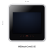

 

# CoreS3-SE

M5Stack · SKU **K128-SE** · also sold as M5CoreS3 SE [1] [2] [3]

Every value below comes from [`board.json`](board.json), where each one carries the id of its source; the numbers in brackets point to the sources listed at the end of this page. This page is written from that file by [`_shared/emit_board_readme.py`](../_shared/emit_board_readme.py): change the file, then run the script.

Vendor links: [docs](https://docs.m5stack.com/en/core/CoreS3%20SE) · [repository](https://github.com/m5stack/M5_Hardware/tree/master/Products/K128-SE_CoreS3-SE)

## Dimensions

| Width | Height | Depth | Weight |
| --- | --- | --- | --- |
| 54.0 mm | 54.0 mm | 15.5 mm | 37.8 g |

Product size and weight as the vendor's specification table gives them; none of them is measured on a unit. The depth, 15.5 mm, is the frame's: the vendor's dimension drawing (the CoreS3-Lite's, which the CoreS3-SE page links as its model size) prints 15.5 mm for the frame and 16.5 mm over the back cover, and the vendor's CoreS3-SE.stl holds a 54.0 x 54.0 x 15.5 mm frame with the back cover standing 1.0 mm proud of it (16.5 mm in all). The owner's hand measurement of 2026-07-15, 15.0 mm, was taken without a caliper and is not used. Package 133.0 x 93.5 x 22.5 mm, gross weight 54.5 g. Operating temperature 0 to 40 °C. The box holds the controller and an L-shaped 2.0 mm hex key for M2.5 screws. The vendor's 2024 export of the same page gave 38.4 g and a 133.4 x 95 x 21 mm package. [1] [2] [3] [18] [19] [20]

## Components

34 entries (40 parts counting quantities).

### Processing and memory

| Part | Role | Ref. | Qty | Key facts | Src |
| --- | --- | --- | --- | --- | --- |
| ESP32-S3 (Espressif) | soc | U5 | 1 | cores: 2; core: Xtensa 32-bit LX7; max clock mhz: 240; package: QFN56 7 x 7 mm; in package flash: none; in package psram: none; vdd spi v: 3.3 on this board: the GPIO45 strap reads 0 (no external pull, the chip's weak pull-down) and no eFuse forces VDD_SPI; the part allows 3.3 or 1.8; rom kb: 384; sram kb: 512; gpios: 45; wifi: IEEE 802.11 b/g/n, 2.4 GHz; bluetooth: Bluetooth 5 (LE); usb: USB OTG and USB Serial/JTAG on GPIO19/GPIO20; gpios on m5 bus: G0, G1, G2, G5, G6, G7, G8, G9, G10, G11, G12, G13, G14, G17, G18, G35, G36, G37, G43, G44 — The schematic names U5 'ESP32-S3' and draws flash (U6) and PSRAM (U7) as separate chips, matching the datasheet's ESP32-S3 ordering code with no in-package memory. VDD3P3 (pins 2, 3) is VDDP_3V3, fed from VDD_3V3 through L4 2.0 nH (C110 470 nF, C122 4.7 uF); VDD3P3_RTC (20), VDD3P3_CPU (46) and VDDA (55, 56) are VDD_3V3; VDD_SPI (29) is FLASH_VCC. The nets the schematic names CAM_D2 to CAM_D9, CAM_HREF, CAM_PCLK and CAM_VSYNC (GPIO15, 16, 38, 39, 40, 41, 42, 45, 46, 47, 48) reach no fitted part on the SE: the camera connector is outside its compiled design. GPIO21 (pin 27) is I2C_INT, the AW9523B's interrupt output. GPIO43 (U0TXD) reaches M5-Bus pin 14 through R48 499 ohm and GPIO44 (U0RXD) pin 13 directly; the schematic labels the pair UART_PRINT. The schematic notes 'VSPI: 0=3.3V 1=1.8V' beside GPIO45; the board puts no pull on GPIO45 or GPIO46, so both straps read 0 on the chip's weak pull-downs, and the bench read VDD_SPI_FORCE = 0, VDD_SPI_TIEH = 0, GPIO45 and GPIO46 low with only the pull-down on, and esptool's 'Flash voltage set by a strapping pin: 3.3V'. | [4] [5] [1] [16] |
| GD25Q128/W25Q128 | flash | U6 | 1 | capacity mbit: 128; capacity mb: 16; supply: FLASH_VCC (the ESP32-S3's VDD_SPI), 3.3 V: as the schematic labels the part, and as the strap sets it on the bench; interface: SPI with four data lines — The schematic's value is 'GD25Q128/W25Q128/128Mbit/3.3V': either part can be fitted. The bench unit's flash is neither: JEDEC manufacturer 0x46, device 0x4018 (128 Mbit, 16 MB, as printed), not GigaDevice (0xC8) or Winbond (0xEF), and ESP-IDF's probe falls back to its generic driver; its maker is not identified (the part's marking needs the case opened), so the part stays as printed. Decoupled by C35 4.7 uF and C36 470 nF. | [4] [1] [16] |
| ESPSRAM | psram | U7 | 1 | capacity mb: 8; interface: quad SPI, sharing CLK and the four data lines with the flash; supply: FLASH_VCC — The schematic's value is 'ESPSRAM'; the vendor gives 8 MB quad PSRAM. The bench unit's debug firmware found and tested 8 MB in quad mode at 80 MHz, and the eFuses show no PSRAM in the ESP32-S3's package, so the 8 MB is this chip. Decoupled by C37 4.7 uF and C38 470 nF. | [4] [1] [16] |
| — | crystal | X1 | 1 | frequency mhz: 40; tolerance ppm: 10; load capacitance pf: 20; package: 2520; load capacitors: C44 and C51, 12 pF each — The schematic gives the value '40Mhz/10ppm/20pF/2520' and no part number. Pins 2 and 4 are GND. | [4] |
| 9H03200034 (TXC) | crystal | Y1 | 1 | frequency khz: 32.768; load capacitors: C30 and C32, 6 pF each — The schematic gives 'TXC/9H03200034'; the frequency is the BM8563's timebase per its datasheet. | [4] [9] |

### Power

| Part | Role | Ref. | Qty | Key facts | Src |
| --- | --- | --- | --- | --- | --- |
| AXP2101 (X-Powers) | pmic | U1 | 1 | interface: I2C (TWSI); i2c address: 0x34; package: QFN-40 5 x 5 mm; input voltage v: 3.9 to 5.5; charger: linear, 100 mA to 1 A, CV accuracy +/-0.5 %; charge current on this board: 5 V at 198 mA (vendor's specification table); fuel gauge: E-gauge 3.0; dcdc1: 1.5 to 3.4 V, 2 A; on this board VDD_3V3 (L1 1.0 uH WPN201610M1R0MT, C8 22 uF), the ESP32-S3 and the board's 3.3 V logic; dcdc2: not used on this board (LX2 and FB2 open); dcdc3: 0.5 to 3.4 V in three ranges, 2 A; on this board VCC_3V3 (L3 1.0 uH, C15 22 uF), the M5-Bus 3V3 pin; dcdc4: not used on this board (LX4 and FB4 open); aldo1: 0.5 to 3.5 V, 300 mA; on this board VDD_1V8 (the AW88298's DVDD); aldo2: 0.5 to 3.5 V, 300 mA; on this board VDDA_3V3 (the ES7210's supplies); aldo3: 0.5 to 3.5 V, 300 mA; on this board VDDCAM_3V3, which reaches no fitted load on the SE; aldo4: 0.5 to 3.5 V, 300 mA; on this board VDD_3V3_SD (the microSD slot); bldo1: 0.5 to 3.5 V, 300 mA; on this board AVDD, which reaches only C13 and C126 on the SE; bldo2: 0.5 to 3.5 V, 300 mA; on this board DVDD, which reaches only C12 and C127 on the SE; dldo1: 0.5 to 3.3 V, 300 mA, LDO or switch, its input DCDC1 inside the chip (VDD_3V3 here); on this board VCC_BL, the LCD backlight (LCD1 pin 9); dldo2: not used on this board (pin 11 open); cpusldo: not used on this board (pin 10 open); rtcldo: 1.8/2.5/3/3.3 V, 30 mA; on this board VRTC (pin 28) is RTC_VDD, the BM8563's supply; vbackup: not connected; gpio1: not connected; power off current ua: the datasheet V1.0 gives two figures: under 20 (BATFET off, RTCLDO on) in its features list, and typically 40 with only a battery present in 6.5.4; this board's is not measured; board consumption: battery 4.2 V: standby 104.64 uA, working 109.67 mA; USB 5 V: working 166.27 mA (vendor's specification table) — VSYS (34), VIN1-4, ALDOIN and BLDOIN are one net, AXP_PS, the system rail that also feeds the 5 V boost and the audio amplifier; L2 1.0 uH sits between it and SW (35). VMID (36) has C9 10 uF, VREF (2) C20 2.2 uF. Rail voltages on this board are as the schematic's net names give them (VDD_3V3, VCC_3V3, VDD_1V8, VDDA_3V3, VDD_3V3_SD); the schematic states no voltage figure for a rail. The vendor says power management combines the AXP2101 with the AW9523B to set the direction of the power path (BUS_OUT_EN, USB_OTG_EN). | [4] [6] [1] |
| SY7088 (Silergy) | regulator | U3 | 1 | topology: synchronous boost; input voltage v: 2.3 to 5.25; input: AXP_PS (the AXP2101's VSYS); output: BUS_5V; feedback reference v: 1.2; feedback divider: R11 15 kohm (OUT to FB), R12 4.7 kohm (FB to GND); output voltage v: 5.03; inductor: L5 2.2 uH WPN3012H2R2MT; capacitors: C24, C25, C26 22 uF at the input; C27, C28 22 uF at the output — The output voltage is computed from the datasheet's VOUT = 1.2 V x (RH/RL + 1) and the schematic's divider; it is not a vendor-stated figure. | [4] [11] |

### Display and touch

| Part | Role | Ref. | Qty | Key facts | Src |
| --- | --- | --- | --- | --- | --- |
| — | display panel | LCD1 | 1 | type: IPS LCD; diagonal in: 2; resolution px: 320 / 240; cover: high-strength glass panel; connector: 10-pin (M5_LCD_10P); interface: SPI with a data/command line | [1] [4] |
| ILI9342C (Ilitek) | display controller | — | 1 | description: a-Si TFT LCD single-chip driver; resolution: 320RGB x 240; colors: 262K; interface on this board: SPI — The vendor names the controller ILI9342C. | [1] [12] |
| FT6336U | touch controller | CTP1 | 1 | type: capacitive; interface: I2C; i2c address: 0x38; touch area px: 320 x 280; connector: 8-pin (M5_TOUCH_8P); cipher register 0xA3: 0x64; focaltech id register 0xA8: 0x20 — The vendor gives a touch area of 320 x 280 pixels against the 320 x 240 panel: the touch glass reaches below the display. The two register values were read on a CoreS3 SE. | [1] [4] [14] |

### Sensors and timekeeping

| Part | Role | Ref. | Qty | Key facts | Src |
| --- | --- | --- | --- | --- | --- |
| BM8563 | rtc | U4 | 1 | interface: I2C, up to 400 kbit/s; i2c address: 0x51; supply v: 1.5 to 5.5; sleep current ua typ: 0.25 (VDD 3.0 V, 25 °C); timebase: 32.768 kHz crystal; interrupt: open drain; functions: alarm, timer, programmable clock output, low-voltage detector — VDD (8) is fed from RTC_VDD (the AXP2101's VRTC) through D8 1N5819 and R16 100 ohm, with C33 1 uF and C34 22 uF. A footprint for a backup cell, BAT1 (XH414HG-IV01E), sits on the same node and carries the designator 'BAT1/NC': not fitted. CLKOUT (7) is not connected. INT (3) is the AXP2101's IRQ line (see the PMIC's connections). | [4] [9] [1] |

### Audio

| Part | Role | Ref. | Qty | Key facts | Src |
| --- | --- | --- | --- | --- | --- |
| AW88298 (Awinic) | audio amp | U8 | 1 | type: digital smart K class audio amplifier with an integrated 10.25 V boost; resolution bits: 16 (vendor); I2S data width 16, 20, 24 or 32 bits (datasheet); audio interface: I2S/TDM, 8 to 96 kHz; control interface: I2C, 400 kHz; i2c address: 0x36; address straps: AD1 (12) to GND, AD2 (23) to VDD_3V3; supplies: VDD (9) on AXP_PS; IOVDD (18) on VDD_3V3; DVDD (20) on VDD_1V8 (AXP2101 ALDO1); boost inductor L6 1.0 uH WPN201610M1R0MT from AXP_PS to SW; PVDD/VBST on AW_PVDD with C59 and C60 10 uF/25 V; output: VOP/VON through ferrite beads FB2/FB1 to SPK_VOP/SPK_VON, C58 and C52 0.1 nF to GND | [4] [8] [1] |
| — | speaker | — | 1 | power w: 1; vendor designation: 9028 — The vendor's table writes the speaker as '1W@9028'. It is not a schematic component: it lands on the SPK_VOP and SPK_VON nets of the amplifier's output, which also feed the ES7210's third channel as an echo reference. | [1] [4] |
| ES7210 (Everest Semiconductor) | audio codec | U9 | 1 | type: four-channel audio ADC; resolution bits: 24; sample rate khz: 8 to 100; snr db: 102; thd n db: -85; package: QFN-32; interface: I2S/PCM/TDM, master or slave; I2C control; i2c address: 0x40; address straps: AD0 (1) and AD1 (2) to GNDA; supplies: VDDP, VDDD, VDDA and VDDM on VDDA_3V3 (AXP2101 ALDO2); GNDA tied to GND by R22 0 ohm; channel 1: MIC1P/MIC1N from microphone U12 through C88 and C91 1 uF; channel 2: MIC2P/MIC2N from microphone U13 through C93 and C96 1 uF; channel 3: MIC3P/MIC3N (AEC_P/AEC_N) from the speaker outputs through R40 and R42 150 kohm and C102 and C105 1 uF, C103 and C104 22 pF to GND; R41 and R43 NC; channel 4: MIC4P and MIC4N tied to GNDA; mic bias: MICBIAS12 (24) is VBIAS_MIC, the microphones' supply; MICBIAS34 (26) has only C70 1 uF — The vendor calls it an audio decoder chip with dual-microphone input. The chip identity registers 0x3D/0x3E read 0x72/0x10 on a CoreS3 SE. | [4] [10] [1] [14] |
| MSM381A3729H9BPC | microphone | U12, U13 | 2 | output: analog (OUT pin 4 into the ES7210's MICxP through a 1 uF capacitor); supply: VDD (pin 1) from VBIAS_MIC through ferrite beads L7 and L8 (HZ1005U102TFB01), C89/C90 and C94/C95 decoupling — Two microphones; their sound holes sit in the front glass. Pin 3 of each (a GND pin in the schematic's symbol) reaches the ES7210's MICxN through C91 or C96 1 uF; C87 and C92, 22 pF, run from each output to GNDA. | [4] [1] |

### Input and indicators

| Part | Role | Ref. | Qty | Key facts | Src |
| --- | --- | --- | --- | --- | --- |
| AW9523B (Awinic) | io expander | U10 | 1 | interface: I2C; i2c address: 0x58; address straps: AD0 (18) and AD1 (24) to GND; ios: 16 (P0_0 to P0_7, P1_0 to P1_7), each GPIO or LED current source; supply: VCC (21) on VDD_3V3; 2.5 to 5.5 V; interrupt: INTN, active low, 8 us deglitch; p0 0: TOUCH_RST, the touch panel's reset (CTP1 pin 6); p0 1: BUS_OUT_EN (U14 and U19 enables); p0 2: AW_RST, the AW88298's RSTN; p0 3: ES_INT, the ES7210's INT; p0 4: TF_SW, the microSD slot's card-detect switch; p0 5: USB_OTG_EN (U17 and U18 enables); p0 6: not connected; p0 7: not connected; p1 0: CAM_RST, which reaches no fitted part on the SE; p1 1: LCD_RST, the LCD's reset (LCD1 pin 6); p1 2: TOUCH_INT, the touch panel's interrupt (CTP1 pin 5); p1 3: AW_INT, the AW88298's INTN; p1 4: not connected; p1 5: not connected; p1 6: not connected; p1 7: BOOST_EN, the SY7088's enable; power on state: after power-on or a reset every pin is an output at 0, which AD0 and AD1 on GND select (datasheet V1.5, Table 1); P0 starts open drain (GCR bit 4 = 0, Table 10), so it drives its 0 low — The vendor's pin map gives P1_1 to LCD_RST, P1_2 and P0_0 to the touch panel's INT and RST, and P0_2 and P1_3 to the AW88298's reset and interrupt; the other assignments come from the schematic. | [4] [7] [1] |
| — | led | LED1 | 1 | color: red; function: AXP2101 charge indicator; drive: between RTC_VDD (through R1 2 kohm) and the AXP2101's CHGLED pin | [4] [1] |
| — | led | LED2 | 1 | color: green; function: download-mode indicator (internal); drive: between VDD_3V3 (through R10 2 kohm) and the ESP_BOOT line (GPIO0) — The vendor: hold the reset key until the internal green LED lights, then release it; the LED goes off and the device is in download mode. | [4] [1] |
| SMT_SW_TS_015 | button | S1, S2 | 2 | s1: reset key, on the bottom edge: pulls AXP_PG (the ESP32-S3's CHIP_PU and the AXP2101's PWROK) to GND through R38 510 ohm; s2: power key, on the left side: pulls the AXP2101's PWRON to GND through R39 510 ohm (net PWR_KEY); power key use: click: power on; long press: power off; reset key use: click: reset; long press until the green LED lights: download mode — The schematic's value for both is 'SMT_SW_TS_015'. Neither key reaches an ESP32-S3 GPIO. | [4] [1] |

### Radio and positioning

| Part | Role | Ref. | Qty | Key facts | Src |
| --- | --- | --- | --- | --- | --- |
| PROANT440 | antenna | ANT1 | 1 | band: 2.4 GHz (Wi-Fi and Bluetooth LE of the ESP32-S3); matching: C68 1.8 nH in series, C69 2.7 pF and C86 2.4 pF to GND; R35 0 ohm to the antenna; L9 and C121 not fitted (NC) — The schematic gives 'PROANT440' as the value of ANT1. | [4] |

### Connectors, storage and USB

| Part | Role | Ref. | Qty | Key facts | Src |
| --- | --- | --- | --- | --- | --- |
| IPEX | connector | J4 | 1 | kind: coaxial RF connector footprint; pins: 3 | [4] |
| MicroSD-SPI | sd slot | U11 | 1 | card: microSD, up to 16 GB; interface: SPI; supply: VDD_3V3_SD (AXP2101 ALDO4), C84 2.2 uF, C85 22 uF, C116 470 nF; card detect: SW (9) to AW9523B P0_4 | [4] [1] |
| USB-TYPEC | connector | J1 | 1 | kind: USB Type-C; usb: USB OTG and USB Serial/JTAG of the ESP32-S3 (no USB-to-UART bridge); cc: CC1 (A5) and CC2 (B5) each pulled to GND by 5.1 kohm (R6, R9); vbus: net VUSB, C123 22 uF | [4] [1] |
| — | connector | J6 | 1 | pins: 4; pitch mm: 2; pin 1: VUSB; pin 2: GND; pin 3: USB D- (connector side of R25); pin 4: USB D+ (connector side of R47) — The schematic's value is 'HDR4接插件-2MM' (a 4-pin, 2 mm header). It carries the USB-C connector's lines inside the board. | [4] |
| SMT_HDR_2x1.25mm | connector | J5 | 1 | pins: 2; pitch mm: 1.25; pin 1: GND; pin 2: VBAT (AXP2101 BAT) — The SE ships with no battery (see absent). | [4] [1] |
| — | connector | J3 | 1 | kind: HY2.0-4P (Grove), PORT.A, I2C; pin 1: BUS_PA_SCL, GPIO1 (white); pin 2: BUS_PA_SDA, GPIO2 (yellow); pin 3: BUS_OUT, 5 V (red); pin 4: GND (black); max output current: 4.2 V at 940 mA on battery; 5 V at 680 mA on USB — The vendor's pin map calls the port HY2.0-4P; the schematic's symbol for J3 is named 'GH2.0-4P'. The schematic fits this one 4-pin port; the PORT.B (GPIO9/GPIO8) and PORT.C (GPIO18/GPIO17) signals of the vendor's port table reach only the M5-Bus. The 2024 export of the vendor page gives PORT-A's color as red. | [4] [1] [3] |
| M5.BUS | connector | BUS1 | 1 | pins: 30; pin 1: GND; pin 2: GPIO10 (ADC); pin 3: GND; pin 4: GPIO8 (PB_IN); pin 5: GND; pin 6: RST: EN, net AXP_PG (CHIP_PU); pin 7: GPIO37 (MOSI); pin 8: GPIO5; pin 9: GPIO35 (MISO); pin 10: GPIO9 (PB_OUT); pin 11: GPIO36 (SCK); pin 12: 3V3 (VCC_3V3, AXP2101 DCDC3); pin 13: GPIO44 (RXD0); pin 14: GPIO43 (TXD0), through R48 499 ohm; pin 15: GPIO18 (PC_RX); pin 16: GPIO17 (PC_TX); pin 17: GPIO12 (internal SDA); pin 18: GPIO11 (internal SCL); pin 19: GPIO2 (PORT.A SDA); pin 20: GPIO1 (PORT.A SCL); pin 21: GPIO6; pin 22: GPIO7; pin 23: GPIO13 (I2S DOUT); pin 24: GPIO0 (net ESP_BOOT; the I2S MCLK line); pin 25: not connected; pin 26: GPIO14 (I2S DIN); pin 27: not connected; pin 28: 5V (BUS_OUT); pin 29: not connected; pin 30: BAT (VBAT) — Pin functions as the vendor's M5-Bus table names them, checked net by net against the schematic. The vendor's table labels pin 24 'I2S_LRCK'; the schematic net on that pin is ESP_BOOT (GPIO0), which the vendor's own audio pin map gives as I2S_MCLK, while the word clock is GPIO33. | [4] [1] |

### Protection

| Part | Role | Ref. | Qty | Key facts | Src |
| --- | --- | --- | --- | --- | --- |
| ESD5Z3V3 | esd | D4, D6 | 2 | protects: USB D+ (D4) and D- (D6) at the connector, to GND | [4] |
| PTVSLC3D3V3B | esd | D7 | 1 | protects: VDD_3V3, to GND | [4] |

### Other parts

| Part | Role | Ref. | Qty | Key facts | Src |
| --- | --- | --- | --- | --- | --- |
| ME1502AM5G (Microne) | other | U14, U17 | 2 | function: 5 V USB high-side load switch with adjustable current limit, 70 mohm on-resistance, SOT23-5; enable: active high (the A suffix); current limit: Ioc = 60 kohm / RSET; RSET is 60 kohm on both, about 1 A (computed); u14: BUS_5V (boost output) to BUS_OUT, enabled by BUS_OUT_EN; the schematic's 'Boost' path; RSET R17 60 kohm; u17: BUS_OUT to VUSB (the USB-C VBUS pin), enabled by USB_OTG_EN; the schematic's 'OTG' path; RSET R44 60 kohm — BUS_OUT carries C125 220 uF (6R3AVEA221M0645), C118 22 uF, C106 and C108 470 nF; the vendor gives the Grove output as up to 940 mA at 4.2 V on battery and 680 mA at 5 V on USB. | [4] [13] [1] |
| ME1502CM5G (Microne) | other | U18, U19 | 2 | function: 5 V USB high-side load switch with adjustable current limit, 70 mohm on-resistance, SOT23-5; enable: active low (the C suffix); current limit: Ioc = 60 kohm / RSET; RSET is 30 kohm on both, about 2 A (computed); u18: VUSB (USB-C) to VBUS (the AXP2101's input), on while USB_OTG_EN is low; the schematic's 'USB' path; RSET R45 30 kohm; u19: BUS_OUT to VBUS, on while BUS_OUT_EN is low, so the board can be powered from the bus; the schematic's 'PMU' path; RSET R46 30 kohm — With the A-suffix pair, the two enable lines make the vendor's four power-path circuits: USB in or USB out (OTG) by USB_OTG_EN, bus out (boost) or bus in by BUS_OUT_EN. VBUS carries C112 and C113 22 uF; VUSB C111 22 uF and C107 470 nF. | [4] [13] [1] |
| LMV331 | other | U2 | 1 | function: comparator of the reset key's delay circuit; output: open collector (pin 4): it only pulls ESP_BOOT low; R4 10 kohm pulls it up; supply: VDD_3V3 (pin 5), C21 2.2 uF; inputs: pin 1: the node of C22 10 uF (to VDD_3V3), R3 680 kohm (to VDD_3V3), D5 1N4148WS (to GND) and R5 270 kohm in series with D3 1N4148WS from AXP_PG; pin 3: the R7 10 kohm / R8 10 kohm divider of VDD_3V3 — The vendor describes it as a built-in delay circuit: holding the reset key until the internal green LED lights, then releasing it, puts the ESP32-S3 in download mode. Its output pulls ESP_BOOT (GPIO0) low and lights LED2. | [4] [1] [15] |
| 1N5819 | other | D8 | 1 | function: in series with R16 100 ohm from RTC_VDD to the BM8563's VDD | [4] |
| 1N4148WS | other | D3, D5 | 2 | function: part of the reset key's delay network in front of the LMV331 | [4] |

## Connections

Each row is one fact of wiring, read from the component in the first column; a row without sources of its own takes its component's.

| From | To | Bus | Address | Pins | Pulls | Notes | Src |
| --- | --- | --- | --- | --- | --- | --- | --- |
| ESP32-S3 | AXP2101 |  |  | CHIP_PU (pin 4) → AXP2101 PWROK (net AXP_PG) | CHIP_PU (AXP_PG): up 10k to VDD_3V3 (R2) | C23 1 uF holds AXP_PG to GND. The same net is the reset key S1's line (through R38 510 ohm, C18 1 nF to GND), the AW9523B's RSTN and M5-Bus pin 6. | [4] |
| ESP32-S3 | LMV331 |  |  | GPIO0 (pin 5) → LMV331 pin 4 (net ESP_BOOT) | GPIO0 (ESP_BOOT): up 10k to VDD_3V3 (R4) | GPIO0 is also the ES7210's MCLK (through R34 51 ohm), the green LED2's cathode and M5-Bus pin 24. | [4] |
| GD25Q128/W25Q128 | ESP32-S3 | SPI flash |  | nCS (1) → SPICS0 (pin 32) CLK (6) → SPICLK (pin 33) DO/IO1 (2) → SPIQ (pin 34) DI/IO0 (5) → SPID (pin 35) nWP/IO2 (3) → SPIWP (pin 31) nHOLD/IO3 (7) → SPIHD (pin 30) |  |  | [4] [1] [16] |
| ESPSRAM | ESP32-S3 | SPI (PSRAM) |  | nCS (1) → SPICS1 (pin 28) SCLK (6) → SPICLK (pin 33) SO/SIO1 (2) → SPIQ (pin 34) SI/SIO0 (5) → SPID (pin 35) SIO2 (3) → SPIWP (pin 31) SIO3 (7) → SPIHD (pin 30) |  |  | [4] [1] [16] |
| crystal X1 | ESP32-S3 |  |  | 1 → XTAL_P (pin 54) through R33 22 nH 3 → XTAL_N (pin 53) |  |  | [4] |
| PROANT440 | ESP32-S3 |  |  | feed (1) → LNA_IN (pin 1), net ESP_LNA, through the matching network and R35 0 ohm |  |  | [4] |
| IPEX | PROANT440 |  |  |  |  | J4 pin 1 reaches the RF line only through R36, which the schematic marks NC (not fitted), so as drawn the external-antenna path is open and the chip antenna is fed through R35 0 ohm. Pins 2 and 3 are GND. | [4] |
| AXP2101 | ESP32-S3 | internal I2C (I2C_SYS) | 0x34 | SDA (39) → GPIO12 SCL (40) → GPIO11 | I2C_SYS_SDA: up 2.2k to VDD_3V3 (R20) I2C_SYS_SCL: up 2.2k to VDD_3V3 (R32) | The schematic carries the note 'I2C NEED REVERSED' beside these two lines; the nets connect SDA to GPIO12 and SCL to GPIO11 as listed. | [4] [1] |
| AXP2101 | BM8563 |  |  | IRQ (38) → BM8563 INT (pin 3), net AXP_WAKEUP | AXP_WAKEUP: up 10k to RTC_VDD (R15) | The line reaches no ESP32-S3 pin: only the AXP2101's IRQ, the BM8563's INT and R15. | [4] [1] |
| AXP2101 | SMT_SW_TS_015 |  |  | PWRON (30) → S2 through R39 510 ohm (net PWR_KEY) PWROK (29) → S1 through R38 510 ohm (net AXP_PG) |  | C97 1 nF on PWR_KEY and C18 1 nF on AXP_PG to GND. D1 and D2 across the keys are marked NC. | [4] |
| AXP2101 | led LED1 |  |  | CHGLED (1) → LED1 pin 2 (net AXP_CHG_LED) |  |  | [4] [1] |
| AXP2101 | SMT_HDR_2x1.25mm |  |  | BAT (33) → J5 pin 2 (VBAT) |  | C4 2.2 uF on VBAT. VBAT is also M5-Bus pin 30. | [4] |
| AXP2101 | ME1502CM5G |  |  | VBUS (37) → net VBUS, the outputs of U18 (from USB) and U19 (from the bus) |  | C1 10 uF on VBUS. TS (31) sits on R29 10 kohm from BUS_OUT and R30 10 kohm to GND. | [4] |
| SY7088 | AW9523B |  |  | EN (3) → AW9523B P1_7 (net BOOST_EN) through R13 47 ohm | EN: down 10k (R14) | C29 1 uF from EN to GND. | [4] |
| SY7088 | ME1502AM5G |  |  | OUT (7, 8) → U14 VIN (net BUS_5V) |  |  | [4] |
| ME1502AM5G | AW9523B |  |  | U14 EN (4) → AW9523B P0_1 (BUS_OUT_EN) U17 EN (4) → AW9523B P0_5 (USB_OTG_EN) |  |  | [4] |
| ME1502AM5G | M5.BUS |  |  | U14 VOUT (1) → BUS_OUT, M5-Bus pin 28 and Port A pin 3 |  |  | [4] |
| ME1502AM5G | USB-TYPEC |  |  | U17 VOUT (1) → VUSB, the connector's VBUS |  |  | [4] |
| ME1502CM5G | AW9523B |  |  | U18 EN (4) → AW9523B P0_5 (USB_OTG_EN) U19 EN (4) → AW9523B P0_1 (BUS_OUT_EN) |  |  | [4] |
| ME1502CM5G | USB-TYPEC |  |  | U18 VIN (5) → VUSB |  |  | [4] |
| BM8563 | ESP32-S3 | internal I2C (I2C_SYS) | 0x51 | SDA (5) → GPIO12 SCL (6) → GPIO11 | I2C_SYS_SDA: up 2.2k to VDD_3V3 (R20) I2C_SYS_SCL: up 2.2k to VDD_3V3 (R32) |  | [4] [1] [17] |
| BM8563 | 9H03200034 |  |  | OSCI (1) → Y1 pin 2 OSCO (2) → Y1 pin 1 |  | C30 and C32, 6 pF each, to GND. | [4] |
| LMV331 | led LED2 |  |  | 4 → LED2 pin 2 (net ESP_BOOT) |  |  | [4] |
| AW9523B | ESP32-S3 | internal I2C (I2C_SYS) | 0x58 | SDA (20) → GPIO12 SCL (19) → GPIO11 INTN (22) → GPIO21 (net I2C_INT) RSTN (23) → CHIP_PU (net AXP_PG) | I2C_SYS_SDA: up 2.2k to VDD_3V3 (R20) I2C_SYS_SCL: up 2.2k to VDD_3V3 (R32) INTN (I2C_INT): up 10k to VDD_3V3 (R23) |  | [4] [1] |
| AW9523B | MicroSD-SPI |  |  | P0_4 (10) → SW (9), net TF_SW | TF_SW: up 10k to VDD_3V3 (R28) |  | [4] |
| display panel LCD1 | ESP32-S3 | SPI (shared with the microSD slot) |  | MOSI (pin 2) → GPIO37 (SPI_MOSI) SCK (pin 4) → GPIO36 (SPI_SCK) CS (pin 5) → GPIO3 (LCD_CS) DC (pin 7) → GPIO35 (net SPI_MISO, shared with the microSD slot's DO) | SPI_MOSI: up 10k to VDD_3V3 (R18) SPI_SCK: up 10k to VDD_3V3 (R19) SPI_MISO: up 10k to VDD_3V3 (R21) LCD_CS: up 10k to VDD_3V3 (R49) | The schematic puts LCD1 pin 7 on the SPI_MISO net; the vendor's pin map names that GPIO35 line DC for the ILI9342C and SPI_MISO for the card. | [4] [1] |
| display panel LCD1 | AW9523B |  |  | RST (pin 6) → AW9523B P1_1 (LCD_RST) |  |  | [4] [1] |
| display panel LCD1 | AXP2101 |  |  | BL (pin 9) → AXP2101 DLDO1 (VCC_BL) VDD (pin 8) → VDD_3V3 (AXP2101 DCDC1) |  | C17 2.2 uF on VCC_BL. Pins 1 and 10 are GND; pin 3 is not connected. | [4] [1] |
| ILI9342C | display panel LCD1 |  |  |  |  | The controller is inside the LCD module; its signals are the module connector's pins. | [1] [12] |
| FT6336U | ESP32-S3 | internal I2C (I2C_SYS) | 0x38 | SDA (pin 3) → GPIO12 SCL (pin 4) → GPIO11 | I2C_SYS_SDA: up 2.2k to VDD_3V3 (R20) I2C_SYS_SCL: up 2.2k to VDD_3V3 (R32) |  | [4] [1] [17] |
| FT6336U | AW9523B |  |  | INT (pin 5) → AW9523B P1_2 (TOUCH_INT) RST (pin 6) → AW9523B P0_0 (TOUCH_RST) | TOUCH_INT: up 10k to VDD_3V3 (R27) | VDD (pin 1) is VDD_3V3, pin 2 GND; pins 7 and 8 are not connected. | [4] [1] |
| AW88298 | ESP32-S3 | I2S |  | BCK (15) → GPIO34 (I2S_BCK) WCK (17) → GPIO33 (I2S_WCK) DATAI (16) → GPIO13 (I2S_DATO) |  | DATAO (19) is not connected. | [4] [1] |
| AW88298 | ESP32-S3 | internal I2C (I2C_SYS) | 0x36 | SDA (13) → GPIO12 SCL (14) → GPIO11 | I2C_SYS_SDA: up 2.2k to VDD_3V3 (R20) I2C_SYS_SCL: up 2.2k to VDD_3V3 (R32) |  | [4] [1] |
| AW88298 | AW9523B |  |  | RSTN (11) → AW9523B P0_2 (AW_RST) INTN (10) → AW9523B P1_3 (AW_INT) | AW_INT: up 10k to VDD_3V3 (R26) |  | [4] [1] |
| AW88298 | speaker |  |  | VOP (2) → SPK_VOP through FB2 VON (1) → SPK_VON through FB1 |  |  | [4] |
| ES7210 | ESP32-S3 | I2S |  | MCLK (5) → GPIO0 through R34 51 ohm SCLK (9) → GPIO34 (I2S_BCK) LRCK (10) → GPIO33 (I2S_WCK) SDOUT1/TDMOUT (11) → GPIO14 (I2S_DATI) |  | SDOUT2/TDMIN (12) and DMIC_CLK (14) are not connected. | [4] [1] |
| ES7210 | ESP32-S3 | internal I2C (I2C_SYS) | 0x40 | CDATA (3) → GPIO12 CCLK (4) → GPIO11 | I2C_SYS_SDA: up 2.2k to VDD_3V3 (R20) I2C_SYS_SCL: up 2.2k to VDD_3V3 (R32) |  | [4] [1] |
| ES7210 | AW9523B |  |  | INT (13) → AW9523B P0_3 (ES_INT) | ES_INT: up 10k to VDD_3V3 (R24) |  | [4] |
| ES7210 | MSM381A3729H9BPC |  |  | MIC1P (16) → U12 OUT through C88 MIC2P (19) → U13 OUT through C93 |  |  | [4] |
| MicroSD-SPI | ESP32-S3 | SPI (shared with the LCD) |  | CS (2) → GPIO4 (TF_CS) DI (3) → GPIO37 (SPI_MOSI) SCLK (5) → GPIO36 (SPI_SCK) DO (7) → GPIO35 (SPI_MISO) |  | No pull is drawn on TF_CS. RSV (1) and RSV/IRQ (8) are not connected; the shell pins are GND. | [4] [1] |
| USB-TYPEC | ESP32-S3 | USB |  | D+ (A6, B6) → GPIO20 (pin 26) through R47 22 ohm D- (A7, B7) → GPIO19 (pin 25) through R25 22 ohm | CC1: down 5.1k (R6) CC2: down 5.1k (R9) |  | [4] [1] |
| USB-TYPEC | ESD5Z3V3 |  |  | D+ → D4 D- → D6 |  |  | [4] |
| USB-TYPEC | ME1502CM5G |  |  | VBUS → U18 VIN (net VUSB) |  | U17 drives the same net when the board supplies USB devices (OTG). | [4] |
| connector J3 | ESP32-S3 | PORT.A (I2C) |  | SCL (pin 1) → GPIO1 SDA (pin 2) → GPIO2 |  | No pull-up is drawn on these two lines. | [4] [1] |
| connector J3 | external |  |  |  |  | The port's far side, also reachable on M5-Bus pins 19 and 20. | [4] |
| M5.BUS | external |  |  |  |  | Stacking modules and bases. | [4] [1] |

## Not on this board

| Role | Notes | Src |
| --- | --- | --- |
| battery | The vendor's comparison table gives the SE no battery (the CoreS3-Lite has 200 mAh, the CoreS3 500 mAh). J5 and M5-Bus pin 30 carry VBAT for one. | [1] [4] |
| imu | No BMI270 (fitted on the CoreS3 and CoreS3-Lite). The schematic still draws a BMI270 and an MPU6886 block, outside the SE's compiled design. | [1] [4] |
| magnetometer | No BMM150 (fitted on the CoreS3 and CoreS3-Lite). | [1] [4] |
| other | No camera (GC0308 on the CoreS3 and CoreS3-Lite). The camera connector and its 20 MHz clock are drawn outside the SE's compiled design. | [1] [4] |
| other | No proximity and light sensor (LTR-553ALS-WA on the CoreS3 and CoreS3-Lite). | [1] |
| usb uart bridge | The USB-C data lines reach the ESP32-S3's own USB pins. | [4] |
| buzzer | Sound comes from the speaker only. | [4] [1] |
| keyboard controller |  | [4] |
| ir led |  | [4] |
| gps |  | [4] |
| lora |  | [4] |

## Notes

Every wiring fact comes from the vendor's schematic Sch_M5_CoreS3_SE_v1.0 (Altium, seven sheets: AXP, PSU, ESP32S3, AUDIO, GPIO, POWER_PATH, ETC), read from the netlist its PDF carries in its bookmarks, and is cross-checked against the vendor's pin map. The schematic is the CoreS3 design with the camera, the IMUs and the compass drawn grey; those blocks are absent from its netlist, and so from this file. Ferrite beads, decoupling capacitors and mounting holes (PHD1 to PHD3) are named where they belong to a connection, not listed as components.

## Sources

1. [CoreS3-SE (K128-SE), M5Stack documentation](https://docs.m5stack.switch-science.com/en/core/CoreS3%20SE) — vendor docs, checked 2026-11-16 (`m5-docs`); read at a mirror of <https://docs.m5stack.com/en/core/CoreS3%20SE>. Read at Switch Science's mirror of docs.m5stack.com: the original host and M5Stack's file hosts timed out or refused connections from the machine that wrote this file on 2026-11-16. The page gives the description, the specification table, the pin map, the M5-Bus table, the comparison with the CoreS3 and CoreS3-Lite, and the links to the schematic and datasheets.
2. [CoreS3-SE documentation page as PDF, update time 2026-09-29 (M5Stack)](https://web.archive.org/web/20261030113258/https://m5stack.oss-cn-shenzhen.aliyuncs.com/resource/docs/static/pdf/static/en/core/CoreS3-SE.pdf) — vendor docs, checked 2026-11-16 (`m5-docs-pdf`); read at a mirror of <https://m5stack.oss-cn-shenzhen.aliyuncs.com/resource/docs/static/pdf/static/en/core/CoreS3-SE.pdf>; found through [1]. The vendor's own PDF export of the docs page, read at the Internet Archive's copy of 2026-10-30. Its specification table matches the mirror's.
3. [M5CoreS3 SE (K128-SE) documentation page as PDF, update time 2024-05-24 (M5Stack), as Distrelec hosts it](https://media.distrelec.com/Web/Downloads/_t/ds/K128-SE_eng_tds.pdf) — vendor docs, checked 2026-11-16 (`m5-docs-2024`). An older print of the vendor's page under the name M5CoreS3 SE. It adds an I2C address table (AXP2101 0x34, AW88298 0x36, FT6336U 0x38, ES7210 0x40, BM8563 0x51, AW9523 0x58) and port colors; its weight and package figures differ from today's page.
4. [CoreS3-SE schematic, Sch_M5_CoreS3_SE_v1.0 (Altium, seven A4 sheets, printed 2025-06-03)](https://web.archive.org/web/20260513112150/https://m5stack-doc.oss-cn-shenzhen.aliyuncs.com/498/Sch_M5_CoreS3_SE_v1.0.pdf) — schematic, checked 2026-11-16 (`sch`); read at a mirror of <https://m5stack-doc.oss-cn-shenzhen.aliyuncs.com/498/Sch_M5_CoreS3_SE_v1.0.pdf>; found through [1]. Read at the Internet Archive's copy of 2026-05-13 (SHA-256 ff105808b6073ab487c63e0af776418a58bcf386c2b63f97e3083f5698847e2f); the vendor's host refused connections. Net membership was taken from the per-sheet netlist in the PDF's bookmarks.
5. [ESP32-S3 Series Datasheet, version 2.2 (Espressif)](https://documentation.espressif.com/esp32-s3_datasheet_en.pdf) — datasheet, checked 2026-11-16 (`esp32s3-ds`).
6. [AXP2101 single-cell NVDC PMU with E-gauge, datasheet V1.0 (X-Powers), as M5Stack hosts it](https://web.archive.org/web/20260318131712/https://m5stack.oss-cn-shenzhen.aliyuncs.com/resource/docs/datasheet/core/K128%20CoreS3/AXP2101_Datasheet_V1.0_en.pdf) — datasheet, checked 2026-11-16 (`axp2101-ds`); read at a mirror of <https://m5stack.oss-cn-shenzhen.aliyuncs.com/resource/docs/datasheet/core/K128%20CoreS3/AXP2101_Datasheet_V1.0_en.pdf>; found through [1].
7. [AW9523B 16 multi-function LED driver and GPIO controller, datasheet V1.5 (Awinic), as M5Stack hosts it](https://web.archive.org/web/20260813154406/https://m5stack.oss-cn-shenzhen.aliyuncs.com/resource/docs/products/core/CoreS3/AW9523B-EN.pdf) — datasheet, checked 2026-11-16 (`aw9523b-ds`); read at a mirror of <https://m5stack.oss-cn-shenzhen.aliyuncs.com/resource/docs/products/core/CoreS3/AW9523B-EN.pdf>; found through [1].
8. [AW88298 I2S/TDM input 10.25 V boost digital smart K audio amplifier, datasheet V1.6 (Awinic), as M5Stack hosts it](https://web.archive.org/web/20260318131710/https://m5stack.oss-cn-shenzhen.aliyuncs.com/resource/docs/datasheet/core/K128%20CoreS3/AW88298.PDF) — datasheet, checked 2026-11-16 (`aw88298-ds`); read at a mirror of <https://m5stack.oss-cn-shenzhen.aliyuncs.com/resource/docs/datasheet/core/K128%20CoreS3/AW88298.PDF>; found through [1].
9. [BM8563 I2C real-time clock/calendar datasheet (Chinese), as M5Stack hosts it](https://web.archive.org/web/20260318131701/https://m5stack.oss-cn-shenzhen.aliyuncs.com/resource/docs/datasheet/core/K128%20CoreS3/BM8563.PDF) — datasheet, checked 2026-11-16 (`bm8563-ds`); read at a mirror of <https://m5stack.oss-cn-shenzhen.aliyuncs.com/resource/docs/datasheet/core/K128%20CoreS3/BM8563.PDF>; found through [1].
10. [ES7210 high performance four channels audio ADC datasheet (Everest Semiconductor), as M5Stack hosts it](https://web.archive.org/web/20261018160724/https://m5stack.oss-cn-shenzhen.aliyuncs.com/resource/docs/datasheet/core/K128%20CoreS3/ES7210.PDF) — datasheet, checked 2026-11-16 (`es7210-ds`); read at a mirror of <https://m5stack.oss-cn-shenzhen.aliyuncs.com/resource/docs/datasheet/core/K128%20CoreS3/ES7210.PDF>; found through [1].
11. [SY7088 synchronous boost regulator datasheet (Silergy), as M5Stack hosts it](https://web.archive.org/web/20260831051721/https://m5stack.oss-cn-shenzhen.aliyuncs.com/resource/docs/datasheet/core/SY7088-Silergy.pdf) — datasheet, checked 2026-11-16 (`sy7088-ds`); read at a mirror of <https://m5stack.oss-cn-shenzhen.aliyuncs.com/resource/docs/datasheet/core/SY7088-Silergy.pdf>.
12. [ILI9342C a-Si TFT LCD single chip driver datasheet (Ilitek), as M5Stack hosts it](https://web.archive.org/web/20260910203533/https://m5stack.oss-cn-shenzhen.aliyuncs.com/resource/docs/datasheet/core/ILI9342C-ILITEK.pdf) — datasheet, checked 2026-11-16 (`ili9342c-ds`); read at a mirror of <https://m5stack.oss-cn-shenzhen.aliyuncs.com/resource/docs/datasheet/core/ILI9342C-ILITEK.pdf>.
13. [ME1502 70 mohm 5 V USB high-side adjustable current-limit load switch datasheet V02 (Microne, Chinese), as ChipDip hosts it](https://static.chipdip.ru/lib/087/DOC043087044.pdf) — datasheet, checked 2026-11-16 (`me1502-ds`). Gives the A (EN active high) and C (EN active low) ordering codes and Ioc = 60 kohm / Rset.
14. FT6336U and ES7210 identity registers read on a CoreS3 SE (Kleidos register introspection) — measured, checked 2026-11-11 (`kleidos-regread`). Register reads over I2C from the board's own ESP32-S3 with the Kleidos debug firmware (cores3_se_debug, REG dumps of ft6x36 0xA3/0xA8 and es7210 0x3D/0x3E), recorded in the Kleidos repository at docs/hardware/introspection/ft6x36.md and es7210.md.
15. [LMV331 Single, LMV393 Dual, LMV339 Quad General-Purpose Low-Voltage Comparators, SLCS136V, revised May 2025 (Texas Instruments)](https://www.ti.com/lit/ds/symlink/lmv331.pdf) — datasheet, checked 2026-11-17 (`lmv331-ds`). 1 Features: open-collector output; Table 4-1: OUT is pin 4 of the 5-pin package.
16. eFuses, strapping latch, flash ID and PSRAM read on the owner's CoreS3 SE (Kleidos boards bench record cores3-se/schematic/bench/2026-11-17-efuse-strap-flash-psram.md) — measured, checked 2026-11-17 (`bench-efuse-strap`). Over the board's USB-C port, case closed, read-only: espefuse summary, esptool flash-id and read-mem (v5.3.1), and the boot log and GPIO? / HEAP? console commands of the Kleidos cores3_se_debug image already on the board.
17. Internal I2C bus scan and AW9523B register state on the owner's CoreS3 SE (Kleidos boards bench record cores3-se/schematic/bench/2026-11-17-i2c-scan.md) — measured, checked 2026-11-17 (`bench-i2c-scan`). I2CSCAN and REGS? on the debug serial console of the Kleidos cores3_se_debug image, the board on its PIN screen, nothing written to any chip.
18. [CoreS3-Lite dimension drawing, which the CoreS3-SE page links as its Model Size PDF (M5Stack)](https://web.archive.org/web/20251018174855/https://m5stack-doc.oss-cn-shenzhen.aliyuncs.com/1162/cores3-lite.pdf) — vendor docs, checked 2026-11-17 (`m5-size-drawing`); read at a mirror of <https://m5stack-doc.oss-cn-shenzhen.aliyuncs.com/1162/cores3-lite.pdf>; found through [1]. Read at the Internet Archive's copy of 2025-10-18 (SHA-256 e2a72bdaf3d09cd7addb24fe39750675dfb282c514a172a0e67ffa2d32419dff); the vendor's host timed out. One sheet, unit mm: 54 x 54, R5, and on the edge view 15.5 for the frame and 16.5 over the back cover. It is the CoreS3-Lite's shell; the page gives the SE no other drawing.
19. [Extents of the parts of M5Stack's CoreS3-SE.stl (M5_Hardware at dccc8047, SHA-256 529349b80662f2bb83e87a3d59075d91ab54aa3e2d5356d72d69fded36767354)](https://raw.githubusercontent.com/m5stack/M5_Hardware/dccc804775037bb1c1457b7d31bf3ba583150d57/Products/K128-SE_CoreS3-SE/Structures/CoreS3-SE.stl) — measured, checked 2026-11-17 (`m5-stl-extents`). The file's assembly split into its connected parts with trimesh 5.2.0 and each part's bounding box read: the frame 54.0 x 54.0 x 15.5 mm, the back cover 53.2 x 53.2 x 7.9 mm reaching 1.0 mm behind the frame, 16.5 mm in all. The extents of the vendor's CAD file, not a measurement of a unit; the model in model/ is built from the same file, and _shared/check_board_model.py reports its case meshes 15.5 mm deep.
20. Verified against the owner's physical unit, 2026-11-18 — measured, checked 2026-11-18 (`owner-unit-verified`). The owner compared his own CoreS3-SE with this repository's front drawing (svg/front.svg) and 3D model (model/) on 2026-11-18: the model and the drawing match the real board. A check by eye, no instrument. The original source of the measurement was not recorded (sources.md).

## In this folder

- [`board.json`](board.json): every part on the board, each value with its source ([`_shared/board.schema.json`](../_shared/board.schema.json)); this page is written from it.
- [`measurements.json`](measurements.json): the case, display, button and keyboard geometry the front is drawn against ([`_shared/schema.md`](../_shared/schema.md)).
- [`sources.md`](sources.md): the vendor drawings, photos and CAD files the measurements were taken on.
- [`icon.svg`](icon.svg): a 64 px pictogram of the board.
- [`svg/front.svg`](svg/front.svg): the front at 1 unit = 1 mm: the screen's active area, a press target for every control and each printed legend as a group of its own.
- [`svg/back.svg`](svg/back.svg): the back, seen from behind, with what it prints.
- [`svg/top.svg`](svg/top.svg): the top face and what it prints.
- [`model/cores3-se.glb`](model/cores3-se.glb): the 3D model, glTF 2.0 binary in metres (glTF's unit), every print kept: the format for the web and most viewers.
- [`model/cores3-se-web.glb`](model/cores3-se-web.glb): its web level of detail.
- [`model/cores3-se.obj`](model/cores3-se.obj): the same model as Wavefront OBJ, in millimetres, Y up, one object per part: the format for most other 3D tools (Blender, FreeCAD, Fusion, MeshLab, slicers); written from the master by [`_shared/export_obj.py`](../_shared/export_obj.py).
- [`model/cores3-se.mtl`](model/cores3-se.mtl): the OBJ's materials: each part's colour, transparency, roughness and metalness.
- [`model/spec.json`](model/spec.json): the recipe both are built from.
- [`model/source.json`](model/source.json): the master's provenance.
- [`model/web.json`](model/web.json): the web level's record.
- [`schematic/cores3-se.pdf`](schematic/cores3-se.pdf): the connectivity schematic, made to be followed by clicking.
- [`schematic/README.md`](schematic/README.md): the schematic's sources, its Kleidos additions and corrections, and its open questions.
- [`schematic/netlist.yaml`](schematic/netlist.yaml): every part, pin and net of the schematic with its source.
- [`schematic/improvements.md`](schematic/improvements.md): the triage behind the additions and corrections.
- [`schematic/bench/`](schematic/bench/): the bench probe records.

How the drawings, models and schematics are made, and which script writes each file: [`docs/models-and-drawings.md`](../docs/models-and-drawings.md).
