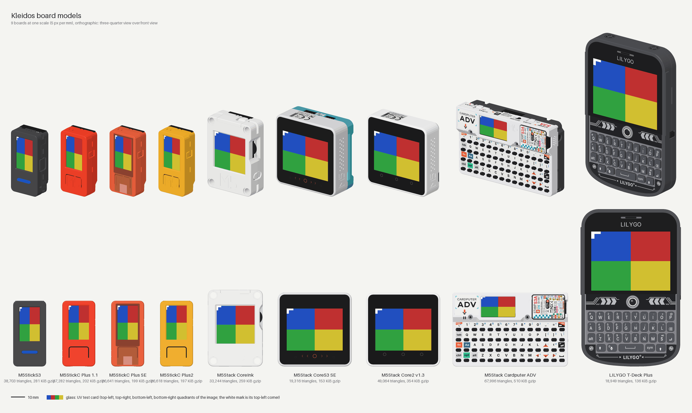

# Drawings and models: how they are made

How the front drawings, the measurements and the 3D models of the boards are made, checked and rebuilt. The repository's own `README.md` says what is here and under which license; this page is the working detail behind it.

See [`../_shared/schema.md`](../_shared/schema.md) for the drawing and measurement schema, and [`../_shared/board.schema.json`](../_shared/board.schema.json) for the component-level specification each `board.json` follows.

## Who writes what

| File | Owner |
| --- | --- |
| `<board>/svg/front.svg` | `_shared/emit_front_svg.py`, the only writer, of the drawing and of the legend groups a board's model reads from it |
| `<board>/svg/back.svg` | `_shared/emit_back_svg.py`, the only writer, of the drawing of what the board prints on its back, seen from behind (`_shared/board_faces.py`): the front's case outline mirrored, the back's legend groups (`BACK_PRINTS`) and its annotations, and on the CoreInk its reset key with that key's target (`BACK_HOTSPOTS`); and of `<board>/svg/<face>.svg`, a side's drawing (`FACE_PRINTS`), the face's rectangle outlined |
| `fronts-contact-sheet.svg` | `_shared/emit_front_svg.py --contact-sheet` |
| `<board>/measurements.json` | maintained by hand against the front |
| `<board>/board.json` | maintained by hand, every value with its source; held to `_shared/board.schema.json` by `_shared/check_board_specs.py` |
| `<board>/icon.svg` | drawn by hand: a 64 px pictogram of the board; its metadata (the SPDX comment, the root's accessible name, `<title>`, `<desc>` and `<metadata>`) is written by `_shared/stamp_icon_meta.py` (`--check` reports a stale one) ("Embedded metadata", below) |
| `<board>/model/spec.json` | maintained by hand: the pinned vendor file, which of its parts to keep, the turn into the model's frame, the screen's depth, the parts the shell lacks and the materials (format in `_shared/build_board_glb.py`) |
| `<board>/model/<board>.glb`, `<board>/model/source.json` | `_shared/build_board_glb.py <board>/model/spec.json`: the board's master model, every part, every triangle and every print kept, its printed legends read from the legend groups of `<board>/svg/front.svg` (and of `back.svg` and the other faces' drawings, for a print on those faces), and its provenance (vendor file, and a module's, digest, builder version, libraries, parameters, size, and for each legends mesh the digest of the groups it was built from). The StickS3's is the one the Kleidos site's first renders were drawn from; its spec also has `sticks3/build_sticks3_glb.py`, which keeps the command line its model was first built with |
| `<board>/model/<board>.obj`, `<board>/model/<board>.mtl` | `_shared/export_obj.py`, which the builder runs whenever it writes a board's master (or `python -I _shared/export_obj.py [<board> ...]` on its own): the master as Wavefront OBJ and its material library, written from the GLB alone, in millimetres, Y up, one object per part; `source.json` records both under `obj` ("Formats: GLB and OBJ", below) |
| `<board>/model/<board>-web.glb`, `<board>/model/web.json` | `_shared/build_board_glb.py <board>/model/spec.json --web-px-per-mm <px per mm>` (each board's scale from the Kleidos repository's `site/tools/build-web-model.mjs --scales`): the board's web level of detail, the master less the prints a reader cannot see at the largest scale the site draws the board at, and its record (its bytes, the master's bytes it was built beside, the scale it was built for) ("Two levels of detail", below) |
| `_shared/fixtures/faces/` | `_shared/face_fixture.py` (two boxes, a front and a back drawing, a spec), then `_shared/build_board_glb.py` (its model and `source.json`): a board of two vendor files that prints on its front and its back, the one model those paths are tested on until a board does both ("Prints on other faces", below) |
| `_shared/check_board_model.py` output | nothing in the tree: its views and report go to `--out` (a temporary directory by default) |
| `<board>/schematic/netlist.yaml`, `<board>/schematic/layout.yaml` | maintained by hand: every part, pin and net with its source (the vendor's published schematic, page and version), and how to draw them ("Schematics", below) |
| `<board>/schematic/*.kicad_sch`, `<board>.kicad_sym`, `<board>.kicad_pro`, `sym-lib-table`, `links.json` | `_shared/kicad_schematic.py <board>`, from `netlist.yaml` and `layout.yaml` |
| `<board>/schematic/<board>.pdf` | `_shared/export_schematic.py <board>` (kicad-cli 10.0.8, then `_shared/schematic_pdf.py` for the links, named destinations, bookmarks and the document's metadata) |
| `<board>/schematic/svg/` | `_shared/export_schematic.py <board>`, one SVG per page, written when it runs and ignored by git (`.gitignore`): the PDF is the kept form |
| `models-contact-sheet.png`, `models-contact-sheet.json` | `_shared/models_contact_sheet.py`, from the nine models: every board at one scale, three-quarter over front, shaded and tone mapped as the Kleidos site's own renderer tone maps a case (`_shared/model_raster.py`, Khronos PBR Neutral), so a face toward the viewer shows the model's base color; the JSON records the PNG's digest and the digests of the models it was drawn from (`--check` draws it again and compares) |

The Kleidos site cuts the web models it publishes (`media/fleet-<board>.ksm`) from each board's web level of detail with its own `site/tools/build-web-model.mjs`, reading `<board>/model/web.json`, which ties the web level to the master it was built beside; nothing of that cut is kept here.

Every `front.svg` answers the contract in [`../_shared/schema.md`](../_shared/schema.md): one `screen-active` glass rectangle over the bare panel, one `annotations` group holding the outside mm callouts and the title, one hidden `hotspots` group with a press target per physical control, and no vendor demo screen. A control on the back is the back drawing's: the CoreInk's reset key is drawn on its `back.svg`, with its own target there. A front that prints anything on the board itself (a key's legends, a wordmark, a sticker's marks) also wraps each print in a `<g class="legend">` group, one per key or print, on a named plane: the groups are what the board's model builds its printed legends from, with nothing typed a second time ("Printed legends", below). A reader that publishes a front (the Kleidos site) strips the annotations and the hotspots, refuses a front without the glass, and leaves the legend groups on the face. `tests/test_front_contract.py` pins those elements and the legend groups, and `tests/test_board_model_legends.py` holds each model to what its front's groups print.

`emit_front_svg.py` regenerates every front; `emit_front_svg.py <board_id> …` regenerates only the named ones. `--contact-sheet` then rebuilds `fronts-contact-sheet.svg` from the `front.svg` files on disk, laying all nine out on a grid of tiles and prefixing every id and every `url(#…)` / `href` reference with `<board_id>--` so no two fronts collide. Both runs are idempotent: a second run changes nothing.

`measurements.json` is edited by hand and must agree with the board's current front: case corner radius and color, `display.origin_*` / `active_*` against the front's `screen-active` rect, and the button, ring and keyboard geometry. It holds no legend: what a keyboard prints is the front's alone (its `hs-key-*` hotspots and legend groups), and the `keyboard.matrix` lists the two keyboards' files once carried, which nothing read and which had drifted from the fronts, are gone (`_shared/schema.md`, "Field rules").

## Status

Every board folder carries `README.md`, `board.json`, `measurements.json`, `svg/front.svg`, `svg/back.svg`, `icon.svg`, `model/` (the master model, as GLB and as OBJ with its MTL, its web level of detail and their records and recipe) and `schematic/` ("Schematics", below); a board that prints on a side also carries that side's drawing (`svg/left.svg`, `svg/top.svg`). Every board but the CoreInk also carries a `sources.md` listing the vendor drawings, photos and CAD files its front and measurements were taken on, and what could not be established about them. `README.md` is written from `board.json` by `_shared/emit_board_readme.py`, one layout for all nine (`tests/test_board_readme.py` fails when a page differs). The vendor files the figures came from (CAD files, schematics, dimension drawings, product photos and renders) are never kept here: they are not ours to redistribute, and what they gave is preserved in `measurements.json`, in the drawings and in the table below. `NOTICE.md` says what is cited and why.

Legend: ✅ an official file for this SKU, ⚠️ proxy from a related SKU, ❌ never found.

| Board              | measurements.json | front.svg | Geometry measured on (each board's `sources.md`)  |
| ------------------ | ----------------- | --------- | ------------------------------------------------- |
| M5StickC Plus 1.1  | ✅ | ✅ | ✅ M5Stack dimension drawing (K016) + STL          |
| M5StickC Plus2     | ✅ | ✅ | ✅ the Plus 1.1 drawing (one chassis) + schematic v0.5 |
| M5StickC Plus SE   | ✅ | ✅ | ✅ M5Stack dimension drawing (K016-P-SE) |
| M5StickS3          | ✅ | ✅ | ✅ M5Stack shop photos (front, right side, angled views); the K150 drawing for the corners |
| M5Stack Core2 v1.3 | ✅ | ✅ | ✅ K010-V13 drawing + front photos; Core2 v1.3 STL for the microSD slot |
| M5Stack CoreS3 SE  | ✅ | ✅ | ✅ CoreS3 SE STL + renders; ⚠️ CoreS3 Lite drawing (the same shell) |
| M5Stack CoreInk    | ✅ | ✅ | ✅ M5Stack dimension render + schematic             |
| M5Stack Cardputer ADV | ✅ | ✅ | ✅ M5Stack K132-Adv drawing + front photo     |
| LILYGO T-Deck Plus | ✅ | ✅ | ✅ LILYGO shell STEP + PINMAP image + shop photo (measured); the model's case: LILYGO's product pictures (measured) |

Nine boards, one folder each, named as the Kleidos site names them. The Plus2 is dimensionally identical to the Plus 1.1 (one chassis, a different interior), and so is the Plus SE: M5Stack's own drawings of the Plus and of the Plus SE agree within 0.02 mm on the outline, the window, the BtnA slot and the "M5".

## Case sizes (vendor files)

| Board          | Source file                              | W × H × D (mm)         |
|----------------|------------------------------------------|------------------------|
| StickC Plus    | M5Stack K016 drawing                     | 24.01 × 47.98 (the fronts draw **24.0 × 48.0**; M5Stack publishes 48.0 × 24.0 × 13.5 for both K016 and K016-P2) |
| StickS3        | M5Stack K150 drawing                     | 24 × 48 × 15 (the drawing gives R3; the front draws R3.2, which is what the photos read) |
| StickC Plus SE | M5Stack K016-P-SE drawing                | 24 × 48 × 13.52 (R3; the same mold as the Plus 1.1, within 0.02 mm on the front) |
| Core2 v1.3     | M5Stack K010-V13 drawing                 | 54 × 54 × 16.5 (R5; the white frame is 1.5 mm wide around a 51 × 51 mm glass front with R3.6 corners) |
| CoreS3 SE      | M5Stack specification table, drawing and STL | 54 × 54 × 15.5 (R5; the frame, 16.5 over the back cover; the owner's hand measurement of 2026-07-15, 15.0 and 22.0 with the battery base, was taken without a caliper and is not used) |
| CoreInk        | M5Stack dimension render                 | **40 × 56 × 16**       |
| T-Deck Plus    | LILYGO `T-Deck-Plus-Shell.stp` (measured; the model is built from no vendor file) | 73.14 × 114.98 × 20.40 |

## 3D models

One builder, `_shared/build_board_glb.py`, writes every board's model from the board's `model/spec.json` and, for the eight M5Stack boards, one vendor CAD file (or more: a module stacked on the board, as a battery base under a core, is a second pinned file under the spec's `modules`), which is not ours to redistribute and is never in the repository: the spec pins its address and its SHA-256, the builder refuses any other bytes, and `--fetch` downloads it into a cache outside the tree (`$KLEIDOS_CAD_CACHE`, by default `~/.cache/kleidos-cad/`). The StickS3's spec rebuilds `sticks3/model/sticks3.glb` byte for byte, which is the builder's regression test. Every other board's model sits beside its `svg/` folder, at `<board>/model/<board>.glb`, with the `source.json` the builder writes next to it: the vendor file's address, commit, SHA-256 and license note, the builder's version and libraries, the spec's digest, the frame and the screen rectangle, and the model's own digest, size and triangle count. The T-Deck Plus's model is built from no vendor file: its spec's `source` has `format` `none` and only its license, and its case is shapes of the spec that `_shared/tdeck_plus_case.py` writes from this repository's own drawing and measurements (below, "The T-Deck Plus's case").



| Board | Model | Triangles | Bytes (gzip) | Largest deviation | Source | Screen clearance, under / over |
| --- | --- | ---: | ---: | --- | --- | --- |
| StickS3 | `sticks3/model/sticks3.glb` | 38,703, 30,596 of them its printed legends (30,039 the back sticker's) | 765,884 (285,585); 179,424 (68,385) without the legends | 0.19 mm | M5Stack `StickS3.stl` | 0.017 mm (LCD) / 0.015 mm (glass) |
| Plus 1.1 | `m5stickc-plus1/model/m5stickc-plus1.glb` | 27,282, 19,732 of them its back label | 551,392 (205,582); 166,100 (62,746) without the legends | 0.19 mm, the bottom edge across the USB-C and Grove openings | M5Stack `StickC-Plus.stl` | 0.015 mm (LCD) / 0.010 mm (glass) |
| Plus SE | `m5stickc-plus-se/model/m5stickc-plus-se.glb` | 26,641, 19,069 of them its back label | 542,856 (202,540); 169,876 (64,062) without the legends | 0.12 mm, where the shell is cut away round BtnB | M5Stack `StickC-Plus.stl` | 0.015 mm (LCD) / 0.010 mm (glass) |
| Plus2 | `m5stickc-plus2/model/m5stickc-plus2.glb` | 26,618, 19,333 of them its back label's printed legends | 531,580 (200,617); 160,152 (61,366) without the legends | 0.19 mm | M5Stack `StickC-Plus.stl` | 0.020 mm (LCD) / 0.010 mm (glass) |
| CoreInk | `coreink/model/coreink.glb` | 33,244, 25,715 of them its printed legends | 678,152 (263,940); 182,972 (79,428) without the legends | 0.50 mm, the four corners (the shell's R4.2 against R3) | M5Stack `CoreInk.stl` | 0.020 mm (panel) / 0.015 mm (glass) |
| CoreS3 SE | `cores3-se/model/cores3-se.glb`, on its M5GO Battery Bottom3 | 19,316, 2,822 of them its printed legends | 418,272 (155,462); 361,464 (133,515) without the legends | 0.06 mm | M5Stack `CoreS3-SE.stl` and `Base_M5GO_Bottom3_Bottom_Shell.stl` | 0.020 mm (window) / 0.020 mm (glass) |
| Core2 v1.3 | `m5stack-core2-v13/model/m5stack-core2-v13.glb` | 49,064, 37,175 of them its printed legends | 963,924 (360,766); 257,656 (95,463) without the legends | 0.06 mm | M5Stack `Core2_v1.3.stl` | 0.010 mm (black glass) / 0.010 mm (glass) |
| Cardputer ADV | `cardputer/model/cardputer.glb` | 67,996, 51,387 of them its printed legends (16,597 the StampS3A label's, 26,693 the back sticker's, 3,121 the top edge's, 1,053 the left side's) | 1,390,768 (521,410); 383,648 (148,807) without the legends | 0.96 mm, the two top corners (chamfered on the shell, R4 in `front.svg`); 0.35 mm elsewhere | M5Stack `Cardputer-Adv.stl` | 0.020 mm (LCD) / 0.020 mm (glass) |
| T-Deck Plus | `tdeck-plus/model/tdeck-plus.glb` | 18,949, 4,391 of them its printed legends (1,070 the back's) | 406,196 (137,940); 315,068 (103,871) without the legends | 0.45 mm at the power slide's knob, which `front.svg` does not draw; 0.00 mm elsewhere | none: the spec's own shapes (`_shared/tdeck_plus_case.py`) | 0.010 mm (LCD) / 0.010 mm (glass) |

The deviation is `check_board_model.py`'s `worst_mm`: the front silhouette against the `front.svg` case outline, its width and height against `measurements.json`, and the `screen` rectangle against the active area. The screen is 0.000 mm off on every edge of every board, and every outline's bounding edges are within 0.03 mm.

### Rebuilding

The builder's Python libraries are pinned in its docstring (`numpy==2.5.5 shapely==2.2.0 trimesh==5.2.1 mapbox_earcut==2.1.0 scipy==1.18.1 networkx==3.7 rtree==1.4.1`, plus `cascadio==0.1.1` for a STEP (no model reads one now; `check_board_model.py` still imports it), `fast-simplification==0.2.0` for the specs that decimate and `fonttools==4.68.0` for a spec with printed legends); with them, the same spec and source build the same bytes. To rebuild one model, or check it against the committed file without writing it:

```bash
python -I _shared/build_board_glb.py \
    <board>/model/spec.json --fetch [--check]
```

A build writes the spec's `output` and the `source.json` beside the spec; `--check --record` rewrites `source.json` only when the rebuild is byte-identical. A model with legends is rebuilt whenever what it reads from its `svg/front.svg` changes, and only then: for each legends mesh, `source.json` records the digest of its plane's legend groups, element by element, and of what places them, the transforms of the groups around them and the font family they inherit (`legends_sha256`, by `_shared/legend_source.py`, which is also how the builder finds the groups). `legend_placement.py` and `tests/test_board_model_legends.py` fail a model whose drawing gives another digest, and say which plane changed. A front regenerated with its legends as they were (a new callout, a hotspot, a cap, the screen marker) leaves its model as built. To check all nine:

```bash
for b in sticks3 m5stickc-plus1 m5stickc-plus-se m5stickc-plus2 coreink \
         cores3-se m5stack-core2-v13 cardputer tdeck-plus; do
    python -I _shared/build_board_glb.py \
        $b/model/spec.json --fetch --check || break
done
```

`_shared/check_board_model.py` takes the board's directory, not its name, and renders the model the spec names (or `--glb`):

```bash
python -I _shared/check_board_model.py \
    <board> [--out DIR] [--max-dev-mm X] \
    [--legend-tolerance-mm X]
python -I _shared/check_board_model.py --selftest
```

It draws the front, left and top views, and the back with `back.svg` over it where the board has one (depth-buffered, by `_shared/model_raster.py`) with the `front.svg` outline, the `measurements.json` box and the active area over them, reports how far the model is from each, in mm, and the screen's clearance, and exits 1 when the clearance is short, when two meshes share a depth ("No two materials at one depth", below) or, with `--max-dev-mm`, when a deviation passes that bound. On a board that prints legends it also holds every legend of the model to where `front.svg` draws it (below) and to an opaque material of its own ink, lays the drawing's legend outlines over the front view, and exits 1 when one is off. It reads the model as a glTF reader draws it, each mesh where its node and the nodes above it place it (`model_raster.read_glb`), so a legend moved by a node's translation is a legend moved. `--selftest` plants defects in the Cardputer's model (in its triangles, in its drawing, and in the file itself: a node's translation, the root's, an ink's material turned red) and fails unless that check catches each, and unless it passes a drawing changed only where no model reads; it also plants depth ties in the T-Deck Plus's and the Cardputer's models (below) and fails unless the depth check catches each. Beyond the builder's libraries it needs `matplotlib==3.11.2`, and `cascadio==0.1.1` on every board, an STL one too: `_shared/render_views.py`, which draws the silhouettes, imports it whatever the model. `_shared/models_contact_sheet.py` redraws `models-contact-sheet.png` from the nine models (it needs `pillow==13.0.0`).

The spec format is documented at the top of the builder. Version 1.1.0 added polygon profiles and discs, spheres, volumes written in the front frame, a `cull` operation a part can run before it is decimated, `same_box` culling, and strict keys: a key the builder would not read fails the build instead of being ignored. Version 1.2.0 added a part mesh's `inside` and `outside`, which split a part between two meshes by a volume, every face to one of them and none cut, the part shaded whole first so the two meshes meet without a crease (the Plus SE's clear front wall and its opaque walls are one part), a prism's `faces`, which keeps only the caps and sides it names (the Plus SE's lining keeps the faces a view through the clear wall reaches, not those inside the solid walls), and holds a material's `alpha` above 0 and below 1. A material with `alpha` is core glTF `alphaMode: BLEND`, no extension and no texture; `model_raster.py` draws such meshes after every opaque one, farthest first, writing no depth, as a glTF reader does, and leaves out only the `glass` mesh, which a page replaces with its own cover glass. Version 1.3.0 added the `legends` mesh, and 1.4.0 its `plane` and `on`, the `stroke_mm` and `on` its meshes carry, a limit of materials and `--without-legends` (below); 1.4.1 set that limit to 29, what the strictest reader holds, where 1.4.0 let 31 through, and made a legends mesh's record the digest of what it reads from the drawing where 1.4.0 wrote the whole file's. 1.4.1 also refuses a model in which two meshes of different materials share a depth ("No two materials at one depth", below), and lets a model have 45 materials since the readers' table grew to 48: neither changes a byte it writes, so both keep the version. Version 1.5.0 added prints on the other faces (a legends mesh's `drawing`, `face` and a height along that face's normal, and the spec's `face_frames`) and `modules`, the further vendor files a model is built from, with `--module-source`; it builds the nine models' bytes as 1.4.1 did, so they keep the `source.json` they have. The five models that shared one (the Plus SE, the Plus2, the CoreInk, the Cardputer ADV and the T-Deck Plus) were rebuilt by 1.4.1 and carry the `source.json` it writes; the other four are the bytes 1.1.0 built, which 1.4.1 rebuilds byte for byte, and keep the `source.json` 1.1.0 wrote. Version 1.6.0 added a model built from no vendor file (`source` with `format` `none` and only `license`, `copyright` and `license_note`, and no `transform`, `parts` or `auto` frame) and the `loft` shape, the side surface through two or more sections of one count of points, for a chamfer or a slope no prism draws; it builds every other spec's bytes as 1.5.0 did. Version 1.7.0 writes each model's embedded metadata ("Embedded metadata", below): `asset` with its `generator`, its `copyright` notice and its `extras`, the `KHR_xmp_json_ld` packet and the scene's name, all from the file's record; a spec's `generator` key is gone and its `copyright` holds the credits of the model's parts alone, and a model whose legends are glyphs of Inter must name Inter there. It changes no byte of the binary chunk: every model and web level was rebuilt by it, and less its metadata each is the one 1.6.0 built, byte for byte.

### Printed legends

A model holds no image and no texture, so what a board prints is geometry: a `legends` mesh in the spec names the board's `svg/front.svg` and one of its planes, and the builder turns that plane's `<g class="legend">` groups (`_shared/schema.md`) into flat sheets of triangles, one mesh an ink color, named `<mesh>_<rrggbb>` (`_shared/legend_mesh.py`). The spec types no legend: text, place, size, stretch and color are the drawing's, so the model and the front cannot drift apart. A `<text>` is set in Inter from the pinned files under `fonts/inter/` (the face the fronts are drawn in, not the hardware's own), at the weight it asks for or the nearest pinned one as a browser holding only those files picks it (the T-Deck Plus's two LILYGO wordmarks ask for 300 and 800 and are set in Regular and Bold); its glyph outlines are flattened to within `flatness` (0.004 mm), moved onto the model's 0.01 mm position grid and only then triangulated, so no triangle collapses when the model is quantized, and a triangle is cut wherever a corner lies inside one of its edges, so no edge inside a letter is one edge on one side and two on the other. Shapes of different inks that overlap in the drawing (a legend over its orange arrow) are cut into one another, so the sheets of a plane share one height and no two of them cover one point.

| Board | Legends mesh | Plane, printed on | Groups | Inks: triangles, stroke |
| --- | --- | --- | ---: | --- |
| Cardputer ADV | `key_legends` | `keys`, on `legend_strips` | 56 keys | `#111113` 2,100, 0.305 mm; `#2e6db0` (shifted) 788, 0.188 mm; `#ff6633` (arrows) 92, 0.478 mm; `#ffffff` 492, 0.269 mm |
| | `panel_legends` | `panel`, on `sticker` | 1 (ten marks) | `#1a1a1c` (CARDPUTER, ADV) 363, 0.468 mm; `#14c8ee` (corners) 16, 0.275 mm; `#111113` 44, 0.364 mm and `#ff6633` 28, 0.776 mm (microphone) |
| Plus2 | `label_legends` (back) | `label`, on `back_label` | 1 (the back label, 125 shapes) | `#141413` (text, marks, the GND and G cells) 6,189, 0.200 mm; `#eeeeea` (white print) 3,251, 0.178 mm; `#4a4a48` (small print) 2,341, 0.080 mm; `#c8300a` 1,101, 0.545 mm; `#ecc205` 914, 0.618 mm; `#cd1457` 854, 0.390 mm; `#01304d` 808, 0.139 mm; `#0594de` 674, 0.398 mm; `#c1c2bf` 628, 0.389 mm; `#b8262b` 458, 0.119 mm; ten more inks of at most 400 each, the thinnest `#f0a247` (OUT) and `#3c7fb4` (the M5 cube), 0.099 mm |
| | `stamp_legends` | `stamp`, on `stamp_label` | 1 (the StampS3A label, 428 shapes) | `#111113` (text, marks) 7,117, 0.113 mm; `#2e6db0` (the LCD port's 7-10 and 12, BACKSIDE) 1,539, 0.071 mm; `#ffffff` (on the pills and dots, the hollow GND, the two 0s, the Espressif disc) 1,383, 0.110 mm; `#44c294` (11, 12, 14, 46, 2-4) 719, 0.216 mm; `#14c8ee` (GPIO 1-10) 713, 0.375 mm; `#d2390c` (the Espressif tile, 3V3, 5V, 11-3V3, 1-5V) 630, 0.266 mm; `#bcbcb9` (dotted rules, the GPIO+ADC bracket, 15) 629, 0.063 mm; `#dfdfdc` (the GPIO and SCL pills, the GPIO 2-10 leads) 622, 0.242 mm; `#ee2f80` (OTG/SERIAL, 5-BL-G38) 532, 0.175 mm; `#06302d` (the BTN pill) 483, 0.386 mm; `#f8cf1d` (13, DOWNLOAD MODE) 399, 0.133 mm; `#ea8f8d` (LCD.PORT, the GPIO 0 pill) 372, 0.332 mm; `#cbcb4a` (39-42) 363, 0.295 mm; `#2f97cc` (S3FN8, B) 316, 0.154 mm; `#f6e08a` (the SDA pill, RGB's box) 255, 0.232 mm; `#e22c34` (S3A, R) 225, 0.347 mm; `#a8585c` (ESP32) 208, 0.096 mm; `#ff6633` (the two 0 discs) 195, 0.363 mm; `#78a3f2` (43, 44) 164, 0.291 mm; `#f3a0ec` (the RST pill) 117, 0.298 mm; `#f6cbc6` (Ext.) 92, 0.379 mm; `#9a1a96` (EN) 66, 0.251 mm; `#2176ae` (the M5 logotype) 41, 0.212 mm |
| | `back_legends` | `back:label`, on `back_label` | 43 (the back sticker, 590 shapes) | `#111113` (text, outlines, the arrows to TCA8418, STACK, the divider's resistors) 13,566, 0.241 mm; `#d2390c` (the power traces and their names, the divider's leads, POWER) 3,836, 0.215 mm; `#ffffff` (on the boxes, the cells and the ADV flag) 2,568, 0.232 mm; `#505050` (the ES8311, NS4150, TCA8418 and CN809 boxes, the LCD block's frame) 1,332, 0.588 mm; `#dfdfdc` (the EXT table's shaded cells, G1, 809) 801, 0.481 mm; `#ee2f80` (the DC/DC headings, the battery's bar, the headphones) 730, 0.506 mm; `#fc659b` (the DC/DC boxes' lower half) 727, 0.566 mm; `#ea8f8d` (TP4057's half, the BAT frame) 278, 0.381 mm; `#f8cf1d` (G9 SCL, G2, the jack's tip) 370, 0.485 mm; `#e22c34` (S3A, 5V IN, the red bar) 363, 0.665 mm; `#a6e2fb` (the BMI270's box and its mark's ground) 486, 0.418 mm; `#6f706e` (the key matrix's columns, the jack's sleeve, the sound waves, the SW marks, the divider's ground) 296, 0.214 mm; `#44c294` (G8 SDA, the jack's ground) 245, 0.590 mm; `#2f97cc` (the data lines, the ADV flag) 169, 0.356 mm; `#2176ae` (M5, the switch) 164, 0.709 mm; `#ff6633` (the USB C, the microphone) 324, 0.493 mm; `#a7ac8f` (the key matrix's rows) 128, 0.190 mm; `#bcbcb9` (the EXT table's frame, Mic) 108, 0.244 mm; `#78a3f2` (the speaker, DATA) 78, 0.248 mm; `#9a1a96` (the audio lines) 73, 0.196 mm; `#14c8ee` (the switch's arrow, the gyroscope's disc) 37, 0.388 mm; `#cbcb4a` (the jack's ring) 14, 0.816 mm |
| | `top_legends` | `top:strip`, on `top_label` | 5 | `#111113` 2,474, 0.258 mm; `#ffffff` (SD, MICRO) 292, 0.227 mm; `#e22c34` (S3A, the IR LED) 263, 0.582 mm; `#2f97cc` and `#ee2f80` (the two press marks' rings) 40 each, 0.185 mm; `#ea8f8d` (the IR LED's rays) 10, 0.094 mm; `#ff6633` (the two triangles) 2, 0.513 mm |
| | `side_legends` | `left:side`, on `side_label` | 2 | `#111113` 496, 0.215 mm; `#d2390c` (5V, PORT.A) 222, 0.319 mm; `#ffffff` (G, 5V) 133, 0.230 mm; `#f8cf1d` (G2) 122, 0.422 mm; `#dfdfdc` (G1) 80, 0.419 mm |
| StickS3 | `label_legends` | `back:label`, on `back_label` | 1 (the back sticker) | `#111113` (text, marks, outlines) 12,517, 0.129 mm; `#ffffff` (on the cells and parts) 3,977, 0.159 mm; `#cf3101` (traces, their names, EXT 5V, Espressif, CHG-IC) 2,755, 0.175 mm; `#e4e4e3` (the LCD's and PORT.A's panels) 1,853, 0.324 mm; `#1d903f` (the PM enables, the PM tile) 1,482, 0.116 mm; `#ee9c99` (the parts' lower halves) 1,487, 0.203 mm; `#0283cc` (the banner, the M5 logotype) 1,236, 0.367 mm; and nineteen more inks of under 800 triangles each (the cells' grays, the LDOs' red, the LCD's purple, KEY1, KEY2, BAT, 3V3_L2, IRRX, the DC/DCs), the thinnest the green enables |
| | `strip_legends` | `left:strip`, on `side_strip` | 1 (STICK S3) | `#ffffff` (STICK, S3) 365, 0.284 mm; `#0283cc` (the S3 tile) 192, 1.059 mm |
| Plus SE | `label_legends` | back `label`, on `back_label` | 22 (the whole back label) | 27 inks, 19,069 triangles: `#141414` (black text, GND, G, FCC, WEEE) 4,113, 0.181 mm; `#fcfcfa` (white text, Espressif's mark, the down arrow) 2,942, 0.170 mm; `#302e2c` (CE, the model line, M5STACK, (6S=OFF)) 2,010, 0.190 mm; `#5f605f` (the maker's lines, the baud rates, G33) 1,700, 0.073 mm; `#f3f4f3` 1,103; `#cd3203` 969; `#7c2a33` (D:G34/C:G0, the I2C pins) 968, 0.068 mm; `#cbcbca` 756; `#fcce02` 567; the other eighteen 21 to 460 each |
| T-Deck Plus | `key_legends` | `keys`, on `keys` | 35 keys | `#f2f3f5` 2,412, 0.265 mm |
| | `glass_legends` | `glass`, on `face` | 1 (LILYGO) | `#cfd2d8` 209, 0.349 mm |
| | `plate_legends` | `plate`, on `keyboard_plate` | 2 | `#dcdde2` (traces, rings) 330, 0.301 mm; `#bcbfc5` (chevrons) 24, 1.612 mm; `#e9eaed` (LILYGO®) 270, 0.374 mm |
| | `plate_mark_legends` | `plate-marks`, on `keyboard_plate` | 1 (the two round marks) | `#dcdde2` (their discs) 64, 0.521 mm; `#2f3033` (the bars across them) 12, 0.281 mm |
| | `frame_legends` (back) | `frame`, on `case_shell` | 1 (T-DECK in the top frame) | `#767b7f` 218, 1.071 mm |
| | `frame_line_legends` (back) | `frame-line`, on `case_shell` | 1 (the outline round it) | `#767b7f` 18, 0.299 mm |
| | `badge_legends` (back) | `badge`, on `case_shell` | 1 (the mascot and the small T-DECK) | `#767b7f` 488, 0.531 mm |
| | `base_legends` (back) | `base`, on `case_shell` | 1 (LILYGO®) | `#767b7f` 346, 0.693 mm |
| Core2 v1.3 | `back_legends` | `back:sticker`, on `back_label` | 1 (the back sticker, 367 shapes) | `#141414` (text, GND, the USB plug, SY7088, microSD) 15,743, 0.178 mm; `#ffffff` (the Espressif mark, microSD's SD among them) 5,980, 0.205 mm; `#9a0202` (ESP32, 3.3V, 5V, AXP192, 5V BUS) 1,130, 0.533 mm; `#0870b8` (CAP.TOUCH, the LCD line, the cube, v1.3) 1,007, 0.193 mm; `#555555` (the dashed frames, the speaker's middle wave, the LED's rays) 838, 0.119 mm; `#c91518` 836, 0.208 mm; `#0cadd4` 828, 0.412 mm; `#f59d3a` 792, 0.315 mm; `#f06b10` 1,059, 0.314 mm; `#8e9191` 704, 0.107 mm; `#c62e60` 680, 0.240 mm; `#019630` 560, 0.394 mm; `#2f6765` 552, 0.428 mm; `#fd6460` 429, 0.436 mm; `#c9673f` (3V3, 6S=OFF) 345, 0.085 mm; `#fcccc9` 318, 0.411 mm; `#2f3300` 288, 0.416 mm; `#d03101` (the Espressif tile) 910, 1.046 mm; `#650163` 255, 0.739 mm; `#fdcf06` 247, 0.557 mm; `#a6dcf4` 228, 0.340 mm; `#c9cbca` 121, 0.500 mm; `#37cc35` (the LED's glass) 27, 0.367 mm |
| | `label_legends` | `top:rating`, on `label` | 1 (the rating label) | `#141414` 2,081, 0.263 mm; `#8e9191` (the CORE2 band) 675, 0.382 mm; `#c9cbca` (the input band) 298, 0.599 mm; `#555555` 244, 0.122 mm |
| CoreS3 SE | `label_legends` | `top:rating`, on `top_label` | 1 (the rating label) | `#111111` 2,025, 0.270 mm; `#969696` (the CoreS3 band) 393, 0.554 mm |
| | `port_tag_legends` | `top:port-tag`, on `base_port_tag` | 1 (the base's PORT tag) | `#111111` (PORT, B) 192, 0.223 mm; `#dbdcdb` (the lower half) 144, 0.591 mm; `#1a7fc0` (C) 66, 0.203 mm; `#a9a49e` (the two triangles) 2, 0.310 mm |
| M5StickC Plus 1.1 | `label_legends` | `label` of `back.svg`, on `back_label` | 1 (the back label) | `#ffffff` 3,742 0.170 mm; `#3a3a3a` (small text) 3,462 0.078 mm; `#111111` 3,455 0.236 mm; `#8a3a3a` (D:G34/C:G0, the I2C pins) 1,065 0.076 mm; `#c8320a` (5V, the ESP32 tile, V) 885 0.515 mm; `#858585` (maker, R box, rule, the key marks) 780 0.070 mm; `#cbcbc9` 743 0.461 mm; `#c33161` (IMU) 682 0.433 mm; `#1d95da` (title, BTN G37) 591 0.535 mm; `#fcce0f` 578 0.483 mm; `#118cd0` (RTC) 466 0.398 mm; `#003f5f` (BTN text) 460 0.129 mm; `#9da09e` (BATTERY) 409 0.395 mm; `#e6e7e7` 358 0.726 mm; `#309963` (PMIC) 356 0.527 mm; `#7ad7ed` (BTN G39) 296 0.411 mm; `#c48c4f` (BUZZER) 274 0.484 mm; `#ef6968` (LED) 189 0.488 mm; `#e20e63` (IR) 185 0.414 mm; `#e8642f` (LCD) 108 0.246 mm; `#0d4f82` (MIC) 103 0.183 mm; `#e64824` (5V) 100 0.647 mm; `#b0402a` (PWR) 97 0.167 mm; `#bcca9d` (WAKE) 95 0.280 mm; `#fa6665` (BAT) 90 0.673 mm; `#3d6e8f` (the cube) 34 0.119 mm; `#5f5b58` (the blocks at the title's ends) 28 0.335 mm |

The Cardputer prints every key's legend on the case, on the strip above its row, over colored blocks that are solids of the spec; its keys are plain black buttons. The T-Deck prints on the caps themselves. Its keyboard plate is two planes at one height: `plate`, its traces, chevrons, rings and wordmark, and `plate-marks`, the 2 mm discs of the two round marks beside the bottom row with the dark bar across each. A mesh is one ink of one plane, and the discs are printed in the traces' ink: on the traces' plane they were part of the traces' mesh and carried its `stroke_mm`, so a reader leaving out what is too thin to draw (below) dropped the marks with the hairlines. On a plane of their own they are a mesh that says how thin it is itself. Their 0.3 mm rings are hairlines and stay with the traces. The other seven boards print nothing on their fronts that their models do not already hold: the three Plus Sticks', the CoreInk's and the Cardputer's `M5` are relief in the vendor's own shell, and the Core2's three rings and the CoreS3 SE's `< < O > >` are solids of their specs. The Cardputer's StampS3A label is `stamp`, printed on the label's paper (`stamp_label`, the brand panel's `sticker` material, its corners chamfered like the module's): twenty-three inks, each sampled on M5Stack's front product photo of the board and scaled so that the photo's paper is the model's, its type down to 0.34 mm, its GND letters solid white, its two 0s single stadium strokes as the label prints them, its M5 logotype stroked lines 0.22 mm wide, every pin disc one size (1.42 mm across) where the photo centers it, the name block's dotted rule squares 0.06 mm a side and the LCD port's frame black dashes 0.2 mm long. It is about two fifths of the model's bytes; its thinnest ink, the LCD port's blue pin names, is a pixel once the board is about 1,350 px across. The text of the labels on the backs is drawn in each board's `svg/back.svg`, and of a side's in its `svg/<face>.svg` ("Prints on other faces", below). The Plus2's back label is `label`, printed on the label's paper (`back_label`) and facing out of the back: its eight pin cells, the M5StickC PLUS2 banner (its white panel left as paper), the chips and blocks, every line of text and the Espressif, FCC, Giteki, CE, WEEE and M5Stack marks, twenty inks sampled on M5Stack's straight-on back photo of the board and scaled so that the photo's paper is the model's. Its paper is 20.8 x 37.18 mm, its top 1.07 mm under the case's top end, as deep as the photo's black header band over it (the photo's paper is 1.787 times as long as it is wide); the prints are measured in the photo registered on the paper's four edges and stretched onto that paper by one transform inside their group. Espressif's mark is the Plus SE's trace of it, fitted to this photo. The label prints a condensed grotesque; each run is Inter at the photo's cap height, squeezed to the length the label prints it at, so it covers what the photo's run covers (within one of the photo's pixels, 0.07 mm) in Inter's own letters. Its thinnest ink, the small gray print (the TFT and pin lines, the ADC and I2C lines, the maker's lines), is 0.080 mm.

The M5StickC Plus 1.1 prints its whole back label: `label` of its `back.svg`, on the label's paper (`back_label`, its part in the back's recess 21.0 mm wide as the photo measures it, its paper `#fcfcfa`), drawn by `_shared/back_m5stickc_plus1.py`: the eight pin fields over the header, the `M5STICK CPlus 1.1` title, the colored fields, the FCC, CE, WEEE and Japan radio marks, the serial speeds, the maker's mark, the Grove port and PWR. Twenty-seven inks, each sampled where the print is solid on The Pi Hut's straight-on photo of the back (13.7 px/mm, its plane fitted on the two insert holes and the label's upright edges), every run sized to that photo's cap height and ink width, and every place checked again on M5Stack's own straight-on photo (14.9 px/mm). Its type is Inter, where the label sets a condensed sans and a heavy display face (`M5STICK`, `CPlus 1.1`, `LCD`, `MIC`, `HY2.0-4P`): the runs cover what the print covers, in a lighter stroke. Its thinnest inks, the small grey text and the maker's lines, are about 0.07 mm.

**For a reader of the models.** To show the legends, nothing: they are opaque meshes with a material each, one primitive a mesh, and every reader draws them as it draws the case. What it may count on, for any board:

- `_legends_<rrggbb>` at the end of a node's name finds every legend mesh and nothing else, and a material named `ink_<rrggbb>` is a legend's alone.
- Each carries `extras.legends`: `fill` (its ink), `stroke_mm` (how thin its print is: twice its area over its outline's length) and `on` (the mesh it is printed on). A reader that moves that mesh moves the legend with it; one that presses a single T-Deck key moves the part of `key_legends_f2f3f5` over that cap, or leaves the keys still.
- A print is geometry and has no smaller version of itself: where a stroke covers less than a pixel it adds speckle, not legibility. Leave a legend mesh out when `stroke_mm` times the pixels a millimeter is under 1 with 4x multisampling, or under 1.5 with no antialiasing. For the two keyboards' primary legends that is a board narrower than about 280 px (multisampled) or 420 px (not); the Cardputer's blue shifted legends need 450 px and 670 px, the T-Deck's chevrons hold down to 45 px, and the discs of its two round marks to 140 px (210 px with no antialiasing), after their rings have gone with the plate's traces at about 245 px. Decide it once for a shot, never frame by frame, so nothing pops.
- The model without them is the model as it was built without them:

  ```bash
  python -I _shared/glb_legends.py list MODEL.glb
  python -I _shared/glb_legends.py strip MODEL.glb OUT.glb \
      [--px-per-mm N] [--no-antialias]
  ```

  `strip` needs only the standard library and writes the file from the model alone, every legend gone or, with a scale, only those too thin to draw at it; `build_board_glb.py <spec> --check --without-legends` builds the model with no legends mesh from the vendor file and holds the two to the same bytes. The web model's cutter (the Kleidos repository's `site/tools/build-web-model.mjs`) takes either file with no change.

**What keeps them right.** The sheets lie three position steps (0.03 mm) over the highest face under them, facing +Z (the T-Deck's round marks keep the height of the plate's print around them, three steps over the trackball's band, which leaves them eight over the plate they lie on). The builder reads the written model back and refuses it when the nearest face under a legend is closer than two steps, when any face lies over one, or when a legend has no face of its `on` mesh under it (`model_raster.legend_clearance`); it also refuses a plane of the drawing that no legends mesh draws, and a model of more than 45 materials, the inks counted: what the strictest reader of the format has room for, the lit shader's 48 slots less the three the builder keeps for a scene's own ("The screen contract", below). `_shared/legend_placement.py`, which `check_board_model.py` runs, reads the drawing and the written model apart and measures each group's ink against the model's: the furthest any point of either outline lies from the other is at most 0.012 mm on the Cardputer (mean 0.006) and 0.008 mm on the T-Deck Plus (mean 0.006), against a tolerance of 0.02 mm, two position steps. `tests/test_board_model_legends.py` runs that check on every model wherever the tests run, CI included, and its selftest where the checker's code or the fixtures change, on a weekly schedule and on demand ("Tests and CI", below): `requirements.txt` pins the four libraries they read with (numpy, shapely, mapbox_earcut and fonttools) at the versions each model's `source.json` says it was built with, and the suite fails a pin that is not one of those. On a machine without them the tests skip and name the install command; in CI they fail.

### Formats: GLB and OBJ

Every board's master is in two formats, with the same geometry:

- **GLB** (`<board>.glb`, glTF 2.0 binary): for the web and most viewers (the Kleidos site, browser engines such as three.js, Blender, online glTF viewers). It stores metres, as glTF requires, with quantized positions (`KHR_mesh_quantization`), PBR materials and the screen's UVs; the builder writes it and everything else is read from it.
- **OBJ and MTL** (`<board>.obj` with `<board>.mtl` beside it, Wavefront): for most other 3D tools, which import OBJ where they may not import glTF (FreeCAD, Fusion, MeshLab, slicers, and Blender too). `_shared/export_obj.py` writes both from the GLB alone, whenever the builder writes a board's master: millimetres (one unit a millimetre, the unit of `measurements.json`), the glTF frame (+Y up the screen, +Z out of it, +X to the device's right, the GLB's origin), one object (`o`) and one group (`g`) per mesh of the GLB with its node's name, in the GLB's order, each vertex with its normal, and on the screen and the glass their texture coordinates turned to OBJ's convention (v up), so an image laid on the screen reads upright. The MTL holds the GLB's materials in their order: `Kd` the base colour in sRGB (the GLB stores it linear), `d` its alpha, `Pr` and `Pm` its roughness and metalness (the PBR extension of MTL most importers read), `Ns` and `Ks` a classic reader's approximation of those two, and `illum 0` for the unlit screen, `2` for the rest. The models carry no texture, so neither file names one.

The OBJ's header names the GLB and its SHA-256, and its numbers are fixed decimals (positions and normals to 4 places, texture coordinates to 5, trailing zeros dropped, never `-0`) with LF line endings, so the same GLB always gives the same bytes. `source.json` records the two files under `obj`: their paths, digests and sizes, the exporter's version, the units and the counts. `python -I _shared/export_obj.py --check` and `tests/test_board_model_obj.py` fail when a committed OBJ, MTL or record is not what the committed GLB gives; the test also reads each OBJ back with another reader (trimesh) and holds its vertices, triangles and bounds to the GLB's, its objects to the GLB's meshes and its materials to the GLB's. The checks' fixture (`_shared/fixtures/faces/`) gets no OBJ. A build that writes the OBJ changes no byte of the GLB, so the builder keeps its version.

| Board | GLB bytes (gzip) | OBJ bytes (gzip) | MTL bytes | Objects | Vertices | Triangles |
| --- | ---: | ---: | ---: | ---: | ---: | ---: |
| `sticks3` | 768,704 (287,360) | 1,952,769 (383,272) | 4,673 | 51 | 40,742 | 38,703 |
| `m5stickc-plus2` | 534,464 (201,527) | 1,356,515 (270,479) | 3,938 | 39 | 28,095 | 26,618 |
| `m5stickc-plus1` | 554,120 (206,879) | 1,389,426 (276,880) | 4,734 | 47 | 28,786 | 27,282 |
| `m5stickc-plus-se` | 545,776 (203,574) | 1,360,497 (272,124) | 4,928 | 51 | 28,159 | 26,641 |
| `coreink` | 680,864 (264,889) | 1,735,573 (360,012) | 4,314 | 47 | 36,410 | 33,244 |
| `cores3-se` | 421,120 (156,221) | 1,131,672 (219,987) | 3,037 | 36 | 22,682 | 19,316 |
| `m5stack-core2-v13` | 966,912 (362,090) | 2,651,534 (492,862) | 4,565 | 48 | 52,247 | 49,064 |
| `cardputer` | 1,393,616 (522,348) | 3,816,084 (718,443) | 4,912 | 91 | 75,586 | 67,996 |
| `tdeck-plus` | 408,860 (139,041) | 1,002,203 (188,057) | 3,422 | 38 | 21,659 | 18,949 |

### Two levels of detail: the master and the web's

A board has two models. **The master** (the spec's `output`, recorded in `source.json`) keeps every print of its drawings; the videos draw it, close up. **The web level** (`<board>-web.glb` beside the spec, recorded in `web.json`) is what the site's web model (the Kleidos repository's `site/media-src/models/fleet-<board>.ksm`) is cut from: the same builder, spec and vendor file, every other mesh byte for byte the master's, and of the prints only those a reader can see at the largest scale the site ever draws the board at (the stage's frame, the Kleidos repository's `site/tools/render-fleet.mjs`):

- a drawn element (a run of text, a shape) whose strokes cover fewer than 1.5 pixels there is left out (`WEB_MIN_STROKE_PX`; a stroke's width is `legend_mesh.width_mm`, the shorter side of the rectangle of each polygon's area and outline, weighed by area); texts of one print set in one face at one size go or stay together, as the most legible of them goes, so a row of labels is never left half drawn;
- curves are flattened to a quarter of a pixel there (`WEB_FLATNESS_PX`) where the spec's flatness is finer.

Logos, names and large text always stay; what goes is micro-print, such as the StampS3A's label on the Cardputer ADV. To build it, with each board's scale as the site's own sizes give it (the Kleidos repository's `site/tools/build-web-model.mjs --scales` prints them; each `web.json` records the one it was built for as `px_per_mm`):

```bash
python -I _shared/build_board_glb.py \
    <board>/model/spec.json --web-px-per-mm <px per mm> [--check]
```

The site then cuts its web model from it (`node tools/build-web-model.mjs --board <board> --whole`, in the Kleidos repository's `site/`).

The cutter refuses a web level whose bytes are not the ones `web.json` records, one built beside another master than `source.json` records (rebuild it after the master) and one built for a smaller scale than the site now draws; `tests/test_board_model_legends.py` holds the web level less its prints to the master less its prints, byte for byte once each file's own metadata (its title and its address) is set aside.

### Prints on other faces

A board prints on more than its front: the Sticks' stickers of pin names and marks, the Cardputer's whole base, the Core2's and the CoreInk's back labels. Each face is drawn once, in a drawing of its own seen straight on by someone looking at that face (`_shared/board_faces.py`): `svg/back.svg` for the back, in the back frame, x across from the case's left edge as seen from behind (its right edge as the front is seen), y down from its top. Its legend groups are the front's (`_shared/schema.md`), and a `legends` mesh reads them with `drawing` and `face` (the fixture below, whose base's back face is at z -12):

```json
{"name": "label_legends",
 "legends": {"drawing": "../svg/back.svg", "face": "back", "plane": "label",
             "on": "base", "z": "-12.0 - 0.03"}}
```

The builder lays the sheets on that face, facing out of it (-Z on the back), each triangle wound counterclockwise as its viewer sees it, so a reader that culls back faces draws them; their height is along the face's normal (`z` on the front and the back, `y` on the top and the bottom, `x` on the sides) and lies three position steps out from the face under them, which on the back is three steps under it. The back's frame needs nothing in the spec: its origin is the front's `left_x` plus `case.width`, and its `top_y` the front's. A top, bottom or side drawing is placed by the spec's `face_frames` (`"top": {"left_x": 0, "back_z": -16.5}`), and the same code lays it; `emit_back_svg.py` writes it (`FACE_PRINTS`, `build_face`) to the back's contract, its case outline the face's rectangle (or its `FACE_EXTENT`, where a module makes the stack deeper than the case). `model_raster.legend_clearance` measures "under" and "over" from the face's viewer, `legend_placement.py` measures each print in its own drawing's frame and refuses one that faces the wrong way or is wound into the case, and `check_board_model.py` draws a fourth view, the back, with `back.svg`'s outline and prints over it, and measures the back silhouette against that outline. Left out: a print on sloped or curved ground, which no flat sheet at one height lies over three steps out; draping a sheet over the face under it is new geometry the builder does not have. No print needs it yet: the T-Deck Plus's `LILYGO®`, which looks as if it lay on the slope round the back's bottom end, is on the flat band above it (the shell's face is flat at z -19.0 to y 105.2 under the word).

The CoreInk's back sticker (`_shared/coreink_back.py`, one group on the plane `label`, printed on `back_label`): the HAT pin strip, the maker's block, the dial's disc, the chips and the power chain between them, the certification marks, the power key's block (`Switch G27`, `POWER ON`), USB-C, the MI-BUS table and the Ext.PORT tab, measured on M5Stack's straight-on photo of the back registered through the four corner holes. Its runs are Inter fitted to the photo's ink boxes (the sticker's own face is a condensed sans close to DIN, narrowed to the photo's lengths), its inks the photo's medians but one: the thin gray rules (the dashed frames, the clock's ring, the maker's rule) take the gray whose line, blurred as the photo is, reads as dark as the photo's. Espressif's mark is traced from the photo at the half-tone between its two inks; the marks (giteki, FCC, WEEE, CE) and the clock are drawn to their measured edges. Its paper follows the shell's recess, reaching its wall where the shell's floor under the edge has holes (0.05 mm under the shell's face below ON), and covers the buzzer's six holes, as the photo shows; the paper's material is the photo's white (250, 250, 248). Its thinnest ink, the maker's gray lines, is 0.066 mm. Beside the sticker, where its `SYSTEM RST` arrow points, the drawing shows the reset key (`reset-key`, with its target `hs-Reset`): a tongue of the vendor's back shell, placed from the same STL the model is built from, so the model's `case_back` already holds it and the spec adds nothing for it (`check_board_model.py`'s back view shows the slot under the drawing's). The power key in the right wall and the top key are tongues of the same shell. Its left side's CORE·INK label is `svg/left.svg` (`side_legends` on `side_label`, placed by `face_frames.left`): CORE in Inter Regular narrowed to the photo's length where the label sets a light condensed face, INK in Inter Bold, and the cyan dot between them.

The StickS3's back sticker (`_shared/sticks3_back.py`, plane `label` of `svg/back.svg`) lies on `back_label`, its paper, which fills the back's recess and runs over the open HAT2 end to 0.28 mm from the top, as M5Stack's straight-on photo of the back shows it (x 1.66..22.34, y 10.68..47.78; the vendor's shell has the recess floor at z -13.88 and the header's back under the rest). Everything on it was measured on that photo (16.8 px a millimeter): the two rows of HAT2 cells at the header's pitch, the power tree with its traces and arrows, the parts' two-tone tiles, the LCD and codec pins, the radio, FCC, CE, Espressif and WEEE marks, the M5 logotype, KEY1, KEY2 and PORT.A, in twenty-six inks sampled on the photo's flat fields. The sticker prints in a geometric sans; each run is set in Inter and stretched (`textLength`) so its ink covers the photo's, each line's box fitted by simulating the drawing on the photo's own pixel grid and comparing the two alike, the turned header names at the photo's 45 degrees. The marks that are drawings rather than type (the M5 logotype, CE, the radio mark, the USB-C receptacle, the WEEE bin and the IMU's gyroscope) take their outlines from the photo's half-maximum edge. The banner's condensed black face is heavier than Inter's boldest, so its run is Inter Bold laid down thirteen times round a 0.05 mm circle, which keeps its ink box and widens its strokes to the photo's; STACK's A is the logotype's lambda, drawn, with no bar; the curved traces pass through points read off the photo along their center lines. The left side's strip (`side_strip`, `black_plastic`) fills the 0.35 mm pocket the vendor's file cuts in the front cap (y 14.66..34.86, z -5.68..-1.48), with STICK in white and S3 on a blue tile (plane `strip` of `svg/left.svg`), placed from M5Stack's oblique photo of that side, the only one there is. The right side's `M5` is relief in the vendor's shell (a 0.2 mm recess at y 5.07..10.74), so nothing prints there.

The Plus SE prints its whole back label on its back (`label_legends`, plane `label` of its `back.svg`, on the label's paper `back_label`): the eight pin cells, the banner, the fields, the marks and every line, drawn by `_shared/back_plus_se.py` from one straight-on back photograph, M5Stack's documentation picture (18.2 px/mm on the label; Pi Hut's back picture is the same photograph cropped and rescaled), each run Inter fitted to the printed run's ink box, which the label sets in a humanist sans, a heavy condensed face (the banner, LCD, MIC) and a geometric semibold (the model line); Espressif's mark is traced on the photo. The prints are measured on the photo registered to the paper's four edges and carried onto the paper's measured size, 21.06 x 37.25 mm: its width from the photo's brass inserts and the shell's recess, its length from the photo's aspect, its top edge at the header's top, which the photo's case references place to about 0.3 mm. Its paper is square at the top, where the pin cells run off its edge, and lies 0.01 mm inside the rim, so the prints stand 0.02 mm proud of it and the model keeps its 13.52 mm.

The CoreS3 SE is built from two files: its frame, and the M5GO Battery Bottom3 its owner stands it on, a module of its spec (`bottom3`) that takes the place of the back cover. That base's underside prints nothing: four felt feet, the LEGO tubes and studs, the screw counterbores, the brass insert and the pogo pins, with the marks beside the pins molded into the shell. Its top side prints twice, both on `svg/top.svg` (`_shared/cores3_prints.py`, the outline 54 x 23.5 mm from the base's floor to the front): the frame's rating label in its recess (`label_legends`, the plane `rating` on `top_label`: CE, the WEEE bin and bar, FCC, Japan's radio mark and the boxed R, 219-239073, the FCC ID and `CoreS3` up a gray band) and the base's PORT tag between its two Grove housings (`port_tag_legends`, the plane `port-tag` on `base_port_tag`: PORT over a blue C and a black B on a light gray half, a gray triangle at each housing). Each is fitted on M5Stack's product photos (the label at 9.06 px/mm, the tag at 10.4 px/mm) the Core2's way, drawn upright as its photo shows it and turned half round into the top frame. Inter Bold is lighter than both photos' bold words: `CoreS3` and `PORT` carry about a quarter less ink.

The Cardputer ADV prints on three faces besides its front: the sticker over its whole back (`back_legends` on `back_label`, `face: back`), the one along its top edge (`top_legends` on `top_label`, `face: top`, its height `y`) and the one round its Grove port (`side_legends` on `side_label`, `face: left`, its height `x`), each paper in the shell's own 0.2 mm pocket and its outline the pocket's, 0.05 mm in (`_shared/cardputer_faces.py` draws the three, and its docstring says what they were measured on). Its spec places the top and left drawings with `face_frames` (`"top": {"left_x": -42.0, "back_z": -9.0}`, `"left": {"back_z": -9.0, "top_y": 27.0}`).

The T-Deck Plus prints on its back: four prints in one light-grey ink, tone on tone on the case's flat back face (z -19.0), `T-DECK` in the top frame and a thin outline round it that follows the frame, LILYGO's mascot (the figure of its logo) and a small `T-DECK` on the badge's inner panel, and `LILYGO®` at the bottom end, each on a plane of its own so each keeps its own `stroke_mm` (`_shared/back_tdeck_plus.py`, which `emit_back_svg.py` calls; the spec's `frame_legends`, `frame_line_legends`, `badge_legends` and `base_legends`). They were measured on LILYGO's straight-on photo of the back, registered through the two screw holes and the nut seat, with the badge's two prints placed against the trapezoid round them. Every letter is Inter Bold scaled to the box the photo prints it in: the real faces are LILYGO's own, a square, chamfered face with heavier stems for `T-DECK`. The mascot is the print's outline traced on the same photo.

### The T-Deck Plus's case

The T-Deck Plus's case is this project's own model: no vendor file goes into it. `_shared/tdeck_plus_case.py` writes the case's meshes into `tdeck-plus/model/spec.json` (`case_shell`, `case_relief`, `case_frame`, `key_left`, `key_right`, `case_marks`, `nut_insert`, `grove_socket`), leaving every other mesh as it is, and the builder builds them like any spec's shapes. The plan is the front drawing's outline and its side rails (`TDECK_PLUS_BODY` in `emit_front_svg.py`); the front frame's opening is the drawing's glass and keyboard plate 0.4 mm in, so their edges lie under the frame; the walls are prisms of that plan in bands of depth, each band cut where an opening crosses it (the left face's Grove opening and key, the right face's microSD slot and power slide, the USB-C opening and six holes in the bottom end, a seam round the sides), and the back is a `loft` from the walls' edge to the flat face at z -19.0 that the back drawing prints on, with the 1/4-inch nut's boss on it (1.4 mm proud: the case's 20.4 mm). What the drawing and the measurements leave open (the back's slope, the boss and its lobe, the screw holes, the top frame's edge, the badge's pocket and five rings, the side and end openings' depths, the knock-outs in the top end) was read off LILYGO's published product pictures (the T-Deck Plus PINMAP sheet's back, registered on the back drawing's prints at 15.9 px a mm, and the specification sheet's four side views); the script's docstring lists each figure. The back's relief lines are drawn in a darker material, as the picture shows them, 0.2 mm proud; every dark mark (an opening's floor, a hole, the nut's ring) lies one position step out of the face under it. The case depth is 20.40 mm; the height is 114.99, the knock-outs' marks one step out of the top end.

Besides those boards, the M5StickC Plus 1.1 and the Plus2 (above), the Core2 v1.3 (below) and the Cardputer ADV, both paths are also held to a fixture: `_shared/fixtures/faces/`, a 20 x 30 x 8 mm body with a 4 mm base stacked under it as a module, an `AB` on its front and an `F` and `K1` on its back (the F has no mirror symmetry, so a print laid the wrong way round is a print in another place). `_shared/face_fixture.py` writes it and `build_board_glb.py` builds its model like any board's (`--source _shared/fixtures/faces/vendor/body.stl --module-source base=_shared/fixtures/faces/vendor/base.stl`). `legend_placement.py --selftest` plants on its back print what this work could get wrong (the print mirrored, moved, lifted, wound inwards, its normals turned, the drawing moved after the build, the print laid on its face, the back's print looked for from the front) and fails unless each is caught; `tests/test_board_model_legends.py` runs those, and rebuilds the fixture byte for byte where the builder's libraries are installed.

The Core2 v1.3 prints on two faces. Its back carries M5Stack's sticker in the 0.2 mm pocket the vendor's bottom cover holds it in (x 17.67..52.61, y 1.40..52.60 in the back frame, its right third cut back round the corner screws and feet, every corner R2): `back_label`, the paper (the pocket less 0.05 mm, 0.08 mm thick on the pocket's floor at z -16.30), and on it `back_legends`, the plane `sticker` of `svg/back.svg` (`_shared/core2_prints.py`): the Espressif tile and the chip block, the M-BUS table's fifteen rows, and every part with its pins, 122 runs set flat and six up the sticker, twenty-three inks. Two marks are not set but placed: Espressif's mark is the project's trace of it (the Plus SE's, as the Plus2 places it) fitted to the photo by a scale, a turn and a shift, its rings drawn through on a spline, and microSD's `SD`, a condensed heavy face no width of Inter comes near, is traced from the photo. The label's other heavy runs (PWR, RST, USB-C, and CORE2 on the top) are Inter Bold set inside their ink box and laid down again round a small circle, so their strokes are as wide as the photo's. Its top side carries the rating label in its recess: `label_legends`, the plane `rating` of `svg/top.svg` on the `label` solid (CE, the WEEE bin and bar, FCC, Japan's radio mark, 211-260310, the FCC ID, the input band and the gray CORE2 v1.3 band). Each run is fitted on M5Stack's straight-on product photos (the back at 12.95 px/mm, the top at 15.06 px/mm): Inter's ink at the run's size and `textLength` covers the photo's ink at half contrast, the label's own narrower face squeezed to it; the photo's vertical scale is 0.45 % short of the pocket's, so the back's prints are stretched by that along y inside their group. The dashed rules print 0.89 mm dashes at each rule's own pitch and phase on the photo, their dashes bending round the corners as the sticker's do. The top label is drawn as the photo shows it, upright with the back edge down, and turned half round into the top frame. The four black rubber feet beside the corner screws are `feet`, each in its 5.2 mm pocket. Left out: the removable `CORE2` strip that covers the M-BUS slot as the board ships (the model shows the header in the open slot).

### No two materials at one depth

Two faces of different materials that face the same way, lie on one plane and overlap draw the same pixels at the same depth, and a depth test keeps one or the other by rounding, pixel by pixel, differently in each renderer. An earlier T-Deck Plus model drew each round mark beside the bottom row as a light dot on a dark disc on a light ring, three solids of its spec 0.005 mm apart, which the 0.01 mm position grid put the dot and the disc on one height: SwiftShader drew a dark pinwheel inside the ring and an AMD Radeon an almost white disc, neither the mark the front prints. The marks have been legends since 2026-11-12 (each disc and its bar cut into one another on one plane), and no depth offset is safe at every distance, so the class is held in every model:

- **The rule.** No two meshes of different materials have faces facing the same way (or, on a double-sided material, either way) that overlap by more than a position step squared and lie less than one position step (0.01 mm) apart (`model_raster.coplanar_overlaps`). A reader culls a single-sided material's back faces, so of two faces facing opposite ways it draws at most one from any side: a solid that stands on another (a key cap's underside on its rim's top) is no tie.
- **How a model keeps it.** Prefer geometry that does not overlap: a print cut out of the print under it (the legends of one plane are cut into one another; the Plus2's banner is one path with its white panel as a hole, so the paper shows through and no crack opens), and a solid that starts where the one under it ends (the T-Deck's caps on their rims, its trackball's discs each on the one under it, the dark middle of the slot above its screen on the slot, the Cardputer's colored blocks on their strips' face, the Plus2's label on the recess floor). A face no view reaches may step inside the solid next to it (the CoreInk's HAT header ends 0.1 mm into the filler's column, the Plus SE's USB-C back plate 0.1 mm short of the bay's end, the Cardputer's LCD starts on the filler's top) or the filler may stop where the shell's face ends (the CoreInk's, under the ceiling of the USB-C opening). A layer over another lies a whole number of steps above it: the screen one step over its LCD and the glass one over the screen (the screen contract, below), a legend three over the face under it, and a part behind an opening of the case behind the opening's face (the Plus SE's two LEDs, 0.05 mm under the top end, behind the shell's seam that crosses their notches).
- **Why one step is enough.** One unit of a 24-bit depth buffer is `(far - near) z^2 / (far near 2^24)` at a distance `z`. The landing's fleet scene (the Kleidos repository's `site/src/scripts/fleet/scene.ts`) draws each board on its own axis: its camera stands `VIEW_SIDES` times the case's longer side away, its near and far planes that distance less and plus the case's radius, and the nine boards share the buffer, each in a slice of the depth range of its own. At the far plane a step is then about 110 units for the T-Deck Plus, the tightest, and 274 for the StickS3. The videos' close shots (near 0.01 m, about 0.3 m away) give 18 units a step and their rows (near 0.05 m, out to 1 m) 8 or more. Both renderers the videos run on report a 24-bit buffer, as Chromium, WebKit, Firefox and SwiftShader did on the development Mac (2026-11-13), and the fleet scene refuses a canvas that reports fewer (`DEPTH_BITS`); with 16 bits the nine boards sharing the buffer would leave the T-Deck Plus under half a unit a step, so a reader that draws these models needs 24. A reader whose near plane does not follow the board, as the retired landing film's 1 cm did, should move it out: it draws the legends at no such distance (they are too thin there, "Printed legends") but the 0.01 mm layers it does. The Kleidos repository's own tests hold that, since nothing here reads its site: they read the fleet scene's planes, its shared depth range and its `DEPTH_BITS` from its `site/`, and each board's step from its web model, and fail when a step is under two units.
- **What enforces it.** The builder runs the check on what it writes and refuses a model with a tie, naming each pair, its area, the way it faces and where it lies; `check_board_model.py` reports it as `depth` and exits 1; `check_board_model.py --selftest` plants ties in the T-Deck Plus's and the Cardputer's models (the round marks' discs laid on their plate, the trackball's gap lowered a step onto the metal ring as the old marks lay, the keys' legends half a step over the caps off the grid, a Cardputer block sunk back into its strip with its sides on the strip's, the gap lowered by its node's translation in the file, the keys' material made double-sided over the rims they stand on) and fails unless each is caught, and unless the legends one whole step over the caps pass. `tests/test_board_model_legends.py` runs the check on the nine models, and the selftest under `-m selftest`.

What the rule found when it was added, and what the five models that broke it changed (`mesh_diff` of the rebuilt files: only the meshes named, with the same triangle counts but for the Plus2's yellow band):

| Board | Ties | Fix |
| --- | --- | --- |
| T-Deck Plus | caps' and rims' undersides (1,197 mm²), the band's, bezel's and metal ring's undersides, the top slot's and its dark middle's: all faces no view reaches | caps from their rims' top (z -1.30), bezel from the band's face, metal ring from the bezel's top, dark middle from the slot's top |
| Cardputer ADV | each colored block's sides on its strip's sides where it reaches the strip's edge (0.19 to 0.38 mm², on thirteen planes); the LCD's side on the filler's (24 mm², hidden) | blocks from the strips' face (z 6.90..6.92 in the build frame); the `lcd` volume from the filler's top (z 8.55), which leaves the cull as it was |
| CoreInk | the filler's underside on the shell's ceiling over the USB-C opening (3.9 mm², seen through the opening); the HAT header's inner end on the filler column's (21 mm², hidden) | the filler box from where the ceiling ends (y -50.13 in the build frame); the header to y -4.3 |
| Plus SE | each LED's face on the shell's seam across its notch (0.22 mm² each, on the top end); the USB-C back plate on the bay's end (22 mm², hidden) | LEDs 0.05 mm under the end; the plate to y -17.1 |
| Plus2 | the white panel's top on the yellow band's (25 mm², inside the label); each print's sides on the label's where it reaches its edge (0.05 to 0.1 mm² each, eight) | prints one step thick on the label's face; the white panel cut out of the yellow band |

The StickS3, Plus 1.1, CoreS3 SE and Core2 v1.3 had none and rebuild to the same bytes. Drawn by `model_raster.py` from twelve directions, the five rebuilt models differ from the ones they replace by single pixels along edges (at most 71 of a view, on the Plus2's back, where the white panel no longer lies over the yellow), and the T-Deck Plus and the Cardputer by none.

### The screen contract

Every model carries the StickS3's glass contract, so a page can lay a real capture on any board:

- a `screen` mesh, one quad over the display's active area exactly as `measurements.json` places it, with float positions (not quantized) and an unscaled node, in meters like the rest of the model;
- `extras.resolution`, the panel's pixels in the front view's orientation; `extras.activeAreaMm`, the quad's size; `extras.uv`, the UV convention;
- glTF UVs, (0, 0) at the image's top-left as the user holds the board, so a capture uploaded with no vertical flip (`UNPACK_FLIP_Y_WEBGL` off) reads upright (the contact sheet's test card shows it: the blue quadrant is the image's top-left);
- a `glass` quad just above it, its UVs in the same frame, and every other mesh quantized with `KHR_mesh_quantization`, the only required extension; no image, no texture and no URL anywhere in the file;
- at least one quantization step (0.01 mm) between the screen's plane and every face under it (the LCD, the black glass) or over it (the glass, a bezel lip over the active area's corners), measured on the quantized model, so a depth test never draws the capture and a face at one depth. The builder refuses a model that breaks it, and `check_board_model.py` reports it as the screen's `clearance` (the table's last column) and fails when it is short.

The web model's cutter (the Kleidos repository's `site/tools/build-web-model.mjs`) needs nothing more of a master: a board's model holds no control part, because nothing on the landing presses a button, so every opaque mesh is merged into the case, the StickS3's `button_a` among them. A cut that keeps a control apart names the master's mesh, and is refused when the master has none: only the StickS3 has a `button_a`; the Sticks' other keys are part of their shells, the CoreInk's controls are its `dial` and keys in the shell, the Core2's are the printed `touch_a`, `touch_b` and `touch_c` rings, and the keyboards have keys. A model's blended meshes (the Plus SE's clear front wall) are cut into blended parts, one a material, which the site's renderer draws after everything opaque, as three.js does; a model without one is cut to the bytes it would be without blended parts in the format. The renderer's lit shader holds 48 materials (`MATERIAL_SLOTS` in the Kleidos repository's `site/src/scripts/film/gl/shaders.ts`), and the landing's fleet scene keeps one of them for the cover glass (the Kleidos repository's `site/src/scripts/fleet/scene.ts`), so it draws a model of up to 47; the web model carries every material of its master. The builder lets a model have 45 (`MAX_MATERIALS`: `tests/test_board_model_legends.py` holds every model to it, and the Kleidos repository's tests hold it to the readers of the format). Every one of the nine fits: the Cardputer ADV has the most, 45, of which 28 are inks (its StampS3A label prints in 23, five of them shared with its keys and its brand panel; its back sticker in 21, all but three of them the label's), and its three other stickers' paper is the brand panel's `sticker`. To make room for the back's three inks of its own (the chip boxes' gray `#505050`, the DC/DC boxes' pink `#fc659b`, the key matrix's khaki `#a7ac8f`), three of its base materials that differed from another by a level were merged into it: the EXT header's black into the key labels' (`tile_black`), the top-edge part's black plastic into the keys', the header's funnels into the holes'; the Plus2 has 27. The table held 32 until the Cardputer's label: it is two vertex-shader uniforms a slot, and 48 slots and the matrices take about 110 of the 256 vectors WebGL 2 promises.

### Where the models disagree with `measurements.json`

The models follow the vendor files and photos. `measurements.json` and `front.svg` were left as they are; these are the points to reconcile there:

- **Plus 1.1, Plus2**: `case.depth` is 13.5 since 2026-11-17, as the STL, M5Stack's drawing and its published size have it (it was 13.7). BtnB's 3.69 mm is the key's length and the power key's 5.22 mm the slot's (the STL's slot is 5.04 to 5.08 mm). The Plus2's `extras` put the LED and the IR on the front; both are in two notches on the top end.
- **Plus SE**: the shell is 13.50 deep against 13.52; the model reaches 13.52 because the label's prints stand 0.02 mm proud of the back. The shell is translucent orange, lit through by light scattered inside the plastic, which a material without textures gives only through `KHR_materials_transmission` and `KHR_materials_volume`, and neither the site's own renderer nor `model_raster.py` draws those. The model blends the front cap's front wall alone (core glTF `BLEND`, half alpha, the measured `#F2633E`), up to the fillet round its edge, so the darker LCD, the PCB under the BtnA flap and the USB-C's top show through it, as in the photos and `front.svg`. A blended shell over a dark filler reads as a darker orange, and through the thick walls a turned view sees the ground behind the case, so the walls, the fillet and the back shell stay opaque, and under the clear wall a lining in the shell's own orange (a slab under the wall, a frame over the walls, and a skirt round both up to just under the fillet, so a turned view entering the face near its far edge meets orange and not the ground) stands for the lit plastic; what lies deeper is hidden, as the plastic's scattering hides it. Through the wall the photos also show the PCB's components round the LCD and through the sides, which the model does not draw.
- **CoreInk**: the shell's corners are about R4.2, not R3.0. The USB-C is centered at x 20.0, not 24.0, with an HY2.0-4P port under it that the file does not list. Reconciled on 2026-11-17 against the shell and the owner's unit: the three plain keys (the power key on the right face, a push key under the dial's pocket; the reset key on the back; `BtnEXT` on the top end), their targets on `front.svg` and `back.svg`, and the status LED, which is green and inside the case near the top end (the front cover has no opening at the earlier entry's x 39, y 44).
- **CoreS3 SE**: 16.5 mm deep with its own cover (a 15.5 mm frame, M5Stack's published figure, which `case.depth` carries since 2026-11-17 in place of the owner's hand-measured 15.0, and a 1.0 mm cover). The model stands on the M5GO Battery Bottom3 the owner uses, which replaces the cover: 23.5 mm from the frame's front rim to the base's floor (the 15.5 mm frame and the base's 8.0 mm body) and 23.8 mm to the feet, against the owner's 22.0 mm with the base on, the same 1.5 mm the bare board differs by. The USB-C is on the left face at y 27, not on the bottom face. The power key is centered at y 14.0, not 13.0, and the reset key at x 40.0 in an opening centered at 41.7, against 41.0. There is no front LED at (50, 5).
- **Core2 v1.3**: the USB-C is on the left face at y 27, not on the bottom face. The power key's opening is centered at y 14.0, not 13.0, and both keys are larger than listed. There is no front LED at (50, 3). The glass recess is R3.5, against R3.6.
- **Cardputer ADV**: the top corners are square with a 1 mm chamfer; only the bottom ones are about R4. The photos show the top a little darker than its `#F4F4F6` (the case-colored region of the registered photo averages `#E3E3E3`, 3.9 away in CIEDE2000), over a dark gray base (`#4A4A4C`) the file does not record. The model's top takes the measured `#F4F4F6`, as every other board's case takes its own measured color. The STL's key pitch is 5.80 mm (5.77 listed) and its legend-strip pockets sit up to 0.44 mm from the notes. The STL has no USB-C opening on the left face at y 27, so the side controls could not be confirmed.
- **T-Deck Plus** (as measured on LILYGO's shell STEP before the model became this project's own; the model keeps these places): the power slide is on the right face at y 61.5 to 67.0, not at y 20; the left face has a 6.4 by 3.8 mm button at y 41.8 to 48.2 and a 12.3 by 5.3 mm opening at y 23.0 to 35.3, not a reset hole at y 20. The USB-C opening is centered at x 37.11 (0.61 mm off). There is no microphone opening on the front at (8, 110); the bottom end has six 2 mm holes. The 73.14 mm width includes the left button: the shell is 73.02.

The status table above records what the fronts were measured on; the models are built from each SKU's own vendor file, which those measurements did not use for the CoreInk, the Core2 v1.3 and the CoreS3 SE.

The vendor files the M5Stack boards' models are built from (the T-Deck Plus's is built from none):

| Board | Vendor file | Commit | SHA-256 | License |
| --- | --- | --- | --- | --- |
| StickS3 | M5Stack `M5_Hardware` `Products/K150_StickS3/Structures/StickS3.stl` | `48baa75a` | `cadfa88716cb74a85d0d76dc866d83dbd627d6f5c310b528d43e588dab37ecec` | MIT |
| Plus 1.1, Plus2, Plus SE | M5Stack `M5_Hardware` `Products/K016-P_StickC-Plus/Structures/StickC-Plus.stl` (one chassis: color and back label differ) | `48baa75a` | `56dcfd382032d177ea049f890f59db965a56c161a8db588e80dd45e66576685a` | MIT |
| CoreInk | M5Stack `M5_Hardware` `Products/K048_CoreInk/Structures/CoreInk.stl` | `067ddd8f` | `20ef9043e2ff0bc7814d2ba48481561116109880569b35a2ca9cff18b745467f` | MIT |
| CoreS3 SE | M5Stack `M5_Hardware` `Products/K128-SE_CoreS3-SE/Structures/CoreS3-SE.stl` | `dccc8047` | `529349b80662f2bb83e87a3d59075d91ab54aa3e2d5356d72d69fded36767354` | MIT |
| CoreS3 SE's battery base (M5GO Battery Bottom3, A014-D; a module of its spec) | M5Stack `M5_Hardware` `Products/A014-D_Base_M5GO_Bottom3/Structures/Base_M5GO_Bottom3_Bottom_Shell.stl` | `f66b64a1` | `4c51536c900ee1ecb837f898d8c1b42153fc55bdce24c9c699fe6557860f3098` | MIT |
| Core2 v1.3 | M5Stack `M5_Hardware` `Products/K010-V13_Core2_v1.3/Structures/Core2_v1.3.stl` | `dccc8047` | `223b148fc19892a77d84aaaa6940c9fce1667d393259bd75316d3b6f85052424` | MIT |
| Cardputer ADV | M5Stack `M5_Hardware` `Products/K132-Adv_Cardputer-Adv/Structures/Cardputer-Adv.stl` | `d99c537a` | `50c2b2a72694dd7461125489d99a2f863630bb0c224f86f98f95dda15ae45c00` | MIT |

## Schematics

All nine boards have one, in one format, the StickS3's (approved by the owner on 2026-11-17): the board's connectivity documented from the vendor's public documentation, never the vendor's schematic "redrawn" or "copied". A contents page (a box per page, how to read it, notes, revision history), the drawing pages, then three pages the generator writes from `netlist.yaml`: the power tree and rails, the nets and signals (every net on more than one page and every rail with the page/zone of its labels, the GPIO maps, the I2C addresses, the test points or pads, every pull-up and pull-down), and the parts list, each part linked both ways. Every symbol is this project's: each board's own for its chips and connectors (`<board>.kicad_sym`) and the generic library for the rest (`kleidos.kicad_sym`, written by the generator's `generic_symbol`: passives, diodes, transistors, crystals, switches, plain connectors, the test point, the grounds and the flag), with the pin places and numbers the layouts were drawn with; no KiCad library is read or embedded. One wire width (6 mil) for wires and pin lines, the Kleidos dark theme, KiCad's DNP mark on every part the vendor documents as not fitted (a value `NC` or one that says `DNP`), and a PDF with no script whose every `[page/zone]`, box, reference and row lands on the place it names (`_shared/check_schematic_links.py`). The export fails on any ERC message and on any pin the drawing puts on another net than `netlist.yaml` (`_shared/check_schematic.py`).

The drawings follow the Kleidos KiCad style, owned by the `brand` repository (`kicad/README.md` there holds its rules) and copied here as `_shared/kicad/` with its manifest `KIT.json`: the drawing sheet (KiCad's default frame and zone grid, so every `[page/zone]` holds, and a title block with the Kleidos mark, the title, file, revision, date, paper, sheet n / N, the license and the source address, the last two from the project's text variables `LICENSE` and `SOURCE_URL`), the dark theme, and the numbers the generator reads from `kicad/style.json` instead of holding them itself. The generator refuses a title-block line wider than its cell (`kleidos_kicad.cell_findings`, from KiCad's measured stroke-font advances), and the exporter checks that every page draws the mark once. A change to the kit is synced from brand and every board is generated and exported again.

The drawing improves on the vendor's print rather than following it to the letter (owner, 2026-11-17). A detail the print does not show goes into `netlist.yaml` when a primary source makes it certain: the chip's datasheet (a pin's function, an I2C address, an internal pull, a connection the chip requires), the vendor's own other documents, the Kleidos firmware's verified behaviour on that board (code that works on the real board, cited as "Kleidos firmware" with the file's repository path and the symbol, a function, constant or macro name; never a commit or a line number, which will not survive the firmware's squash at publication), or a bench probe run for it. A drawing error of the print (a missing junction dot, a mislabelled net) is corrected when the evidence settles it. Each addition or correction is an entry of `kleidos` (below), marked where it is drawn and listed with its source on page 1, so nothing silently differs from the print; what is still uncertain stays out, and each board's `schematic/README.md` lists it as open. This repository keeps no firmware errata: a firmware statement the evidence contradicts is reported to the firmware repository, not written here. A bench probe is written up in `schematic/bench/<date>-<what>.md` (what was run, on which image, what it shows and what it does not; no serial number, port path or address), and `schematic/improvements.md` keeps the triage: every candidate, its evidence, and whether it became an entry or stayed open. All nine boards carry entries since 2026-11-17 (195 in all, each reviewed against its cited source). The vendor PDFs are read where they are published (or from the Internet Archive's copy, cited with its digest) and never kept here.

### Kleidos additions and corrections

`kleidos` in `netlist.yaml` is a list, ids `K1`, `K2`... in order, each entry naming one element:

```yaml
kleidos:
  - id: K1
    kind: addition                   # addition | correction
    what: "The RTC U9 answers at I2C address 0x51."
    element: {i2c: U9}               # one of: pin: U9.5 | part: R99 | net: SDA | gpio: GPIO21 (table: <title>
                                     # when two GPIO tables list it) | i2c: U9 | pull: R13 | rail: "+3.3V"
    source:
      type: datasheet                # datasheet | vendor-doc | firmware | bench
      cite: "BM8563 datasheet V1.1, <page or table>: write address A2h"
  - id: K2
    kind: correction
    what: "U1 pin 19 (VDD3P3_RTC) is on VESP_3V3."
    vendor: "the wire crosses the VESP_3V3 bar with no junction dot"   # a correction says what the print shows
    element: {pin: U1.19}
    source: {type: bench, cite: "<bench record path>, <date of the probe>"}
```

A `pin` is the vendor's reference and pin number, and its net is the one the entry establishes (the connection itself stays in `components`, as every other). A `part` is a part added (or corrected) whole; a `net` a net's name; `gpio`, `i2c`, `pull` and `rail` the row of the nets or power page that carries the fact (a function, an address, a pull, a rail's value). A citation is the document and its page or table, the firmware's file path and symbol ("Kleidos firmware, `variants/tdeck/variant.h`, `PIN_TRACKBALL_UP`"), or the bench record's path and date; none is empty. The generator refuses a malformed entry (`additions_errors()`): an unknown element, two entries on one element, a correction without `vendor`, an addition with one, an id that is also a part or a net.

On the drawing every entry is marked by its id, bold, in the one colour nothing else on the drawing takes (amber, `MARK_COLOUR`): after the net's label and its `[page/zone]` links for a pin or a net, after the reference for a part, beside the ground or the not-connected cross of a pin on one, at the end of the row on an index page. The index pages repeat the marker wherever they show the element again (`index_keys()`), so a value never appears somewhere without it: a rail's on its row of the rails table, on its row of the nets page's first table and above each of its boxes in the power tree; a net's only after its labels on the drawing, since a net's row on the nets page shows where it is drawn and no value of it; a part's on its row of the parts list, above its box in the power tree and on its row of the I2C, pull and test-point tables; a pin's on the row of the GPIO table that lists it (the table of the chip its title names) and, for a part of one or two pins, on the part's row of the parts list, which prints the pins' nets. A row with several entries carries their markers side by side, in id order. An added connection's wires are dotted, at the one 6 mil width (a dash at that width shows one gap on a 2.54 mm stub and reads as solid), and a pin that carries its label at its end (`stub: 0`) gets a stub to show it; a correction takes the marker only. Page 1 lists them in a table (continued on page 2 where page 1 is full, `index: additions` below), "Kleidos additions and corrections" (id, kind, what with the print's version for a correction, source), under the notes; each id there leads to the entry's first marker, every marker leads back to its row, and `add-K<n>` is a named destination of the marker. With entries, the notes say "connectivity documented from the vendor's public documentation, with Kleidos additions and corrections listed on page 1", and without any they must not. The generator says the same in two more places, and only where the board has entries (`layout.yaml` leaves them to it): the line under the contents page's heading ends ", with Kleidos additions and corrections", and every page's title block gains a line, "With Kleidos additions and corrections, listed on page 1", as its next comment (the drawing sheet prints four, so a board with entries keeps to three of its own). A board with none has no table, no marker and neither wording. `check_schematic.py` holds that each entry is well formed, marked and listed, that every marker and row is an entry's, and, reading the tables and the power tree back from the KiCad files (`index_pages()`), that both wordings are there exactly when the board has entries and that every row and box that shows an entry's element again carries its marker, and no other row does; `check_schematic_links.py` that each row and marker lands on the other, each marker sits beside its element and each named destination lands on a marker.

The generator takes a few optional keys where a board differs from the StickS3; without them it draws as it always did:

| Key | Where | What it does | Boards |
| --- | --- | --- | --- |
| `gpio_title`, `pmic_title` | the nets sheet, `layout.yaml` | the titles of the GPIO tables, named after the board's own chips (default "ESP32-S3 GPIO (U20)" and "M5PM1 GPIO (U16)"); an empty table is left out, a pin on `NC` reads "not connected" under Net, and the second table takes a "What it does" column when any of its pins has one. Under "What it does" a pin on `NC` reads the map's own text, else what the Kleidos entries on its row or its pin say, else nothing: the Net cell has said "not connected", and the row does not say it twice | every board but the StickS3 and the T-Deck Plus |
| `gpio_maps` | `netlist.yaml` | the GPIO tables listed instead, each `{title, map, what}`, for a board with two controllers | T-Deck Plus |
| `test_points` | the nets sheet | the test-point table's `title`, a `value` column and a `sub` line; a test point is a part named `TP…` or drawn with the `kleidos:TestPoint` symbol | Plus 1.1, Plus SE, Cardputer |
| `pin_length` | an own symbol | longer pins where the vendor's pin numbers are wide (`VBUS`, `SHELL`) | Plus2, Cardputer |
| `hide_pin_numbers` | an own symbol | hides the pin numbers of a part the vendor numbers only in part; the names carry them | Plus SE |
| `{type, b, c, e}` units | a `mosfet_pair` symbol | a transistor pair with base, collector and emitter, in the vendor's numbering | Plus2 |
| `sheet_box` | `root`, `layout.yaml` | the height of a drawing page's box on the contents page, and the step to the next | CoreS3 SE |
| `index: additions` | a sheet of `layout.yaml` | the contents' continuation, page 2: the rows of the Kleidos additions and corrections that page 1 has no room for (above the title block's corner), each still leading to its element and each marker of it leading back to it, then the revision history | T-Deck Plus |
| `erc_ignore` | `layout.yaml` | ERC checks switched off for the board, beside the two library checks every board ignores; its README says why | CoreS3 SE, T-Deck Plus |

Several `pwr_flags` on one sheet are stacked upwards from the first, clear of the page row.

## Embedded metadata

Every drawing, model, schematic and picture here says inside itself what it is, who made it, under which license and where it lives, so the facts travel with a copy and indexers read them (the Kleidos media metadata standard, profile `kleidos-media-meta/1`). The values come from one record per file, `_shared/media_meta.py` `record()`, derived from the file's path and the repository's own sources and never typed per file: the board's name, vendor, SKU and revision from its `board.json` `identity`, a model's credits from its `model/spec.json` `copyright`, the license and the holders from `REUSE.toml` (e-mail addresses removed). The builder that writes a file writes its metadata with the same module, and `_shared/check_metadata.py` holds every committed file to its record. Nothing in it is a machine's: no clock, path, user, host or tool version; the one date is a schematic's title-block date.

| Files | What they carry |
| --- | --- |
| Drawings (`svg/*.svg`, `icon.svg`, `fronts-contact-sheet.svg`) | The SPDX comment first; on the root `role="img"`, `aria-labelledby` and `lang`; a descriptive `<title>` and `<desc>` (with the vendor's trademark note); a Dublin Core and ccREL `<metadata>` block (title, description, creator, publisher, the copyright line, the file's address, language, keywords, the IPTC digital source type `digitalCreation` and the license URL) between REUSE's ignore markers, so REUSE reads no notice out of it. The drawing itself is untouched: `legend_source.digest()` and every `legends_sha256` are what they were. The contact sheet's tiles keep each front's title and leave its block in its own file |
| Models (`model/*.glb`, the face fixture) | `asset.generator` (`Kleidos build_board_glb.py`), `asset.copyright` (the copyright line, the license with its URL, the credits of the parts and the trademark note), `asset.extras` (title, description, creator, license and its URL, holders, address, project, keywords), the same facts as a `KHR_xmp_json_ld` packet (used, never required) and the scene named after the board |
| OBJ and MTL | REUSE's SPDX tags first, then, between REUSE's ignore markers, the title, description, address, project and terms |
| Schematic PDFs | The Info dictionary (title, author, subject, keywords, `/Creator` `KiCad 10.0.8 Eeschema`, `/Producer` `kleidos-boards schematic_pdf.py`, both dates the title block's), the same facts as an uncompressed XMP stream, the credit of the title block's Kleidos mark and its trademark note, `/Lang`, `/DisplayDocTitle` and a trailer `/ID` derived from the schematic's sources and the kit's theme, drawing sheet and style rather than random; every page's `/Font` dictionary in key order; two clean exports in KiCad 10.0.8's container give the same bytes, and CI's schematic job fails when the committed PDF is not byte for byte its fresh export |
| `models-contact-sheet.png` | Text chunks (`Title`, `Author`, `Description`, `Copyright`, `License`, `Comment`) and an XMP packet (with the IPTC fields Google reads: creator, credit line, copyright notice, licensor URL, web statement of rights, digital source type, alt text) before the image data; no color chunk, no time chunk |

```bash
.venv/bin/python -I _shared/check_metadata.py              # every media file against its record
.venv/bin/python -I _shared/stamp_icon_meta.py [--check]    # the icons' metadata
```

The checker reads every tracked media file and fails on a missing or different field (`M001`, `M002`), a license or holder other than REUSE's (`M003`), private data in a value (`M004`), a chunk, key or namespace outside the profile (`M005`), an order or format error (`M006`), two slots of one fact that disagree (`M007`), a media file with no record and no exemption (`M008`), the wrong profile for a picture's size (`M009`), a Spanish file without its Spanish values (`M010`), a text file's metadata outside REUSE's ignore markers (`M011`) and a picture with no digital source type (`M012`). Exempt, with the reason in the checker: Inter's font files (third-party, pinned) and the face fixture's STLs and drawings (test data `face_fixture.py` writes byte for byte). The identity patterns it also looks for are not in the public tree: it reads them from the untracked `_shared/deny-local.txt` or from the `KLEIDOS_DENY_EXTRA` variable, which CI sets from the repository secret of that name; with `--require-identity` a missing list fails the check, which CI passes once that secret exists (until then it warns and checks the generic classes). `tests/test_media_metadata.py` runs the checker over the tree, holds every record's license and holders to `reuse spdx`, pins the writers to the golden files in `tests/fixtures/meta/`, plants a defect for each rule, and holds `models-contact-sheet.json` to the models as they are.

## Tests and CI

`tests/` holds three kinds of test, told apart by pytest markers (`tests/conftest.py`):

- the contracts of the drawings, the specifications and the schematics, and the vendor names spelled as the boards print them (`tests/test_vendor_names.py`), with no marker: fast, on every push and pull request;
- `models`: every model held to what builds it as it is now (built from its drawings and spec as they are, its legends where its drawings print them, its materials at separate depths and within the readers' table, its web level the master less what a reader cannot see, its OBJ and MTL what its GLB gives, `tests/test_board_model_obj.py`), on every push and pull request that touches a model's inputs (a board's `model/`, `svg/` or `measurements.json`, `_shared/`, `fonts/`, `requirements.txt` or these tests);
- `selftest` (also `models`): the checkers' own tests, each planting defects in a model or a drawing that the checker must catch, and the face fixture rebuilt byte for byte. They are slow, each planted defect a whole placement of a board, so CI runs them only when a checker's code (`_shared/*.py` but the schematic and specification scripts) or the fixtures change, every Monday and on demand.

`.github/workflows/check.yml` (workflow `CI`) decides which of the three jobs run in its `changes` job, from the paths a push or a pull request touched, and runs them only after the contracts job passed; a scheduled or manual run runs all three. The contracts job also writes its tests' coverage (`.coveragerc`), and `📊 SonarCloud`, which runs after it on every push, pull request and scheduled run, sends the code and that coverage to SonarQube Cloud (`sonar-project.properties`). Locally:

```bash
.venv/bin/python -m pytest -m "not models" tests            # contracts
.venv/bin/python -m pytest -m "models and not selftest" tests   # the models
.venv/bin/python -m pytest -m selftest tests                # the checkers' selftests (slow)
```

## Model digests

The digests of the committed models, master and web level, for a reader that pins them (the Kleidos site's `MANIFEST.json` rows):

| Board | Master `sha256` | Bytes | Web level `sha256` | Bytes |
| --- | --- | ---: | --- | ---: |
| `sticks3` | `3c0bd335e954677b032e28dfa888953b91265c21240ff54faa0e41877499b6de` | 768,704 | `f85c6658a710982db2e8d62f7d2dab2425d96431a255ab540f8aa4ccd97cbc0a` | 663,076 |
| `m5stickc-plus2` | `8661ef768cf870721e788a6209c0b94079ebbb11fcf3443664b6e844b2e160c0` | 534,464 | `c97f41d4c7c25228a321d3163ce39271c0a4f7b48187353a30c2111e5b68d962` | 476,956 |
| `m5stickc-plus1` | `14ff38aaa827f8c8c95dfdcf93724bcff53a1481cea48a11f329ea2f32c9563d` | 554,120 | `d451659bb803d26bfc88df93b3a3109bec4868e9c9e1eba756d804591a9102e0` | 486,204 |
| `m5stickc-plus-se` | `0d7a5f482d6b933d59a24a854661a0c5ebea5a424cf61f0ade63b6697cd9e070` | 545,776 | `e3015e8d28ea5f4537f19d453de3b85cdb9e525a76d17cb665f09797a3700eff` | 478,072 |
| `coreink` | `dffa0cd31ec6bc778b20cf4b2606280d26738f63412aee38c1fbca67a08fc953` | 680,864 | `d272489241264ad6a956d411c847f2eaf635f80d48ca16640933a3a30e7f2795` | 564,492 |
| `cores3-se` | `407e1bc929ab6abfeb44a5a314f088ea8a27ed73e39c93643eeb5cd7838505a9` | 421,120 | `1ec8a3b8122106116cdf9b813e00478c65da302b518f392ed14f163be661739b` | 409,120 |
| `m5stack-core2-v13` | `08d70d8d89852b309138f5e9fadff637522a86218f75fa92311d294b87e63a76` | 966,912 | `676ff630bef3be80272220f76c75098fe489039511086baf96f57f05089e0440` | 830,020 |
| `cardputer` | `797688a946f5e1dbedf5027328cbc95101469a9a83f5170f21dc2a61668ca7f4` | 1,393,616 | `3d592f32221322c19a9048535a0e974e7e1601f11eef159f797d84d6a021d81d` | 951,896 |
| `tdeck-plus` | `f960cccd6273deea4b2117c167b7d709b0495f303fe966ee007651abab663faa` | 408,860 | `b9fc6a120d77e12d8ed398ff049f3714ffa82b379c39fd391cc8bc36bd191e9d` | 380,292 |

The OBJ and MTL written from each master (`source.json`, `obj`):

| Board | OBJ `sha256` | Bytes | MTL `sha256` | Bytes |
| --- | --- | ---: | --- | ---: |
| `sticks3` | `c8bfc707bcadd5ab654b8ea1ccdd3678e555d081baca064eb53380311aa445a7` | 1,952,769 | `b116b737e5de9fa8a23ffb054769ca4e25cbb23f0fee5b2bcd22cdf3d2067204` | 4,673 |
| `m5stickc-plus2` | `346847a3136e2f7742607ba3871b5d77b551b52d8382faaa6bde3384cc77a33f` | 1,356,515 | `8d85db34b550e2d3c0034c5a0a23055f6e7e3d8f0b4c4952b2c168543f47a3ca` | 3,938 |
| `m5stickc-plus1` | `cf2aa04f272c17301d52a18c55ca0ca67eedcc37015fdd1a326a5ce54f724483` | 1,389,426 | `07dde3b0a241d01090336f9d6784b46a737e2d67ff16d8400639444f7cc91410` | 4,734 |
| `m5stickc-plus-se` | `1cd1b207be97b14de8df9076fd839de64b8209237a78171b50e96cfa40b14e0f` | 1,360,497 | `d01e43d396451e53828ac742888247193b36bc73c060fdc808617574f685eca9` | 4,928 |
| `coreink` | `6dc22699346c445b289f1a37cd4c6eed7ce0d60a849c3aa08dc4bec2f11ffa2a` | 1,735,573 | `8f0976fd62530a7733c28d66b5f6907bf7dc8082cdd05031fafe867db4f2a575` | 4,314 |
| `cores3-se` | `7d19aa2b6bb16383cd9841f84956a11a045d0d122b67df43a035d9ddaf442257` | 1,131,672 | `0bab751b42264c642a157220a1bf3f1946a0254d12fabbae9541205e70d2e277` | 3,037 |
| `m5stack-core2-v13` | `d69aaf43e3727175a82510ecc67388e541be8ba2839bbeb62be399e3a2f0187d` | 2,651,534 | `cfd1f8a1789adad24e55fd2d286ad59df9b77ef807bc42265bd6e0c8cee5311a` | 4,565 |
| `cardputer` | `d4e7b4cade8c9b35dd5b7c336b0e8b80f96c1de4d228c7fe040cdd200b03d8ef` | 3,816,084 | `15529465c698fbdf0eaf99cb65ee01519f56f5130f66fbfb927973fd70c32197` | 4,912 |
| `tdeck-plus` | `e77b9cce650f214e6e9527f40ad7dde8c786bf76d9d92d8e46f5b1bb7d80b154` | 1,002,203 | `51207bb641f2f564783bb401c411f57554bdaf3c66fee09294d4805f569e2c20` | 3,422 |

## Per-board workflow

1. Record every vendor file the figures come from, by address, and what each one was used for (`sources.md`, `board.json` `sources`).
2. Keep the downloaded originals out of the repository: vendor photos, renders, drawings, schematics and CAD files are cited, never committed (`_shared/check_public_tree.py` fails a tree that holds one).
3. Extract the dimensions into `measurements.json` (schema in `_shared/schema.md`).
4. Generate `svg/front.svg` with `_shared/emit_front_svg.py` and validate by overlaying it on a real photo at the same scale, outside the repository. Register a photo that is not cropped exactly to the case before measuring on it (the Core2's is turned 0.4° inside a margin and registers through its glass outline onto the glass; the CoreInk's front face is 1.2 % larger than the case outline, so it maps through the four hole centers).
5. Bring `measurements.json` back in line with the new front, then rebuild the contact sheet (`emit_front_svg.py --contact-sheet`).

## Tooling notes

- STEP inspection: `cascadio.step_to_glb()` + `trimesh` for bounding boxes; `freecad`/`cadquery` for headless orthographic renders.
- PDF measurement: open in Inkscape, set scale to 1:1, use the measure tool.
- Photo-based fallback: use USB-C port (8.94 × 3.26 mm) as a known reference.
