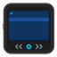
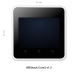

 

# Core2 v1.3

M5Stack · SKU **K010-V13** · revision v1.3 [1]

Every value below comes from [`board.json`](board.json), where each one carries the id of its source; the numbers in brackets point to the sources listed at the end of this page. This page is written from that file by [`_shared/emit_board_readme.py`](../_shared/emit_board_readme.py): change the file, then run the script.

Vendor links: [docs](https://docs.m5stack.com/en/core/Core2_v1.3) · [repository](https://github.com/m5stack/M5_Hardware/tree/master/Products/K010-V13_Core2_v1.3)

## Dimensions

| Width | Height | Depth | Weight |
| --- | --- | --- | --- |
| 54.0 mm | 54.0 mm | 16.5 mm | 58.8 g |

Product size and weight as the vendor's specification table gives them. Package 80.0 x 59.9 x 21.6 mm, gross weight 88.2 g. Operating temperature 0 to 60 °C. The base is held by hex countersunk M3 screws. [1] [16]

## Components

34 entries (43 parts counting quantities).

### Processing and memory

| Part | Role | Ref. | Qty | Key facts | Src |
| --- | --- | --- | --- | --- | --- |
| ESP32-D0WDQ6-V3 (Espressif) | soc | U7 | 1 | cores: 2; core: Xtensa 32-bit LX6; max clock mhz: 240; chip revision: v3.0 or v3.1; package: QFN48 6 x 6 mm; in package flash: none; in package psram: none; rom kb: 448; sram kb: 520; wifi: 802.11 b/g/n, 2.4 GHz; bluetooth: Bluetooth v4.2 BR/EDR and Bluetooth LE; lifecycle: NRND (Not Recommended for New Designs) in the datasheet v5.3 — CHIP_PU (pin 9) is the MCU_RST net, driven by the AXP192's PWROK, pulled up to MCU_VDD by R11 10 kohm with C17 1 uF to GND, and pulled low by the reset key S1. GPIO0 has R10 2.2 kohm to MCU_VDD. VDD_SDIO (pin 26) is decoupled by C44 1 uF; CAP1/CAP2 carry R29 20 kohm, C40 3.3 nF and C41 10 nF. GPIO37 (pin 6) is not connected. VDD_SDIO is 3.3 V from VDD3P3_RTC: R15 holds MTDI (GPIO12) low at reset, and the bench unit has no eFuse override (XPD_SDIO_FORCE not burned). The bench unit reads ESP32-D0WDQ6-V3 revision v3.1 (esptool, 2026-11-17). | [1] [2] [4] [14] |
| X252040MMB4SC | crystal | X2 | 1 | frequency mhz: 40; load capacitors: C3 and C4, 12 pF each; pins: 4 — The ESP32's main crystal. The schematic names the part only, not its frequency; 40 MHz was read from the chip by esptool on the bench unit (2026-11-17). | [2] [14] |
| XM25QH128BHIQ | flash | U1 | 1 | capacity mb: 16; interface: SPI (the ESP32's SPI flash pins); supply: MCU_VDD — Decoupled by C15 100 nF. | [1] [2] |
| ESPSRAM64H | psram | U2 | 1 | capacity mb: 8; interface: quad SPI, sharing data lines with the flash; supply: MCU_VDD — Decoupled by C16 100 nF. | [1] [2] |
| — | crystal | X1 | 1 | frequency hz: 32768; load capacitors: C32 and C33, 6 pF each | [2] |

### Power

| Part | Role | Ref. | Qty | Key facts | Src |
| --- | --- | --- | --- | --- | --- |
| AXP192 (X-Powers) | pmic | U4 | 1 | interface: I2C (TWSI); i2c address: 0x34; package: QFN48 6 x 6 mm; input voltage v: 2.9 to 6.3; charger: linear, integrated MOSFET, up to 1.4 A, CV target 4.1/4.15/4.2/4.36 V; charge current a: 0.219; fuel gauge: coulomb counter and 12-bit ADC (16 channels); dcdc1: 0.7 to 3.5 V in 25 mV steps, 1.2 A; on this board MCU_VDD; dcdc2: 0.7 to 2.275 V, 1.6 A; not used on this board (DCDC2 and LX2 open); dcdc3: 0.7 to 3.5 V in 25 mV steps, 0.7 A; on this board the LCD backlight (LCD_BL); ldo1: 30 mA, always on; on this board RTC_VDD; ldo2: 1.8 to 3.3 V in 100 mV steps, 200 mA; on this board PERI_VDD (LCD and microSD supply); ldo3: 1.8 to 3.3 V in 100 mV steps, 200 mA; on this board the vibration motor; backup battery charger: integrated; on this board charges the MS412FE RTC cell through BACKUP — Pin by pin from the core schematic: DCDC1 through L3 is MCU_VDD (test point TP2 'ESP_3V3'); LDO2 is PERI_VDD (TP3 'PERIPH_3V3'); LDO1 is RTC_VDD (TP5 'RTC_3V3'); IPSOUT/APS is IPS_BUS (TP4 'IPSOUT'), which also feeds VIN1-3 and LDOIN. GPIO0 (pin 19) drives BUS_PW_EN, the same net as N_VBUSEN (pin 6), which R5 10 kohm and C11 1 uF hold to GND. TS (pin 37) is tied to GND (no battery thermistor). N_OE (pin 4) is tied to GND. SYSEN (pin 29) is drawn on RTC_VDD. CHGLED (36), PWREN (27), GPIO3 (41), IRQ (48), N_RSTO (3) and the DCDC2 pins are not connected. BIAS has R4 200 kohm. The vendor table gives the charging current (0.219 A), the current after a full charge with the board off (0.055 A) and on (0.147 A). | [1] [2] [5] |
| SY7088 (Silergy) | regulator | U8 | 1 | topology: synchronous boost; input voltage v: 2.3 to 5.25; output voltage range v: 2.5 to 5.5; switching frequency mhz: 1; current limit a: 3; feedback reference v: 1.2; feedback divider: R30 15 kohm (OUT to FB), R31 4.7 kohm (FB to GND); output voltage v: 5.03; inductor: L4 2.2 uH — The 5 V boost (5V_BOOST block) from IPS_BUS to BUS_5V, enabled by the AXP192's EXTEN through R23 47 ohm, with R24 10 kohm from EN to GND. The output voltage is computed from the datasheet's VOUT = 1.2 V x (RH/RL + 1) and the schematic's divider; it is not a vendor-stated figure. | [2] [6] |
| MS412FE | battery | BT1 | 1 | nominal voltage v: 3; capacity mah: 1; chemistry: rechargeable micro lithium — The RTC backup cell on net RTC_BAT, charged by the AXP192's BACKUP pin (C10 1 uF). | [1] [2] |
| — | battery | — | 1 | nominal voltage v: 3.7; capacity mah: 500; chemistry: lithium — Built in. The vendor says the battery bottom must be removed to stack M5 modules. | [1] |

### Display and touch

| Part | Role | Ref. | Qty | Key facts | Src |
| --- | --- | --- | --- | --- | --- |
| — | display panel | LCD1 | 1 | type: IPS LCD; diagonal in: 2; resolution px: 320 / 240; connector: 10-pin (M5_CORE2_LCD_10P); interface: 4-line SPI with a data/command pin — VDD is decoupled by C53 100 nF; pins 1 and 10 are GND. | [1] [2] |
| — | display controller | — | 1 | part options: ILI9342C / ILI9342E; ili9342c manufacturer: Ilitek; ili9342c resolution: 320RGB x 240; ili9342c colors: 262K — The vendor lists 'ILI9342C / ILI9342E' and records a change of the LCD driver from ILI9342C to ILI9342E on 2026-08-07 (M5GFX 0.2.27 or later required). Which one a given unit carries depends on its build date, so no single part is given here. | [1] [11] |
| FT6336U (FocalTech) | touch controller | CTP1 | 1 | interface: I2C; i2c address: 0x38; panel: capacitive, 2.0 inch (CTP_2.0Inch); cipher register 0xA3: 0x64; focaltech id register 0xA8: 0x11 — The three dot-shaped touch zones on the front are part of this touch panel, mapped to three virtual buttons by software. The vendor notes that some screen edges can show touch non-linearity, fixed by a touch firmware update through M5Tool. The two register values were read on a Core2 v1.3. | [1] [2] [13] |

### Sensors and timekeeping

| Part | Role | Ref. | Qty | Key facts | Src |
| --- | --- | --- | --- | --- | --- |
| BM8563 | rtc | U5 | 1 | interface: I2C, up to 400 kbit/s; i2c address: 0x51; supply v: 1.5 to 5.5; sleep current ua typ: 0.25; interrupt: open drain; package options: SOP8, MSOP8 or TSSOP8 — Powered from RTC_VDD (AXP192 LDO1), decoupled by C20 100 nF. | [1] [2] [7] |
| BMI270 (Bosch Sensortec) | imu | U1 (expansion board) | 1 | axes: 3-axis accelerometer + 3-axis gyroscope; interface: I2C (CSB tied to VDDIO); i2c address: 0x68; supply v: VDD 1.71 to 3.6, VDDIO 1.2 to 3.6; package: LGA 14 pins, 2.5 x 3.0 mm, 0.83 mm high — On the rear expansion board, which reaches the core through the M5-Bus. v1.3 replaced the MPU6886 of the Core2 and Core2 v1.1 with this part. | [1] [3] [12] |

### Audio

| Part | Role | Ref. | Qty | Key facts | Src |
| --- | --- | --- | --- | --- | --- |
| SPM1423HM4H-B (Knowles) | microphone | U2 (expansion board) | 1 | type: MEMS, PDM digital output; supply v: 1.6 to 3.6; clock mhz: 1.0 to 3.25; sensitivity dbfs: -22; snr db a: 61.5; directivity: omnidirectional — On the rear expansion board. | [1] [3] [9] |
| NS4168 | audio amp | U6 | 1 | type: class D, mono, I2S digital input; output power: 2.5 W at VDD 5 V into 4 ohm; supply v: 3.0 to 5.5; sample rates khz: 8 to 96, detected automatically; channel select: CTRL at 0.9 to 1.15 V selects left, 1.5 V to VDD selects right; shutdown leakage ua: 1; package: eSOP-8 — Powered from MCU_VDD (C34 10 uF). | [1] [2] [8] |
| — | speaker | PAD1 | 1 | The built-in speaker on SPEAKER_PAD. Neither the schematic nor the vendor page gives its impedance or power. | [1] [2] |

### Input and indicators

| Part | Role | Ref. | Qty | Key facts | Src |
| --- | --- | --- | --- | --- | --- |
| — | led | LED1 | 1 | color: green; function: power indicator | [1] [2] |
| TS_015 | button | S1, S2 | 2 |  | [1] [2] |

### Radio and positioning

| Part | Role | Ref. | Qty | Key facts | Src |
| --- | --- | --- | --- | --- | --- |
| — | antenna | ANT1 | 1 | type: 2.4 GHz 3D antenna — The schematic also draws an IPEX footprint (ANT2), whose 0 ohm link R2 is not fitted (DNP); ANT1 is linked by R1 0 ohm. | [1] [2] |

### Connectors, storage and USB

| Part | Role | Ref. | Qty | Key facts | Src |
| --- | --- | --- | --- | --- | --- |
| CH9102F (WCH) | usb uart bridge | — | 1 | The vendor's specification table and product comparison give CH9102F (CH9102 driver); the linked core schematic shows a CP2104-F03-GMR. The Core2 v1.0 shipped with either a CP2104 or a CH9102, per the vendor's comparison table. The bench unit enumerates as USB 1a86:55d4 (WCH), product "USB Single Serial" (2026-11-17). | [1] [2] [15] |
| — | connector | J3 | 1 | type: USB Type-C, 16 pins; input: 5 V at 500 mA; fuse: FU1 1 A / 6 V on VBUS | [1] [2] |
| M1250V-04P | connector | J2 | 1 | type: 1.25 mm pitch, 4 pins (reserved USB line interface) | [1] [2] |
| M1250V-02P | connector | J5 | 1 | type: MX1.25, 2 pins (reserved battery interface, EXT.BATT) | [1] [2] |
| — | connector | J4 | 1 | type: HY2.0-4P (Grove), PORT.A; functions: I2C + I/O + UART | [1] [2] |
| — | connector | BUS1 | 1 | type: M5-Bus, 30 pins (2 x 15); pinout: 1: GND; 2: G35 (ADC); 3: GND; 4: G36 (ADC); 5: GND; 6: EN/RST; 7: G23 (MOSI); 8: G25 (DAC); 9: G38 (MISO); 10: G26 (DAC); 11: G18 (SCK); 12: 3.3V (MCU_VDD); 13: G3 (RXD0); 14: G1 (TXD0); 15: G13 (RXD2); 16: G14 (TXD2); 17: G21 (internal SDA); 18: G22 (internal SCL); 19: G32 (PORT.A SDA); 20: G33 (PORT.A SCL); 21: G27 (GPIO); 22: G19 (GPIO); 23: G2 (I2S_DOUT); 24: G0 (I2S_LRCK); 25: NC (HPWR on the schematic); 26: G34 (I2S_DATA); 27: NC (HPWR); 28: 5V (BUS_5V); 29: NC (HPWR); 30: BAT (SYS_VBAT) | [1] [2] |
| — | sd slot | J1 | 1 | type: microSD (TF) socket; mode: SPI | [1] [2] |

### Protection

| Part | Role | Ref. | Qty | Key facts | Src |
| --- | --- | --- | --- | --- | --- |
| SRV05-4 | esd | D3, D4, D5, D6, D7, D8 | 6 | Four-line ESD arrays, VCC on MCU_VDD: D3 to D7 on the M5-Bus GPIOs, D8 on the USB data pair and the bus EN/RST line. | [2] |

### Other parts

| Part | Role | Ref. | Qty | Key facts | Src |
| --- | --- | --- | --- | --- | --- |
| — | other | L4 | 1 | inductance uh: 2.2 — The SY7088's inductor, between IPS_BUS and LX. The schematic gives its value only. | [2] |
| SWPA3015S2R2MT | other | L2, L3 | 2 | The AXP192's buck inductors: L3 on DCDC1 (MCU_VDD), L2 on DCDC3 (LCD backlight). | [2] |
| 1027RFN01-33d (Dongguan Jusheng Acoustic Technology) | other | PAD2 | 1 | type: 1027 coin-type coreless DC vibration motor; rated voltage v: 3; operating voltage v: 2.5 to 3.6; rated current ma max: 80; rated speed rpm: 13000 +/- 3000 — Fed from the AXP192's LDO3 through R21 22 ohm, with D2 (1N4148) across it to GND as a flyback diode (VIB_MOTOR_PAD). The vendor warns that the motor interferes mechanically with Base series bases. | [1] [2] [10] |
| S8050 | other | Q1, Q2 | 2 | NPN pair driven by the bridge's DTR and RTS through R12/R13 10 kohm: Q1 pulls CHIP_PU (MCU_RST) low, Q2 pulls GPIO0 low through D1 (1N4148). | [2] |
| 1N4148 | other | D1, D2 | 2 | D1 sits in the auto-reset path to GPIO0; D2 is the vibration motor's flyback diode. | [2] |
| — | other | FU1 | 1 | rating: 1 A, 6 V — In series with the USB-C VBUS, ahead of USB_5V. | [2] |

## Connections

Each row is one fact of wiring, read from the component in the first column; a row without sources of its own takes its component's.

| From | To | Bus | Address | Pins | Pulls | Notes | Src |
| --- | --- | --- | --- | --- | --- | --- | --- |
| ESP32-D0WDQ6-V3 | X252040MMB4SC |  |  | XTAL_P (pin 45) → X2 through R3 51 ohm XTAL_N (pin 44) → X2 |  |  | [2] |
| ESP32-D0WDQ6-V3 | antenna ANT1 |  |  | LNA_IN (pin 2) → ANT1 through L1 (0 ohm) and R1 (0 ohm) |  | The pi network around L1 has C1 and C2 not fitted (DNP). | [2] |
| XM25QH128BHIQ | ESP32-D0WDQ6-V3 | SPI flash |  | CS# → GPIO11 SO → GPIO7 SCLK → GPIO6 SI → GPIO8 HOLD# → GPIO9 WP# → GPIO10 |  |  | [2] |
| ESPSRAM64H | ESP32-D0WDQ6-V3 | SPI PSRAM |  | SI/SIO0 → GPIO8 SO/SIO1 → GPIO7 SIO2 → GPIO10 SIO3 → GPIO9 SCLK → GPIO17 CS# → GPIO16 | CS#: up 5.1k to MCU_VDD (R9) |  | [2] |
| AXP192 | ESP32-D0WDQ6-V3 | internal I2C | 0x34 | SDA (pin 1) → GPIO21 SCK (pin 2) → GPIO22 PWROK (pin 5) → CHIP_PU (MCU_RST) | SDA (GPIO21): up 2.2k to MCU_VDD (R57) SCL (GPIO22): up 2.2k to MCU_VDD (R58) | R57 and R58 are the internal I2C bus pull-ups, shared by the AXP192, BM8563, FT6336U and BMI270. The AXP192's IRQ (pin 48) and N_RSTO (pin 3) are not connected. | [2] [1] |
| AXP192 | display panel LCD1 |  |  | DCDC3 (pin 17) → LED_A through R17 4.7 ohm (LCD_BL) LDO2 (pin 12) → VDD (PERI_VDD) GPIO4 (pin 42) → RST (LCD_RST) |  |  | [2] [1] |
| AXP192 | FT6336U |  |  | GPIO4 (pin 42) → RST (LCD_RST, shared with the LCD reset) |  |  | [2] [1] |
| AXP192 | sd slot J1 |  |  | LDO2 (pin 12) → VDD (PERI_VDD) |  |  | [2] |
| AXP192 | BM8563 |  |  | LDO1 (pin 28) → VDD (RTC_VDD) PWRON (pin 23) → INT through C30 10 uF (PWR_KEY) |  |  | [2] [1] |
| AXP192 | MS412FE |  |  | BACKUP (pin 30) → BT1 (RTC_BAT) |  |  | [2] |
| AXP192 | 1027RFN01-33d |  |  | LDO3 (pin 11) → motor + through R21 22 ohm (VIB_MOTOR) |  |  | [2] [1] |
| AXP192 | led LED1 |  |  | GPIO1 (pin 18) → LED cathode side (SYS_LED) |  |  | [2] [1] |
| AXP192 | NS4168 |  |  | GPIO2 (pin 20) → CTRL (SPK_EN) |  |  | [2] [1] |
| AXP192 | SY7088 |  |  | EXTEN (pin 40) → EN through R23 47 ohm (BST_EN) IPSOUT (pins 38, 39) / APS (pin 21) → IN (IPS_BUS) |  |  | [2] |
| AXP192 | connector J3 |  |  | ACIN (pins 32, 33) → USB_5V (after fuse FU1) |  |  | [2] |
| AXP192 | connector BUS1 |  |  | VBUS (pin 31) → 5V (BUS_5V) BAT (pins 34, 35) → BAT (SYS_VBAT) DCDC1 (pin 47) → 3.3V (MCU_VDD) |  |  | [2] |
| AXP192 | M1250V-02P |  |  | BAT (pins 34, 35) → pin 2 (SYS_VBAT) |  |  | [2] |
| AXP192 | TS_015 |  |  | PWRON (pin 23) → S2 (PWR_KEY) PWROK (pin 5) → S1 (MCU_RST) |  |  | [2] |
| SY7088 | connector BUS1 |  |  | OUT (pins 7, 8) → 5V (BUS_5V) |  |  | [2] |
| SY7088 | connector J4 |  |  | OUT (pins 7, 8) → 5V, pin 2 (BUS_5V) |  |  | [2] |
| BM8563 | ESP32-D0WDQ6-V3 | internal I2C | 0x51 | SDA (pin 5) → GPIO21 SCL (pin 6) → GPIO22 |  |  | [2] [1] |
| BM8563 | AXP192 |  |  | INT (pin 3) → PWRON through C30 10 uF (PWR_KEY) | INT: up 10k to IPS_BUS (R14) | The vendor pin map lists the RTC INT against AXP_PWR. CLKOUT (pin 7) is not connected. | [2] [1] |
| BM8563 | crystal X1 |  |  | OSCI (pin 1) → X1 OSCO (pin 2) → X1 |  |  | [2] |
| display panel LCD1 | ESP32-D0WDQ6-V3 | SPI (shared with the microSD slot) |  | MOSI (pin 2) → GPIO23 through R61 47 ohm MISO (pin 3) → GPIO38 through R62 47 ohm SCK (pin 4) → GPIO18 through R63 47 ohm CS (pin 5) → GPIO5 D/C (pin 7) → GPIO15 |  |  | [2] [1] |
| display panel LCD1 | AXP192 |  |  | RST (pin 6) → AXP192 GPIO4 (LCD_RST) LED_A (pin 9) → AXP192 DCDC3 through R17 4.7 ohm (LCD_BL) VDD (pin 8) → AXP192 LDO2 (PERI_VDD) | RST (LCD_RST): up 5.1k to PERI_VDD (R64) |  | [2] [1] |
| display controller | display panel LCD1 |  |  |  |  | The controller is inside the LCD module; its signals are the module connector's pins. | [1] [11] |
| FT6336U | ESP32-D0WDQ6-V3 | internal I2C | 0x38 | SDA (pin 3) → GPIO21 SCL (pin 4) → GPIO22 INT (pin 5) → GPIO39 |  | VDD (pin 1) is MCU_VDD through R65 4.7 ohm, decoupled by C54 4.7 uF. Pins 7 and 8 are not connected. No pull is drawn on INT. | [2] [1] |
| FT6336U | AXP192 |  |  | RST (pin 6) → AXP192 GPIO4 (LCD_RST, shared with the LCD reset) |  |  | [2] [1] |
| BMI270 | connector BUS1 | internal I2C (through the M5-Bus) | 0x68 | SDX (pin 14) → pin 17, G21 (IMU_SDA) SCX (pin 13) → pin 18, G22 (IMU_SCL) VDD/VDDIO (pins 8, 5) → pin 12, 3.3V (SYS_P033) | SDO (pin 1): down 10k (R1) | SDO pulled to GND selects address 0x68 (datasheet). INT1, INT2 and the auxiliary interface (ASDX, ASCX, OSDO, OCSB) are not connected. Decoupled by C2 and C3, 1 uF each. | [3] [12] |
| BMI270 | ESP32-D0WDQ6-V3 | internal I2C | 0x68 | SDA → GPIO21 SCL → GPIO22 |  |  | [1] |
| SPM1423HM4H-B | connector BUS1 | PDM (through the M5-Bus) |  | CLK (pin 4) → pin 24, G0 (MIC_CLK) DATA (pin 5) → pin 26, G34 (MIC_DAT) VCC (pin 6) → pin 12, 3.3V (SYS_P033) |  | SELECT (pin 2) is tied to GND. Decoupled by C1 1 uF. | [3] |
| SPM1423HM4H-B | ESP32-D0WDQ6-V3 |  |  | CLK → GPIO0 DATA → GPIO34 |  | GPIO0 is also the NS4168's LRCK. | [1] |
| NS4168 | ESP32-D0WDQ6-V3 | I2S |  | LRCK (pin 2) → GPIO0 BCLK (pin 3) → GPIO12 SDATA (pin 4) → GPIO2 | BCLK (GPIO12): down 5.1k (R15) SDATA (GPIO2): down 2.2k (R18) |  | [2] [1] |
| NS4168 | AXP192 |  |  | CTRL (pin 1) → AXP192 GPIO2 (SPK_EN) | CTRL (SPK_EN): up 5.1k to MCU_VDD (R20) |  | [2] [1] |
| NS4168 | speaker PAD1 |  |  | VOP (pin 8) → PAD1 pin 1 through R22 4.7 ohm VON (pin 5) → PAD1 pin 2 |  |  | [2] |
| led LED1 | AXP192 |  |  | cathode → AXP192 GPIO1 (SYS_LED) through R19 5.1 kohm | SYS_LED: up 5.1k to MCU_VDD (R16) | The anode is on MCU_VDD; the AXP192's GPIO1 sinks the current. | [2] |
| TS_015 | ESP32-D0WDQ6-V3 |  |  | S1 → CHIP_PU (MCU_RST) to GND |  | S1 is the reset key on the bottom edge. | [2] [1] |
| TS_015 | AXP192 |  |  | S2 → PWRON (PWR_KEY) to GND |  | S2 is the power key on the left edge: a click powers on, a long press powers off. | [2] [1] |
| CH9102F | ESP32-D0WDQ6-V3 | UART0 |  | TXD → GPIO3 (U0RXD) through R7 47 ohm RXD → GPIO1 (U0TXD) through R8 47 ohm DTR/RTS → CHIP_PU and GPIO0 through the Q1/Q2 auto-reset pair |  | Read from the core schematic the vendor links for v1.3, which is titled V1.0 and draws a CP2104-F03-GMR (U3) here: the UART nets, the 47 ohm series resistors and the auto-reset pair are taken from it, not from a CH9102F drawing. | [2] |
| CH9102F | connector J3 |  |  | D+/D- → SYS_DP/SYS_DM, through R54/R55 47 ohm and the D8 ESD array to USB_DP/USB_DM |  |  | [2] |
| connector J3 | external |  |  | VCC → USB_5V through FU1 DP1/DP2 (A6/B6) → USB_DP DN1/DN2 (A7/B7) → USB_DM | CC1 (A5): down 5.1k (R32) CC2 (B5): down 5.1k (R33) | USB_5V is decoupled by C52 22 uF and feeds the AXP192's ACIN and the bridge's VBUS/REGIN. | [2] |
| connector J3 | CH9102F |  |  | USB_DP/USB_DM → D+/D- (SYS_DP/SYS_DM) |  |  | [2] |
| M1250V-04P | external |  |  | 1 → USB VCC (before FU1) 2 → GND 3 → USB_DM 4 → USB_DP |  |  | [2] |
| M1250V-02P | external |  |  | 1 → GND 2 → SYS_VBAT |  |  | [2] |
| connector J4 | external |  |  | 1 (black) → GND 2 (red) → 5V (BUS_5V) 3 (yellow) → G32 (EXT_G32) 4 (white) → G33 (EXT_G33) |  |  | [2] [1] |
| connector J4 | ESP32-D0WDQ6-V3 | external I2C |  | pin 3 → GPIO32 through R47 47 ohm pin 4 → GPIO33 through R48 47 ohm | GPIO32: up 5.1k to MCU_VDD (R60) GPIO33: up 5.1k to MCU_VDD (R59) | The M5-Bus names G32 EXT_SDA and G33 EXT_SCL. | [2] [1] |
| connector BUS1 | ESP32-D0WDQ6-V3 |  |  | every Gnn pin → GPIOnn through a 47 ohm series resistor (R34 to R53) 6 (EN/RST) → CHIP_PU (MCU_RST) through R56 47 ohm |  | Each bus signal passes a 47 ohm resistor and an SRV05-4 ESD array (D3 to D8) on its way to the ESP32. | [2] |
| connector BUS1 | external |  |  |  |  | The far side is the stacked base; on this board the rear expansion board (BMI270 and microphone) sits on it. | [3] [1] |
| sd slot J1 | ESP32-D0WDQ6-V3 | SPI (shared with the LCD) |  | DAT0/MISO (pin 7) → GPIO38 DAT3/CS (pin 2) → GPIO4 CLK/SCK (pin 5) → GPIO18 CMD/MOSI (pin 3) → GPIO23 | DAT0/MISO: up 10k to PERI_VDD (R25) DAT3/CS: up 10k to PERI_VDD (R26) CLK/SCK: up 10k to PERI_VDD (R27) CMD/MOSI: up 10k to PERI_VDD (R28) | DAT1, DAT2 and Detect are not connected. VDD is PERI_VDD (AXP192 LDO2), decoupled by C38 100 nF. | [2] [1] |

## Not on this board

| Role | Notes | Src |
| --- | --- | --- |
| audio codec | Audio is an I2S amplifier and a PDM microphone, both wired to the ESP32 directly. | [2] [3] |
| keyboard controller |  | [2] [3] [1] |
| io expander |  | [2] [3] |
| magnetometer |  | [2] [3] |
| buzzer | Sound comes from the speaker only. | [2] [1] |
| ir led |  | [2] [3] [1] |
| gps |  | [2] [3] [1] |
| lora |  | [2] [3] [1] |

## Notes

The board is two PCBs: the core (ESP32, AXP192, LCD, touch, RTC, speaker amplifier, microSD, USB) and a rear expansion board on the M5-Bus that carries the BMI270 and the PDM microphone. The vendor links one schematic per board; the core one is titled 'CORE2_V1.0_SCH' (printed 2020-07-07) and the expansion one 'core2_v1.3_SCH' (printed 2025-11-14). Where the v1.0 core drawing and the v1.3 specification table differ (the USB-UART bridge), both are recorded. Power nets: MCU_VDD (AXP192 DCDC1, 3.3 V by its test point label 'ESP_3V3' and the M5-Bus pin '3.3V'), PERI_VDD (LDO2), RTC_VDD (LDO1), IPS_BUS (IPSOUT), BUS_5V (the SY7088 boost, also the AXP192's VBUS), USB_5V (USB-C after FU1, the AXP192's ACIN), SYS_VBAT (battery). Test points TP1 to TP7: GND, ESP_3V3, PERIPH_3V3, IPSOUT, RTC_3V3 (twice, on RTC_VDD and PWR_KEY) and VB (SYS_VBAT). Certifications per the vendor: CE, MIC, FCC, RCM and IEC 62133.

## Sources

1. [Core2 v1.3 (K010-V13), M5Stack documentation](https://docs.m5stack.switch-science.com/en/core/Core2_v1.3) — vendor docs, checked 2026-11-16 (`m5-docs`); read at a mirror of <https://docs.m5stack.com/en/core/Core2_v1.3>. Read at Switch Science's mirror of docs.m5stack.com: the original host timed out from the machine that wrote this file on 2026-11-16. The page gives the description, the specification table, the pin map, the M5-Bus table, the version change (ILI9342C to ILI9342E on 2026-08-07) and the comparison with the Core2 and Core2 v1.1.
2. [Core2 core section schematic, CORE2_V1.0_SCH (one A4 sheet, printed 2020-07-07)](https://web.archive.org/web/20260825073713/https://m5stack-doc.oss-cn-shenzhen.aliyuncs.com/644/CORE2_V1.0_SCH.pdf) — schematic, checked 2026-11-16 (`core-sch`); read at a mirror of <https://m5stack-doc.oss-cn-shenzhen.aliyuncs.com/644/CORE2_V1.0_SCH.pdf>; found through [1]. Linked by the docs page as 'Core2 v1.3 Core Section Schematics PDF'. Read at the Internet Archive's copy of 2026-08-25: the vendor's file host timed out from this machine. Its USB-UART bridge is a CP2104-F03-GMR, where the v1.3 specification table says CH9102F.
3. [Core2 v1.3 expansion board schematic, core2_v1.3_SCH (one A4 sheet, printed 2025-11-14)](https://web.archive.org/web/20260717144432/https://m5stack-doc.oss-cn-shenzhen.aliyuncs.com/486/core2_v1.3_SCH_2025_11_14_09_40_33.pdf) — schematic, checked 2026-11-16 (`ext-sch`); read at a mirror of <https://m5stack-doc.oss-cn-shenzhen.aliyuncs.com/486/core2_v1.3_SCH_2025_11_14_09_40_33.pdf>; found through [1]. Linked by the docs page as 'Core2 v1.3 Expansion Board Section Schematics PDF'. Read at the Internet Archive's copy of 2026-07-17: the vendor's file host timed out from this machine.
4. [ESP32 Series Datasheet, version 5.3 (Espressif)](https://www.espressif.com/sites/default/files/documentation/esp32_datasheet_en.pdf) — datasheet, checked 2026-11-16 (`esp32-ds`).
5. [AXP192 datasheet, revision 1.1 (X-Powers), as M5Stack keeps it on GitHub](https://github.com/m5stack/M5-Schematic/blob/master/Core/AXP192%20Datasheet_v1.1_en_draft_2211.pdf) — datasheet, checked 2026-11-16 (`axp192-ds`). The docs page links an AXP192 datasheet on the vendor's file host, which timed out from this machine; this is the same part's English datasheet in the vendor's schematic repository.
6. [SY7088 synchronous boost regulator datasheet (Silergy), as M5Stack hosts it](https://web.archive.org/web/20260831051721/https://m5stack.oss-cn-shenzhen.aliyuncs.com/resource/docs/datasheet/core/SY7088-Silergy.pdf) — datasheet, checked 2026-11-16 (`sy7088-ds`); read at a mirror of <https://m5stack.oss-cn-shenzhen.aliyuncs.com/resource/docs/datasheet/core/SY7088-Silergy.pdf>; found through [1].
7. [BM8563 real-time clock datasheet V1.1 (Chinese), as M5Stack hosts it](https://web.archive.org/web/20261031011628/https://m5stack.oss-cn-shenzhen.aliyuncs.com/resource/docs/datasheet/core/BM8563_V1.1_cn.pdf) — datasheet, checked 2026-11-16 (`bm8563-ds`); read at a mirror of <https://m5stack.oss-cn-shenzhen.aliyuncs.com/resource/docs/datasheet/core/BM8563_V1.1_cn.pdf>; found through [1]. Gives the I2C address as 0A2H (write) / 0A3H (read), the 7-bit address 0x51.
8. [NS4168 I2S class D amplifier datasheet (Chinese), as M5Stack hosts it](https://web.archive.org/web/20260910203533/https://m5stack.oss-cn-shenzhen.aliyuncs.com/resource/docs/datasheet/core/NS4168_CN_datasheet.pdf) — datasheet, checked 2026-11-16 (`ns4168-ds`); read at a mirror of <https://m5stack.oss-cn-shenzhen.aliyuncs.com/resource/docs/datasheet/core/NS4168_CN_datasheet.pdf>; found through [1].
9. [SPM1423HM4H-B digital microphone specification, revision A (Knowles), as M5Stack hosts it](https://web.archive.org/web/20260917142323/https://m5stack.oss-cn-shenzhen.aliyuncs.com/resource/docs/datasheet/core/SPM1423HM4H-B_datasheet_en.pdf) — datasheet, checked 2026-11-16 (`spm1423-ds`); read at a mirror of <https://m5stack.oss-cn-shenzhen.aliyuncs.com/resource/docs/datasheet/core/SPM1423HM4H-B_datasheet_en.pdf>; found through [1].
10. [1027RFN01-33d vibration motor specification 1.0 (Dongguan Jusheng Acoustic Technology), as M5Stack hosts it](https://web.archive.org/web/20260318095447/https://m5stack.oss-cn-shenzhen.aliyuncs.com/resource/docs/datasheet/core/1027RFN01-33d.pdf) — datasheet, checked 2026-11-16 (`motor-ds`); read at a mirror of <https://m5stack.oss-cn-shenzhen.aliyuncs.com/resource/docs/datasheet/core/1027RFN01-33d.pdf>; found through [1].
11. [ILI9342C a-Si TFT LCD single chip driver datasheet (Ilitek), as M5Stack hosts it](https://web.archive.org/web/20260910203533/https://m5stack.oss-cn-shenzhen.aliyuncs.com/resource/docs/datasheet/core/ILI9342C-ILITEK.pdf) — datasheet, checked 2026-11-16 (`ili9342c-ds`); read at a mirror of <https://m5stack.oss-cn-shenzhen.aliyuncs.com/resource/docs/datasheet/core/ILI9342C-ILITEK.pdf>; found through [1].
12. [BMI270 datasheet, BST-BMI270-DS000-05 (Bosch Sensortec), as M5Stack hosts it](https://web.archive.org/web/20261025084801/https://m5stack.oss-cn-shenzhen.aliyuncs.com/resource/docs/datasheet/core/K128%20CoreS3/BMI270.PDF) — datasheet, checked 2026-11-16 (`bmi270-ds`); read at a mirror of <https://m5stack.oss-cn-shenzhen.aliyuncs.com/resource/docs/datasheet/core/K128%20CoreS3/BMI270.PDF>; found through [1].
13. FT6336U identity registers read on a Core2 v1.3 (Kleidos register introspection) — measured, checked 2026-11-16 (`kleidos-regread`). Register reads over I2C from the board's own ESP32 with the Kleidos debug firmware (REGR ft6x36 0xA3 and 0xA8), recorded in the Kleidos repository at docs/hardware/introspection/ft6x36.md.
14. ESP32, crystal, flash ID and VDD_SDIO eFuses read on the Kleidos bench Core2 v1.3 (probe P01) — measured, checked 2026-11-17 (`bench-esptool`). esptool.py and espefuse.py 4.11.0, read only over the board's USB-C (chip_id, flash_id, espefuse summary); recorded in schematic/bench/2026-11-17-esptool-chip-flash-efuse.md.
15. USB device descriptor of the Kleidos bench Core2 v1.3 (probe P02) — measured, checked 2026-11-17 (`bench-usb`). The host's listing of the board's USB device descriptor on its USB-C; recorded in schematic/bench/2026-11-17-usb-descriptor.md.
16. Verified against the owner's physical unit, 2026-11-18 — measured, checked 2026-11-18 (`owner-unit-verified`). The owner compared his own Core2 v1.3 with this repository's front drawing (svg/front.svg) and 3D model (model/) on 2026-11-18: the model and the drawing match the real board. A check by eye, no instrument. The original source of the measurement was not recorded (sources.md).

## In this folder

- [`board.json`](board.json): every part on the board, each value with its source ([`_shared/board.schema.json`](../_shared/board.schema.json)); this page is written from it.
- [`measurements.json`](measurements.json): the case, display, button and keyboard geometry the front is drawn against ([`_shared/schema.md`](../_shared/schema.md)).
- [`sources.md`](sources.md): the vendor drawings, photos and CAD files the measurements were taken on.
- [`icon.svg`](icon.svg): a 64 px pictogram of the board.
- [`svg/front.svg`](svg/front.svg): the front at 1 unit = 1 mm: the screen's active area, a press target for every control and each printed legend as a group of its own.
- [`svg/back.svg`](svg/back.svg): the back, seen from behind, with what it prints.
- [`svg/top.svg`](svg/top.svg): the top face and what it prints.
- [`model/m5stack-core2-v13.glb`](model/m5stack-core2-v13.glb): the 3D model, glTF 2.0 at 1 unit = 1 mm, every print kept.
- [`model/m5stack-core2-v13-web.glb`](model/m5stack-core2-v13-web.glb): its web level of detail.
- [`model/spec.json`](model/spec.json): the recipe both are built from.
- [`model/source.json`](model/source.json): the master's provenance.
- [`model/web.json`](model/web.json): the web level's record.
- [`schematic/m5stack-core2-v13.pdf`](schematic/m5stack-core2-v13.pdf): the connectivity schematic, made to be followed by clicking.
- [`schematic/README.md`](schematic/README.md): the schematic's sources, its Kleidos additions and corrections, and its open questions.
- [`schematic/netlist.yaml`](schematic/netlist.yaml): every part, pin and net of the schematic with its source.
- [`schematic/improvements.md`](schematic/improvements.md): the triage behind the additions and corrections.
- [`schematic/bench/`](schematic/bench/): the bench probe records.

How the drawings, models and schematics are made, and which script writes each file: [`docs/models-and-drawings.md`](../docs/models-and-drawings.md).
