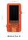

 

# StickC-Plus SE

M5Stack · SKU **K016-P-SE** [1]

Every value below comes from [`board.json`](board.json), where each one carries the id of its source; the numbers in brackets point to the sources listed at the end of this page. This page is written from that file by [`_shared/emit_board_readme.py`](../_shared/emit_board_readme.py): change the file, then run the script.

Vendor links: [docs](https://docs.m5stack.com/en/core/StickC-Plus_SE) · [shop](https://shop.m5stack.com/products/m5stickc-plus-se-mini-iot-dev-kit-esp32-pico) · [repository](https://github.com/m5stack/M5StickC-Plus-SE-Factory)

## Dimensions

| Width | Height | Depth | Weight |
| --- | --- | --- | --- |
| 24.0 mm | 48.0 mm | 8.4 mm | 17.0 g |

Width, height, depth and weight are the docs page's product size (48.0 x 24.0 x 8.4 mm) and product weight (17.0 g); the package is 104.4 x 65.0 x 18.0 mm and 25.3 g gross. The vendor's own dimension drawing of the SE (K016-P-SE model size) dimensions the case 13.52 mm deep, the depth measurements.json uses; the 8.4 mm of the docs page matches no dimension on that drawing. The enclosure is translucent orange with a magnetic back. [1] [3]

## Components

24 entries (45 parts counting quantities).

### Processing and memory

| Part | Role | Ref. | Qty | Key facts | Src |
| --- | --- | --- | --- | --- | --- |
| ESP32-PICO-D4 (Espressif Systems) | soc | — | 1 | type: System-in-Package built on the ESP32; cpu: Xtensa dual-core 32-bit LX6, up to 240 MHz; rom kb: 448; sram kb: 520; in package flash: 4 MB, Quad SPI; in package psram: none; in package other: crystal oscillator, filter capacitors, SPI flash and RF matching circuit; wifi: 802.11 b/g/n, 2.4 GHz (2412-2484 MHz); bluetooth: v4.2 BR/EDR and Bluetooth LE; gpio: up to 34, 5 of them strapping pins; supply v: 3.0-3.6; operating temperature c: -40 to 85; package mm: 7.0 x 7.0 x 0.94; chip revision: v1.0 or v1.1 (Espressif upgraded the ESP32 die from v1.0 to v1.1, PCN20220901); v1.1 on the unit measured; lifecycle: Not Recommended for New Designs (Espressif); supply net: VESP_3V3 on VDDA (pins 1, 43, 46), VDD3P3_CPU (37) and VDDA3P3 (3), decoupled by C38, C39, C41, C42 (100 nF each) and C44 (10 uF). VDD3P3_RTC (19) and VDDA3P3 (4) are drawn on their own nets with C40 and C43 (100 nF): their wires cross the VESP_3V3 bar with no junction dot. Pin 19 is certainly supplied, since VDD_SDIO, the in-package flash's supply, is powered from it (the MTDI strap reads low at reset); neither pin's rail is settled (schematic/README.md, Open questions); vdd sdio: pin 26, not connected on the board: the in-package flash's supply, powered from VDD3P3_RTC rather than the internal 1.8 V LDO because the MTDI strap (IO12, pin 18, unconnected, internal pull-down) reads low at reset, unless the eFuse EFUSE_SDIO_FORCE overrides it; unconnected gpio: IO4, IO12, IO14 and IO19 reach nothing on the board; IO6, IO7, IO8, IO11, IO16 and IO17 are the in-package flash's lines (Espressif's Table 3), crossed out on the schematic because nothing outside the package uses them; strapping pins: GPIO0 (internal pull-up, R12 1 kOhm up), GPIO2 (internal pull-down), MTDI/IO12 (internal pull-down), MTDO/IO15 (LCD_MOSI, internal pull-up), GPIO5 (LCD_CS, internal pull-up); input only gpio: GPIO34 to GPIO39, with no internal pulls; no resistor on the board pulls GPIO36 (pad PAD4) or GPIO38 (pad PAD3); whether GPIO25 meets GPIO36 at the Hat-Bus header is not yet measured — The schematic leaves the module's designator unassigned ("U?", value PICO_D4). The chip revision v1.1 was read from the one SE unit the Kleidos project has; the docs page lists only "2.4 GHz Wi-Fi" and does not mention Bluetooth, which comes from Espressif's datasheet. | [1] [2] [4] [10] |
| — | flash | — | 1 | capacity mb: 4; interface: Quad SPI; location: inside the ESP32-PICO-D4 package — Espressif's datasheet does not name the flash die. | [1] [4] |
| — | crystal | Y1 | 1 | frequency hz: 32768; load capacitance pf: 6; load capacitors: C12 and C9, 6 pF each — The schematic gives the value as "32.768/6PF". The ESP32's own crystal is inside the ESP32-PICO-D4 package. | [2] [4] |

### Power

| Part | Role | Ref. | Qty | Key facts | Src |
| --- | --- | --- | --- | --- | --- |
| AXP192 (X-Powers) | pmic | U2 | 1 | function: single-cell Li-ion power management: Intelligent Power Select between ACIN, VBUS and the battery, linear charger, 3 buck converters, 4 LDOs, 12-bit ADC, coulomb counter; interface: I2C (the datasheet's TWSI); i2c address: 0x34; operating voltage v: 2.9-6.3; charger: built-in MOSFET, up to 1.4 A, 4.1 / 4.15 / 4.2 / 4.36 V targets, 0.5 % accuracy; adc: 16 channels, 12-bit; fuel gauge: coulomb counter; backup battery charger: yes; inputs: ACIN (pins 32, 33) on VBUS_VIN; VBUS (pin 31) on VBUS_USB; battery pins: BAT (pins 34, 35) on VBAT_Li_Ion, C3 10 uF; TS (pin 37) tied to GND; ipsout: IPSOUT (pins 38, 39), the system rail, decoupled by C24 and C30 (100 nF) and C23 (10 uF) plus CX2 (10 uF / 6.3 V); APS (pin 21) and LDOIN (pin 13) on IPSOUT, C13 220 nF on APS; dcdc1: DCDC1 (pin 47) -> VESP_3V3, the 3.3 V rail of the SoC and the pull-ups; LX1 (pin 45) through L2 2.2 uH; VIN1 (pin 44) on IPSOUT; output caps C5 10 uF and CX1 100 uF / 4 V. Datasheet range 0.7-3.5 V, 1.2 A; dcdc2: unused: DCDC2 (pin 10) and LX2 (pin 8) open, VIN2 (pin 7) on IPSOUT; dcdc3: unused: DCDC3 (pin 17) and LX3 (pin 15) open, VIN3 (pin 14) on IPSOUT; ldo1: LDO1 (pin 28) -> RTC_VDD, the BM8563's supply. Datasheet: 30 mA, always on; ldo2: LDO2 (pin 12) -> LCD_BL_VCC, the backlight (LEDA); C15 1 uF. Datasheet: 1.8-3.3 V in 100 mV steps, 200 mA; ldo3: LDO3 (pin 11) -> LCD_LOGIC_VCC, the panel's logic supply; C20 1 uF. Datasheet: 1.8-3.3 V in 100 mV steps, 200 mA; ldoio0: GPIO0 (pin 19) -> MIC_VCC, the microphone's supply; C8 1 nF. Datasheet: LDOIO0 1.8-3.3 V in 100 mV steps, 50 mA; exten: EXTEN (pin 40) -> EXT_BOOST_EN, the enable of the 5 V boost; pwron: PWRON (pin 23) on PWR_KEY, the power button; backup: BACKUP (pin 30) on VBAT_RTC; bias and references: BIAS (pin 24) R5 200 kOhm to GND; VREF (pin 25) C16 1 uF; VINT (pin 26) C10 1 uF; fixed levels: N_OE (pin 4) tied to GND; open pins: N_RSTO (3), CHGLED (36), PWREN (27), GPIO1 (18), GPIO2 (20), GPIO3 (41), GPIO4 (42), NC (43); sysen: SYSEN (pin 29) is drawn on the RTC_VDD net; ground: PGND1 (46), PGND2 (9), PGND3 (16), AGND (22) and the exposed PAD (49) to GND; n vbusen: N_VBUSEN (pin 6) on GPIO27, R21 10 kOhm to GND: low lets VBUS supply IPSOUT, high shuts VBUS out (with REG30H bit 7 = 0); confirmed on the bench unit on 2026-11-17 — One chip holds the board's charger, fuel gauge and four of its five rails (DCDC1, LDO1, LDO2, LDO3, LDOio0); the fifth, the 5 V EXT_VDD, is the SGM6603 boost it enables. The docs page's power map agrees: LDO1 = RTC_VDD, LDO2 = LCD_BL, LDO3 = LCD_LOGIC_VCC, GPIO0 = MIC_VCC, EXT_EN = Grove 5 V boost enable, PWRON = power key. VBUS_VIN and VBUS_USB accept 4.8-5.5 V, and with VBUS present the AXP192 charges the battery (docs page). | [1] [2] [5] [11] [15] |
| SGM6603-5.0 | regulator | U8 | 1 | topology: boost: L4 4.7 uH from IPSOUT to SW (pin 1); input: IN (pin 6) on IPSOUT; output: OUT (pin 5) -> EXT_VDD; the schematic block is titled 5VOUT_BOOST and the part is the -5.0 variant; enable: EN (pin 3) on EXT_BOOST_EN, from the AXP192's EXTEN; feedback: NC/FB (pin 4) open; output capacitors: C36 100 nF, C45 10 uF, C46 10 uF; ground: GND (pin 2) — Its datasheet could not be fetched from the maker's site (HTTP 403), so only what the schematic draws is recorded. | [2] |
| — | battery | — | 1 | chemistry: lithium (the docs page's wording); the schematic's connector reads Li_Ion; nominal v: 3.7; capacity mah: 120; connector: 2-pin, labeled Li_Ion: pin 1 VBAT_Li_Ion, pin 2 GND — Built in. | [1] [2] |
| DMS_3R3 | battery | BAT1 | 1 | function: backup supply on VBAT_RTC, the AXP192's BACKUP input; connector: pin 1 VBAT_RTC, pin 2 GND — The part is written as the schematic prints it; the schematic gives no capacity or chemistry, and the docs page's specifications list no backup cell. | [2] |

### Display and touch

| Part | Role | Ref. | Qty | Key facts | Src |
| --- | --- | --- | --- | --- | --- |
| — | display panel | U5 | 1 | technology: IPS TFT LCD, color; diagonal in: 1.14; resolution px: 135 / 240; interface: SPI, written only: SCK, MOSI, RS (data/command), CS and RESET; no read line is drawn; supplies: LEDA (pin 1) on LCD_BL_VCC with C18 1 uF to GND; VDD (pin 7) on LCD_LOGIC_VCC; ground: GND (pin 2) and PAD — The schematic labels the module "LCD" in a block titled IPS_LCD and gives no panel part number. | [1] [2] |
| ST7789V2 (Sitronix) | display controller | — | 1 | function: single-chip TFT-LCD controller and driver with on-chip frame memory; max resolution: 240 RGB x 320; frame memory bits: 1382400; colors: 262K (RGB 666) max; pixel formats: 12-bit (444), 16-bit (565), 18-bit (666); interfaces: 8080 parallel (8/9/16/18-bit), RGB, SPI (3-line and 4-line serial); vddi v: 1.65-3.3; vdd v: 2.4-3.3 — The docs page names the panel's driver "ST7789v2" and links a datasheet titled ST7789V (Version 1.0, 2013-10); the figures here come from that datasheet. | [1] [8] |

### Sensors and timekeeping

| Part | Role | Ref. | Qty | Key facts | Src |
| --- | --- | --- | --- | --- | --- |
| BM8563 (Belling) | rtc | U4 | 1 | function: real-time clock and calendar with alarm, timer, programmable clock output and power-fail detector; interface: I2C, up to 400 kbit/s; i2c address: 0x51; i2c address 8bit: write 0xA2, read 0xA3; supply v: 1.5-5.5; sleep current ua typical: 0.25 at VDD 3.0 V, 25 C; interrupt output: open drain; clock out frequencies: 32.768 kHz, 1024 Hz, 32 Hz, 1 Hz; supply: VDD (pin 8) on RTC_VDD (AXP192 LDO1), C11 1 uF; clkout: CLKOUT (pin 7) open; oscillator: OSCI (pin 1) and OSCO (pin 2) to Y1, with C12 and C9 (6 pF each) | [1] [2] [6] [14] |

### Audio

| Part | Role | Ref. | Qty | Key facts | Src |
| --- | --- | --- | --- | --- | --- |
| SPM1423HM4H-B (Knowles) | microphone | U3 | 1 | type: digital MEMS microphone, PDM output (1/2-cycle PDM); supply v: 1.6-3.6; current ua max: 600; sleep current ua typical: 25; sensitivity dbfs: -22 typical (94 dB SPL at 1 kHz); snr db a: 61.5; clock mhz: 1.0-3.25; directivity: omnidirectional; operating temperature c: -40 to 100; channel select: SELECT (pin 2) tied to GND; supply: VCC (pin 6) on MIC_VCC, C7 1 uF | [1] [2] [7] |
| — | buzzer | — | 1 | type: passive — The docs page lists an onboard passive buzzer on G2 (output). The schematic draws no buzzer part: there GPIO2 reaches only the module's IO2 (pin 22) and pad PAD2. On the bench unit GPIO2 has no DC load (a released level holds for 7 s) and a 2.7 kHz tone changes the board's draw by nothing resolvable; whether it drives a sounder was not heard (2026-11-17). | [1] [16] |

### Input and indicators

| Part | Role | Ref. | Qty | Key facts | Src |
| --- | --- | --- | --- | --- | --- |
| — | ir led | LED1 | 1 | function: infrared transmitter; drive: anode on VESP_3V3, cathode on GPIO9: lit while GPIO9 is low; series resistor: none; esd: D6 on GPIO9 — The schematic labels it LED_IR and draws no resistor in series with it. | [1] [2] |
| — | led | LED2 | 1 | color: red; function: status indicator; drive: anode on VESP_3V3, cathode on GPIO10: lit while GPIO10 is low; series resistor: none; esd: D7 on GPIO10 — The schematic labels it LED_RED and draws no resistor in series with it. | [1] [2] |
| TS_015 | button | S1, S2 | 2 | S1: POWER: PWR_KEY to GND when pressed; ESD diode D13 on PWR_KEY; S2: BUTTONB: GPIO39 to GND when pressed; ESD diode D8 on GPIO39 — The part is written as the schematic prints it. The docs page's features also name a reset button; the schematic draws no reset switch beyond these three, and its pin map gives button B as G39. | [1] [2] |
| PTS_820 | button | S3 | 1 | S3: BUTTONA: GPIO37 to GND when pressed; no ESD diode drawn — The part is written as the schematic prints it; the docs page's pin map gives button A as G37. | [1] [2] |

### Radio and positioning

| Part | Role | Ref. | Qty | Key facts | Src |
| --- | --- | --- | --- | --- | --- |
| — | antenna | E1 | 1 | type: 2.4 GHz 3D antenna; matching: pi network from LNA_IN: C2 1.5 pF to GND, L1 1.8 nH (HQ) in series, C1 1.2 pF to GND | [1] [2] |

### Connectors, storage and USB

| Part | Role | Ref. | Qty | Key facts | Src |
| --- | --- | --- | --- | --- | --- |
| CH552T | usb uart bridge | U6 | 1 | usb: P3.6 (pin 14) on USB_DP, P3.7 (pin 15) on USB_DM; supply: VCC (pin 19) and P3.2 (pin 1) on VBUS_USB with C27 100 nF; V33 (pin 20), the internal USB regulator's output, on its own net with C25 100 nF only, as the datasheet requires with VCC above 3.6 V; ground: GND (pin 18); used pins: P1.7 (pin 5) CH552_GP0_CTRL, P1.0 (pin 7) CH552_EN_CTRL, P3.1 (pin 9, TXD) CH552_TXD, P3.0 (pin 10, RXD) CH552_RXD; open pins: P1.4, P1.5, P1.6, RST, P1.1, P1.2, P1.3, P3.3, P3.4, P3.5 (pins 2-4, 6, 8, 11-13, 16, 17); usb ids seen: 0403:6001 (the FTDI FT232 vendor and product IDs); host driver: FTDI VCP (the docs page's USB driver section); baud rates: 1200-115200, 250000, 500000, 750000, 1500000; for downloads 1500000, 750000, 500000, 250000 or 115200 — The schematic prints pin 10 as "P3.2", the same name as pin 1; WCH's datasheet names it P3.0 (RXD), as its net CH552_RXD fits. The USB IDs were read from the unit measured; the docs page has the host install FTDI's driver and calls the device "M5Stack" or "USB Serial" when unrecognized. | [1] [2] [10] [12] |
| — | connector | J2 | 1 | type: USB Type-C receptacle; vbus: VBUS_USB, C4 10 uF to GND; cc: CC1 (A5) and CC2 (B5) each pulled down by 5.1 kOhm; data: DP1/DP2 (A6, B6) on USB_DP, DN1/DN2 (A7, B7) on USB_DM; ESD diodes D3, D4; input rating: 5 V at 500 mA (docs page input voltage); vbus range v: 4.8-5.5 — The schematic gives the part as "TYPEC". | [1] [2] |
| HY2.0-4P | connector | J1 | 1 | name: PORT.CUSTOM (Grove); pin 1: GND (black); pin 2: 5V, EXT_VDD (red); C37 10 uF to GND; pin 3: GPIO32 (yellow); ESD diode D1; pin 4: GPIO33 (white); ESD diode D2 | [1] [2] |
| — | connector | — | 1 | type: 2.54 mm pitch, 8 pins (the docs page: "Hat-Bus 2.54-8P"); pin 1: GND; pin 2: 5V_OUT; pin 3: G26; pin 4: G36/G25 (the docs page's pin list says G36; its note and the back label say G36 and G25 share the pin); pin 5: G0; pin 6: BAT; pin 7: 3V3; pin 8: 5V_IN — Pin list from the docs page, which also warns that G36 and G25 share one port: when one is used the other must be set as a floating input. The schematic draws no 8-pin header, only the pads PAD1-PAD10; seven of the header's cells match a pad by name, the BAT cell has none, and which pad meets which pin (and that PAD4 and PAD10 meet at pin 4) is not drawn and not yet measured. | [1] |
| — | connector | PAD1-PAD10 | 10 | PAD1: 3V3, VESP_3V3; PAD2: GPIO2; PAD3: GPIO38; PAD4: GPIO36, as GPIO36_EXT; PAD5: GPIO0, as GPIO0_EXT; PAD6: VIN, VBUS_VIN; PAD7: 5VOUT, EXT_VDD; PAD8: GND; PAD9: GPIO26, as GPIO26_EXT; PAD10: GPIO25 — The pad names and nets are the schematic's. Which pad meets which pin of the Hat-Bus header is not drawn. | [2] |

### Protection

| Part | Role | Ref. | Qty | Key facts | Src |
| --- | --- | --- | --- | --- | --- |
| — | esd | D1-D4, D6-D8, D13-D16 | 11 | value: ESD/3.3V; D1: GPIO32 (Grove); D2: GPIO33 (Grove); D3: USB_DP (USB-C); D4: USB_DM (USB-C); D6: GPIO9 (IR LED); D7: GPIO10 (red LED); D8: GPIO39 (button B); D13: PWR_KEY (power button); D14: GPIO26; D15: GPIO0; D16: GPIO36 — Every diode goes from its signal to GND, with the value printed as "ESD/3.3V" and no part number. Read at full resolution, D3 sits on USB_DP and D4 on USB_DM. | [2] |

### Other parts

| Part | Role | Ref. | Qty | Key facts | Src |
| --- | --- | --- | --- | --- | --- |
| CJ2302 | other | MOS1, MOS2 | 2 | type: N-channel MOSFET (schematic symbol); MOS2: switches ESP32_EN (through R109 2.2 kOhm) to CH552_EN_CTRL; gate on a VBUS_USB divider, R101 1 kOhm over R102 1 kOhm to GND; MOS1: switches GPIO0 (through R108 22 Ohm) to CH552_GP0_CTRL; gate on a VBUS_USB divider, R103 1 kOhm over R104 1 kOhm to GND — The block is titled GP0/EN/UART: with USB power present the bridge can pull EN and GPIO0 low to reset the ESP32 into its boot loader. | [2] |

## Connections

Each row is one fact of wiring, read from the component in the first column; a row without sources of its own takes its component's.

| From | To | Bus | Address | Pins | Pulls | Notes | Src |
| --- | --- | --- | --- | --- | --- | --- | --- |
| ESP32-PICO-D4 | antenna E1 | RF |  | LNA_IN (pin 2) → E1 through a pi network: C2 1.5 pF to GND, L1 1.8 nH series, C1 1.2 pF to GND |  |  | [2] |
| ESP32-PICO-D4 | external | strapping and reset |  | EN (pin 9) → ESP32_EN IO0 (pin 23) → GPIO0 IO2 (pin 22) → GPIO2 | ESP32_EN: up 5.1k to VESP_3V3 (R8) GPIO0: up 1k to VESP_3V3 (R12) | ESP32_EN is also driven by the AXP192's PWROK and by the USB bridge's reset switch (MOS2); GPIO0 also reaches the microphone clock, the boot switch (MOS1) and pad PAD5. No pull is drawn on GPIO2. | [2] |
| AXP192 | ESP32-PICO-D4 | I2C (internal, shared with the RTC) | 0x34 | SDA (pin 1) → SYS_SDA, GPIO21 (IO21, pin 42) SCK (pin 2) → SYS_SCL, GPIO22 (IO22, pin 39) IRQ (pin 48) → SYS_INT, GPIO35 (IO35, pin 11) PWROK (pin 5) → ESP32_EN, EN (pin 9) N_VBUSEN (pin 6) → GPIO27 (IO27, pin 16) | SYS_SDA: up 2.2k to VESP_3V3 (R4) SYS_SCL: up 2.2k to VESP_3V3 (R3) SYS_INT: up 2.2k to VESP_3V3 (R2) N_VBUSEN / GPIO27: down 10k (R21) | The address is the AXP192 default in M5Stack's M5Unified driver, and the one the bus answered at on the unit measured. | [2] [9] [10] |
| AXP192 | battery | power |  | BAT (pins 34, 35) → VBAT_Li_Ion TS (pin 37) → GND |  |  | [2] |
| AXP192 | DMS_3R3 | power |  | BACKUP (pin 30) → VBAT_RTC |  |  | [2] |
| AXP192 | connector J2 | power |  | VBUS (pin 31) → VBUS_USB |  |  | [2] |
| AXP192 | connector PAD1-PAD10 | power |  | ACIN (pins 32, 33) → VBUS_VIN, pad PAD6 (VIN) |  |  | [2] |
| AXP192 | TS_015 | GPIO |  | PWRON (pin 23) → PWR_KEY, switch S1 (POWER) to GND |  |  | [2] |
| AXP192 | SGM6603-5.0 | power |  | EXTEN (pin 40) → EXT_BOOST_EN, SGM6603 EN (pin 3) IPSOUT → SGM6603 IN (pin 6) and L4 |  |  | [2] |
| SGM6603-5.0 | AXP192 | enable |  | EN (pin 3) → EXT_BOOST_EN, AXP192 EXTEN (pin 40) | EXT_BOOST_EN: down 100k (R18) |  | [2] |
| SGM6603-5.0 | HY2.0-4P | power |  | OUT (pin 5) → EXT_VDD, Grove pin 2 (5V) |  |  | [2] |
| SGM6603-5.0 | connector PAD1-PAD10 | power |  | OUT (pin 5) → EXT_VDD, pad PAD7 (5VOUT) |  |  | [2] |
| BM8563 | ESP32-PICO-D4 | I2C (internal, shared with the AXP192) | 0x51 | SDA (pin 5) → SYS_SDA, GPIO21 SCL (pin 6) → SYS_SCL, GPIO22 |  | The bus pull-ups are the AXP192 block's R4 and R3 (2.2 kOhm to VESP_3V3). | [2] [6] [10] |
| BM8563 | AXP192 | power and wake |  | VDD (pin 8) → RTC_VDD, AXP192 LDO1 (pin 28) INT (pin 3) → RTC_INT, through C401 ("106/6.3V", 10 uF) to PWR_KEY, the AXP192's PWRON (pin 23) | RTC_INT: up 10k to IPSOUT (R401) | The RTC interrupt reaches no ESP32 pin: it is AC-coupled onto the power-key line, the same net the power button pulls to GND. On the bench unit a BM8563 countdown registered as one power-key press while GPIO35 stayed high, and powered the board on from an AXP192 power-off on battery alone (2026-11-17). | [2] [14] |
| BM8563 | crystal Y1 | oscillator |  | OSCI (pin 1) → Y1 OSCO (pin 2) → Y1 |  |  | [2] |
| display panel U5 | ESP32-PICO-D4 | SPI |  | SCK (pin 6) → LCD_SCK, GPIO13 (IO13, pin 20) MOSI (pin 5) → LCD_MOSI, GPIO15 (IO15, pin 21) RS (pin 4) → LCD_DC, GPIO23 (IO23, pin 36) CS (pin 8) → LCD_CS, GPIO5 (IO5, pin 34) RESET (pin 3) → LCD_RST, GPIO18 (IO18, pin 35) | LCD_RST: up 5.1k to VESP_3V3 (R14) | The docs page's LCD pin map gives the same five pins (G15 MOSI, G13 CLK, G23 DC, G18 RST, G5 CS). | [1] [2] |
| display panel U5 | AXP192 | power |  | LEDA (pin 1) → LCD_BL_VCC, AXP192 LDO2 (pin 12) VDD (pin 7) → LCD_LOGIC_VCC, AXP192 LDO3 (pin 11) |  |  | [1] [2] |
| display panel U5 | ST7789V2 |  |  |  |  | The controller is part of this LCD module; the board reaches it only through the module's pins above. | [1] [2] |
| SPM1423HM4H-B | ESP32-PICO-D4 | PDM |  | CLK (pin 4) → GPIO0 (IO0, pin 23) DATA (pin 5) → GPIO34 (IO34, pin 10) |  | The schematic titles the block I2S_MIC. GPIO0 is also the boot strapping pin and carries R12 (1 kOhm to VESP_3V3). | [1] [2] [7] |
| SPM1423HM4H-B | AXP192 | power |  | VCC (pin 6) → MIC_VCC, AXP192 GPIO0 / LDOio0 (pin 19) |  |  | [1] [2] [7] |
| buzzer | ESP32-PICO-D4 | GPIO |  | drive → GPIO2 |  |  | [1] |
| ir led LED1 | ESP32-PICO-D4 | GPIO |  | cathode → GPIO9 (IO9/SD2, pin 28) |  |  | [1] [2] |
| led LED2 | ESP32-PICO-D4 | GPIO |  | cathode → GPIO10 (IO10/SD3, pin 29) |  |  | [1] [2] |
| TS_015 | AXP192 | GPIO |  | S1 → PWR_KEY, AXP192 PWRON (pin 23) |  | The docs page: a single click of the power button powers on or resets, a double click powers off. | [1] [2] |
| TS_015 | ESP32-PICO-D4 | GPIO |  | S2 → GPIO39 (IO39, pin 8) | GPIO39: up 5.1k to VESP_3V3 (R11) |  | [1] [2] |
| PTS_820 | ESP32-PICO-D4 | GPIO |  | S3 → GPIO37 (IO37, pin 6) | GPIO37: up 10k to VESP_3V3 (R20) |  | [1] [2] |
| CH552T | ESP32-PICO-D4 | UART0 |  | CH552_TXD, P3.1 (pin 9) → ESP32_U0RXD, GPIO3 (IO3/U0RXD, pin 40), through R24 100 Ohm CH552_RXD, P3.0 (pin 10) → ESP32_U0TXD, GPIO1 (IO1/U0TXD, pin 41), through R25 100 Ohm |  |  | [1] [2] [10] [12] |
| CH552T | CJ2302 | auto-reset |  | CH552_EN_CTRL, P1.0 (pin 7) → MOS2 CH552_GP0_CTRL, P1.7 (pin 5) → MOS1 |  |  | [1] [2] [10] [12] |
| CH552T | connector J2 | USB 2.0 |  | P3.6 (pin 14) → USB_DP P3.7 (pin 15) → USB_DM |  |  | [1] [2] [10] [12] |
| CJ2302 | ESP32-PICO-D4 | auto-reset |  | MOS2 → ESP32_EN, EN (pin 9) MOS1 → GPIO0, IO0 (pin 23) |  |  | [2] |
| CJ2302 | CH552T | auto-reset |  | MOS2 → CH552_EN_CTRL MOS1 → CH552_GP0_CTRL |  |  | [2] |
| connector J2 | CH552T | USB 2.0 |  | DP (A6, B6) → USB_DP, CH552T P3.6 DN (A7, B7) → USB_DM, CH552T P3.7 |  |  | [1] [2] |
| connector J2 | AXP192 | power |  | VBUS → VBUS_USB, AXP192 VBUS (pin 31) | CC1: down 5.1k (R13) CC2: down 5.1k (R19) |  | [1] [2] |
| HY2.0-4P | ESP32-PICO-D4 | GPIO |  | 3 (yellow) → GPIO32 (IO32, pin 12) 4 (white) → GPIO33 (IO33, pin 13) |  |  | [1] [2] |
| HY2.0-4P | SGM6603-5.0 | power |  | 2 (red) → EXT_VDD |  |  | [1] [2] |
| hat-bus | ESP32-PICO-D4 | GPIO |  | 3 → GPIO26 4 → GPIO36 5 → GPIO0 |  |  | [1] |
| connector PAD1-PAD10 | ESP32-PICO-D4 | GPIO |  | PAD2 → GPIO2 (IO2, pin 22) PAD3 → GPIO38 (IO38, pin 7) PAD4 → GPIO36 (IO36, pin 5) through R107 22 Ohm; ESD diode D16 on GPIO36 PAD5 → GPIO0 (IO0, pin 23) through R106 22 Ohm; ESD diode D15 on GPIO0 PAD9 → GPIO26 (IO26, pin 15) through R105 22 Ohm; ESD diode D14 on GPIO26 PAD10 → GPIO25 (IO25, pin 14) |  |  | [2] |
| antenna E1 | ESP32-PICO-D4 | RF |  | feed → LNA_IN (pin 2) |  |  | [1] [2] |
| battery | AXP192 | power |  | + (connector pin 1) → VBAT_Li_Ion, AXP192 BAT (pins 34, 35) |  |  | [2] |
| DMS_3R3 | AXP192 | power |  | pin 1 → VBAT_RTC, AXP192 BACKUP (pin 30) |  |  | [2] |

## Not on this board

| Role | Notes | Src |
| --- | --- | --- |
| imu | The schematic keeps the footprint as U7 marked NC, with the note "IMU (MPU6886) was removed in version SE and only exists in versions V1.1 and earlier". The docs page's product comparison gives the SE no IMU against the StickC-Plus's MPU6886. On the unit measured the internal I2C bus answered only at 0x34 and 0x51, nothing at 0x68 or 0x69 (2026-09-04, again 2026-11-17 on both I2C controllers). | [2] [1] [10] [13] |
| psram | Espressif's datasheet lists no in-package PSRAM for the ESP32-PICO-D4, and the schematic draws no external one. | [4] [2] |
| touch controller | The schematic, which draws the whole board on one sheet, has none. | [2] |
| magnetometer | The schematic, which draws the whole board on one sheet, has none. | [2] |
| audio codec | The schematic, which draws the whole board on one sheet, has none. | [2] |
| audio amp | The schematic, which draws the whole board on one sheet, has none. | [2] |
| speaker | The schematic, which draws the whole board on one sheet, has none. | [2] |
| keyboard controller | The schematic, which draws the whole board on one sheet, has none. | [2] |
| io expander | The schematic, which draws the whole board on one sheet, has none. | [2] |
| sd slot | The schematic, which draws the whole board on one sheet, has none. | [2] |
| gps | The schematic, which draws the whole board on one sheet, has none. | [2] |
| lora | The schematic, which draws the whole board on one sheet, has none. | [2] |

## Notes

Nets and their sources: VESP_3V3 is the AXP192's DCDC1 output and supplies the SoC, every pull-up and both LEDs; IPSOUT is the AXP192's Intelligent Power Select output, which feeds its own converters, the SGM6603 boost and R401; EXT_VDD is the 5 V boost output on the Grove port and PAD7; VBUS_USB comes from the USB-C port and VBUS_VIN from PAD6 (VIN). The schematic is one A4 sheet, drawn from the StickC-Plus V1.1's with the IMU footprint left unfitted. Pin numbers are the schematic's symbol pins.

## Sources

1. [StickC-Plus SE (K016-P-SE), M5Stack documentation](https://docs.m5stack.switch-science.com/en/core/StickC-Plus_SE) — vendor docs, checked 2026-11-16 (`m5-docs`); read at a mirror of <https://docs.m5stack.com/en/core/StickC-Plus_SE>. Read at Switch Science's mirror of docs.m5stack.com: the original host timed out from the machine that wrote this file on 2026-11-16. Description, features, specifications, power on/off, pin map, Hat-Bus, HY2.0-4P, USB driver, notes and product comparison.
2. [StickC-Plus SE schematic (K016-P-SE-SCH), one A4 sheet](https://web.archive.org/web/20260831122432/https://m5stack-doc.oss-cn-shenzhen.aliyuncs.com/1234/K016-P-SE-SCH_StickC-Plus-SE_SCH.pdf) — schematic, checked 2026-11-16 (`k016-p-se-schematic`); read at a mirror of <https://m5stack-doc.oss-cn-shenzhen.aliyuncs.com/1234/K016-P-SE-SCH_StickC-Plus-SE_SCH.pdf>; found through [1]. Read at the Internet Archive's copy of 2026-08-31: the vendor's file host refused or timed out from this machine on 2026-11-16. The PDF was printed on 2025-11-04 (its metadata) and states no revision of its own.
3. [StickC-Plus SE model size (dimension drawing K016-P-SE)](https://m5stack-doc.oss-cn-shenzhen.aliyuncs.com/1234/K016-P-SE-model-size.pdf) — vendor docs, checked 2026-11-16 (`k016-p-se-drawing`); found through [1]. The address is the one the docs page lists on 2026-11-16; the drawing itself was read on 2026-10-19, when measurements.json was measured on it.
4. [ESP32-PICO Series Datasheet, version 1.5 (Espressif Systems)](https://www.espressif.com/sites/default/files/documentation/esp32-pico_series_datasheet_en.pdf) — datasheet, checked 2026-11-16 (`esp32-pico-datasheet`). The docs page links the Chinese edition hosted by M5Stack (https://m5stack-doc.oss-cn-shenzhen.aliyuncs.com/669/esp32-pico_series_datasheet_cn.pdf); this is Espressif's English edition of the same datasheet.
5. [AXP192 datasheet, Revision 1.0 (X-Powers), as M5Stack hosts it](https://web.archive.org/web/20261031011628/https://m5stack.oss-cn-shenzhen.aliyuncs.com/resource/docs/datasheet/core/AXP192_datasheet_en.pdf) — datasheet, checked 2026-11-16 (`axp192-datasheet`); read at a mirror of <https://m5stack.oss-cn-shenzhen.aliyuncs.com/resource/docs/datasheet/core/AXP192_datasheet_en.pdf>; found through [1]. Read at the Internet Archive's copy of 2026-10-31. The file M5Stack hosts is a four-page summary: features, description, application diagram and pin configuration.
6. [BM8563 datasheet V1.1, Chinese (Shanghai Belling), as M5Stack hosts it](https://web.archive.org/web/20261031011628/https://m5stack.oss-cn-shenzhen.aliyuncs.com/resource/docs/datasheet/core/BM8563_V1.1_cn.pdf) — datasheet, checked 2026-11-16 (`bm8563-datasheet`); read at a mirror of <https://m5stack.oss-cn-shenzhen.aliyuncs.com/resource/docs/datasheet/core/BM8563_V1.1_cn.pdf>; found through [1]. Read at the Internet Archive's copy of 2026-10-31.
7. [SPM1423HM4H-B specification, Revision A (Knowles), as M5Stack hosts it](https://web.archive.org/web/20260917142323/https://m5stack.oss-cn-shenzhen.aliyuncs.com/resource/docs/datasheet/core/SPM1423HM4H-B_datasheet_en.pdf) — datasheet, checked 2026-11-16 (`spm1423-datasheet`); read at a mirror of <https://m5stack.oss-cn-shenzhen.aliyuncs.com/resource/docs/datasheet/core/SPM1423HM4H-B_datasheet_en.pdf>; found through [1]. Read at the Internet Archive's copy of 2026-09-17.
8. [ST7789V datasheet, Version 1.0, 2013-10 (Sitronix), as M5Stack hosts it](https://web.archive.org/web/20261022024740/https://m5stack.oss-cn-shenzhen.aliyuncs.com/resource/docs/datasheet/core/ST7789V.pdf) — datasheet, checked 2026-11-16 (`st7789v-datasheet`); read at a mirror of <https://m5stack.oss-cn-shenzhen.aliyuncs.com/resource/docs/datasheet/core/ST7789V.pdf>; found through [1]. Read at the Internet Archive's copy of 2026-10-22. The docs page links it under the name ST7789v2.
9. [M5Unified AXP192_Class.hpp at commit 96576a1 (M5Stack's driver library)](https://github.com/m5stack/M5Unified/blob/96576a14247ddc935149145aa6b51943464120f1/src/utility/power/AXP192_Class.hpp) — vendor docs, checked 2026-11-16 (`m5unified-axp192`); found through [1]. DEFAULT_ADDRESS = 0x34. The docs page links M5Unified as the board's Arduino driver library.
10. Kleidos bench unit of the StickC-Plus SE, read on the hardware — measured, checked 2026-09-04 (`bench-unit`). One StickC-Plus SE on USB to a Mac, running Kleidos debug firmware: an I2C scan of the internal bus (GPIO21 SDA, GPIO22 SCL) answered at 0x34 and 0x51 only; the flashing tool reported an ESP32-PICO-D4, chip revision v1.1, with 4 MB of embedded flash; the host enumerated the USB device as 0403:6001.
11. [AXP192 datasheet, revision 1.1, English draft (X-Powers), in M5Stack's M5-Schematic repository](https://github.com/m5stack/M5-Schematic/blob/master/Core/AXP192%20Datasheet_v1.1_en_draft_2211.pdf) — datasheet, checked 2026-11-17 (`axp192-datasheet-full`). SHA-256 b15b800222b91480ab3ab9a73dacdea1ef2643598d11358913532cf02e0183f0. N_VBUSEN's function (p. 17, pin 6; p. 23) and the TWSI address (p. 31) come from this edition.
12. [CH552/CH551 datasheet V1G (WCH)](https://web.archive.org/web/20240404213535/https://wch-ic.com/downloads/file/309.html) — datasheet, checked 2026-11-17 (`ch552-datasheet`); read at a mirror of <https://wch-ic.com/downloads/file/309.html>. Read at the Wayback Machine capture of 2024-04-04, SHA-256 fcccd350a578416d189bdbee175609dae03210261a5c4491b9b17b71d0a7a5d2. Section 4, pin definitions: TSSOP20 pin 10 is P3.0 (RXD), pin 1 P3.2; V33 is decoupled alone when VCC is above 3.6 V.
13. Internal I2C bus scan on the Kleidos bench unit of the StickC-Plus SE (Kleidos boards bench record m5stickc-plus-se/schematic/bench/2026-11-17-i2c-scan.md) — measured, checked 2026-11-17 (`bench-i2c-scan`). Over the board's USB-C port, case closed: I2CSCAN of the Kleidos m5stickc_plus_se_debug console on GPIO21/GPIO22, on both I2C controllers and with the pins swapped as a control.
14. RTC interrupt to the power key on the Kleidos bench unit of the StickC-Plus SE (Kleidos boards bench record m5stickc-plus-se/schematic/bench/2026-11-17-rtc-int-power-key.md) — measured, checked 2026-11-17 (`bench-rtc-int`). Over the board's USB-C port, case closed, no key touched: BM8563 countdowns armed over I2C with GPIO35 and the AXP192's power-key latch read, twice; then PMICOFFTEST 30 with VBUS cut at the hub, on a debug image whose board wiring sets rtcIntPowersOn = true.
15. GPIO27 and the AXP192 N_VBUSEN on the Kleidos bench unit of the StickC-Plus SE (Kleidos boards bench record m5stickc-plus-se/schematic/bench/2026-11-17-gpio27-n-vbusen.md) — measured, checked 2026-11-17 (`bench-gpio27`). Over the board's USB-C port, case closed, battery fitted: GPIO27 driven high and released from a bench-only debug build (never committed), with REG00H, the VBUS current ADC and the battery current ADCs read 25 times in each state.
16. GPIO2 load and tone on the Kleidos bench unit of the StickC-Plus SE (Kleidos boards bench record m5stickc-plus-se/schematic/bench/2026-11-17-gpio2-buzzer.md) — measured, checked 2026-11-17 (`bench-gpio2`). Over the board's USB-C port, case closed: a 2.7 kHz LEDC tone and static levels on GPIO2 from a bench-only debug build (never committed), the AXP192's VBUS current averaged over 30-40 reads per state, and GPIO2's level read after release with no pull; nobody listened.

## In this folder

- [`board.json`](board.json): every part on the board, each value with its source ([`_shared/board.schema.json`](../_shared/board.schema.json)); this page is written from it.
- [`measurements.json`](measurements.json): the case, display, button and keyboard geometry the front is drawn against ([`_shared/schema.md`](../_shared/schema.md)).
- [`sources.md`](sources.md): the vendor drawings, photos and CAD files the measurements were taken on.
- [`icon.svg`](icon.svg): a 64 px pictogram of the board.
- [`svg/front.svg`](svg/front.svg): the front at 1 unit = 1 mm: the screen's active area, a press target for every control and each printed legend as a group of its own.
- [`svg/back.svg`](svg/back.svg): the back, seen from behind, with what it prints.
- [`model/m5stickc-plus-se.glb`](model/m5stickc-plus-se.glb): the 3D model, glTF 2.0 binary in metres (glTF's unit), every print kept: the format for the web and most viewers.
- [`model/m5stickc-plus-se-web.glb`](model/m5stickc-plus-se-web.glb): its web level of detail.
- [`model/m5stickc-plus-se.obj`](model/m5stickc-plus-se.obj): the same model as Wavefront OBJ, in millimetres, Y up, one object per part: the format for most other 3D tools (Blender, FreeCAD, Fusion, MeshLab, slicers); written from the master by [`_shared/export_obj.py`](../_shared/export_obj.py).
- [`model/m5stickc-plus-se.mtl`](model/m5stickc-plus-se.mtl): the OBJ's materials: each part's colour, transparency, roughness and metalness.
- [`model/spec.json`](model/spec.json): the recipe both are built from.
- [`model/source.json`](model/source.json): the master's provenance.
- [`model/web.json`](model/web.json): the web level's record.
- [`schematic/m5stickc-plus-se.pdf`](schematic/m5stickc-plus-se.pdf): the connectivity schematic, made to be followed by clicking.
- [`schematic/README.md`](schematic/README.md): the schematic's sources, its Kleidos additions and corrections, and its open questions.
- [`schematic/netlist.yaml`](schematic/netlist.yaml): every part, pin and net of the schematic with its source.
- [`schematic/improvements.md`](schematic/improvements.md): the triage behind the additions and corrections.
- [`schematic/bench/`](schematic/bench/): the bench probe records.

How the drawings, models and schematics are made, and which script writes each file: [`docs/models-and-drawings.md`](../docs/models-and-drawings.md).
