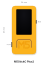

 

# StickC-Plus2

M5Stack · SKU **K016-P2** · also sold as M5StickC Plus2, M5StickC PLUS2 [1]

Every value below comes from [`board.json`](board.json), where each one carries the id of its source; the numbers in brackets point to the sources listed at the end of this page. This page is written from that file by [`_shared/emit_board_readme.py`](../_shared/emit_board_readme.py): change the file, then run the script.

Vendor links: [docs](https://docs.m5stack.com/en/core/StickC-Plus2) · [shop](https://shop.m5stack.com/products/m5stickc-plus2-esp32-mini-iot-development-kit) · [repository](https://github.com/m5stack/M5StickCPlus2)

## Dimensions

| Width | Height | Depth | Weight |
| --- | --- | --- | --- |
| 24.0 mm | 48.0 mm | 13.5 mm | 16.7 g |

The vendor gives the product size as 48.0 x 24.0 x 13.5 mm and the product weight as 16.7 g (gross weight with the package: 26.3 g; package 110.0 x 65.0 x 15.0 mm). Shell material: plastic (PC). Operating temperature: 0 to 40 °C. [1] [13]

## Components

41 entries (70 parts counting quantities).

### Processing and memory

| Part | Role | Ref. | Qty | Key facts | Src |
| --- | --- | --- | --- | --- | --- |
| ESP32-PICO-V3-02 (Espressif Systems) | soc | U1 | 1 | type: System in package: ESP32 chip with in-package flash, PSRAM, crystal and RF matching; cpu: Xtensa dual-core 32-bit LX6, up to 240 MHz; rom kb: 448; sram kb: 520; rtc sram kb: 16; chip revision: v3.0 / v3.1; in package flash: 8 MB, quad SPI; in package psram: 2 MB, quad SPI; wifi: 802.11 b/g/n, 2412-2484 MHz, 1T1R, up to 150 Mbps; bluetooth: Bluetooth v4.2 BR/EDR and Bluetooth LE; supply v: 3 / 3.6; operating temperature c: -40 / 85; package mm: 7 / 7 / 1.11; lifecycle: Not recommended for new designs (NRND), per Espressif; supply: VDDA (pins 1, 43, 46), VDDA3P3 (pins 3, 4), VDD3P3_CPU (pin 37) and VDD3P3_RTC (pin 19) on +3.3V, decoupled by C4 10 uF and C5 100 nF; VDD_SDIO (pin 26) is an output: VDD3P3_RTC through about 6 ohm, 3.3 V, for the in-package 3.3 V flash and PSRAM, which needs the MTDI strap (GPIO12, internal pull-down) low at reset; decoupled by C8 100 nF (ESP32-PICO datasheet v1.5, Table 4, section 3.2, Table 17, Figure 12); unused pins: IO20 (27), SD0/IO7 (32) and SD1/IO8 (33) are left unconnected on the board; SD2/IO9 (28) and SD3/IO10 (29) are the in-package PSRAM's CS and CLK, CMD/IO11 (30) and CLK/IO6 (31) the in-package flash's CS and CLK (ESP32-PICO datasheet v1.5, Table 5), which is why the board leaves them unconnected — Its main crystal, flash and PSRAM are inside the package; the board carries only the antenna network and decoupling around it. | [1] [3] [2] |
| — | flash | — | 1 | capacity: 8 MB; interface: quad SPI; location: inside the ESP32-PICO-V3-02 package | [1] [3] |
| — | psram | — | 1 | capacity: 2 MB; interface: quad SPI; location: inside the ESP32-PICO-V3-02 package | [1] [3] |
| — | crystal | Y1 | 1 | frequency hz: 32768; tolerance ppm: 20; load capacitance pf: 12.5; load capacitors: C26 and C28, 6.0 pF each to GND | [2] |

### Power

| Part | Role | Ref. | Qty | Key facts | Src |
| --- | --- | --- | --- | --- | --- |
| — | battery | — | 1 | capacity mah: 200; nominal v: 3.7; chemistry: lithium; location: inside the case | [1] |
| TP4057 | charger | U5 | 1 | input: VCC (pin 4) from +5VIN through R21 0.8 ohm, decoupled by C14 10 uF; output: BAT (pin 3) to VBAT_IN, decoupled by C20 10 uF; prog resistor ohm: 3300; status pins: CHRG (pin 1) and STDBY (pin 5) not connected — The schematic gives no part manufacturer. | [2] |
| SY7088 | regulator | U6 | 1 | topology: boost (step-up) converter; input: VBAT_OUT through R22 0 ohm; C18 22 uF and C19 1 uF on the input; enable: EN (pin 3) tied to IN; inductor: L2 1.5 uH, 3015 size; output v: 5.3; feedback: R25 160 kohm and R27 47 kohm; the schematic prints Vout = 1.2 V x (R1/R2 + 1); output cap: C17 22 uF; output path: through D20 SS34 to +5VOUT — +5VOUT feeds the Grove-style port, the STICKIO header and the GS321 power-off timer. | [2] |
| SY8089 | regulator | U7 | 1 | topology: buck (step-down) converter; input: VBAT_OUT; C23 100 nF and C24 22 uF on the input; enable: EN (pin 1) on the 3V3EN net, pulled up to the input by R31 150 kohm and driven by U8 GS321; inductor: L3 4.7 uH, 3015 size; output v: 3.3; feedback: R32 68 kohm and R33 15 kohm; output caps: C21 22 uF, C22 100 nF — Its output is the +3.3V rail (net +3V3OUT) that feeds the SoC, the IMU, the microphone, the LCD, the backlight switch and the I2C pull-ups. | [2] |

### Display and touch

| Part | Role | Ref. | Qty | Key facts | Src |
| --- | --- | --- | --- | --- | --- |
| — | display panel | — | 1 | technology: colour TFT LCD; diagonal in: 1.14; resolution px: 135 / 240; controller: ST7789V2 | [1] [2] |
| ST7789V2 (Sitronix) | display controller | — | 1 | interface: 3-wire SPI with a bidirectional data line: no MISO on the connector, and the panel answers register reads on the MOSI pin (connector pin 4, GPIO15); bench 2026-11-17 read the ST7789 IDs 0x85 0x85 0x52 back on it, each byte one bit late; frame memory: 240 x RGB x 320 at 18 bpp (ST7789V datasheet); colors: 262K — The vendor names the driver IC ST7789V2 and links Sitronix's ST7789V datasheet (version 1.0) for it. | [1] [7] [2] [12] |

### Sensors and timekeeping

| Part | Role | Ref. | Qty | Key facts | Src |
| --- | --- | --- | --- | --- | --- |
| BM8563 | rtc | U9 | 1 | interface: I2C, up to 400 kbit/s; i2c address: 0x51 (write 0xA2, read 0xA3); supply: VDD (pin 8) from VBAT_IN, the battery side of the power switch, decoupled by C27 100 nF; supply range v: 1.5 / 5.5; sleep current ua: 0.25; clkout: pin 7 not connected; interrupt: open-drain INT (pin 3) — The schematic symbol is labelled RTC8563; the vendor's documentation names the part BM8563 and links its datasheet. | [1] [2] [5] [11] |
| MPU-6886 (TDK InvenSense) | imu | U10 | 1 | axes: 3-axis accelerometer + 3-axis gyroscope; accel range g: 2 / 4 / 8 / 16; gyro range dps: 250 / 500 / 1000 / 2000; fifo: 1 kB; vdd range v: 1.71 / 3.45; supply: VDD (pin 13) and VDDIO (pin 8) on +3.3V; C30 10 nF, C31 2.2 uF, C32 100 nF; REGOUT (pin 10) C29 100 nF; interface select: CS (pin 22) tied to +3.3V (I2C mode); address select: AD0/SDO (pin 9) tied to GND; interrupt: INT (pin 12) not connected; fsync: FSYNC (pin 11) not connected | [1] [2] [4] |

### Audio

| Part | Role | Ref. | Qty | Key facts | Src |
| --- | --- | --- | --- | --- | --- |
| SPM1423HM4H-B (Knowles) | microphone | U11 | 1 | type: digital MEMS microphone (SiSonic); supply: 3V3 (pin 6) on +3.3V, C33 100 nF; channel select: SELECT (pin 2) tied to GND; operating temperature c: -40 / 100 | [1] [2] [6] |
| — | buzzer | LS1 | 1 | type: passive buzzer; supply: +3.3V through R16 10 ohm; flyback diode: D14 1N4148WT across the buzzer | [1] [2] |

### Input and indicators

| Part | Role | Ref. | Qty | Key facts | Src |
| --- | --- | --- | --- | --- | --- |
| — | led | D24 | 1 | colour: red; series resistor: R30 300 ohm from VBAT_OUT — Shares its driver and control pin (G19) with the IR emitter; the vendor states the red LED and IR emitter share G19. | [1] [2] |
| — | ir led | IR1 | 1 | function: infrared emitter; series resistor: R15 22 ohm 1 % from VBAT_OUT | [1] [2] |
| — | led | LED1 | 1 | colour: green; series resistor: R39 2 kohm 1 % from +5VOUT; programmable: no — The vendor: non-programmable, a sleep-state indicator; it lights when a long press of the power button turns the board off. | [1] [2] |
| — | button | S2 | 1 | name: Button A; type: push button to GND; esd: D8 PESDNC2FD3V3B | [1] [2] |
| — | button | S1 | 1 | name: Button B; type: push button to GND; esd: D5 PESDNC2FD3V3B | [1] [2] |
| — | button | S3 | 1 | name: Button C (power); type: push button pulling the WAKE net to GND; esd: D25 PESDNC2FD3V3B on WAKE — The vendor: a press of more than 2 s powers the board on (the program must then raise HOLD); more than 6 s powers it off without USB. | [1] [2] |

### Radio and positioning

| Part | Role | Ref. | Qty | Key facts | Src |
| --- | --- | --- | --- | --- | --- |
| — | antenna | E1 | 1 | type: 2.4 GHz 3D antenna; matching: pi network C1 2.0 pF (shunt), L1 1.8 nH (series), C2 2.4 pF (shunt) | [1] [2] |

### Connectors, storage and USB

| Part | Role | Ref. | Qty | Key facts | Src |
| --- | --- | --- | --- | --- | --- |
| FPC-0.5-8P | connector | U3 | 1 | type: 8-pin FPC connector, 0.5 mm pitch; pinout: 1: CS (GPIO5); 2: VCC (+3.3V); 3: SCK (GPIO13 through R17 0 ohm); 4: MOSI (GPIO15); 5: D/C (GPIO14); 6: RST (GPIO12); 7: GND; 8: VLED (backlight, from U4 VOUT); decoupling: C11 10 uF on +3.3V | [2] |
| — | connector | J2 | 1 | type: USB Type-C receptacle; input: 5 V at 500 mA (vendor's rating); vbus path: VBUS through F1 (6 V / 1 A PPTC) to the VBUS net, then D15 SS34 to +5VIN; data: DP1/DP2 (A6/B6) joined as USB_DU_P, DN1/DN2 (A7/B7) joined as USB_DU_N | [1] [2] |
| CH9102F | usb uart bridge | U2 | 1 | interface: USB full-speed to UART; supply: VBUS (pin 8) and VDD5 (pin 7) from VBUS through D29 1N4148WT, with C9 10 uF; V3 (pin 6), the chip's own 3.3 V regulator output, feeds VIO (pin 5) on the +VDD net, decoupled by C34 and C7 100 nF, so +VDD is up only on USB. The print names pins 6 and 7 VDD and REGIN, the CP2104's names; reset: RST (pin 9), active low, pulled up to +VDD by R14 10 kohm beside its built-in pull-up; built in pulls: RST (pin 9) and RXD (pin 20) pull up, VBUS (pin 8) pulls down (CH9102 datasheet 1C, pin table); unused pins: RI (1), ACT# (10), WAKEUP/GPIO3 (11), TNOW/GPIO2 (12), RXS/GPIO1 (13), TXS/GPIO0 (14), SUSPEND# (15), GPIO4 (16), SUSPEND (17), CTS (18), DSR (22) and DCD (24) are left unconnected; the print names 10, 11-14 and 16 NC, GPIO.3-GPIO.0 and VPP, the CP2104's names — The vendor's driver page and its comparison table name the chip CH9102. | [1] [2] [8] |
| — | connector | J3 | 1 | type: 2-pin header; pinout: 1: GND; 2: VBAT_IN; decoupling: C35 100 nF on VBAT_IN | [2] |
| GH2.0-4P | connector | J1 | 1 | type: 4-pin port; the vendor's page calls it HY2.0-4P (I2C + I/O + UART); pinout: 1: GPIO33 (white wire); 2: GPIO32 (yellow wire); 3: +5VOUT (red wire); 4: GND (black wire); esd: D12 and D13 PESDNC2FD3V3B on GPIO33 and GPIO32, D28 PESDNC2FD5VB on +5VOUT; decoupling: C38 100 nF/25 V on +5VOUT | [1] [2] |
| — | connector | P1 | 1 | type: 8-pin expansion header (STICKIO, HAT compatible); pinout: 1: GND; 2: 5VOUT (+5VOUT); 3: G26 (GPIO26); 4: G36 (GPI36, joined with GPIO25 on this pin); 5: G0 (GPIO0); 6: BAT (VBAT_IN); 7: 3V3 (+3.3V); 8: 5VIN (into +5VIN through D2 SS34); esd: PESDNC2FD3V3B on GPIO26 (D4), GPI36 (D6), GPIO0 (D7), +3.3V (D10); PESDNC2FD5VB on +5VOUT (D3), VBAT_IN (D9), +5VIN (D11); decoupling: C36 100 nF (+5VOUT), C37 100 nF (VBAT_IN), C39 100 nF (+3.3V), C40 100 nF (+5VIN) — The vendor lists the external pins as G0, G25/G26, G36, G32, G33 (G32/G33 are on the Grove-style port). | [1] [2] |
| — | connector | P2 | 1 | type: 4-pin header; pinout: 1: SCL; 2: SDA; 3: +5VOUT; 4: GND — The schematic names it only "Header 4"; it is not one of the external ports the vendor lists. | [2] |

### Protection

| Part | Role | Ref. | Qty | Key facts | Src |
| --- | --- | --- | --- | --- | --- |
| PESDNC2FD3V3B | esd | — | 11 | type: bidirectional ESD protection diode; placement: D4 GPIO26, D6 GPI36, D7 GPIO0, D10 +3.3V, D5 GPI39 (Button B), D8 GPI37 (Button A), D12 GPIO33, D13 GPIO32, D25 WAKE, D17 USB_DU_P and D18 USB_DU_N — The designators of the two USB data-line diodes overlap their labels on the printed page; the PDF's bookmarks name them D17 (pins on USB_DU_P) and D18 (USB_DU_N). | [2] |
| PESDNC2FD5VB | esd | D3, D9, D11, D16, D28 | 5 | type: bidirectional ESD protection diode; placement: D3 +5VOUT, D9 VBAT_IN, D11 +5VIN, D16 +5VIN at the USB input, D28 +5VOUT at the Grove-style port | [2] |

### Other parts

| Part | Role | Ref. | Qty | Key facts | Src |
| --- | --- | --- | --- | --- | --- |
| SGM2578 | other | U4 | 1 | function: load switch feeding the LCD backlight (VLED); input: +3.3V (VIN, A2), decoupled by C13 100 nF; output: VOUT (A1) to the FPC's VLED pin; alternate part: WS4622C-4/TR (printed beside it on the schematic) — The vendor's pin map calls GPIO27 TFT_BL. | [2] |
| — | other | F1 | 1 | type: PPTC resettable fuse; rating: 6 V / 1 A — Between the USB-C VBUS pin and the VBUS net (test point JP3). | [2] |
| LMBT3904DW1T1G | other | Q1 | 1 | type: dual NPN transistor; function: drives EN and GPIO0 from the bridge's RTS and DTR, with R3 and R4 10 kohm in the bases | [2] |
| LP3218DT1G | other | Q3, Q4 | 2 | type: 12 V P-channel MOSFET in DFN2020-6S: pins 1, 2, 5, 6 and pad 8 drain, 4 and pad 7 source, 3 gate (LRC LP3218DT1G datasheet Rev.B, pin configuration); q3: between VBAT_IN and +VIN; gate on +5VIN, with R28 100 kohm to GND; q4: between +VIN and VBAT_OUT (the switched system rail); gate pulled up to +VIN by R24 100 kohm and pulled down by Q7 (HOLD), by D22 from the RTC INT net and by D23 from the WAKE net (power key) — D21 SS34 also feeds VBAT_OUT from +5VIN, so the system rail is up whenever USB or the header's 5VIN supplies the board. The +VIN net carries C15 10 uF and the INT pull-up R23; VBAT_OUT carries C16 10 uF. | [2] [9] |
| SI2302 | other | Q7 | 1 | type: N-channel MOSFET, SOT-23; function: holds Q4's gate low while HOLD is high — The vendor: after a wake-up, the program sets HOLD (G4) high to keep the power on; setting it to 0 cuts the power when no USB power is connected. | [1] [2] |
| GS321 | other | U8 | 1 | type: drawn as an operational amplifier, used open-loop as a comparator; powered from +5VOUT (C41 100 nF); non inverting input: pin 1: R35 680 kohm 1 % and C25 10 uF from +5VOUT, D27 1N4148WT to GND, and D26 1N4148WT with R36 270 kohm 1 % to the WAKE net (power key); inverting input: pin 3: R37 10 kohm to +5VOUT and R38 10 kohm to GND; output: pin 4 to the 3V3EN net (SY8089 EN); the green LED LED1 hangs from +5VOUT through R39 2 kohm 1 % onto the same net; pin numbering: The print's numbers agree with the Gainsil GS321 datasheet V2 (Figure 1, SOT23-5): 1 IN+, 2 VSS, 3 IN-, 4 OUT, 5 VDD; the GS321Y variant (marked 321Y) differs, with OUT on pin 1 — Holding the power key low discharges C25 through D26 and R36; once the non-inverting input falls below half of +5VOUT the output pulls 3V3EN low, the 3.3 V rail stops and the green LED lights. The vendor: holding Button C for more than 6 s powers the board off without USB, and with USB connected turns the display off and sleeps without cutting power; the green LED is a sleep-state indicator. | [1] [2] [10] |
| SS8050 | other | Q2, Q5 | 2 | type: NPN transistor, emitter to GND; q2: buzzer driver: base from GPIO2 through R19 470 ohm and C12 10 uF in series, D19 1N4148WT from base to GND; q5: red LED and IR emitter driver: base on the GPIO19 net, R29 100 kohm to GND — Q2's base is AC-coupled through C12. | [2] |
| — | other | JP1-JP5 | 5 | JP1: URX; JP2: UTX; JP3: VBUS; JP4: USB D+; JP5: USB D- | [2] |
| SS34 | other | D2, D15, D20, D21 | 4 | type: Schottky diode; placement: D15 VBUS to +5VIN; D2 header 5VIN to +5VIN; D20 boost output to +5VOUT; D21 +5VIN to VBAT_OUT | [2] |
| B5819WT | other | D1, D22, D23 | 3 | type: Schottky diode; placement: D1 GPI35 to WAKE; D22 Q4 gate to INT; D23 Q4 gate to WAKE | [2] |
| 1N4148WT | other | D14, D19, D26, D27, D29 | 5 | type: small-signal switching diode; placement: D14 across the buzzer; D19 Q2 base clamp; D26 and D27 in the power-off timer; D29 VBUS to the CH9102F supply | [2] |

## Connections

Each row is one fact of wiring, read from the component in the first column; a row without sources of its own takes its component's.

| From | To | Bus | Address | Pins | Pulls | Notes | Src |
| --- | --- | --- | --- | --- | --- | --- | --- |
| ESP32-PICO-V3-02 | antenna E1 | RF |  | LNA_IN (pin 2) → E1 through a pi network: C1 2.0 pF to GND, L1 1.8 nH in series, C2 2.4 pF to GND |  |  | [2] |
| ESP32-PICO-V3-02 | LMBT3904DW1T1G | reset and boot strapping |  | EN (pin 9) → Q1 pin 3 IO0 (pin 23) → Q1 pin 6 | EN: up 10k to +3.3V (R7) GPIO0: up 10k to +3.3V (R8) | EN is also decoupled to GND by C6 100 nF and C3 10 uF. | [2] |
| flash | ESP32-PICO-V3-02 | SPI0/1 (in package) |  | FLASH_CLK → CLK/IO6 (pin 31) FLASH_CS → CMD/IO11 (pin 30) |  |  | [3] |
| psram | ESP32-PICO-V3-02 | SPI0/1 (in package) |  | PSRAM_CS → SD2/IO9 (pin 28) PSRAM_CLK → SD3/IO10 (pin 29) |  |  | [3] |
| display panel | FPC-0.5-8P | 8-pin 0.5 mm FPC |  |  |  |  | [2] |
| ST7789V2 | ESP32-PICO-V3-02 | SPI |  | CS → GPIO5 (U1 pin 34) SCK → GPIO13 (U1 pin 20), through R17 0 ohm MOSI → GPIO15 (U1 pin 21) D/C → GPIO14 (U1 pin 17) RST → GPIO12 (U1 pin 18) |  | Reached through the FPC connector U3; C10 on SCK to GND is marked NC (not fitted). | [1] [2] |
| FPC-0.5-8P | ESP32-PICO-V3-02 | SPI |  | 1 → GPIO5 3 → GPIO13 4 → GPIO15 5 → GPIO14 6 → GPIO12 |  |  | [2] |
| FPC-0.5-8P | SGM2578 | power |  | 8 VLED → U4 VOUT (A1) |  |  | [2] |
| SGM2578 | ESP32-PICO-V3-02 | GPIO |  | EN (B2) → GPIO27 (U1 pin 16) |  |  | [1] [2] |
| SGM2578 | FPC-0.5-8P | power |  | VOUT (A1) → pin 8 VLED |  |  | [2] |
| connector J2 | CH9102F | USB 2.0 |  | D+ (A6, B6) → U2 pin 3 (UD+) D- (A7, B7) → U2 pin 4 (UD-) |  | Each data line has a PESDNC2FD3V3B to GND and a test point (JP4 on D+, JP5 on D-). | [1] [2] |
| connector J2 | external | USB Type-C configuration |  | CC1 (A5) → R18 to GND CC2 (B5) → R20 to GND GND, SHELL → GND | CC1: down 5.1k (R18) CC2: down 5.1k (R20) | Both CC resistors are 5.1 kohm 1 %. | [1] [2] |
| connector J2 | other F1 | power |  | VCC → F1 |  |  | [1] [2] |
| CH9102F | ESP32-PICO-V3-02 | UART0 |  | TXD (pin 21) → URX net, R11 0 ohm, U0RXD/IO3 (U1 pin 40) RXD (pin 20) → UTX net, R12 0 ohm, U0TXD/IO1 (U1 pin 41) |  | Test points JP1 (URX) and JP2 (UTX) sit on the two lines. | [1] [2] [8] |
| CH9102F | LMBT3904DW1T1G | modem control |  | DTR (pin 23) → Q1 pin 5 through R3 10 kohm, and Q1 pin 1 RTS (pin 19) → Q1 pin 2 through R4 10 kohm, and Q1 pin 4 |  |  | [1] [2] [8] |
| LMBT3904DW1T1G | CH9102F | modem control |  | 5 (base) → DTR through R3 10 kohm 4 (emitter) → RTS 2 (base) → RTS through R4 10 kohm 1 (emitter) → DTR |  |  | [2] |
| LMBT3904DW1T1G | ESP32-PICO-V3-02 | reset and boot strapping |  | 3 (collector) → EN 6 (collector) → GPIO0 |  |  | [2] |
| battery | connector J3 | power |  | + → J3 pin 2 (VBAT_IN) - → J3 pin 1 (GND) |  |  | [2] |
| battery | ESP32-PICO-V3-02 | ADC |  | VBAT_IN → GPI38 (U1 pin 7) through a divider, R40 100 kohm from VBAT_IN and R41 100 kohm to GND, with C42 100 nF |  | The vendor's pin table lists G38 as the battery voltage detect pin. | [1] [2] |
| TP4057 | battery | power |  | BAT (pin 3) → VBAT_IN |  |  | [2] |
| TP4057 | external | power |  | PROG (pin 6) → R26 3.3 kohm to GND |  |  | [2] |
| LP3218DT1G | SI2302 | power control |  | Q4 gate → Q7 drain |  |  | [2] [9] |
| LP3218DT1G | BM8563 | power control |  | Q4 gate → D22 B5819WT to the INT net |  |  | [2] [9] |
| LP3218DT1G | button S3 | power control |  | Q4 gate → D23 B5819WT to the WAKE net |  |  | [2] [9] |
| SI2302 | ESP32-PICO-V3-02 | GPIO |  | gate (HOLD) → GPIO4 (U1 pin 24) | HOLD: down 100k (R34) |  | [1] [2] |
| SI2302 | LP3218DT1G | power control |  | drain → Q4 gate |  |  | [1] [2] |
| BM8563 | ESP32-PICO-V3-02 | I2C | 0x51 | SCL (pin 6) → GPIO22 (U1 pin 39) SDA (pin 5) → GPIO21 (U1 pin 42) | SCL: up 2.2k to +3.3V (R10) SDA: up 2.2k to +3.3V (R13) |  | [1] [2] [5] |
| BM8563 | LP3218DT1G | power control |  | INT (pin 3) → INT net, D22 B5819WT to Q4's gate | INT: up 100k to +VIN (R23) | INT reaches no ESP32 GPIO; it can only switch the board on. | [2] |
| BM8563 | crystal Y1 | oscillator |  | OSCI (pin 1) → Y1 OSCO (pin 2) → Y1 |  |  | [2] |
| MPU-6886 | ESP32-PICO-V3-02 | I2C | 0x68 | SCL/SCLK (pin 23) → GPIO22 (U1 pin 39) SDA/SDI (pin 24) → GPIO21 (U1 pin 42) | SCL: up 2.2k to +3.3V (R10) SDA: up 2.2k to +3.3V (R13) |  | [1] [2] [4] |
| SPM1423HM4H-B | ESP32-PICO-V3-02 | PDM |  | CLK (pin 4) → GPIO0 (U1 pin 23) DAT (pin 5) → GPI34 (U1 pin 10) | DAT (GPI34): up 10k to +3.3V (R5) CLK (GPIO0): up 10k to +3.3V (R8) | The clock line is the GPIO0 strapping pin, shared with the STICKIO header and the auto-reset circuit. | [1] [2] |
| buzzer LS1 | SS8050 | low-side switch |  | - → Q2 collector |  |  | [1] [2] |
| SS8050 | ESP32-PICO-V3-02 | GPIO |  | Q2 base → GPIO2 (U1 pin 22) through R19 and C12 |  |  | [1] [2] |
| SS8050 | ESP32-PICO-V3-02 | GPIO |  | Q5 base → GPIO19 net, from IO19 (U1 pin 38) through R9 10 ohm | GPIO19: down 100k (R29) |  | [1] [2] |
| SS8050 | buzzer LS1 | low-side switch |  | Q2 collector → LS1 |  |  | [2] |
| SS8050 | led D24 | low-side switch |  | Q5 collector → D24 cathode |  |  | [2] |
| SS8050 | ir led IR1 | low-side switch |  | Q5 collector → IR1 cathode |  |  | [2] |
| led LED1 | GS321 | status |  | cathode → U8 output (3V3EN net) |  |  | [1] [2] |
| button S2 | ESP32-PICO-V3-02 | GPIO |  | switch → GPI37 (U1 pin 6) | GPI37: up 10k to +3.3V (R1) |  | [1] [2] |
| button S1 | ESP32-PICO-V3-02 | GPIO |  | switch → GPI39 (U1 pin 8) | GPI39: up 10k to +3.3V (R2) |  | [1] [2] |
| button S3 | ESP32-PICO-V3-02 | GPIO |  | WAKE → GPI35 (U1 pin 11) through D1 B5819WT | GPI35: up 10k to +3.3V (R6) |  | [1] [2] |
| button S3 | LP3218DT1G | power control |  | WAKE → Q4 gate through D23 B5819WT |  |  | [1] [2] |
| button S3 | GS321 | power control |  | WAKE → U8 pin 1 through D26 1N4148WT and R36 270 kohm |  |  | [1] [2] |
| GH2.0-4P | ESP32-PICO-V3-02 | GPIO |  | 1 → GPIO33 (U1 pin 13) 2 → GPIO32 (U1 pin 12) |  |  | [1] [2] |
| GH2.0-4P | external | PORT.CUSTOM |  | 1 → G33 2 → G32 3 → 5V 4 → GND |  |  | [1] [2] |
| connector P1 | ESP32-PICO-V3-02 | GPIO |  | 3 → GPIO26 (U1 pin 15) 4 → GPI36 (U1 pin 5) and GPIO25 (U1 pin 14) 5 → GPIO0 (U1 pin 23) |  |  | [1] [2] |
| connector P1 | external | HAT |  | 1 → GND 2 → 5VOUT 3 → G26 4 → G36/G25 5 → G0 6 → BAT 7 → 3V3 8 → 5VIN |  |  | [1] [2] |
| connector P2 | ESP32-PICO-V3-02 | I2C |  | 1 → GPIO22 2 → GPIO21 |  |  | [2] |

## Not on this board

| Role | Notes | Src |
| --- | --- | --- |
| pmic | The vendor's version history: the AXP192 power management chip was removed in 2023.12 (v2); its comparison table gives the Plus2 no power management chip. | [1] |
| fuel gauge | Battery voltage is read only through the GPI38 divider. | [2] |
| touch controller |  | [2] |
| magnetometer |  | [2] |
| audio codec |  | [2] |
| audio amp |  | [2] |
| speaker | The board's sound part is the passive buzzer LS1. | [2] |
| keyboard controller |  | [2] |
| io expander |  | [2] |
| sd slot |  | [2] |
| gps |  | [2] |
| lora |  | [2] |

## Notes

Components are the parts of the vendor's schematic v0.5 (three sheets). Resistors, capacitors and inductors are recorded on the part they serve (pulls, decoupling, feedback, matching) rather than as entries of their own. Power rails as the schematic names them: +5VIN (USB VBUS through D15, or the header's 5VIN through D2), VBAT_IN (the battery), +VIN (battery through Q3), VBAT_OUT (the switched system rail, through Q4 or from +5VIN through D21), +5VOUT (SY7088 boost through D20) and +3.3V (SY8089 buck, enabled by 3V3EN). The absent roles rest on the full schematic drawing no such part.

## Sources

1. [StickC-Plus2 (K016-P2), M5Stack documentation](https://docs.m5stack.switch-science.com/en/core/StickC-Plus2) — vendor docs, checked 2026-11-16 (`m5-docs`); read at a mirror of <https://docs.m5stack.com/en/core/StickC-Plus2>. Read at Switch Science's mirror of docs.m5stack.com: the original host timed out from the machine that wrote this file on 2026-11-16. Specifications, pin map, power on/off, USB driver, version change and hardware difference tables.
2. [M5StickC Plus2 schematic v0.5 (Altium, 3 sheets)](https://web.archive.org/web/20260318085629/https://m5stack-doc.oss-cn-shenzhen.aliyuncs.com/512/Sch_M5StickC_Plus2_v0.5.pdf) — schematic, checked 2026-11-16 (`plus2-schematic`); read at a mirror of <https://m5stack-doc.oss-cn-shenzhen.aliyuncs.com/512/Sch_M5StickC_Plus2_v0.5.pdf>; found through [1]. Read at the Internet Archive's capture of 2026-03-18; the vendor's file host timed out. SHA-256 of the file read: 75017af5c47c7e56904469f032e7d71a63803651a6e8af070d427f125e88e6cd.
3. [ESP32-PICO Series Datasheet v1.5 (Espressif)](https://www.espressif.com/sites/default/files/documentation/esp32-pico_series_datasheet_en.pdf) — datasheet, checked 2026-11-16 (`esp32-pico-datasheet`).
4. [MPU-6886 datasheet DS-000193 revision 1.1 (TDK InvenSense), as M5Stack hosts it](https://web.archive.org/web/20261031011628/https://m5stack.oss-cn-shenzhen.aliyuncs.com/resource/docs/datasheet/core/MPU-6886-000193%2Bv1.1_GHIC_en.pdf) — datasheet, checked 2026-11-16 (`mpu6886-datasheet`); read at a mirror of <https://m5stack.oss-cn-shenzhen.aliyuncs.com/resource/docs/datasheet/core/MPU-6886-000193%2Bv1.1_GHIC_en.pdf>; found through [1]. Read at the Internet Archive's capture; the vendor's file host timed out.
5. [BM8563 real-time clock datasheet V1.1 (Chinese), as M5Stack hosts it](https://web.archive.org/web/20261031011628/https://m5stack.oss-cn-shenzhen.aliyuncs.com/resource/docs/datasheet/core/BM8563_V1.1_cn.pdf) — datasheet, checked 2026-11-16 (`bm8563-datasheet`); read at a mirror of <https://m5stack.oss-cn-shenzhen.aliyuncs.com/resource/docs/datasheet/core/BM8563_V1.1_cn.pdf>; found through [1]. Read at the Internet Archive's capture; the vendor's file host timed out.
6. [SPM1423HM4H-B digital microphone datasheet revision A (Knowles), as M5Stack hosts it](https://web.archive.org/web/20260917142323/https://m5stack.oss-cn-shenzhen.aliyuncs.com/resource/docs/datasheet/core/SPM1423HM4H-B_datasheet_en.pdf) — datasheet, checked 2026-11-16 (`spm1423-datasheet`); read at a mirror of <https://m5stack.oss-cn-shenzhen.aliyuncs.com/resource/docs/datasheet/core/SPM1423HM4H-B_datasheet_en.pdf>; found through [1]. Read at the Internet Archive's capture; the vendor's file host timed out. Its specification tables are images, so only the text values are taken.
7. [ST7789V display controller datasheet version 1.0 (Sitronix), as M5Stack hosts it for the ST7789V2](https://web.archive.org/web/20261022024740/https://m5stack.oss-cn-shenzhen.aliyuncs.com/resource/docs/datasheet/core/ST7789V.pdf) — datasheet, checked 2026-11-16 (`st7789v-datasheet`); read at a mirror of <https://m5stack.oss-cn-shenzhen.aliyuncs.com/resource/docs/datasheet/core/ST7789V.pdf>; found through [1]. Read at the Internet Archive's capture; the vendor's file host timed out.
8. [CH9102 USB to high-speed serial port chip datasheet, version 1C (WCH)](https://akizukidenshi.com/goodsaffix/ch9102.pdf) — datasheet, checked 2026-11-17 (`ch9102-datasheet`). Read at a distributor's copy; WCH's own host timed out on 2026-11-17. SHA-256 of the file read: 876966aa794ec18d850b622a76386d7565bd76e7f76fdb972b1602172062fb3a.
9. [LP3218DT1G P-channel MOSFET datasheet Rev.B, May 2017 (Leshan Radio Company)](https://static.chipdip.ru/lib/495/DOC013495055.pdf) — datasheet, checked 2026-11-17 (`lp3218-datasheet`). Read at a distributor's copy. SHA-256 of the file read: 336b22f5df448eab6804ba03191fa0035faed5e4ecb915b193f9917f96553e49.
10. [GS321/358/324 operational amplifier datasheet V2 (Gainsil)](https://static.chipdip.ru/lib/913/DOC012913966.pdf) — datasheet, checked 2026-11-17 (`gs321-datasheet`). Read at a distributor's copy. SHA-256 of the file read: 59fba7a51d3ae6b8a84803d7fae7bcc5f66c91ccfba01907f3b02f9a6b5acab1.
11. I2C bus scan on the owner's StickC-Plus2 (Kleidos boards bench record m5stickc-plus2/schematic/bench/2026-11-17-i2c-scan.md) — measured, checked 2026-11-17 (`bench-i2c-scan`). Over the board's USB-C port, case closed: the I2C? console command of the Kleidos m5stickc_plus2_debug image already on the board, on SDA GPIO21 / SCL GPIO22 and with the two swapped, three runs after fresh resets; only 0x51 and 0x68 answered.
12. LCD panel register read-back on the owner's StickC-Plus2 (Kleidos boards bench record m5stickc-plus2/schematic/bench/2026-11-17-panel-readback-spird.md) — measured, checked 2026-11-17 (`bench-panel-readback`). Over the board's USB-C port, case closed, read only: the SPIRD console command of the Kleidos m5stickc_plus2_debug image already on the board (3-wire panel bus, the answer read on GPIO15), three sessions after fresh resets.
13. Verified against the owner's physical unit, 2026-11-18 — measured, checked 2026-11-18 (`owner-unit-verified`). The owner compared his own StickC-Plus2 with this repository's front drawing (svg/front.svg) and 3D model (model/) on 2026-11-18: the model and the drawing match the real board. A check by eye, no instrument. The original source of the measurement was not recorded (sources.md).

## In this folder

- [`board.json`](board.json): every part on the board, each value with its source ([`_shared/board.schema.json`](../_shared/board.schema.json)); this page is written from it.
- [`measurements.json`](measurements.json): the case, display, button and keyboard geometry the front is drawn against ([`_shared/schema.md`](../_shared/schema.md)).
- [`sources.md`](sources.md): the vendor drawings, photos and CAD files the measurements were taken on.
- [`icon.svg`](icon.svg): a 64 px pictogram of the board.
- [`svg/front.svg`](svg/front.svg): the front at 1 unit = 1 mm: the screen's active area, a press target for every control and each printed legend as a group of its own.
- [`svg/back.svg`](svg/back.svg): the back, seen from behind, with what it prints.
- [`model/m5stickc-plus2.glb`](model/m5stickc-plus2.glb): the 3D model, glTF 2.0 binary in metres (glTF's unit), every print kept: the format for the web and most viewers.
- [`model/m5stickc-plus2-web.glb`](model/m5stickc-plus2-web.glb): its web level of detail.
- [`model/m5stickc-plus2.obj`](model/m5stickc-plus2.obj): the same model as Wavefront OBJ, in millimetres, Y up, one object per part: the format for most other 3D tools (Blender, FreeCAD, Fusion, MeshLab, slicers); written from the master by [`_shared/export_obj.py`](../_shared/export_obj.py).
- [`model/m5stickc-plus2.mtl`](model/m5stickc-plus2.mtl): the OBJ's materials: each part's colour, transparency, roughness and metalness.
- [`model/spec.json`](model/spec.json): the recipe the master and its web level are built from.
- [`model/source.json`](model/source.json): the master's provenance.
- [`model/web.json`](model/web.json): the web level's record.
- [`schematic/m5stickc-plus2.pdf`](schematic/m5stickc-plus2.pdf): the connectivity schematic, made to be followed by clicking.
- [`schematic/README.md`](schematic/README.md): the schematic's sources, its Kleidos additions and corrections, and its open questions.
- [`schematic/netlist.yaml`](schematic/netlist.yaml): every part, pin and net of the schematic with its source.
- [`schematic/improvements.md`](schematic/improvements.md): the triage behind the additions and corrections.
- [`schematic/bench/`](schematic/bench/): the bench probe records.

How the drawings, models and schematics are made, and which script writes each file: [`docs/models-and-drawings.md`](../docs/models-and-drawings.md).
