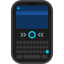
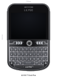

<!--
SPDX-FileCopyrightText: 2026 José M. Requena Plens
SPDX-License-Identifier: MIT
-->

 

# T-Deck Plus

LILYGO · SKU **T-Deck-Plus** · revision V1.0 [1]

Every value below comes from [`board.json`](board.json), where each one carries the id of its source; the numbers in brackets point to the sources listed at the end of this page. This page is written from that file by [`_shared/emit_board_readme.py`](../_shared/emit_board_readme.py): change the file, then run the script.

Vendor links: [docs](https://wiki.lilygo.cc/products/t-deck-series/t-deck-plus/) · [shop](https://lilygo.cc/products/t-deck) · [repository](https://github.com/Xinyuan-LilyGO/T-Deck)

## Dimensions

| Width | Height | Depth |
| --- | --- | --- |
| 73.1 mm | 115.0 mm | 20.4 mm |

Outline of the shell: width and height of the front face, depth front to back. LILYGO's documentation states 100 x 68 x 11 mm, which differs from the shell model; no source states a weight. [11] [26]

## Components

42 entries (50 parts counting quantities).

### Processing and memory

| Part | Role | Ref. | Qty | Key facts | Src |
| --- | --- | --- | --- | --- | --- |
| ESP32-S3-WROOM-1 (Espressif) | soc | U1 | 1 | ordering code: ESP32-S3-WROOM-1-N16R8; chip: ESP32-S3R8; cpu: Xtensa LX7, dual core, up to 240 MHz; wifi: 2.4 GHz 802.11 b/g/n; bluetooth: Bluetooth 5 (LE); antenna: on-board PCB antenna; crystal mhz: 40; module size mm: 18 / 25.5 / 3.1; usb: native USB on IO19 (D-) and IO20 (D+); gpio not available: IO35 / IO36 / IO37 — The schematic names the module ESP32-S3-WROOM-1 without its ordering code; N16R8 is the one WROOM-1 code with 16 MB of Quad SPI flash and 8 MB of Octal SPI PSRAM, the memory LILYGO states, and its datasheet places an ESP32-S3R8 inside it. LILYGO's pages call the MCU 'ESP32-S3FN16R8', a name that is not in Espressif's ESP32-S3 series table. Notes on the sheet: IO35, IO36 and IO37 serve the in-package Octal PSRAM and cannot be used for anything else; GPIO46 is pulled down by default, and GPIO46 high with GPIO0 low is not a usable strap combination. | [4] [1] [12] [13] |
| — | flash | — | 1 | capacity mb: 16; interface: Quad SPI; location: inside the ESP32-S3-WROOM-1 module — The flash of the module; LILYGO states 16 MB and its board definition sets 80 MHz QIO. | [1] [12] [9] |
| — | psram | — | 1 | capacity mb: 8; interface: Octal SPI (OPI); location: in the ESP32-S3R8 package inside the module; pins used: IO35 / IO36 / IO37 | [1] [12] [9] |
| W25Q32FVSS (Winbond) | flash | U3 | 1 | capacity mbit: 32; capacity mb: 4; supply v: 2.7 / 3.6; package: SOIC-8 208-mil — Program storage of the keyboard controller, not of the main SoC. | [4] [15] |
| — | crystal | U4 | 1 | frequency mhz: 40; tolerance ppm: 10; pins: 4 | [4] |

### Power

| Part | Role | Ref. | Qty | Key facts | Src |
| --- | --- | --- | --- | --- | --- |
| SY8089AAC (Silergy) | regulator | U8 | 1 | topology: synchronous step-down; input net: +5V; output net: VDD3V3; inductor: L5, SWPA5020S100MT; feedback: R23 100 kOhm 1 % (top), R24 22 kOhm 1 % (bottom), C42 22 pF across R23 — VDD3V3 is the always-on rail of a running board: the module, the touch controller, the display logic, the GPS and the I2C pull-ups RC2/RC4 hang on it. | [4] |
| TP4065B (Nanjing Top Power ASIC) | charger | UP1 | 1 | type: linear CC/CV single-cell Li-ion charger; prog resistor ohms: 2000; package: SOT23-5 — The TP4065 datasheet lists 4.20 V and 4.35 V float-voltage versions and no 'B' suffix. | [4] [21] |
| — | battery | — | 1 | chemistry: lithium polymer; capacity mah: 2000; connector: P3, 2 pins (1 VBAT, 2 GND) — Its make and part number are not published. | [1] [3] [4] |
| MS412FE (Seiko Instruments) | battery | J1 (GPS board; J101 in the Kleidos schematic) | 1 | function: backup supply of the GNSS receiver (VRTC) | [5] |

### Display and touch

| Part | Role | Ref. | Qty | Key facts | Src |
| --- | --- | --- | --- | --- | --- |
| — | display panel | — | 1 | diagonal in: 2.8; technology: IPS LCD; viewing angle: full; resolution px: 320 / 240; interface: SPI; connector: P2, 18 pins — The panel's own part number is not published; its logic is fed from VDD3V3 and its backlight anode from the switched V3V. | [4] [2] [1] |
| ST7789 (Sitronix) | display controller | — | 1 | interface: SPI with a D/C line; location: on the display panel — LILYGO revised its ST7789 initialization sequence on 2024-07-26 (commit 6adb888 of the T-Deck repository). | [1] [2] |
| GT911 (Goodix) | touch controller | — | 1 | touch points: 5; supply v: 2.8 / 3.3; host interface v: 1.8 / 3.3; i2c addresses: 0x5D / 0x14; address select: level of INT during reset; connector: P4, 6 pins — The controller sits on the touch panel, reached through connector P4; the standard T-Deck has no touchscreen. | [4] [1] [17] [24] |

### Audio

| Part | Role | Ref. | Qty | Key facts | Src |
| --- | --- | --- | --- | --- | --- |
| ES7210 (Everest Semiconductor) | audio codec | U2 | 1 | function: 4-channel microphone ADC with I2S/TDM output; snr db: 102; resolution bits: 24; sample rate khz: 8 / 100; package: QFN-32 | [4] [19] [1] |
| MSM381A3729H9CP | microphone | MIC1, MIC2, MIC3, MIC4 | 4 | type: MEMS microphone, differential output — The schematic draws four; LILYGO's back view labels two openings, Mic1 and Mic2. Each one's ground goes through a 0 ohm resistor (Rm1 to Rm4). | [4] [1] [2] |
| MAX98357A (Analog Devices (Maxim Integrated)) | audio amp | U6 | 1 | class: D, digital PCM input; vdd v: 2.5 / 5.5; output w: 3.2 W into 4 ohm at 5 V; gain db: 12 | [4] [20] |
| — | speaker | P1 | 1 | connector: P1 (SPEEK), 2 pins; location: bottom-right corner, behind the PCB; grille: none; case openings: six holes on the lower side edge — The case has no speaker grille: six holes on the lower side edge, and the speaker sits at the bottom-right corner, behind the PCB (owner observed on his unit, 2026-11-17; he did not say from which side right is taken). LILYGO's specification image labels 'BAT&SPK' on the back. Its part and impedance are not published. | [4] [2] [25] |

### Input and indicators

| Part | Role | Ref. | Qty | Key facts | Src |
| --- | --- | --- | --- | --- | --- |
| ESP32-C3 (Espressif) | keyboard controller | U5 | 1 | variant: ESP32-C3 without in-package flash (external flash U3); i2c role: slave; i2c address: 0x55; matrix: 7 rows x 5 columns; backlight pwm hz: 1000; i2c commands: 0x01: backlight duty; 0x02: Alt+B backlight duty; 0x03: raw matrix mode; 0x04: key mode — Powered from the switched V3V (VDD3P3, VDD3P3_RTC, VDD3P3_CPU, VDDA). Its stock firmware (LILYGO's Keyboard_ESP32C3 sketch) answers at 0x55; the INT line on GPIO8 is wired to the S3's IO46. | [4] [8] [14] |
| TS-1187AB | button | KEY1 | 1 | function: press of the trackball, BOOT strap — LILYGO: with the microphone in use, the GPIO0 button is not available. | [4] [7] [1] |
| — | button | S1 | 1 | function: reset of the ESP32-S3 (EN / CHIP_PU); location: left edge | [4] [2] |
| — | led | LED1 | 1 | color: blue; function: charge indicator: lit while charging, off when full; location: bottom side — No GPIO reaches it. | [4] [1] |

### Radio and positioning

| Part | Role | Ref. | Qty | Key facts | Src |
| --- | --- | --- | --- | --- | --- |
| HPD16A | lora | U0 | 1 | radio: Semtech SX1262; tx power dbm: 22; band options mhz: 433 / 868 / 915; optional: yes; schematic annotations: sleep_current_max_ua: 1.5; tx_current_max_ma: 114; rx_current_max_ma: 8.2; supply_current_min_ma: 200 — LILYGO sells the board with a 433, 868 or 915 MHz radio, or none. The current figures are design notes written on the schematic beside the module (the supply must deliver at least 200 mA), not datasheet values. | [4] [2] [3] [1] |
| — | antenna | XX2 | 1 | type: external whip on the LoRa antenna seat; length mm: 170; band mhz: 860 / 920; gain dbi: -1.43 / -0.7; efficiency percent: 19.8 / 22.7 — Figures from LILYGO's T-Deck Plus antenna report (860 to 920 MHz); its repository also holds T-Deck antenna sheets for 433 MHz and 868-915 MHz, so the antenna follows the radio band ordered. The case has an AUX opening for an extended antenna. | [10] [4] [3] |
| MIA-M10Q (u-blox) | gps | U1 (GPS board; U101 in the Kleidos schematic) | 1 | gnss: GPS / GLONASS / Galileo / BeiDou; default constellations: GPS, Galileo and BeiDou B1I; uart default: 38400 baud, 8N1; vcc v: 1.76 / 3.6; board: T-Deck-GPS V1.0 daughterboard — LILYGO also publishes a T-Deck-L76K V1.0 board (Quectel L76K, RESET_N pulled up by 10 kOhm R1 with C4 100 nF, VBACKUP from VRTC, the same 5-pin J2 and MS412FE backup cell). The GPS takes the Grove seat's pins, so the Grove connector cannot be used for anything else on the Plus. | [5] [6] [1] [22] [7] [23] |

### Connectors, storage and USB

| Part | Role | Ref. | Qty | Key facts | Src |
| --- | --- | --- | --- | --- | --- |
| BM14B(0.8)-24DS-0.4V(53) | connector | JP1 | 1 | pitch mm: 0.4; contacts: 24 — The schematic symbol numbers 28 pins, the 24 contacts of the part name plus the ground pins drawn at its corners. | [4] |
| — | connector | U7 | 1 | type: USB Type-C receptacle, 16 pins; function: power input and native USB of the ESP32-S3; location: bottom edge | [4] [1] |
| MP3T-F | sd slot | TF | 1 | card: microSD (TF); mode: SPI; location: right edge | [4] [1] |
| — | connector | J3 (GPS board; J103 in the Kleidos schematic) | 1 | type: IPEX (U.FL-type) RF connector; function: GNSS antenna connector — The GNSS antenna itself is not published. | [5] |
| — | connector | P8 | 1 | type: HY2.0-4P (Grove); pitch mm: 2; pins: 4; location: left edge — Sold as the Grove interface on the T-Deck; on the Plus it is taken by the GPS. | [4] [7] [2] [23] |
| — | connector | J1 | 1 | pitch mm: 2; pins: 6; function: UART programming header of the keyboard controller; location: beside the reset button | [4] [1] [7] |

### Other parts

| Part | Role | Ref. | Qty | Key facts | Src |
| --- | --- | --- | --- | --- | --- |
| AW9364DNR (Awinic) | other | U9 | 1 | function: 4-channel LED current sink with 1-wire dimming; channels: 4; max current per channel ma: 20; vin v: 2.8 / 5.5; package: DFN2x2-8L — Its four sinks take the four LED-K pins of the display connector P2; the backlight anode sits on V3V. | [4] [16] |
| — | other | — | 1 | function: QWERTY keyboard (LILYGO T-Keyboard); keys: 35; matrix: 7 rows x 5 columns; backlight: LEDs between V3V and LEDK, switched by Q3; colors: black / white — On a separate board joined through JP1; its LED count and switch part are not published. | [4] [8] [3] |
| BSS138 | other | Q3 | 1 | function: N-MOSFET low-side switch of the keyboard backlight | [4] |
| BSS123 | other | Q1, Q2 | 2 | function: bidirectional MOSFET level shifter between the VDD3V3 and V3V segments of the I2C bus | [4] |
| — | other | T1 | 1 | function: trackball, read by four Hall sensors (UZ1 to UZ4) and a press switch (KEY1); directions: up: IO3 (UZ3, G_S1); down: IO15 (UZ1, G_S3); left: IO1 (UZ4, G_S4); right: IO2 (UZ2, G_S2); press: IO0 (KEY1) — Directions, as the Kleidos firmware maps them (PIN_TRACKBALL_UP, _DOWN, _LEFT, _RIGHT and _CLICK in variants/tdeck/variant.h) and as the owner verified on his unit on 2026-11-17, each direction acting as the ball is rolled: UP IO3 (UZ3, G_S1), DOWN IO15 (UZ1, G_S3), LEFT IO1 (UZ4, G_S4), RIGHT IO2 (UZ2, G_S2), press IO0 (KEY1, BOOT). LILYGO's pin map image names them otherwise (UP IO2, DOWN IO3, LEFT IO1, RIGHT IO15, press IO0) and agrees only on LEFT and the press; the sheet names no direction. Its four pads are drawn to GND. | [4] [25] [3] |
| AN48841B (Panasonic) | other | UZ1, UZ2, UZ3, UZ4 | 4 | function: CMOS Hall IC for alternating magnetic field directions; supply v: 2.5 / 5.25; output: CMOS inverter (no pull-up needed); package: SMINI-5 | [4] [18] [25] |
| K3-1391D-5MM | other | SW1 | 1 | function: slide switch between the battery/USB power-path node and the +5V net; location: right edge — It cuts both the battery and the USB supply to the system; the charger, fed straight from VBUS, is upstream of it. | [4] [2] |
| SI2301 | other | Q4, Q6 | 2 | function: P-MOSFET high-side switches of the peripheral rails, both driven by PWR_EN (IO10) — LILYGO: on battery, GPIO10 must be set high before the peripherals work. | [4] [1] |
| PMBT3904 | other | Q7 | 1 | function: NPN transistor that pulls the Q4/Q6 gates low through R26 (1 kOhm) | [4] |
| SI2307 | other | Q5 | 1 | function: P-MOSFET that connects VBAT to the power-path node when VBUS is absent | [4] |
| 1N5819 | other | D1 | 1 | function: Schottky diode from VBUS to the power-path node | [4] |
| — | other | RD2, RD3, CD1 | 1 | function: battery voltage divider; ratio: 1/2; top ohms: 100000; bottom ohms: 100000; tolerance: 1 %; filter: CD1 10 nF across RD3 — It reads the BAT net, which Q4 switches from +5V, not the cell itself: with USB connected that net carries the USB-fed node, and with PWR_EN low it is off. RD1 (100 kOhm 1 %) sits across VBAT and GND on its own. | [4] [1] |
| — | other | — | 1 | thread: 1/4 inch; location: back of the case | [2] |

## Connections

Each row is one fact of wiring, read from the component in the first column; a row without sources of its own takes its component's.

| From | To | Bus | Address | Pins | Pulls | Notes | Src |
| --- | --- | --- | --- | --- | --- | --- | --- |
| ESP32-S3-WROOM-1 | button S1 |  |  | EN (CHIP_PU) → S1 to GND | EN: up 10k to VDD3V3 (R6) | C9 (1 uF) from EN to GND forms the power-on delay; C5 and C6 (22 uF each) decouple the module's 3V3 pin. | [4] [1] [12] [13] |
| ESP32-S3-WROOM-1 | connector U7 | USB 2.0 full speed (native USB of the ESP32-S3) |  | IO19 → D- (A7, B7) IO20 → D+ (A6, B6) |  |  | [4] [1] [12] [13] |
| display panel | ESP32-S3-WROOM-1 | SPI (shared with the TF card and the LoRa module) |  | SCL (P2.3) → IO40 (ESP32_CLK) D/C (P2.4) → IO11 CSX (P2.5) → IO12 SDA (P2.6) → IO41 (ESP32_MOSI) SDO (P2.7) → IO38 (ESP_MISO) RESET (P2.2) → no GPIO: RC network on VDD3V3 VDD (P2.9) → VDD3V3 LED-A (P2.10) → V3V GND → P2.1, P2.8 | RESET: up 10k to VDD3V3 (RY34) | CW22 (100 nF) from RESET to GND completes the power-on reset. Pins 15 to 18 are not connected. CW1 (10 uF) decouples LED-A; CW2 (10 uF) and CW3 (100 nF) decouple VDD. | [4] [2] [1] |
| display panel | AW9364DNR |  |  | LED-K (P2.11) → LED4 sink (LEDK1) LED-K (P2.12) → LED3 sink (LEDK2) LED-K (P2.13) → LED2 sink (LEDK3) LED-K (P2.14) → LED1 sink (LEDK4) |  |  | [4] [2] [1] |
| AW9364DNR | ESP32-S3-WROOM-1 |  |  | EN → IO42 (ESP_LCD_EN) VIN → V3V PGND, AGND, EP → GND | EN: up 100k to V3V (R3Y) | R3Y is marked NC (not fitted) on the sheet. CW5 (10 uF/10 V) decouples VIN. | [4] [16] |
| GT911 | ESP32-S3-WROOM-1 | I2C, VDD3V3 segment (II2C_SDA IO18, II2C_SCL IO8) |  | SDA (P4.4) → IO18 SCL (P4.5) → IO8 INT (P4.3) → IO16 (ESP_TP_INT) RST (P4.2) → no GPIO: RC network on VDD3V3 VCC (P4.6) → VDD3V3 GND (P4.1) → GND | RST: up 10k to VDD3V3 (RY35) SDA: up 4.7k to VDD3V3 (RC4) SCL: up 4.7k to VDD3V3 (RC2) | CW24 (100 nF) from RST to GND; CW6 (10 uF) and CW7 (100 nF) decouple VCC. The address is 0x5D or 0x14 by the INT level at reset (GT911 datasheet), and no GPIO drives RST. A touch-enable network (Q25 PMBT3906, D30, R49, R70, R74, C73, net TP_EN) is drawn inside a compile-mask box on the sheet; on the owner's unit it does nothing (bench: eight falling edges on IO16 with V3V dead switched V3V on in none of the 40 ms after them), so it is not fitted as printed there; whether a part is absent or differs needs the board opened. | [4] [1] [17] [24] |
| ESP32-C3 | ESP32-S3-WROOM-1 | I2C, V3V segment (behind the Q1/Q2 level shifters) | 0x55 | GPIO2 (SDA) → I2C_SDA GPIO10 (SCL) → I2C_SCL GPIO8 (C3_INT) → IO46 | I2C_SDA: up 4.7k to V3V (R14) I2C_SCL: up 4.7k to V3V (R13) C3_INT: up 4.7k to V3V (R12) |  | [4] [8] |
| ESP32-C3 | BM14B(0.8)-24DS-0.4V(53) |  |  | GPIO0 → ROW1 GPIO3 → ROW2 GPIO19 → ROW3 SPIHD (GPIO12) → ROW4 GPIO18 → ROW5 MTCK (GPIO6) → ROW6 MTDO (GPIO7) → ROW7 GPIO1 → COL1 MTMS (GPIO4) → COL2 MTDI (GPIO5) → COL3 VDD_SPI (GPIO11) → COL4 SPIWP (GPIO13) → COL5 |  | The stock firmware reads the rows as inputs and the columns as inputs with pull-up. | [4] [8] |
| ESP32-C3 | BSS138 |  |  | GPIO9 (BL_CTRL) → Q3 gate | BL_CTRL: up 4.7k to V3V (R11) | GPIO9 is also the C3's boot strap, which is why BL_CTRL reaches the programming header J1. | [4] [8] [14] |
| ESP32-C3 | connector J1 |  |  | U0TXD (GPIO21) → J1.6 UART_TX U0RXD (GPIO20) → J1.5 UART_RX GPIO9 → J1.4 BL_CTRL (BOOT) CHIP_EN → J1.3 RESET | CHIP_EN: up 10k to V3V (R19) | C37 (1 uF) from CHIP_EN to GND. | [4] [8] [14] |
| W25Q32FVSS | ESP32-C3 | SPI flash bus of the ESP32-C3 |  | CS → SPICS0 DO → SPIQ CLK → SPICLK (through R17, 200 ohm) DI → SPID WP → V3V HOLD → VCC (V3V) | CS: up 10k to V3V (R10) |  | [4] [15] |
| crystal U4 | ESP32-C3 |  |  | XIN → XTAL_P XOUT → XTAL_N |  | R15 (2.2 nH, marked reserved) sits in the XTAL_P path. | [4] |
| BM14B(0.8)-24DS-0.4V(53) | external |  |  | 1, 4, 5, 11-16, 28 → GND / AGND 6 → ROW1 7 → COL1 8 → ROW2 9 → COL2 10 → COL3 17 → COL4 18 → ROW3 19 → COL5 20 → ROW4 21 → ROW5 22 → ROW6 27 → ROW7 24, 26 (LDDA_1_4, LDDA_1_2) → V3V 23, 25 (LDDA_2_3, LDDA_3_4) → LEDK (Q3 drain) 2, 3 (MIC_VDD, MIC) → not connected |  | The far side is the keyboard board: the key matrix and its backlight LEDs. | [4] |
| BSS138 | BM14B(0.8)-24DS-0.4V(53) |  |  | G → BL_CTRL (ESP32-C3 GPIO9) D → LEDK S → GND | G: down (R18) | R18 is marked NC (not fitted). | [4] |
| BSS123 | ESP32-S3-WROOM-1 | I2C |  | Q1 S → I2C_SCL (V3V side) Q1 D → II2C_SCL (VDD3V3 side, IO8) Q2 S → I2C_SDA (V3V side) Q2 D → II2C_SDA (VDD3V3 side, IO18) G (both) → V3V | I2C_SCL: up 4.7k to V3V (RC1) I2C_SDA: up 4.7k to V3V (RC3) II2C_SCL: up 4.7k to VDD3V3 (RC2) II2C_SDA: up 4.7k to VDD3V3 (RC4) | The ESP32-S3 and the touch controller are on the VDD3V3 segment; the ES7210 and the keyboard controller are on the V3V segment, which also carries R13 and R14 (4.7 kOhm to V3V) near the ESP32-C3. | [4] |
| AN48841B | ESP32-S3-WROOM-1 |  |  | UZ1 OUT → IO15 (G_S3) UZ2 OUT → IO2 (G_S2) UZ3 OUT → IO3 (G_S1) UZ4 OUT → IO1 (G_S4) VCC (all) → V3V |  | Each sensor has its own 100 nF decoupling capacitor. By direction (owner observed on his unit, 2026-11-17, with the Kleidos firmware's map): UZ3 up, UZ1 down, UZ4 left, UZ2 right. | [4] [18] [25] |
| TS-1187AB | ESP32-S3-WROOM-1 |  |  | A0, A1 → IO0 (GPIO_0) B0, B1 → GND | GPIO_0: up 100k to VDD3V3 (RY31) |  | [4] [7] [1] |
| SY8089AAC | K3-1391D-5MM |  |  | IN → +5V EN → divider RY1 / RY2 (100 kOhm / 100 kOhm) from +5V LX → L5 to VDD3V3 |  | C40 (22 uF/16 V) and C41 (100 nF) on the input; C43 (100 nF) and C44 (22 uF/10 V) on VDD3V3. | [4] |
| SI2301 | PMBT3904 |  |  | Q4 → +5V to BAT (feeds the amplifier and the battery divider) Q6 → VDD3V3 to V3V (feeds the keyboard controller, the hall sensors, the ES7210, the LoRa module, the TF card and the backlight) gates → common node, pulled low by Q7 | gates: up 100k to +5V (RQ1) |  | [4] [1] |
| PMBT3904 | ESP32-S3-WROOM-1 |  |  | B → IO10 (PWR_EN) through D3 (1N4148) and R27 (10 kOhm) C → Q4/Q6 gates through R26 (1 kOhm) E → GND | B: down 100k to GND (R28) | A second input, VBUS through D2 (1N4148), is marked NC; a third, TP_EN through D4, sits inside a compile-mask box. | [4] |
| SI2307 | battery |  |  | S → VBAT D → power-path node (SW1 pin 2) G → VBUS | G: down 100k to GND (RD4) |  | [4] |
| TP4065B | battery |  |  | VCC (4) → VBUS BAT (3) → VBAT PROG (5) → R25 2 kOhm 1 % to GND CHRG (1) → LED1 cathode GND (2) → GND |  | C39 (10 uF/10 V) and CW4 (100 nF) on VBUS; C45 (100 nF) and C46 (10 uF) on VBAT. The TP4065 datasheet tables 450 to 550 mA at RPROG = 2.2 kOhm; the board's 2 kOhm is not a tabled point. | [4] [21] |
| led LED1 | TP4065B |  |  | anode → VBUS through RW1 (2 kOhm) cathode → CHRG |  |  | [4] [1] |
| other RD2, RD3, CD1 | ESP32-S3-WROOM-1 |  |  | top → BAT net (after Q4) tap → IO4 (BAT_ADC) bottom → GND |  |  | [4] [1] |
| connector U7 | external |  |  | A4, A9, B4, B9 → VBUS A6, B6 → D+ (IO20) A7, B7 → D- (IO19) A1, A12, B1, B12 → GND A8, B8 → not connected | CC1 (A5): down 5.1k to GND (RC5) CC2 (B5): down 5.1k to GND (RC6) |  | [4] [1] |
| MP3T-F | ESP32-S3-WROOM-1 | SPI (shared with the display and the LoRa module) |  | DATA3/CS (2) → IO39 (ESP_SD_CS) CMD (3) → IO41 (MOSI) through RU1 22 ohm CLK (5) → IO40 through RU2 22 ohm DATA0 (7) → IO38 (MISO) through RU3 22 ohm VDD (4) → V3V DATA1, DATA2 → not connected | ESP32_MOSI: up 10k to V3V (R3) ESP32_CLK: up 10k to V3V (R4) ESP_MISO: up 10k to V3V (R5) | C10 (100 nF) and C11 (1 uF) decouple VDD. The card-detect contact is tied to the shell ground with the COM pins. | [4] [1] |
| HPD16A | ESP32-S3-WROOM-1 | SPI (shared with the display and the TF card) |  | NSS (13) → IO9 SCK (12) → IO40 MOSI (11) → IO41 MISO (10) → IO38 NRESET (14) → IO17 BUSY (8) → IO13 DIO1 (7) → IO45 VCC (5) → V3V DIO3 (3) → not connected |  | C50 (10 uF) and C51 (100 nF) decouple VCC. LILYGO: only one SPI device may be selected at a time, so the other chip selects must be high before talking to the radio. | [4] [2] [3] [1] |
| HPD16A | antenna XX2 |  |  | ANT (1) → XX2 through R50 (0 ohm) |  |  | [4] [2] [3] [1] |
| MIA-M10Q | ESP32-S3-WROOM-1 | UART0 through the Grove seat P8 |  | RX → IO43 (U0TXD) TX → IO44 (U0RXD) VCC, V_IO → VDD3V3 TIMEPULSE → not carried: PPS (J2.1 of the GPS board) reaches no mainboard pin |  | No cable is published: the connection is known by function. The GPS board's own 5-pin connector J2 carries PPS, GPS_TX, GPS_RX, VDD3V3 and GND; the mainboard's P8 has four pins (GND, VDD3V3, UAR0_TX, UAR0_RX) and no PPS. On the owner's unit (MIA-M10Q board) the Kleidos firmware reads NMEA and UBX on IO44 and its UBX commands sent on IO43 take effect, and LILYGO gives the Grove pins (P8) to the GPS module; the GPS board's one connector J2 brings its supply, so it is fed from the always-on VDD3V3, the one supply P8 carries. | [5] [6] [1] [22] [7] [23] |
| MIA-M10Q | MS412FE |  |  | V_BCKP → VRTC |  |  | [5] [6] [1] [22] [7] [23] |
| MIA-M10Q | connector J3 (GPS board; J103 in the Kleidos schematic) |  |  | RF_IN → J3 through C6 (47 pF) |  | The active-antenna feed runs from VCC_RF through R4 (10 ohm) and L1 (27 nH) with C5 (10 nF) to GND. The Kleidos schematic numbers the GPS board's parts +100 (J103, C106, R104, L101, C105), since they repeat the mainboard's designators. | [5] [6] [1] [22] [7] [23] |
| MS412FE | MIA-M10Q |  |  | 1 → VRTC 2 → GND |  | Charged from VDD3V3 through D1 (1N4148) and R3 (1 kOhm), D101 and R103 in the Kleidos schematic. | [5] |
| connector P8 | MIA-M10Q |  |  | 1 → GND 2 → VDD3V3 3 → UAR0_TX (IO43) 4 → UAR0_RX (IO44) |  | Pin order from the mainboard schematic; that these reach the GPS board's GND, VDD3V3, GPS_RX and GPS_TX is known by function (see gps), as no cable is published. | [4] [7] [2] [23] |
| ES7210 | ESP32-S3-WROOM-1 | I2C, V3V segment | 0x40 | CDATA → I2C_SDA CCLK → I2C_SCL | AD1: down 100k to ADC_GND (R1) AD0: down 100k to ADC_GND (R2) | Address 1000 0 AD1 AD0 with both straps low. | [4] [19] [1] |
| ES7210 | ESP32-S3-WROOM-1 | I2S |  | MCLK → IO48 SCLK → IO47 LRCK → IO21 SDOUT1/TDMOUT → IO14 through R7 (1 kOhm) SDOUT2/TDMIN → IO14 through R8 (1 kOhm) INT, DMIC_CLK → not routed to the ESP32-S3 |  | VDDD, VDDP, VDDA and VDDM are on V3V (C3 100 nF, C4 10 uF, C23 and C24 1 uF). ADC_GND joins GND through R9 (0 ohm). | [4] [19] [1] |
| ES7210 | MSM381A3729H9CP |  |  | MIC1P/N to MIC4P/N → through 1 uF coupling capacitors MICBIAS12 → MIC1, MIC2 MICBIAS34 → MIC3, MIC4 |  |  | [4] [19] [1] |
| MAX98357A | ESP32-S3-WROOM-1 | I2S |  | LRCLK → IO5 (ESP_I2S_WS) BCLK → IO7 (ESP_I2S_BCK) DIN → IO6 (ESP_I2S_DA) SD_MODE → net ESP_GPIO_MODE through R21 (0 ohm); no GPIO GAIN_SLOT → AGND through R20 (0 ohm) VDD → BAT through L4 (600 ohm, 500 mA ferrite bead) | SD_MODE: up 100k to V3V (R22) | GAIN_SLOT to GND sets 12 dB (datasheet). C35 (10 uF) and C36 (100 nF) decouple VDD; AGND joins GND through R16 (0 ohm). | [4] [20] |
| MAX98357A | speaker P1 |  |  | OUTP → P1.2 through L2 (220 ohm at 100 MHz) OUTN → P1.1 through L3 (220 ohm at 100 MHz) |  | CP1 to CP6 (10 pF and 33 pF) filter the outputs to AGND. | [4] [20] |
| connector J1 | ESP32-C3 |  |  | 1 → V3V 2 → GND 3 → RESET (CHIP_EN) 4 → BL_CTRL (GPIO9, BOOT) 5 → UART_RX (GPIO20) 6 → UART_TX (GPIO21) |  |  | [4] [1] [7] |

## Not on this board

| Role | Notes | Src |
| --- | --- | --- |
| pmic | Power is a buck regulator, a linear charger and MOSFET rail switches. | [4] |
| fuel gauge | The battery is read through a resistor divider on IO4. | [4] |
| rtc | No RTC chip on the sheet; the GNSS receiver has its own backup cell. | [4] |
| imu |  | [4] |
| magnetometer |  | [4] |
| buzzer |  | [4] |
| ir led |  | [4] |
| io expander |  | [4] |
| usb uart bridge | USB goes straight to the ESP32-S3's native USB pins. | [4] |
| esd | No protection part is drawn on the USB lines. | [4] |

## Notes

LILYGO publishes one mainboard schematic for the T-Deck family (dated 2023-06-01) and links it from the T-Deck Plus page; the GNSS parts come from its separate GPS daughterboard sheets (T-Deck-GPS V1.0, T-Deck-L76K V1.0). Three rails: VDD3V3 from the buck while SW1 is on, V3V and BAT switched from it by PWR_EN (IO10). Designators are the schematic's. The case has no speaker grille (owner observed on his unit, 2026-11-17): six holes on the lower side edge, the speaker behind the PCB at the bottom-right corner. The slot above the screen, drawn by measurements.json, svg/front.svg and the model, is of undocumented purpose: LILYGO's specification and pin-map images draw it without a label, and its documentation page and repository name nothing there.

## Sources

1. [T-Deck Plus, LILYGO documentation (source of wiki.lilygo.cc)](https://github.com/Xinyuan-LilyGO/documentation/blob/master/en/products/t-deck-series/t-deck-plus/index.md) — vendor docs, checked 2026-11-16 (`lilygo-wiki`); read at a mirror of <https://wiki.lilygo.cc/products/t-deck-series/t-deck-plus/>. Read as the Markdown source in LILYGO's documentation repository, which builds wiki.lilygo.cc; the page's old address under get_started/ answers 404 since the site moved (2026-11-17).
2. [T-Deck Plus Specifications (LILYGO product image)](https://raw.githubusercontent.com/Xinyuan-LilyGO/documentation/master/public/products/t-deck-series/t-deck-plus/index/image/t-deck-info-en.jpg) — vendor docs, checked 2026-11-16 (`lilygo-spec-image`); found through [1].
3. [LILYGO T-Deck Plus PINMAP (product image)](https://raw.githubusercontent.com/Xinyuan-LilyGO/documentation/master/public/products/t-deck-series/t-deck-plus/index/image/t-deck-plus-en.jpg) — vendor docs, checked 2026-11-16 (`lilygo-pinmap-image`); found through [1].
4. [T-Deck mainboard schematic (LILYGO, Altium, dated 2023-06-01)](https://github.com/Xinyuan-LilyGO/T-Deck/blob/master/schematic/schematic.pdf) — schematic, checked 2026-11-16 (`tdeck-schematic`); found through [1].
5. [T-Deck-GPS V1.0 (MIA-M10Q) daughterboard schematic](https://github.com/Xinyuan-LilyGO/T-Deck/blob/master/schematic/T-Deck-GPS%20V1.0%20%2024-03-29.pdf) — schematic, checked 2026-11-16 (`gps-schematic`).
6. [T-Deck-L76K V1.0 daughterboard schematic](https://github.com/Xinyuan-LilyGO/T-Deck/blob/master/schematic/T-Deck-L76K%20V1.0%20%2024-08-12.pdf) — schematic, checked 2026-11-16 (`l76k-schematic`).
7. [T-Deck repository README (LILYGO)](https://github.com/Xinyuan-LilyGO/T-Deck/blob/master/README.MD) — vendor docs, checked 2026-11-16 (`tdeck-readme`).
8. [Keyboard_ESP32C3, the keyboard controller's stock firmware (LILYGO)](https://github.com/Xinyuan-LilyGO/T-Deck/blob/master/examples/Keyboard_ESP32C3/Keyboard_ESP32C3.ino) — vendor docs, checked 2026-11-16 (`tdeck-keyboard-sketch`).
9. [T-Deck PlatformIO board definition (LILYGO)](https://github.com/Xinyuan-LilyGO/T-Deck/blob/master/boards/T-Deck.json) — vendor docs, checked 2026-11-16 (`tdeck-board-definition`).
10. [T-Deck Plus antenna test report (matching, efficiency, drawing; dated 2025-04-02)](https://github.com/Xinyuan-LilyGO/T-Deck/blob/master/datasheet/T-Deck-Plus-Antenna.pdf) — datasheet, checked 2026-11-16 (`tdeck-plus-antenna-report`).
11. [Outline of LILYGO's T-Deck Plus shell model](https://github.com/Xinyuan-LilyGO/T-Deck/blob/master/shell/T-Deck-Plus-Shell.stp) — measured, checked 2026-11-16 (`shell-step-measured`). Bounding outline of the shell measured in LILYGO's T-Deck-Plus-Shell.stp for the Kleidos front drawing (svg/front.svg, measurements.json).
12. [ESP32-S3-WROOM-1 / WROOM-1U datasheet (Espressif)](https://www.espressif.com/sites/default/files/documentation/esp32-s3-wroom-1_wroom-1u_datasheet_en.pdf) — datasheet, checked 2026-11-16 (`esp32-s3-wroom-1-datasheet`).
13. [ESP32-S3 series datasheet (Espressif)](https://www.espressif.com/sites/default/files/documentation/esp32-s3_datasheet_en.pdf) — datasheet, checked 2026-11-16 (`esp32-s3-datasheet`).
14. [ESP32-C3 series datasheet (Espressif)](https://www.espressif.com/sites/default/files/documentation/esp32-c3_datasheet_en.pdf) — datasheet, checked 2026-11-16 (`esp32-c3-datasheet`).
15. [W25Q32FV 3V 32M-bit serial flash datasheet, revision J (Winbond)](https://www.winbond.com/resource-files/w25q32fv%20revj%2006032016.pdf) — datasheet, checked 2026-11-16 (`w25q32fv-datasheet`).
16. [AW9364 4-channel 1-wire dimming LED driver datasheet, V2.4 (Awinic, Feb. 2024)](https://doc.awinic.com/doc/202402/d1a46d65-a45d-494f-bfc9-3d6a6a93a860.pdf) — datasheet, checked 2026-11-16 (`aw9364-datasheet`).
17. [GT911 5-point capacitive touch controller datasheet, Rev.10 (Goodix), as Waveshare hosts it](https://files.waveshare.com/wiki/common/GT911_Datasheet.pdf) — datasheet, checked 2026-11-16 (`gt911-datasheet`).
18. [AN48841B CMOS Hall IC datasheet (Panasonic), as Farnell hosts it](https://www.farnell.com/datasheets/1916954.pdf) — datasheet, checked 2026-11-16 (`an48841b-datasheet`).
19. [ES7210 datasheet, revision 21.0 (Everest Semiconductor, January 2023), as Waveshare hosts it](https://files.waveshare.com/wiki/common/ES7210_DS.pdf) — datasheet, checked 2026-11-16 (`es7210-datasheet`).
20. [MAX98357A/MAX98357B datasheet (Maxim Integrated), as Adafruit hosts it](https://cdn-shop.adafruit.com/product-files/3006/MAX98357A-MAX98357B.pdf) — datasheet, checked 2026-11-16 (`max98357a-datasheet`); read at a mirror of <https://www.analog.com/media/en/technical-documentation/data-sheets/MAX98357A-MAX98357B.pdf>. analog.com did not answer from the machine that wrote this file on 2026-11-16.
21. [TP4065 linear Li-ion charger datasheet (Nanjing Top Power ASIC, Chinese), as a forum attachment](https://hobbielektronika.hu/forum/getfile.php?id=342341) — datasheet, checked 2026-11-16 (`tp4065-datasheet`). No copy from the maker was found; re-check against an authoritative copy.
22. [MIA-M10Q data sheet, UBX-22015849 R08 (u-blox, 2026-01-30)](https://content.u-blox.com/sites/default/files/documents/MIA-M10Q_DataSheet_UBX-22015849.pdf) — datasheet, checked 2026-11-16 (`mia-m10q-datasheet`).
23. The GPS receiver run on the owner's T-Deck Plus by the Kleidos firmware (2026-11-17) — measured, checked 2026-11-17 (`kleidos-gps-run`). Kleidos tdeck_debug on the owner's unit (MIA-M10Q board): NMEA and UBX read at 38400 baud on IO44, UBX commands on IO43 (the verified GPS park, whose deep-sleep floor was measured at the cell with the bench meter on 2026-10-29); recorded in the Kleidos firmware repository: PIN_GPS_TX, PIN_GPS_RX and GPS_BAUD_RATE in variants/tdeck/variant.h, and docs/research/peripheral-parking.md section 11.
24. TP_EN edge detector probe on the owner's T-Deck Plus (Kleidos boards bench record tdeck-plus/schematic/bench/2026-11-17-tp-en-edge-detector.md) — measured, checked 2026-11-17 (`bench-tp-en`). Case closed, the touch controller asleep and V3V cut with its back-feeding pads released: eight falling edges on IO16 from a throwaway probe in the Kleidos tdeck_debug image, V3V sensed on IO46 through R12 every 8 us or so for 40 ms after each.
25. Owner observed on his unit, 2026-11-17 — measured, checked 2026-11-17 (`owner-unit`). Seen and tried by the owner on his own T-Deck Plus and reported on 2026-11-17: the case's openings and where the speaker sits, by eye; the trackball rolled each way with the Kleidos firmware running its map (UP IO3, DOWN IO15, LEFT IO1, RIGHT IO2, press IO0), each direction acting as rolled. No instrument, and no pad sampled.
26. Verified against the owner's physical unit, 2026-11-18 — measured, checked 2026-11-18 (`owner-unit-verified`). The owner compared his own T-Deck Plus with this repository's front drawing (svg/front.svg) and 3D model (model/) on 2026-11-18: the model and the drawing match the real board. A check by eye, no instrument. The original source of the measurement was not recorded (sources.md).

## In this folder

- [`board.json`](board.json): every part on the board, each value with its source ([`_shared/board.schema.json`](../_shared/board.schema.json)); this page is written from it.
- [`measurements.json`](measurements.json): the case, display, button and keyboard geometry the front is drawn against ([`_shared/schema.md`](../_shared/schema.md)).
- [`sources.md`](sources.md): the vendor drawings, photos and CAD files the measurements were taken on.
- [`icon.svg`](icon.svg): a 64 px pictogram of the board.
- [`svg/front.svg`](svg/front.svg): the front at 1 unit = 1 mm: the screen's active area, a press target for every control and each printed legend as a group of its own.
- [`svg/back.svg`](svg/back.svg): the back, seen from behind, with what it prints.
- [`model/tdeck-plus.glb`](model/tdeck-plus.glb): the 3D model, glTF 2.0 binary in meters (glTF's unit), every print kept: the format for the web and most viewers.
- [`model/tdeck-plus-web.glb`](model/tdeck-plus-web.glb): its web level of detail.
- [`model/tdeck-plus.obj`](model/tdeck-plus.obj): the same model as Wavefront OBJ, in millimeters, Y up, one object per part: the format for most other 3D tools (Blender, FreeCAD, Fusion, MeshLab, slicers); written from the master by [`_shared/export_obj.py`](../_shared/export_obj.py).
- [`model/tdeck-plus.mtl`](model/tdeck-plus.mtl): the OBJ's materials: each part's color, transparency, roughness and metalness.
- [`model/spec.json`](model/spec.json): the recipe the master and its web level are built from.
- [`model/source.json`](model/source.json): the master's provenance.
- [`model/web.json`](model/web.json): the web level's record.
- [`schematic/tdeck-plus.pdf`](schematic/tdeck-plus.pdf): the connectivity schematic, made to be followed by clicking.
- [`schematic/README.md`](schematic/README.md): the schematic's sources, its Kleidos additions and corrections, and its open questions.
- [`schematic/netlist.yaml`](schematic/netlist.yaml): every part, pin and net of the schematic with its source.
- [`schematic/improvements.md`](schematic/improvements.md): the triage behind the additions and corrections.
- [`schematic/bench/`](schematic/bench/): the bench probe records.

How the drawings, models and schematics are made, and which script writes each file: [`docs/models-and-drawings.md`](../docs/models-and-drawings.md).
